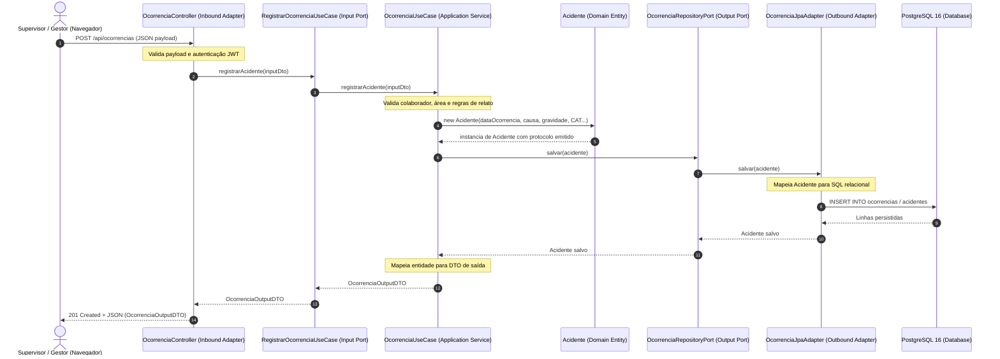

# Guia Canônico de Arquitetura Hexagonal (Ports & Adapters) — SafePlace

Este documento estabelece o padrão canônico de **Arquitetura Hexagonal (Portas e Adaptadores)** adotado no sistema **SafePlace**. Ele serve como especificação formal e guia de referência para que desenvolvedores e agentes compreendam os limites arquiteturais, a inversão de dependência e as convenções de implementação do backend (Java 21 e Spring Boot) e sua integração com a interface (React e TypeScript).

---

## 1. Princípios Fundamentais e Regra das Dependências

O propósito primordial da Arquitetura Hexagonal é isolar as regras de negócio e os processos operacionais de segurança do trabalho (Domínio e Casos de Uso) de detalhes técnicos e de infraestrutura externa (HTTP REST, bibliotecas de persistência, drivers de banco de dados PostgreSQL, tokens JWT e navegadores web).

### A Regra de Dependência
> **As dependências do código-fonte apontam unicamente para o núcleo, em direção aos Casos de Uso e ao Domínio.**

```
+---------------------------------------------------------------------------------+
|  INFRAESTRUTURA EXTERNA (HTTP, Spring Web MVC, Spring Security, Swagger/OpenAPI)|
|  +---------------------------------------------------------------------------+  |
|  |  ADAPTADORES DE ENTRADA / INBOUND (`adapters/in/web`)                     |  |
|  |  +---------------------------------------------------------------------+  |  |
|  |  |  APLICAÇÃO: PORTAS (`application/port/in`, `/out`), DTOs, CASOS DE USO|  |  |
|  |  |  +---------------------------------------------------------------+  |  |  |
|  |  |  |  NÚCLEO DE DOMÍNIO (`domain/*`): Entidades, VOs, Regras Puras |  |  |  |
|  |  |  +---------------------------------------------------------------+  |  |  |
|  |  |  ADAPTADORES DE SAÍDA / OUTBOUND (`adapters/out/persistencia`)       |  |  |
|  |  +---------------------------------------------------------------------+  |  |
|  +---------------------------------------------------------------------------+  |
|  INFRAESTRUTURA EXTERNA (PostgreSQL 16, Spring Data JPA, JdbcTemplate, Flyway) |
+---------------------------------------------------------------------------------+
```

1. **Domínio (`domain/`)**: É o núcleo do sistema. Composto por classes Java puras (`POJOs`, `Records`, `Enums`). **Não possui dependência** do Spring Framework, de anotações JPA (`@Entity`, `@Table`), nem de bibliotecas de transporte HTTP.
2. **Aplicação (`application/`)**: Orquestra a execução das regras de negócio. Define as **Portas de Entrada** (`port/in/`), as **Portas de Saída** (`port/out/`), os contratos de transporte de dados (`dto/`) e as implementações dos **Casos de Uso** (`usecase/`). Depende apenas do Domínio.
3. **Adaptadores de Entrada (`adapters/in/`)**: Recebem requisições externas (controladores REST anotados com `@RestController`), validam a camada HTTP e invocam as portas de entrada.
4. **Adaptadores de Saída (`adapters/out/`)**: Implementam as portas de saída (`port/out/`), interagindo com o PostgreSQL via Spring Data JPA, `JdbcTemplate` ou serviços de infraestrutura, convertendo dados entre o formato relacional e as entidades puras de domínio.

---

## 2. Topologia Estrutural de Pacotes (SafePlace Backend)

O backend do SafePlace (`backend/src/main/java/br/edu/safeplace/backend/`) organiza-se na seguinte estrutura canônica de pacotes:

```
br.edu.safeplace.backend/
├── domain/                                  # NÚCLEO DE NEGÓCIO PURO (Sem dependências externas)
│   ├── comum/                               # Tipos e enumeradores transversais (NivelPerigo, LogAuditoria)
│   ├── ocorrencia/                          # Ocorrencia, Acidente, Incidente, NumeroProtocoloCAT, StatusOcorrencia
│   ├── epi/                                 # Epi, ModeloEpi, MovimentacaoEstoque, ManutencaoEpi, StatusEpi
│   ├── emprestimo/                          # Emprestimo, ClassificacaoEmprestimo, EstadoDevolucao
│   ├── projecao/                            # ProjecaoSubstituicao, AlertaProjecao, ParametrosSubstituicao
│   ├── area_risco/                          # AreaRisco, Setor
│   ├── tarefa/                              # Tarefa, HistoricoClassificacaoTarefa
│   ├── capacitacao/                         # Certificacao, Treinamento, ExigenciaTreinamento
│   └── usuario/                             # Usuario, Perfil, Credenciais
├── application/                             # CAMADA DE APLICAÇÃO E ORQUESTRAÇÃO
│   ├── port/
│   │   ├── in/                              # Portas Primárias / Driving (Casos de Uso expostos)
│   │   └── out/                             # Portas Secundárias / Driven (Repositórios e Serviços de infraestrutura)
│   ├── dto/
│   │   ├── input/                           # DTOs de Entrada (Records imutáveis de payload)
│   │   └── output/                          # DTOs de Saída (Records imutáveis de resposta)
│   └── usecase/                             # Implementações dos Casos de Uso (ex.: OcorrenciaUseCase, EpiUseCase)
├── adapters/                                # ADAPTADORES (Bordas de comunicação com o mundo externo)
│   ├── in/
│   │   └── web/                             # Controladores REST Spring (@RestController) e Handlers de Erro
│   └── out/
│       └── persistencia/                    # Adaptadores de Persistência (@Repository / JpaAdapter) e Mappers
└── config/                                  # CONFIGURAÇÕES TÉCNICAS DE INFRAESTRUTURA
    ├── SecurityConfig.java                  # Autenticação JWT e autorização RBAC
    ├── OpenApiConfig.java                   # Documentação Swagger/OpenAPI v3
    └── JacksonConfig.java                   # Serialização JSON e fusos horários
```

---

## 3. Anatomia das Camadas e Seus Contratos

### 3.1 Camada de Domínio (`domain/`)
* **Entidades**: Classes ricas que encapsulam dados e comportamento (ex.: `Acidente`, `Epi`, `Emprestimo`). Não usam anotações JPA.
* **Objetos de Valor (Value Objects)**: Tipos imutáveis com validação própria (ex.: `NumeroProtocoloCAT`).
* **Enumerações**: Vocabulário formal do negócio (ex.: `NivelPerigo`: `BAIXO`, `MEDIO`, `ALTO`, `CRITICO`; `StatusOcorrencia`: `ABERTA`, `EM_TRIAGEM`, `ARQUIVADA`).
* **Regra**: Esta camada **jamais** importa classes de `org.springframework.*`, `jakarta.persistence.*` ou `adapters.*`.

### 3.2 Portas da Aplicação (`application/port/`)
As portas são interfaces Java puras:
1. **Portas de Entrada (Driving / Inbound Ports - `port/in/`)**:
   - Definem as operações de negócio acessíveis pela borda (ex.: `RegistrarOcorrenciaUseCase`, `GerenciarEpiUseCase`, `ControlarEmprestimoUseCase`).
   - Os controladores web chamam exclusivamente essas interfaces.
2. **Portas de Saída (Driven / Outbound Ports - `port/out/`)**:
   - Definem contratos que a aplicação necessita do mundo externo (ex.: `OcorrenciaRepositoryPort`, `EpiRepositoryPort`, `AuditoriaPort`).
   - Os adaptadores de persistência e serviços externos implementam essas interfaces.

### 3.3 Data Transfer Objects (`application/dto/`)
Modelados como Java `record` imutáveis para garantir concisão e segurança de memória:
* **Input DTO (`dto/input/`)**: Encapsula parâmetros de entrada vindos de payloads JSON ou formulários, realizando validação sintática.
* **Output DTO (`dto/output/`)**: Projeta dados para apresentação externa sem vazar referências diretas de instâncias mutáveis de domínio.

### 3.4 Casos de Uso (`application/usecase/`)
* Implementam uma ou mais portas de entrada (`port/in/`).
* Recebem suas portas de saída via injeção por construtor (gerenciada pelo Spring com `@Service`).
* Coordenam transações `@Transactional` quando necessário.
* Carregam dados através de `port/out/`, aplicam lógica de domínio e persistem resultados via `port/out/`.

### 3.5 Adaptadores de Entrada (`adapters/in/web/`)
* Classes anotadas com `@RestController` mapeadas sob `/api/*`.
* Extraem informações de cabeçalhos, tokens de segurança (via `SecurityContextHolder`) e corpo JSON.
* Documentam endpoints através de `@Tag` e `@Operation` (OpenAPI).
* Traduzem exceções de negócio em respostas HTTP semânticas (201 Created, 400 Bad Request, 403 Forbidden, 404 Not Found, 409 Conflict).

### 3.6 Adaptadores de Saída (`adapters/out/persistencia/`)
* Implementam as interfaces de `port/out/`.
* Utilizam Spring Data JPA, `JdbcTemplate` ou repositórios específicos.
* Realizam o mapeamento bidirecional:
  - **Domínio para Banco**: Converte atributos da entidade de domínio para parâmetros SQL ou entidades JPA.
  - **Banco para Domínio**: Reconstrói as entidades puras a partir de `ResultSet` ou modelos JPA, preservando datas, identificadores e vínculos.

---

## 4. Estudo de Caso Ponta a Ponta: Registro de Acidente (RF01 / RF13)

### 4.1 Diagrama de Sequência Arquitetural



---

### 4.2 Exemplo de Código Camada por Camada no SafePlace

#### 1. Adaptador de Entrada (Inbound): `adapters/in/web/OcorrenciaController.java`
```java
@RestController
@RequestMapping("/api/ocorrencias")
@Tag(name = "Ocorrências", description = "Registro e triagem de acidentes e incidentes")
public class OcorrenciaController {

    private final RegistrarOcorrenciaUseCase registrarUseCase;

    public OcorrenciaController(RegistrarOcorrenciaUseCase registrarUseCase) {
        this.registrarUseCase = registrarUseCase;
    }

    @PostMapping
    @Operation(summary = "Registrar novo acidente de trabalho")
    public ResponseEntity<OcorrenciaOutputDTO> registrarAcidente(@Valid @RequestBody RegistrarAcidenteInputDTO dto) {
        OcorrenciaOutputDTO resposta = registrarUseCase.registrarAcidente(dto);
        return ResponseEntity.status(HttpStatus.CREATED).body(resposta);
    }
}
```

#### 2. DTO de Entrada: `application/dto/input/RegistrarAcidenteInputDTO.java`
```java
public record RegistrarAcidenteInputDTO(
        @NotNull LocalDateTime dataOcorrencia,
        String local,
        @NotBlank String descricao,
        String acaoImediata,
        @NotBlank String causaRaiz,
        String tipoLesao,
        String parteCorpoAtingida,
        Integer afastamentoDias,
        String destino,
        @NotNull NivelPerigo gravidade,
        Integer areaRiscoId,
        @NotNull Integer colaboradorId,
        Integer gestorId
) {}
```

#### 3. Porta de Entrada (Primary Port): `application/port/in/RegistrarOcorrenciaUseCase.java`
```java
public interface RegistrarOcorrenciaUseCase {
    OcorrenciaOutputDTO registrarAcidente(RegistrarAcidenteInputDTO input);
    OcorrenciaOutputDTO registrarIncidente(RegistrarIncidenteInputDTO input);
    List<OcorrenciaOutputDTO> listar();
}
```

#### 4. Caso de Uso (Application Service): `application/usecase/OcorrenciaUseCase.java`
```java
@Service
@Transactional
public class OcorrenciaUseCase implements RegistrarOcorrenciaUseCase, GerenciarOcorrenciaUseCase {

    private final OcorrenciaRepositoryPort repositoryPort;
    private final GeradorProtocoloCatPort geradorCatPort;

    public OcorrenciaUseCase(OcorrenciaRepositoryPort repositoryPort, GeradorProtocoloCatPort geradorCatPort) {
        this.repositoryPort = repositoryPort;
        this.geradorCatPort = geradorCatPort;
    }

    @Override
    public OcorrenciaOutputDTO registrarAcidente(RegistrarAcidenteInputDTO dto) {
        NumeroProtocoloCAT protocolo = geradorCatPort.proximoProtocolo(dto.dataOcorrencia());
        
        Acidente acidente = new Acidente(
                null,
                dto.dataOcorrencia(),
                dto.descricao(),
                StatusOcorrencia.ABERTA,
                protocolo,
                dto.gravidade(),
                dto.colaboradorId(),
                dto.areaRiscoId()
        );

        Acidente salvo = (Acidente) repositoryPort.salvar(acidente);
        return OcorrenciaOutputDTO.deDominio(salvo);
    }
}
```

#### 5. Entidade Pura de Domínio: `domain/ocorrencia/Acidente.java`
```java
public class Acidente extends Ocorrencia {

    private final NumeroProtocoloCAT numeroProtocoloCAT;
    private final NivelPerigo gravidade;

    public Acidente(Integer id, LocalDateTime dataOcorrencia, String descricao,
                     StatusOcorrencia status, NumeroProtocoloCAT protocolo,
                     NivelPerigo gravidade, Integer colaboradorId, Integer areaRiscoId) {
        super(id, dataOcorrencia, descricao, status, colaboradorId, areaRiscoId);
        this.numeroProtocoloCAT = protocolo;
        this.gravidade = gravidade;
    }

    public NumeroProtocoloCAT getNumeroProtocoloCAT() {
        return numeroProtocoloCAT;
    }

    public NivelPerigo getGravidade() {
        return gravidade;
    }
}
```

#### 6. Porta de Saída (Secondary Port): `application/port/out/OcorrenciaRepositoryPort.java`
```java
public interface OcorrenciaRepositoryPort {
    Ocorrencia salvar(Ocorrencia ocorrencia);
    Optional<Ocorrencia> buscarPorId(Integer id);
    Optional<Acidente> buscarAcidentePorProtocolo(NumeroProtocoloCAT protocolo);
    List<Ocorrencia> listarTodas();
}
```

#### 7. Adaptador de Saída: `adapters/out/persistencia/OcorrenciaJpaAdapter.java`
```java
@Repository
public class OcorrenciaJpaAdapter implements OcorrenciaRepositoryPort {

    private final JdbcTemplate jdbcTemplate;

    public OcorrenciaJpaAdapter(JdbcTemplate jdbcTemplate) {
        this.jdbcTemplate = jdbcTemplate;
    }

    @Override
    public Ocorrencia salvar(Ocorrencia ocorrencia) {
        if (ocorrencia instanceof Acidente acidente) {
            return salvarAcidente(acidente);
        }
        return salvarIncidente((Incidente) ocorrencia);
    }

    private Acidente salvarAcidente(Acidente acidente) {
        Integer id = jdbcTemplate.queryForObject("""
                INSERT INTO ocorrencias (data_ocorrencia, descricao, status, colaborador_id, area_risco_id, tipo)
                VALUES (?, ?, ?, ?, ?, 'ACIDENTE')
                RETURNING id_ocorrencia
                """, Integer.class,
                acidente.getDataOcorrencia(), acidente.getDescricao(),
                acidente.getStatus().name(), acidente.getColaboradorId(), acidente.getAreaRiscoId());

        jdbcTemplate.update("""
                INSERT INTO acidentes (id_ocorrencia, numero_protocolo, gravidade)
                VALUES (?, ?, ?)
                """, id, acidente.getNumeroProtocoloCAT().valor(), acidente.getGravidade().name());

        return reconstruirAcidente(id);
    }

    private Acidente reconstruirAcidente(Integer id) {
        // Leitura relacional e reconstrução da entidade de domínio pura
        ...
    }
}
```

---

## 5. Checklist de Conformidade Arquitetural do SafePlace

Antes de concluir qualquer adição ou refatoração no sistema, verifique cada uma das seguintes regras invioláveis:

- [ ] **Pureza do Domínio**: Nenhuma classe no pacote `br.edu.safeplace.backend.domain` importa Spring, Jakarta Persistence (`@Entity`, `@Table`, `@Id`), Hibernate ou Jackson.
- [ ] **Desacoplamento dos Casos de Uso**: Os serviços em `application/usecase` dependem exclusivamente de interfaces `port/out` e nunca de classes adaptadoras concretas (`*JpaAdapter`, `*Repository`).
- [ ] **Controle de Vazamento de Persistência**: Nenhuma conexão com banco (`JdbcTemplate`, `EntityManager`), `ResultSet` ou entidade relacional transpassa o limite do adaptador para os casos de uso.
- [ ] **Uso Obrigatório de DTOs**: Os controladores nunca recebem ou expõem diretamente entidades de domínio. A comunicação ocorre exclusivamente através de Records de `application/dto/input` e `application/dto/output`.
- [ ] **Testabilidade Unitária**: Qualquer caso de uso pode ser testado de forma unitária instanciando-se a classe diretamente com mocks ou fakes em memória das portas de saída, sem necessidade de carregar o Spring Context ou conectar a um banco de dados real.
- [ ] **Isolamento de Testes de Integração**: Testes de persistência em PostgreSQL real (`*PersistenciaIntegracaoTest`) devem gerenciar adequadamente a limpeza de dados (inclusive desfazendo chaves estrangeiras circulares) para não interferir na execução de outros testes da suíte.
