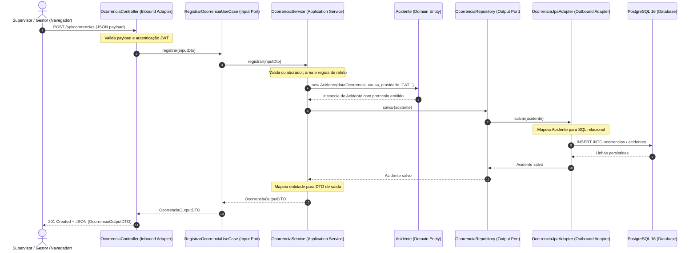

# Guia Canônico de Arquitetura Hexagonal (Ports & Adapters) — SafePlace

Este documento estabelece o padrão canônico de **Arquitetura Hexagonal (Portas e Adaptadores)** adotado no sistema **SafePlace**. Ele serve como especificação formal e guia de referência para que desenvolvedores e agentes compreendam os limites arquiteturais, a inversão de dependência e as convenções de implementação do backend (Java 21 e Spring Boot) e sua integração com a interface (React e TypeScript).

---

## 1. Princípios Fundamentais e Regra das Dependências

O propósito primordial da Arquitetura Hexagonal é isolar as regras de negócio e os processos operacionais de segurança do trabalho (Domínio e Casos de Uso) de detalhes técnicos e de infraestrutura externa (HTTP REST, bibliotecas de persistência, drivers de banco de dados PostgreSQL, tokens JWT e navegadores web).

### A Regra de Dependência
> **As dependências do código-fonte apontam unicamente para o núcleo, em direção aos Casos de Uso e ao Domínio.**

```
+---------------------------------------------------------------------------------+
|  INFRAESTRUTURA EXTERNA (HTTP, Spring Web MVC, Spring Security, Swagger/OpenAPI)|
|  +---------------------------------------------------------------------------+  |
|  |  ADAPTADORES DE ENTRADA / INBOUND (`adapters/in/web`)                     |  |
|  |  +---------------------------------------------------------------------+  |  |
|  |  |  APLICAÇÃO: PORTAS (`application/port/in`, `/out`), DTOs, CASOS DE USO|  |  |
|  |  |  +---------------------------------------------------------------+  |  |  |
|  |  |  |  NÚCLEO DE DOMÍNIO (`domain/*`): Entidades, VOs, Regras Puras |  |  |  |
|  |  |  +---------------------------------------------------------------+  |  |  |
|  |  |  ADAPTADORES DE SAÍDA / OUTBOUND (`adapters/out/persistencia`)       |  |  |
|  |  +---------------------------------------------------------------------+  |  |
|  +---------------------------------------------------------------------------+  |
|  INFRAESTRUTURA EXTERNA (PostgreSQL 16, Spring Data JPA, JdbcTemplate, Flyway) |
+---------------------------------------------------------------------------------+
```

1. **Domínio (`domain/`)**: É o núcleo do sistema. As entidades de domínio são também as entidades JPA ([decisão #254](decisao-entidades-jpa-dominio.md)): podem usar anotações de `jakarta.persistence` (e `@Immutable` do Hibernate nas tabelas só de inserção), mas **não dependem** do Spring Framework, do Spring Data, de Jackson nem de bibliotecas de transporte HTTP.
2. **Aplicação (`application/`)**: Orquestra a execução das regras de negócio. Define as **Portas de Entrada** (`port/in/`), as **Portas de Saída** (`port/out/`), os contratos de transporte de dados (`dto/`) e as implementações dos **Casos de Uso** (`usecase/`). Depende apenas do Domínio.
3. **Adaptadores de Entrada (`adapters/in/`)**: Recebem requisições externas (controladores REST anotados com `@RestController`), validam a camada HTTP e invocam as portas de entrada.
4. **Adaptadores de Saída (`adapters/out/`)**: Implementam as portas de saída (`port/out/`), delegando a repositórios Spring Data JPA das próprias entidades de domínio, sem classes espelhadas, conversões ou SQL escrito à mão.

---

## 2. Topologia Estrutural de Pacotes (SafePlace Backend)

O backend do SafePlace (`backend/src/main/java/br/edu/safeplace/backend/`) organiza-se na seguinte estrutura canônica de pacotes:

```
br.edu.safeplace.backend/
├── domain/                                  # NÚCLEO DE NEGÓCIO (entidades JPA; sem Spring)
│   ├── comum/                               # Tipos e enumeradores transversais (NivelPerigo, LogAuditoria)
│   ├── ocorrencia/                          # Ocorrencia, Acidente, Incidente, NumeroProtocoloCAT, StatusOcorrencia
│   ├── epi/                                 # Epi, ModeloEpi, MovimentacaoEstoque, ManutencaoEpi, StatusEpi
│   ├── emprestimo/                          # Emprestimo, ClassificacaoEmprestimo, EstadoDevolucao
│   ├── projecao/                            # ProjecaoSubstituicao, AlertaProjecao, ParametrosSubstituicao
│   ├── area_risco/                          # AreaRisco, Setor
│   ├── tarefa/                              # Tarefa, HistoricoClassificacaoTarefa
│   ├── capacitacao/                         # Certificacao, Treinamento, ExigenciaTreinamento
│   └── usuario/                             # Usuario, Perfil, Credenciais
├── application/                             # CAMADA DE APLICAÇÃO E ORQUESTRAÇÃO
│   ├── port/
│   │   ├── in/                              # Portas Primárias / Driving (Casos de Uso expostos)
│   │   └── out/                             # Portas Secundárias / Driven (Repositórios e Serviços de infraestrutura)
│   ├── dto/
│   │   ├── input/                           # DTOs de Entrada (Records imutáveis de payload)
│   │   └── output/                          # DTOs de Saída (Records imutáveis de resposta)
│   └── usecase/                             # Implementações dos Casos de Uso (ex.: OcorrenciaService, EpiService)
├── adapters/                                # ADAPTADORES (Bordas de comunicação com o mundo externo)
│   ├── in/
│   │   └── web/                             # Controladores REST Spring (@RestController) e Handlers de Erro
│   └── out/
│       └── persistencia/                    # Adaptadores (XxxJpaAdapter) e repositórios Spring Data (XxxJpaRepository)
└── config/                                  # CONFIGURAÇÕES TÉCNICAS DE INFRAESTRUTURA
    ├── SecurityConfig.java                  # Autenticação JWT e autorização RBAC
    ├── OpenApiConfig.java                   # Documentação Swagger/OpenAPI v3
    └── JacksonConfig.java                   # Serialização JSON e fusos horários
```

---

## 3. Anatomia das Camadas e Seus Contratos

### 3.1 Camada de Domínio (`domain/`)
* **Entidades**: Classes ricas que encapsulam dados e comportamento (ex.: `Acidente`, `Epi`, `Emprestimo`). São mapeadas com anotações JPA, seguindo as convenções da [decisão #254](decisao-entidades-jpa-dominio.md#22-convenções-de-mapeamento). Associações são referências a objetos, não ids. Não têm setters públicos nem validam entrada nos construtores; a validação fica na camada `validacao` (#228).
* **Objetos de Valor (Value Objects)**: Tipos imutáveis com validação própria (ex.: `NumeroProtocoloCAT`).
* **Enumerações**: Vocabulário formal do negócio (ex.: `NivelPerigo`: `BAIXO`, `MEDIO`, `ALTO`, `CRITICO`; `StatusOcorrencia`: `ABERTA`, `EM_TRIAGEM`, `ARQUIVADA`).
* **Regra**: Esta camada **jamais** importa classes de `org.springframework.*`, `jakarta.persistence.*` ou `adapters.*`.

### 3.2 Portas da Aplicação (`application/port/`)
As portas são interfaces Java puras:
1. **Portas de Entrada (Driving / Inbound Ports - `port/in/`)**:
   - Definem as operações de negócio acessíveis pela borda (ex.: `RegistrarOcorrenciaUseCase`, `GerenciarEpiUseCase`, `ControlarEmprestimoUseCase`).
   - Os controladores web chamam exclusivamente essas interfaces.
2. **Portas de Saída (Driven / Outbound Ports - `port/out/`)**:
   - Definem contratos que a aplicação necessita do mundo externo (ex.: `OcorrenciaRepository`, `EpiRepository`, `OperadorAutenticado`).
   - Os adaptadores de persistência e serviços externos implementam essas interfaces.

### 3.2.1 Convenção de nomes (issue #269)

| Tipo | Padrão | Exemplo |
| --- | --- | --- |
| Porta de entrada (`port/in/`) | `XxxUseCase` | `GerenciarEpiUseCase` |
| Implementação do caso de uso (`usecase/`) | `XxxService` | `EpiService` |
| Porta de repositório (`port/out/`) | `XxxRepository` | `TarefaRepository` |
| Outra porta de saída (`port/out/`) | nome do papel, sem sufixo | `CodificadorSenha`, `NotificadorAcao` |
| Adaptador de saída (`adapters/out/`) | `<Tecnologia>XxxAdapter` | `TarefaJpaAdapter`, `JwtTokenAdapter` |
| Controlador web (`adapters/in/web/`) | `XxxController` | `UsuarioController` |
| Tratamento de exceções da borda | `XxxExceptionHandler` | `ApiExceptionHandler`, `TarefaExceptionHandler` |
| Corpo HTTP de entrada e de saída | `XxxRequest`, `XxxResponse` | `LoginRequest`, `UsuarioResponse` |
| DTO da aplicação | `XxxInputDTO`, `XxxOutputDTO` | `LoginInputDTO`, `TokenOutputDTO` |
| Repositório Spring Data | `XxxJpaRepository` | `TarefaJpaRepository` |

Os sufixos `Port`, `Porta`, `RepositoryPort`, `CasoDeUso`, `UseCaseImpl`, `Adaptador`, `Controlador`, `TratadorExcecoes`, `Requisicao`, `Resposta`, `EntradaDTO` e `SaidaDTO` não são mais usados.

### 3.3 Data Transfer Objects (`application/dto/`)
Modelados como Java `record` imutáveis para garantir concisão e segurança de memória:
* **Input DTO (`dto/input/`)**: Encapsula parâmetros de entrada vindos de payloads JSON ou formulários, realizando validação sintática.
* **Output DTO (`dto/output/`)**: Projeta dados para apresentação externa sem vazar referências diretas de instâncias mutáveis de domínio.

### 3.4 Casos de Uso (`application/usecase/`)
* Implementam uma ou mais portas de entrada (`port/in/`).
* Recebem suas portas de saída via injeção por construtor (gerenciada pelo Spring com `@Service`).
* Coordenam transações `@Transactional` quando necessário.
* Carregam dados através de `port/out/`, aplicam lógica de domínio e persistem resultados via `port/out/`.

### 3.5 Adaptadores de Entrada (`adapters/in/web/`)
* Classes anotadas com `@RestController` mapeadas sob `/api/*`.
* Extraem informações de cabeçalhos, tokens de segurança (via `SecurityContextHolder`) e corpo JSON.
* Documentam endpoints através de `@Tag` e `@Operation` (OpenAPI).
* Traduzem exceções de negócio em respostas HTTP semânticas (201 Created, 400 Bad Request, 403 Forbidden, 404 Not Found, 409 Conflict).

#### 3.5.1 Tratamento de erros da API (#234, #249)

Todo erro da API responde no mesmo contrato, montado por `CorpoErro.mapa`:

```json
{ "timestamp": "2026-11-13T21:54:28.826", "status": 404, "error": "Não Encontrado", "message": "..." }
```

O frontend compara rótulos de `error` (por exemplo, `"Colaborador Não Alocável"`) e lê `message`, e os testes verificam `$.error` e `$.message`; por isso o contrato não muda e o `ProblemDetail` (RFC 7807) não é usado.

Quem responde cada erro:

| Classe | Escopo | Responde |
| --- | --- | --- |
| `TarefaExceptionHandler` | `TarefaController` | `AlocacaoBloqueadaException` (422), com o campo extra `impedimentos` |
| `EmprestimoExceptionHandler` | `EmprestimoController` | `DuplicidadeDePosseException` (409), com o campo extra `emprestimoAtivoId` |
| `ApiExceptionHandler` | global | um handler por tipo de exceção de domínio, mais `IllegalArgumentException`, `IllegalStateException` e `MethodArgumentNotValidException` |
| `ErroInesperadoExceptionHandler` | global | o que nenhum outro advice tratou (ver abaixo) |
| `RestSegurancaExceptionHandler` (`config/`) | filtro de segurança | 401 e 403 do Spring Security, que acontecem antes do controlador e não passam pelos advices |

Regras:

* **Advice com escopo só para campo extra.** Um advice restrito a um controlador (`assignableTypes`) só existe quando o corpo precisa de um campo além dos quatro. Os demais handlers ficam no `ApiExceptionHandler`, sem duplicar tipo de exceção entre advices (`ApiExceptionHandlerTest` confere).
* **Ordem explícita** (`OrdemAdvices`): advices com escopo, depois o global, por último o de erro inesperado. Para cada exceção, o Spring percorre os advices nessa ordem e usa o primeiro que trata a exceção ou a causa dela.
* **Mensagem nula.** Uma exceção lançada sem mensagem responde com o status do seu handler e `"message": null`. O `CorpoErro` usa `LinkedHashMap`, que aceita o valor nulo (o `Map.of` usado antes da #234 lançava `NullPointerException` e a resposta virava 500). O frontend já trata esse caso e mostra o texto padrão da tela.

**Decisão sobre `Exception` genérica (#249).** O `ErroInesperadoExceptionHandler` trata `Exception`, mas só recebe o que os outros advices não trataram:

* Erro inesperado (`NullPointerException`, falha de banco etc.) responde **500** no contrato acima, com `error: "Erro Interno"` e uma mensagem genérica. O texto da exceção, que pode trazer SQL ou nomes de classe, vai só para o log.
* Exceções que o próprio Spring já traduz para um status são **devolvidas ao Spring** (o handler relança a própria exceção) e continuam com o status e o corpo de antes: JSON malformado ou com tipo errado (400), parâmetro ausente (400), rota inexistente (404), método não suportado (405), `ResponseStatusException` e exceções anotadas com `@ResponseStatus`. As do Spring Security também são relançadas, para chegarem ao `RestSegurancaExceptionHandler`.
* O handler fica num advice separado, e não dentro do `ApiExceptionHandler`, por causa da busca pela causa. Uma `IllegalArgumentException` lançada por um construtor durante a leitura do JSON chega embrulhada numa `HttpMessageNotReadableException` e hoje responde 400 "Requisição Inválida" porque o Spring encontra o handler pela causa. Um `@ExceptionHandler(Exception.class)` no mesmo advice seria escolhido antes, pela exceção de fora, e essa resposta viraria um 400 sem o corpo da API. `TratamentoErrosApiTest` cobre esses casos; com a ordem invertida, três deles falham.

### 3.6 Adaptadores de Saída (`adapters/out/persistencia/`)
* Implementam as interfaces de `port/out/`.
* Delegam a um repositório Spring Data (`XxxJpaRepository extends JpaRepository<Xxx, Integer>`) da própria entidade de domínio.
* Não fazem conversão entre classes: a entidade de domínio é a entidade JPA.
* Consultam com métodos derivados ou JPQL (`@Query` sem `nativeQuery`). `JdbcTemplate` e SQL escrito à mão não são usados.
* Durante a migração (#255 a #262), os módulos ainda não migrados mantêm as classes `*Entity` antigas.

---

## 4. Estudo de Caso Ponta a Ponta: Registro de Acidente (RF01 / RF13)

### 4.1 Diagrama de Sequência Arquitetural



---

### 4.2 Exemplo de Código Camada por Camada no SafePlace

#### 1. Adaptador de Entrada (Inbound): `adapters/in/web/OcorrenciaController.java`
```java
@RestController
@RequestMapping("/api/ocorrencias")
@Tag(name = "Ocorrências", description = "Registro e triagem de acidentes e incidentes")
public class OcorrenciaController {

    private final RegistrarOcorrenciaUseCase registrarUseCase;

    public OcorrenciaController(RegistrarOcorrenciaUseCase registrarUseCase) {
        this.registrarUseCase = registrarUseCase;
    }

    @PostMapping
    @Operation(summary = "Registrar novo acidente de trabalho")
    public ResponseEntity<OcorrenciaOutputDTO> registrarAcidente(@Valid @RequestBody RegistrarAcidenteInputDTO dto) {
        OcorrenciaOutputDTO resposta = registrarUseCase.registrar(dto);
        return ResponseEntity.status(HttpStatus.CREATED).body(resposta);
    }
}
```

#### 2. DTO de Entrada: `application/dto/input/RegistrarAcidenteInputDTO.java`
```java
public record RegistrarAcidenteInputDTO(
        @NotNull LocalDateTime dataOcorrencia,
        @NotBlank String descricao,
        String acaoImediata,
        @NotBlank String causaRaiz,
        String tipoLesao,
        String parteCorpoAtingida,
        Integer afastamentoDias,
        String destino,
        @NotNull NivelPerigo gravidade,
        @NotNull Integer areaRiscoId,
        @NotNull Integer colaboradorId
        // Protocolo CAT e relator são definidos pelo servidor (issue #195).
) {}
```

#### 3. Porta de Entrada (Primary Port): `application/port/in/RegistrarOcorrenciaUseCase.java`
```java
public interface RegistrarOcorrenciaUseCase {
    OcorrenciaOutputDTO registrar(RegistrarAcidenteInputDTO input);
    OcorrenciaOutputDTO registrar(RegistrarIncidenteInputDTO input);
    List<OcorrenciaOutputDTO> listar();
}
```

#### 4. Caso de Uso (Application Service): `application/usecase/OcorrenciaService.java`
```java
@Service
@Transactional
public class OcorrenciaService implements RegistrarOcorrenciaUseCase, GerenciarOcorrenciaUseCase {

    private final OcorrenciaRepository repository;
    private final GeradorProtocoloCat geradorCat;

    public OcorrenciaService(OcorrenciaRepository repository, GeradorProtocoloCat geradorCat) {
        this.repository = repository;
        this.geradorCat = geradorCat;
    }

    @Override
    public OcorrenciaOutputDTO registrar(RegistrarAcidenteInputDTO dto) {
        NumeroProtocoloCAT protocolo = geradorCat.proximoProtocolo(dto.dataOcorrencia());
        
        Acidente acidente = new Acidente(
                null,
                dto.dataOcorrencia(),
                dto.descricao(),
                StatusOcorrencia.ABERTA,
                protocolo,
                dto.gravidade(),
                dto.colaboradorId(),
                dto.areaRiscoId()
        );

        Acidente salvo = (Acidente) repository.salvar(acidente);
        return OcorrenciaOutputDTO.deDominio(salvo);
    }
}
```

#### 5. Entidade Pura de Domínio: `domain/ocorrencia/Acidente.java`
```java
public class Acidente extends Ocorrencia {

    private final NumeroProtocoloCAT numeroProtocoloCAT;
    private final NivelPerigo gravidade;

    public Acidente(Integer id, LocalDateTime dataOcorrencia, String descricao,
                     StatusOcorrencia status, NumeroProtocoloCAT protocolo,
                     NivelPerigo gravidade, Integer colaboradorId, Integer areaRiscoId) {
        super(id, dataOcorrencia, descricao, status, colaboradorId, areaRiscoId);
        this.numeroProtocoloCAT = protocolo;
        this.gravidade = gravidade;
    }

    public NumeroProtocoloCAT getNumeroProtocoloCAT() {
        return numeroProtocoloCAT;
    }

    public NivelPerigo getGravidade() {
        return gravidade;
    }
}
```

#### 6. Porta de Saída (Secondary Port): `application/port/out/OcorrenciaRepository.java`
```java
public interface OcorrenciaRepository {
    Ocorrencia salvar(Ocorrencia ocorrencia);
    Optional<Ocorrencia> buscarPorId(Integer id);
    Optional<Ocorrencia> buscarPorProtocolo(String protocolo);
    List<Ocorrencia> listar();
}
```

#### 7. Adaptador de Saída: `adapters/out/persistencia/OcorrenciaJpaAdapter.java`
```java
@Repository
public class OcorrenciaJpaAdapter implements OcorrenciaRepository {

    private final JdbcTemplate jdbcTemplate;

    public OcorrenciaJpaAdapter(JdbcTemplate jdbcTemplate) {
        this.jdbcTemplate = jdbcTemplate;
    }

    @Override
    public Ocorrencia salvar(Ocorrencia ocorrencia) {
        if (ocorrencia instanceof Acidente acidente) {
            return salvarAcidente(acidente);
        }
        return salvarIncidente((Incidente) ocorrencia);
    }

    private Acidente salvarAcidente(Acidente acidente) {
        Integer id = jdbcTemplate.queryForObject("""
                INSERT INTO ocorrencias (data_ocorrencia, descricao, status, colaborador_id, area_risco_id, tipo)
                VALUES (?, ?, ?, ?, ?, 'ACIDENTE')
                RETURNING id_ocorrencia
                """, Integer.class,
                acidente.getDataOcorrencia(), acidente.getDescricao(),
                acidente.getStatus().name(), acidente.getColaboradorId(), acidente.getAreaRiscoId());

        jdbcTemplate.update("""
                INSERT INTO acidentes (id_ocorrencia, numero_protocolo, gravidade)
                VALUES (?, ?, ?)
                """, id, acidente.getNumeroProtocoloCAT().valor(), acidente.getGravidade().name());

        return reconstruirAcidente(id);
    }

    private Acidente reconstruirAcidente(Integer id) {
        // Leitura relacional e reconstrução da entidade de domínio pura
        ...
    }
}
```

---

## 5. Checklist de Conformidade Arquitetural do SafePlace

Antes de concluir qualquer adição ou refatoração no sistema, verifique cada uma das seguintes regras invioláveis:

- [ ] **Limites do Domínio**: Nenhuma classe no pacote `br.edu.safeplace.backend.domain` importa Spring, Spring Data, Jackson, `application` ou `adapters`. Do JPA, só `jakarta.persistence.*` e `org.hibernate.annotations.Immutable` ([decisão #254](decisao-entidades-jpa-dominio.md)).
- [ ] **Desacoplamento dos Casos de Uso**: Os serviços em `application/usecase` dependem exclusivamente de interfaces `port/out` e nunca de classes adaptadoras concretas (`*JpaAdapter`) nem de repositórios Spring Data (`*JpaRepository`).
- [ ] **Controle de Vazamento de Persistência**: Nenhuma conexão com banco (`EntityManager`) ou repositório Spring Data transpassa o limite do adaptador para os casos de uso. Nenhum `JdbcTemplate` ou SQL nativo nos adaptadores.
- [ ] **Uso Obrigatório de DTOs**: Os controladores nunca recebem ou expõem diretamente entidades de domínio. A comunicação ocorre exclusivamente através de Records de `application/dto/input` e `application/dto/output`.
- [ ] **Testabilidade Unitária**: Qualquer caso de uso pode ser testado de forma unitária instanciando-se a classe diretamente com mocks ou fakes em memória das portas de saída, sem necessidade de carregar o Spring Context ou conectar a um banco de dados real.
- [ ] **Isolamento de Testes de Integração**: Testes de persistência em PostgreSQL real (`*PersistenciaIntegracaoTest`) devem gerenciar adequadamente a limpeza de dados (inclusive desfazendo chaves estrangeiras circulares) para não interferir na execução de outros testes da suíte.
