# Padrões de Projeto Aplicados

Este documento registra os padrões de projeto aplicados ao SafePlace depois da release [v1.0.0](https://github.com/yIuriy/rp-iv-grupo03-safeplace/releases/tag/v1.0.0), que é a linha de base. A escolha de cada padrão segue a [análise de padrões](../revisões/analise-padroes-projeto-v1.0.0.md): um padrão só é aplicado quando resolve um problema medido no código.

Cada seção traz:

- o problema encontrado;
- por que o padrão escolhido resolve esse problema;
- a correspondência entre os papéis do padrão e as classes ou funções do código;
- os diagramas antes e depois;
- as evidências de que o comportamento foi preservado.

As métricas gerais da refatoração são comparadas uma única vez, no fim, com a [linha de base](../metricas/relatorio-metricas-v1.0.0.md) ([#235](https://github.com/yIuriy/rp-iv-grupo03-safeplace/issues/235)). Os números citados em cada seção medem apenas o ponto alterado.

As classes e funções técnicas criadas pelos padrões (`OperadorAtual`, `RegistradorAuditoria`, mapeadores, builders de teste, adaptadores nulos e outras) não fazem parte do diagrama de classes do domínio. Elas ficam registradas aqui ([#220](https://github.com/yIuriy/rp-iv-grupo03-safeplace/issues/220)).

## Índice

| Padrão | Catálogo | Onde | Issue | Situação |
| --- | --- | --- | --- | --- |
| [Strategy](#strategy--mensagens-de-falha-http) | GoF, comportamental | Frontend: mensagens de falha HTTP | [#232](https://github.com/yIuriy/rp-iv-grupo03-safeplace/issues/232) | Aplicado |
| [Adapter](#adapter--porta-de-operador-autenticado) | GoF, estrutural | Backend: operador autenticado | [#222](https://github.com/yIuriy/rp-iv-grupo03-safeplace/issues/222), [#236](https://github.com/yIuriy/rp-iv-grupo03-safeplace/issues/236) | Aplicado (2/2: #222, #236) |
| [Facade](#facade--registrador-de-auditoria) | GoF, estrutural | Backend: registro de auditoria (`RegistradorAuditoria`) | [#223](https://github.com/yIuriy/rp-iv-grupo03-safeplace/issues/223), [#237](https://github.com/yIuriy/rp-iv-grupo03-safeplace/issues/237), [#238](https://github.com/yIuriy/rp-iv-grupo03-safeplace/issues/238) | Aplicado (3/3: #223, #237, #238) |
| [State (Backend)](#state--transicoes-de-statusepi) | GoF, comportamental | Backend: transições de `StatusEpi` | [#224](https://github.com/yIuriy/rp-iv-grupo03-safeplace/issues/224) | Aplicado |
| [Factory Method](#factory-method--criação-de-epi) | GoF, criacional | Backend: criação de `Epi` (`FabricaEpi`) e capacitação (`FabricaCapacitacao`) | [#225](https://github.com/yIuriy/rp-iv-grupo03-safeplace/issues/225), [#268](https://github.com/yIuriy/rp-iv-grupo03-safeplace/issues/268) | Aplicado (2/2: #225, #268) |
| [Abstract Factory](#abstract-factory--família-de-relato-de-ocorrências) | GoF, criacional | Backend: família de relato de ocorrências (Acidente/Incidente, notificação e auditoria; uma fábrica por `TipoOcorrencia`) | [#239](https://github.com/yIuriy/rp-iv-grupo03-safeplace/issues/239) | Aplicado |
| [Builder](#builder--emprestimobuilder-tarefabuilder-e-builders-de-ocorrencia) | GoF, criacional | Backend: `Emprestimo.Builder`, `TarefaBuilder`, `AcidenteBuilder` e `IncidenteBuilder` em produção | [#226](https://github.com/yIuriy/rp-iv-grupo03-safeplace/issues/226), [#240](https://github.com/yIuriy/rp-iv-grupo03-safeplace/issues/240) | Aplicado (2/2: #226, #240) |
| [Null Object](#null-object--adaptador-nulo-de-notificacao-e-dependencias-opcionais) | Woolf / PLoPD 3 | Backend: `NotificadorOcorrenciaNulo` e dependências opcionais | [#227](https://github.com/yIuriy/rp-iv-grupo03-safeplace/issues/227), [#241](https://github.com/yIuriy/rp-iv-grupo03-safeplace/issues/241) | Aplicado (2/2: #227, #241) |
| [Chain of Responsibility](#chain-of-responsibility--camada-de-validação) | GoF, comportamental | Backend: camada `validacao` (aptidão do colaborador e tarefa) | [#228](https://github.com/yIuriy/rp-iv-grupo03-safeplace/issues/228); continua em [#263](https://github.com/yIuriy/rp-iv-grupo03-safeplace/issues/263) a [#267](https://github.com/yIuriy/rp-iv-grupo03-safeplace/issues/267); complemento em [#297](https://github.com/yIuriy/rp-iv-grupo03-safeplace/issues/297) | Aplicado (6/6: #228, #267, #263, #264, #265, #266; complemento #297) |
| [Data Mapper](#data-mapper--mapeadores-de-persistencia) | Fowler / PoEAA | Backend: conversão entre classes espelho `*Entity` e o domínio | [#229](https://github.com/yIuriy/rp-iv-grupo03-safeplace/issues/229), [#242](https://github.com/yIuriy/rp-iv-grupo03-safeplace/issues/242) | Substituído pela [decisão #254](decisao-entidades-jpa-dominio.md) |
| [Value Object](#value-object--protocolo-cat-em-acidente) | Fowler / DDD | Backend: `NumeroProtocoloCAT` dentro de `Acidente` | [#230](https://github.com/yIuriy/rp-iv-grupo03-safeplace/issues/230) | Aplicado |
| [DTO Assembler](#dto-assembler--ocorrenciaoutputdto) | Fowler / PoEAA | Backend: `OcorrenciaOutputAssembler` sem expor `PlanoDeAcao` | [#245](https://github.com/yIuriy/rp-iv-grupo03-safeplace/issues/245) | Aplicado |
| [Strategy (Backend)](#strategy--fonte-de-tempo-clock) | GoF, comportamental | Backend: injeção de `java.time.Clock` nas regras de vencimento | [#247](https://github.com/yIuriy/rp-iv-grupo03-safeplace/issues/247) | Aplicado |
| [Adapter (Frontend)](#adapter--leitura-da-api-e-contrato-de-epi) | GoF, estrutural | Frontend: primitivas de leitura da API e unificação de `Epi` | [#244](https://github.com/yIuriy/rp-iv-grupo03-safeplace/issues/244), [#231](https://github.com/yIuriy/rp-iv-grupo03-safeplace/issues/231) | Aplicado (2/2: #244, #231) |
| [Template Method (hook)](#template-method-hook--envio-de-formulario) | GoF, comportamental | Frontend: submissão de formulários (`useEnvioFormulario`) | [#233](https://github.com/yIuriy/rp-iv-grupo03-safeplace/issues/233), [#243](https://github.com/yIuriy/rp-iv-grupo03-safeplace/issues/243) | Aplicado (2/2: #233, #243) |
| [State (Frontend)](#state--dialogos-de-taskspage) | GoF, comportamental | Frontend: estado único `DialogoTarefa` em `TasksPage` | [#246](https://github.com/yIuriy/rp-iv-grupo03-safeplace/issues/246) | Aplicado |
| [Bridge](#bridge--relatórios-estatísticos-e-formatos-de-arquivo) | GoF, estrutural | Backend: relatórios (`Relatorio`) × formatos (`FormatoCsv`, `FormatoPdf`) | [#299](https://github.com/yIuriy/rp-iv-grupo03-safeplace/issues/299) | Aplicado |
| [Template Method (Backend)](#template-method-backend--esqueleto-dos-relatórios-estatísticos) | GoF, comportamental | Backend: `Relatorio.gerar` e os três relatórios do RF18 | [#299](https://github.com/yIuriy/rp-iv-grupo03-safeplace/issues/299) | Aplicado |

---

## Strategy — mensagens de falha HTTP

**Catálogo:** GoF, comportamental.

**Intenção:** definir uma família de algoritmos, encapsular cada um e torná-los intercambiáveis. O cliente escolhe o algoritmo sem alterar o código que o executa.

**Issue:** [#232](https://github.com/yIuriy/rp-iv-grupo03-safeplace/issues/232).

### Problema (antes)

Quando uma chamada à API falha, cada tela precisa mostrar uma mensagem. Na v1.0.0, isso era feito por **12 funções** espalhadas em 10 arquivos, todas com o mesmo esqueleto:

1. ler o status HTTP do erro;
2. comparar o status com uma sequência de `if`;
3. devolver um texto fixo, ou a mensagem enviada pelo backend com um texto alternativo;
4. sem nenhum `if` correspondente, devolver um texto padrão.

Exemplo real, `frontend/src/features/usuarios/api.ts` na v1.0.0:

```ts
export function descreverFalhaDeCadastro(erro: unknown): string {
  const status = statusDoErro(erro)
  if (status === 403) return 'Seu perfil não tem permissão para esta operação.'
  if (status === 404) return 'Cadastro não encontrado. Ele pode ter sido alterado por outra pessoa; recarregue a lista.'
  if (status === 409 || status === 400) {
    return mensagemDaApi(erro) ?? 'Os dados informados conflitam com um cadastro existente ou são inválidos.'
  }
  return 'Não foi possível concluir a operação agora. Os dados preenchidos foram mantidos; tente novamente.'
}
```

O algoritmo — ler o status, escolher a regra e cair na regra padrão — estava copiado 12 vezes, misturado às mensagens de cada tela. Consequências:

- **Corrigir ou mudar o tratamento de um status exigia procurar 12 lugares**, e as cópias já divergiam. Só ocorrências tratava 401. O 422 era tratado em umas telas e não em outras. O 404 usava a mensagem do backend em ocorrências, mas um texto fixo em estoque.
- **A forma de usar a mensagem do backend era reescrita à mão** em cada tela (`mensagemDaApi(erro) ?? '...'`).
- **Não havia como testar o algoritmo de escolha isoladamente**, porque ele não existia separado das mensagens.

Medição nas features do frontend (`frontend/src/features`), v1.0.0:

| Medida | Valor |
| --- | ---: |
| Chamadas a `statusDoErro(` | 18 |
| Chamadas a `mensagemDaApi(` | 22 |
| Comparações `status === 4xx` | 36 |
| Arquivos que chamam `statusDoErro(` | 13 |

### Por que Strategy

O problema tem as forças típicas do Strategy:

- **uma parte fixa:** o algoritmo de escolha;
- **uma parte que varia:** a regra de mensagem de cada status, em cada tela;
- **essa variação aparece como condicionais copiadas.**

Separando as duas, o algoritmo passa a existir uma vez, como **Context**. Cada tela só **declara** suas estratégias, numa tabela de status → estratégia.

Analisando as 12 funções, as regras se reduzem a **duas estratégias concretas**:

- **texto fixo**, por exemplo `403 → 'Seu perfil não tem permissão…'`;
- **mensagem da API, com texto alternativo**, por exemplo `400 → mensagemDaApi(erro) ?? 'Os dados…'`.

Alternativas descartadas:

| Alternativa | Por que foi descartada |
| --- | --- |
| Uma única função global com todas as mensagens | As mensagens são próprias de cada tela ("…para registrar devoluções", "…para gerenciar setores"). Centralizar os textos misturaria as features. |
| Uma classe por estratégia, no estilo GoF clássico | Em TypeScript, funções são valores. Um tipo de função já é o contrato da estratégia, e criar classes só acrescentaria cerimônia, sem ganho. |
| Biblioteca de validação ou de tratamento de erros | Não resolve a escolha de mensagem por status e acrescentaria uma dependência. |

### Papéis do padrão

| Papel (GoF) | Elemento no código | Arquivo |
| --- | --- | --- |
| **Strategy** | tipo `EstrategiaDeMensagem = string \| ((erro: unknown) => string)` | `frontend/src/shared/api/erros.ts` |
| **ConcreteStrategy** | texto fixo (`string`) | declarado em cada tela |
| **ConcreteStrategy** | `usarMensagemDaApi(alternativa)` | `frontend/src/shared/api/erros.ts` |
| **Context** | `criarDescritorDeFalha(estrategiasPorStatus, padrao)` | `frontend/src/shared/api/erros.ts` |
| **Client** | os 12 descritores de falha (tabela a seguir) | features do frontend |

O Context recebe a tabela de estratégias por status e a estratégia padrão. Ele devolve a função `(erro) => string` que a tela chama. Ao ser chamada, essa função:

1. lê o status;
2. escolhe a estratégia do status ou, se não houver, a padrão;
3. executa a estratégia escolhida.

O Context não conhece nenhuma mensagem.

Clientes, com as estratégias que cada um declara:

| Descritor | Arquivo | Estratégias por status | Estratégia padrão |
| --- | --- | --- | --- |
| `descreverFalhaDeCadastro` | `usuarios/api.ts` | 403, 404 texto; 400, 409 API | texto |
| `descreverFalha` | `autenticacao/LoginPage.tsx` | 401 texto | texto |
| `descreverFalha` | `areas-risco/SetorFormDialog.tsx` | 403 texto | API |
| `descreverFalha` | `areas-risco/InspecaoFormDialog.tsx` | 403 texto | API |
| `descreverFalhaDeAnalise` | `emprestimos/apiProjecoes.ts` | 403 texto | API |
| `descreverErro` | `epis/EpiPage.tsx` | 403, 404 texto | API |
| `descreverFalhaCadastro` | `capacitacoes/api.ts` | 403 texto; 400 API | texto |
| `descreverFalha` | `capacitacoes/api.ts` | 403 texto; 400 API; 404 API com texto informado por quem chama | texto |
| `descreverFalhaDeMovimentacao` | `estoque/api.ts` | 403, 404 texto; 400 API | texto |
| `descreverFalhaDeEntrega` | `emprestimos/api.ts` | 403 texto; 400, 404, 422 API | texto |
| `descreverFalhaDeDevolucao` | `emprestimos/api.ts` | 403 texto; 400 API; 404, 409 API (outro texto) | texto |
| `descreverFalhaDeOcorrencia` | `ocorrencias/api.ts` | 401, 403 texto; 404 API; 400, 409, 422 API | texto |

Na tabela, "texto" é a estratégia de texto fixo e "API" é `usarMensagemDaApi`.

### Diagramas

**Antes.** Cada tela tinha a própria cópia do algoritmo e dependia diretamente dos utilitários de erro. O diagrama mostra 3 das 12 funções.

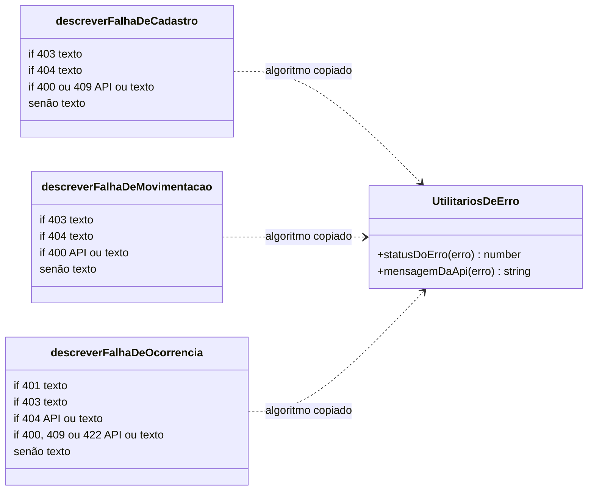

**Depois.** O algoritmo está só no Context. As telas configuram o Context com as estratégias.

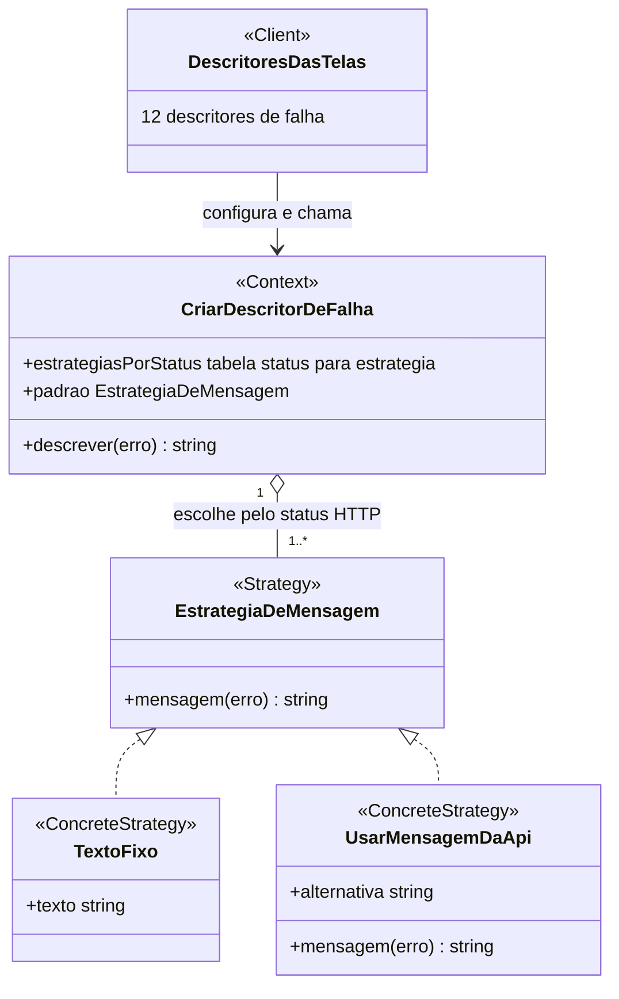

**Execução** de uma falha 409 no cadastro de colaborador:

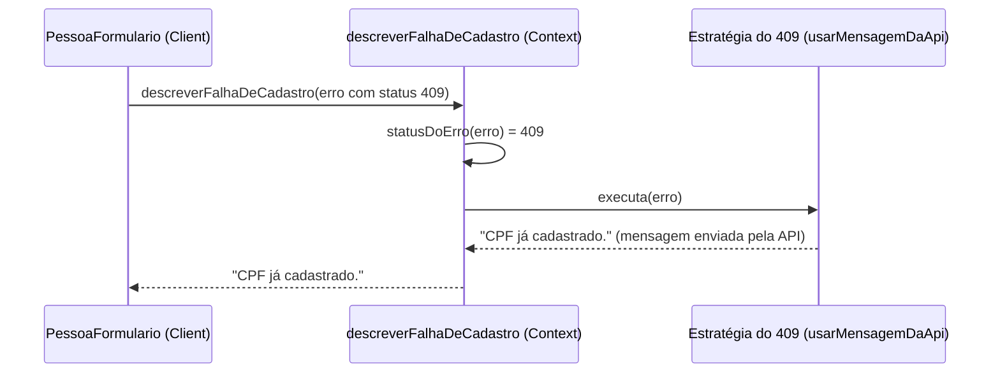

### Depois (código)

O Context e as estratégias, em `frontend/src/shared/api/erros.ts`:

```ts
export type EstrategiaDeMensagem = string | ((erro: unknown) => string)

export function usarMensagemDaApi(alternativa: string): EstrategiaDeMensagem {
  return (erro) => mensagemDaApi(erro) ?? alternativa
}

export function criarDescritorDeFalha(
  estrategiasPorStatus: Readonly<Partial<Record<number, EstrategiaDeMensagem>>>,
  padrao: EstrategiaDeMensagem,
): (erro: unknown) => string {
  return (erro) => {
    const status = statusDoErro(erro)
    const escolhida = (status !== undefined && estrategiasPorStatus[status]) || padrao
    return typeof escolhida === 'string' ? escolhida : escolhida(erro)
  }
}
```

O mesmo cliente do exemplo inicial, agora apenas declarando as estratégias:

```ts
const dadosRecusados = usarMensagemDaApi(
  'Os dados informados conflitam com um cadastro existente ou são inválidos.')

export const descreverFalhaDeCadastro = criarDescritorDeFalha({
  400: dadosRecusados,
  403: 'Seu perfil não tem permissão para esta operação.',
  404: 'Cadastro não encontrado. Ele pode ter sido alterado por outra pessoa; recarregue a lista.',
  409: dadosRecusados,
}, 'Não foi possível concluir a operação agora. Os dados preenchidos foram mantidos; tente novamente.')
```

O mesmo Context também atende uma regra conhecida só na hora da chamada. Em `capacitacoes/api.ts`, o texto do 404 é informado por quem chama, então o descritor é montado e executado na mesma chamada:

```ts
export function descreverFalha(erro: unknown, naoEncontrado: string): string {
  return criarDescritorDeFalha({
    400: usarMensagemDaApi('A consulta foi recusada pelo servidor. Revise os dados e tente novamente.'),
    403: 'Seu perfil não tem permissão para consultar capacitações.',
    404: usarMensagemDaApi(naoEncontrado),
  }, 'Não foi possível consultar agora. Verifique sua conexão ou tente novamente em alguns instantes.')(erro)
}
```

**Nenhuma tela precisou mudar a forma de chamar.** Os descritores mantiveram nome e assinatura, por exemplo `setFalha(descreverFalhaDeCadastro(erro))`, e todos os textos exibidos ao usuário continuaram idênticos.

### Trechos que não entraram no padrão

Três trechos parecidos ficaram de fora porque não cumprem o contrato da estratégia, que é receber um erro e devolver uma mensagem:

| Trecho | Motivo |
| --- | --- |
| `duplicidadeDaFalha` (`emprestimos/api.ts`) | Devolve `null` quando a falha não é duplicidade de posse. O `EntregaDialog` usa esse `null` para decidir se pede a confirmação de substituição. |
| `ProtocoloBusca.tsx` | Monta um objeto `{ titulo, texto }`, não uma mensagem. |
| `interceptadores.ts` | Encerra a sessão no 401. É controle de sessão, não descrição de falha. |

### Benefício

O algoritmo que transforma uma falha HTTP em mensagem passou a existir **num único lugar, testado**. Cada tela deixou de reimplementá-lo e passou a **declarar** apenas suas regras.

Na prática:

- mudar o comportamento geral, como a forma de ler a mensagem do backend, é uma alteração no Context;
- tratar um novo status numa tela é acrescentar uma linha na tabela dela, sem tocar na lógica (aberto para extensão, fechado para modificação);
- as diferenças entre telas, como o 404 com texto fixo no estoque e com mensagem da API em ocorrências, ficaram explícitas na tabela de cada uma, em vez de escondidas em `if`s diferentes.

O que **não** mudou foi o que o usuário vê: as mensagens são as mesmas e os testes das telas continuam passando.

Medição nas features do frontend:

| Medida | v1.0.0 | Depois |
| --- | ---: | ---: |
| Chamadas a `statusDoErro(` | 18 | 5 |
| Chamadas a `mensagemDaApi(` | 22 | 8 |
| Comparações `status === 4xx` | 36 | 4 |
| Arquivos que chamam `statusDoErro(` | 13 | 5 |
| Implementações do algoritmo de escolha | 12 | 1 |

O total de linhas quase não muda: o Context e os comentários ocupam o espaço das cópias removidas. O ganho está em ter uma única implementação, não em ter menos código. As chamadas que restam a `statusDoErro(` e `mensagemDaApi(` estão nos trechos da seção anterior e na alocação de capacitações, que lê o corpo do erro 422.

### Evidências

**Teste do Context:** `frontend/tests/erros.spec.ts`, com 6 casos que exercitam os papéis do padrão sem abrir navegador:

1. estratégia de texto fixo escolhida pelo status;
2. `usarMensagemDaApi` devolvendo a mensagem do backend;
3. `usarMensagemDaApi` caindo no texto alternativo (sem mensagem, mensagem em branco ou corpo HTML);
4. status sem estratégia usando a padrão;
5. falha de rede ou erro que não veio do axios usando a padrão;
6. estratégia padrão que também consulta a API, com prioridade da regra do status.

**Comportamento preservado:** os specs Playwright das telas migradas passaram (126 testes, incluindo os do Context):

- `users`, `login`, `setores` e `inspecoes`;
- `emprestimos`, `epis` e `estoque`;
- `capacitacoes`, `ocorrencias` e `ocorrencias-acompanhamento`.

Dois exemplos mostram que a estratégia `usarMensagemDaApi` funciona dentro do Context: o conflito de CPF em `users.spec.ts` e a recusa com mensagem do servidor em `setores.spec.ts`.

**Verificação estática:** `npx tsc -b` e `npx eslint .` sem erros.

---

## Adapter — porta de operador autenticado

**Catálogo:** GoF, estrutural.

**Intenção:** converter a interface de uma classe na interface esperada pelos clientes. O Adapter permite que classes com interfaces incompatíveis trabalhem juntas, desacoplando o núcleo da aplicação dos detalhes e classes estáticas do framework de segurança.

**Issues:** [#222](https://github.com/yIuriy/rp-iv-grupo03-safeplace/issues/222) (parte 1, aplicada: porta, adaptador e fachada `OperadorAtual`) e [#236](https://github.com/yIuriy/rp-iv-grupo03-safeplace/issues/236) (parte 2, aplicada: os 8 clientes passam a ler o operador pela fachada).

### Problema (antes)

A porta `application/port/out/OperadorAutenticado.java` e o adaptador `adapters/out/seguranca/SpringSecurityOperadorAutenticadoAdapter.java` já existiam, mas apenas `UsuarioService` os utilizava. Os demais casos de uso (`OcorrenciaService`, `TarefaService`, `EpiService`, `ControlarManutencaoEpiService`, `CadastrarCapacitacaoService`, `InspecaoService`, `PlanoDeAcaoService` e `PlanoDeAcaoJpaAdapter`) acessavam o `SecurityContextHolder` diretamente.

Medição na release v1.0.0:

| Medida | Valor v1.0.0 |
| --- | ---: |
| `violacoes_camadas.application_importa_spring_security` | 7 |
| `contagens.security_context_holder` | 27 |

Além do acoplamento ao Spring Security, havia dois problemas de consistência:

1. **Defeito no descarte de `"anonymousUser"`:** o adaptador não filtrava o usuário anônimo fornecido pelo Spring Security quando não autenticado, retornando `Optional.of("anonymousUser")`. Apenas 4 locais (`OcorrenciaService`, `TarefaService`, `InspecaoService` e `PlanoDeAcaoJpaAdapter`) descartavam esse valor manualmente; nos demais fluxos, a auditoria podia gravar `responsavel = "anonymousUser"` em vez de `SISTEMA`.
2. **Regra divergente para recuperação do Gestor:** a busca do Gestor de Segurança pelo e-mail autenticado possuía comportamentos diferentes no sistema. `TarefaService` e `InspecaoService` lançavam `AccessDeniedException` quando não havia gestor autenticado, enquanto `PlanoDeAcaoService` devolvia `null`.

**Parte 2 ([#236](https://github.com/yIuriy/rp-iv-grupo03-safeplace/issues/236)).** A parte 1 criou a porta e a fachada, mas os 8 clientes ainda tinham a sua própria leitura do `SecurityContextHolder`, cada uma com uma regra:

| Cliente | Helper local | Filtrava `anonymousUser` | Sem operador | Gestor ausente |
| --- | --- | :---: | --- | --- |
| `CadastrarCapacitacaoService` | `resolverOperador()`, com `catch (Exception)` | não | `SISTEMA` | (não busca) |
| `ControlarManutencaoEpiService` | `resolverOperador(explicito)` | não | `SISTEMA` | (não busca) |
| `EpiService` | `emailDoUsuarioAutenticado(explicito)` e `resolverOperador` | não | `null` ou `SISTEMA` | (não busca) |
| `InspecaoService` | `resolverGestorAutenticado()` e `semGestor()` | sim | exceção | `AccessDeniedException` |
| `OcorrenciaService` | `emailAutenticado()` e `resolverOperador()`, mais a leitura dos papéis na visibilidade | sim | `SISTEMA` | (não busca) |
| `PlanoDeAcaoService` | `gestorAutenticado()` | não | `null` | `null` |
| `TarefaService` | `emailAutenticado()`, `resolverOperador()` e `resolverResponsavelTecnico()` | sim | `SISTEMA` | `AccessDeniedException` |
| `PlanoDeAcaoJpaAdapter` | `emailAutenticado()` e `resolverOperador(plano)` | sim | Gestor do plano ou `SISTEMA` | (não busca) |

Eram 14 helpers privados e 9 leituras diretas do `SecurityContextHolder` (8 helpers e a leitura dos papéis em `OcorrenciaService`), em 8 arquivos; 7 deles na camada de aplicação, que importava o Spring Security. `TarefaService` e `InspecaoService` lançavam a `AccessDeniedException` do framework a partir de um caso de uso. Os testes unitários desses casos de uso montavam e limpavam o `SecurityContextHolder` (estado estático por thread) em 8 classes.

### Por que Adapter

A camada de aplicação precisa saber **quem está operando** e quais os seus papéis ou entidades de domínio associadas, e não como o Spring Security armazena o token na thread (`SecurityContextHolder`).

O padrão Adapter permite:

- Isolar a dependência de `org.springframework.security` no adaptador de infraestrutura (`SpringSecurityOperadorAutenticadoAdapter`);
- Centralizar o filtro de `"anonymousUser"` em um único local, garantindo que usuários anônimos resultem em `Optional.empty()`;
- Fornecer uma fachada na camada de aplicação (`OperadorAtual`) que padroniza o fallback para `"SISTEMA"` e unifica a busca do Gestor de Segurança com regras explícitas (`buscarGestor()` para fluxos opcionais e `gestorObrigatorio()` para fluxos restritos);
- Testar casos de uso com dublês de teste simples (mocks da interface `OperadorAutenticado`), sem necessidade de montar ou limpar o contexto estático do Spring Security.

### Papéis do padrão

| Papel (GoF) | Elemento no código | Arquivo |
| --- | --- | --- |
| **Target** | `OperadorAutenticado` | `backend/src/main/java/br/edu/safeplace/backend/application/port/out/OperadorAutenticado.java` |
| **Adapter** | `SpringSecurityOperadorAutenticadoAdapter` | `backend/src/main/java/br/edu/safeplace/backend/adapters/out/seguranca/SpringSecurityOperadorAutenticadoAdapter.java` |
| **Adaptee** | `SecurityContextHolder` / `Authentication` | `org.springframework.security.core` |
| **Fachada de uso** | `OperadorAtual` | `backend/src/main/java/br/edu/safeplace/backend/application/usecase/OperadorAtual.java` |
| **Client** | `UsuarioService` (parte 1) e, na parte 2, `CadastrarCapacitacaoService`, `ControlarManutencaoEpiService`, `EpiService`, `InspecaoService`, `OcorrenciaService`, `PlanoDeAcaoService`, `TarefaService` e `PlanoDeAcaoJpaAdapter` | `backend/src/main/java/br/edu/safeplace/backend/application/usecase/*` e `adapters/out/persistencia/PlanoDeAcaoJpaAdapter.java` |
| **Dublê do Target (testes)** | `OperadorAutenticadoFixo` (#236) | `backend/src/test/java/br/edu/safeplace/backend/suporte/OperadorAutenticadoFixo.java` |

### Diagramas

**Antes.** Casos de uso liam diretamente a classe estática do Spring Security, duplicando a regra de filtragem de `"anonymousUser"` ou omitindo o tratamento.

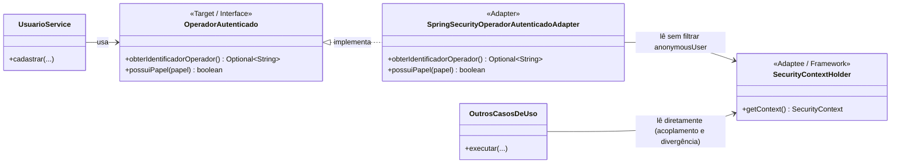

**Depois.** O adaptador encapsula a leitura do Spring Security e filtra `"anonymousUser"`. Os casos de uso consomem a fachada de aplicação `OperadorAtual`, que se apoia na porta `OperadorAutenticado`.

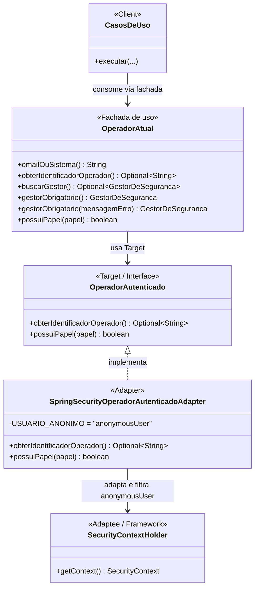

**Execução:** resolução de operador anônimo com fallback para `"SISTEMA"`:

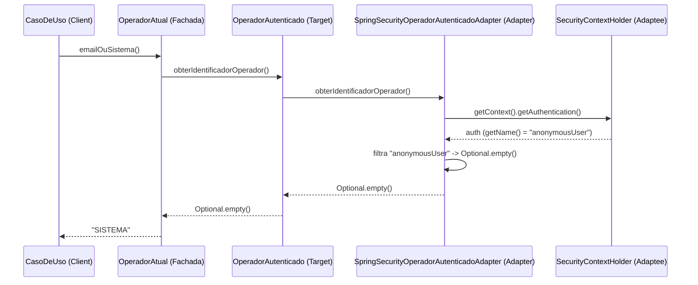

**Antes da parte 2 (#236).** Só `UsuarioService` usava o Target; os outros 8 clientes liam o Adaptee diretamente, cada um com a sua regra.

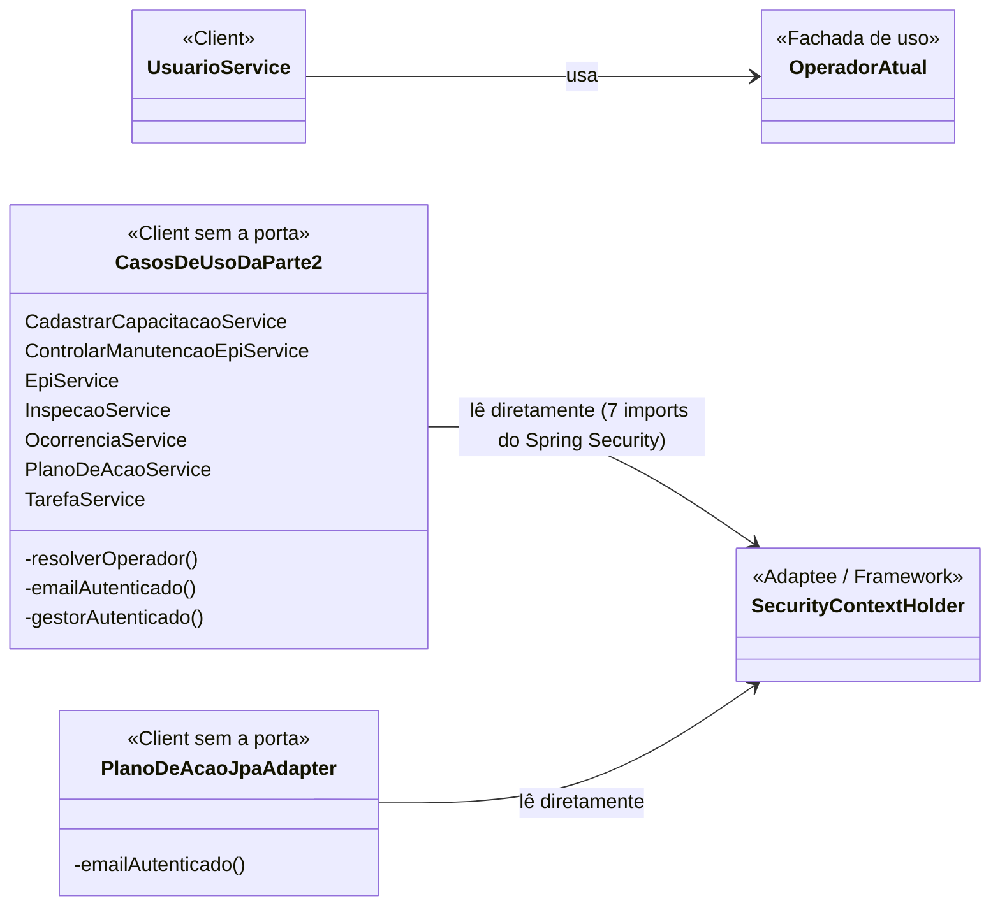

**Depois da parte 2 (#236).** Os 8 clientes recebem `OperadorAtual` no construtor, como dependência obrigatória. Só o Adapter lê o Adaptee, e os testes trocam o Adapter pelo dublê `OperadorAutenticadoFixo`.

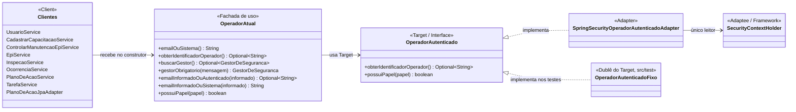

### Código antes × depois

**Adaptador (`SpringSecurityOperadorAutenticadoAdapter.java`):**

Antes:
```java
@Override
public Optional<String> obterIdentificadorOperador() {
    Authentication auth = SecurityContextHolder.getContext().getAuthentication();
    if (auth != null && auth.getName() != null && !auth.getName().isBlank()) {
        return Optional.of(auth.getName().trim());
    }
    return Optional.empty();
}
```

Depois (descarte centralizado de `"anonymousUser"`):
```java
private static final String USUARIO_ANONIMO = "anonymousUser";

@Override
public Optional<String> obterIdentificadorOperador() {
    Authentication auth = SecurityContextHolder.getContext().getAuthentication();
    if (auth != null && auth.getName() != null && !auth.getName().isBlank()) {
        String identificador = auth.getName().trim();
        if (USUARIO_ANONIMO.equalsIgnoreCase(identificador)) {
            return Optional.empty();
        }
        return Optional.of(identificador);
    }
    return Optional.empty();
}
```

**Fachada de uso (`OperadorAtual.java`):**

Criação da fachada na camada de aplicação para abstrair o acesso e unificar a regra do Gestor:
```java
@Service
public class OperadorAtual {

    public static final String SISTEMA = "SISTEMA";
    private static final String MENSAGEM_GESTOR_PADRAO = "Operação exige um Gestor de Segurança autenticado.";

    private final OperadorAutenticado operadorPorta;
    private final UsuarioRepository usuarioRepository;

    public OperadorAtual(OperadorAutenticado operadorPorta, UsuarioRepository usuarioRepository) {
        this.operadorPorta = Objects.requireNonNull(operadorPorta, "operadorPorta não pode ser nula.");
        this.usuarioRepository = Objects.requireNonNull(usuarioRepository, "usuarioRepository não pode ser nulo.");
    }

    public String emailOuSistema() {
        return operadorPorta.obterIdentificadorOperador().orElse(SISTEMA);
    }

    public Optional<GestorDeSeguranca> buscarGestor() {
        return operadorPorta.obterIdentificadorOperador()
                .flatMap(usuarioRepository::buscarPorEmail)
                .filter(GestorDeSeguranca.class::isInstance)
                .map(GestorDeSeguranca.class::cast);
    }

    public GestorDeSeguranca gestorObrigatorio() {
        return gestorObrigatorio(MENSAGEM_GESTOR_PADRAO);
    }

    public GestorDeSeguranca gestorObrigatorio(String mensagemErro) {
        return buscarGestor()
                .orElseThrow(() -> new AcessoNegadoException(
                        mensagemErro != null && !mensagemErro.isBlank() ? mensagemErro : MENSAGEM_GESTOR_PADRAO
                ));
    }

    public boolean possuiPapel(String papel) {
        return operadorPorta.possuiPapel(papel);
    }
}
```

**Parte 2 (#236): cliente `TarefaService`.**

Antes:

```java
import org.springframework.security.access.AccessDeniedException;
import org.springframework.security.core.Authentication;
import org.springframework.security.core.context.SecurityContextHolder;

public TarefaService(TarefaRepository repository, LogAuditoriaRepository logAuditoriaRepository,
        UsuarioRepository usuarioRepositorio, Validador<Tarefa> validador, EpiRepository epiRepository) { ... }

private GestorDeSeguranca resolverResponsavelTecnico() {
    String email = emailAutenticado();
    if (email != null) {
        GestorDeSeguranca gestor = usuarioRepositorio.buscarPorEmail(email)
                .filter(GestorDeSeguranca.class::isInstance)
                .map(GestorDeSeguranca.class::cast)
                .orElse(null);
        if (gestor != null) {
            return gestor;
        }
    }
    throw new AccessDeniedException(
            "A classificação de periculosidade exige um Gestor de Segurança autenticado como responsável técnico.");
}

private String resolverOperador() {
    String email = emailAutenticado();
    return email != null ? email : "SISTEMA";
}

private String emailAutenticado() {
    Authentication auth = SecurityContextHolder.getContext().getAuthentication();
    if (auth != null && auth.getName() != null && !auth.getName().isBlank()) {
        String email = auth.getName().trim();
        return "anonymousUser".equals(email) ? null : email;
    }
    return null;
}
```

Depois (sem import do Spring Security; o `OperadorAtual` ocupa o lugar do `UsuarioRepository`, que só servia para achar o operador):

```java
public TarefaService(TarefaRepository repository, LogAuditoriaRepository logAuditoriaRepository,
        OperadorAtual operadorAtual, Validador<Tarefa> validador, EpiRepository epiRepository) {
    ...
    this.operadorAtual = Objects.requireNonNull(operadorAtual, "Operador atual é obrigatório.");
}

RegistroClassificacaoTarefa registro = tarefa.classificar(
        nivelPerigo, operadorAtual.gestorObrigatorio(SEM_RESPONSAVEL_TECNICO));

registrarLog(LogAuditoria.registrarCadastro(
        operadorAtual.emailOuSistema(), ENTIDADE, salva.getId(), "Cadastro de Tarefa: " + salva.getDescricao()));
```

**Parte 2 (#236): testes do cliente.**

Antes, cada teste montava e limpava o estado estático do framework:

```java
@BeforeEach
void setUp() {
    useCase = new TarefaService(repository, auditoria, usuarios, null, null, epiRepository);
    SecurityContextHolder.getContext().setAuthentication(new UsernamePasswordAuthenticationToken(EMAIL_GESTOR, null));
}

@AfterEach
void limparAutenticacao() {
    SecurityContextHolder.clearContext();
}
```

Depois, o teste injeta um dublê do Target:

```java
private final OperadorAutenticadoFixo operador = OperadorAutenticadoFixo.semSessao();

@BeforeEach
void setUp() {
    useCase = new TarefaService(repository, auditoria, operador.operadorAtual(usuarios), null, null, epiRepository);
    operador.autenticar(EMAIL_GESTOR);
}
```

Os demais clientes seguem o mesmo modelo. Em `EpiService` e `ControlarManutencaoEpiService`, o e-mail que o controller lê do token continua tendo precedência. Essa regra estava copiada em 3 helpers dos dois serviços e passou para a fachada, em `emailInformadoOuAutenticado(informado)` e `emailInformadoOuSistema(informado)`:

```java
// Antes (EpiService e ControlarManutencaoEpiService, cada um com a sua cópia)
private String resolverOperador(String explicit) {
    if (explicit != null && !explicit.isBlank()) {
        return explicit.trim();
    }
    Authentication auth = SecurityContextHolder.getContext().getAuthentication();
    if (auth != null && auth.getName() != null && !auth.getName().isBlank()) {
        return auth.getName().trim();
    }
    return "SISTEMA";
}

// Depois (OperadorAtual), usado pelos dois serviços
public Optional<String> emailInformadoOuAutenticado(String informado) {
    if (informado != null && !informado.isBlank()) {
        return Optional.of(informado.trim());
    }
    return obterIdentificadorOperador();
}
```

No `PlanoDeAcaoJpaAdapter`, a ordem continua sendo operador autenticado, Gestor do plano e `SISTEMA`.

### Benefício

A identificação do operador autenticado e o descarte de `"anonymousUser"` passaram a existir **em um ponto único e testado**. A auditoria fica protegida contra a gravação de `"anonymousUser"` como responsável, e a busca por Gestor de Segurança foi padronizada: fluxos que exigem gestor usam `gestorObrigatorio()` (lançando `AcessoNegadoException`), enquanto fluxos opcionais usam `buscarGestor()`. A camada de aplicação permanece desacoplada do Spring Security, simplificando os testes unitários.

**Parte 2 (#236).** A pergunta "quem está operando?" passou a ter uma resposta só no backend. Ficou mais simples porque os 8 clientes perderam 13 dos 14 helpers privados (82 linhas a menos no código de produção, já contando os dois métodos novos da fachada) e cada um diz só o que precisa: `emailOuSistema()` para a auditoria, `buscarGestor()` quando o Gestor é opcional (plano de ação) e `gestorObrigatorio(mensagem)` quando é exigido (tarefa e inspeção). Ficou mais seguro porque o descarte de `anonymousUser` deixou de depender de cada cliente lembrar dele: capacitação, manutenção e EPI, que não o filtravam, passam a cair em `SISTEMA` como os demais. E ficou mais fácil de testar e de mudar: os testes injetam um dublê da porta em vez de manipular estado estático por thread, e trocar o mecanismo de autenticação afeta só o Adapter.

### Métricas locais

| Métrica | Antes (`dev`, `e338bc0`) | Depois da #236 |
| --- | ---: | ---: |
| `violacoes_camadas.application_importa_spring_security` (coletor) | 7 | **0** |
| `contagens.security_context_holder` (coletor, código de produção) | 27 | 10 |
| Arquivos fora de `adapters/` e `config/` com `SecurityContextHolder` | 7 | 0 |
| Pontos que filtram `anonymousUser` | 5 | 1 (o Adapter) |
| Helpers privados de resolução do operador nos clientes | 14 | 1 |
| Classes de teste unitário que montam o `SecurityContextHolder` | 8 | 0 |
| Linhas de produção, 8 clientes e `OperadorAtual` (diff) | base | 82 a menos (131 inseridas, 213 removidas) |
| `duplicacao.percentual` (coletor) | 10,45% | 10,43% |
| `requireNonNull` (coletor) | 31 | 38 |

As 10 ocorrências restantes de `SecurityContextHolder` ficam em `adapters/out/seguranca` (o Adapter e o filtro JWT) e em `adapters/in/web` (dois controllers que leem o e-mail do token). O único helper que sobrou é o `resolverOperador(plano)` do `PlanoDeAcaoJpaAdapter`: ele delega à fachada e guarda uma regra que só existe ali, o recurso ao Gestor do plano quando não há sessão; a auditoria inteira sai desse adaptador na #238. O `requireNonNull` sobe porque o `OperadorAtual` passou a ser dependência obrigatória nos 8 clientes (Null Object, #241).

**Contrato HTTP.** A recusa por falta de Gestor em tarefa e inspeção continua respondendo **403** com `error: "Acesso Proibido"`. Antes, a `AccessDeniedException` subia até o `AccessDeniedHandler` do Spring Security, que trocava a mensagem do caso de uso por "Seu perfil não possui permissão para acessar este recurso." e acrescentava `path`. Agora a `AcessoNegadoException` do domínio é tratada pelo advice de usuários (`UsuarioExceptionHandler`), que devolve a mensagem do caso de uso, como nos outros 403 do domínio. Esse caminho só ocorre com um token de Gestor cujo e-mail não corresponde mais a um Gestor cadastrado, porque a regra de acesso já barra os outros perfis antes do caso de uso. Os demais fluxos não mudam de resposta.

### Evidências

**Testes unitários novos:**

1. `SpringSecurityOperadorAutenticadoAdapterTest`: 10 testes cobrindo contexto sem autenticação, nome em branco, descarte de `"anonymousUser"`, verificação de papéis com/sem prefixo `ROLE_` e negação de papéis para anônimos.
2. `OperadorAtualTest`: 13 testes cobrindo fallback de `emailOuSistema()` para `"SISTEMA"`, delegação de papéis, resolução de `buscarGestor()` com usuário inexistente, colaborador comum e gestor válido, além de `gestorObrigatorio()` lançando `AcessoNegadoException` com mensagem padrão ou personalizada.

**Suíte de testes existente:**
- Execução de `./mvnw test` concluída com sucesso: **1094 testes executados, 0 falhas, 0 erros**.
- Cobertura mantida em conformidade com as metas do projeto.

**Parte 2 (#236).**

Testes novos (22):

1. `OperadorAtualClientesTest` (10 testes): cada um dos 8 clientes recusa `OperadorAtual` nulo com a mensagem "Operador atual é obrigatório."; um teste varre `application/` e falha se algum arquivo importar `org.springframework.security`; outro varre o código de produção e falha se `SecurityContextHolder` aparecer fora de `adapters/` e `config/`. Os dois últimos protegem os critérios da issue contra regressões.
2. `CadastrarCapacitacaoServiceTest` e `ControlarManutencaoEpiServiceTest` (2 testes cada): a auditoria grava o e-mail lido pela porta e, sem sessão, `SISTEMA`. Antes, esses dois clientes não descartavam `anonymousUser`.
3. `PlanoDeAcaoServiceTest` (2 testes): o Gestor autenticado lido pela porta fica registrado no plano; sem Gestor, o plano é cadastrado sem gestor (fluxo opcional, `buscarGestor()`).
4. `PlanoDeAcaoJpaAdapterTest` (2 testes): a auditoria grava o operador autenticado e, sem sessão nem Gestor no plano, `SISTEMA`.
5. `InspecaoControllerTest` (1 teste): a `AcessoNegadoException` do caso de uso responde 403 com `error` "Acesso Proibido" e a mensagem do caso de uso.
6. `OperadorAtualTest` (3 testes): o e-mail informado pelo controller tem precedência (e a porta nem é consultada); informado ausente ou em branco usa o operador autenticado; sem nenhum dos dois, vazio ou `SISTEMA`.

Testes ajustados: as 8 classes que montavam o `SecurityContextHolder` (`EpiServiceTest`, `EstoqueCriticoConsultaUseCaseTest`, `InspecaoServiceTest`, `OcorrenciaConsultaUseCaseTest`, `OcorrenciaServiceTest`, `OcorrenciaUseCaseAuditoriaTest`, `TarefaServiceTest` e `AuditoriaEvidenciaIntegracaoTest`) passaram a usar o dublê `OperadorAutenticadoFixo`. As asserções de comportamento não mudaram; em `InspecaoServiceTest` e `TarefaServiceTest` a exceção esperada passou de `AccessDeniedException` para `AcessoNegadoException`, agora com a mensagem conferida. `TarefaControllerTest` simula a mesma exceção do domínio e confere o corpo do 403. As demais classes só receberam a nova dependência no construtor. Os 4 testes de integração com PostgreSQL que autenticam pelo `SecurityContextHolder` continuam assim, porque sobem o contexto Spring e exercitam o Adapter real.

Suíte do backend (`./mvnw test`): antes, 1174 testes, 0 falhas, 131 ignorados; depois, **1196 testes, 0 falhas, 0 erros**, os mesmos 131 ignorados (integração com PostgreSQL, ver #248).

Suíte com a integração ativada (`SAFEPLACE_TEST_DATASOURCE_URL` apontando para um PostgreSQL 16 descartável, o contorno descrito em #248): os 131 testes de integração rodaram, nenhum ignorado. Os que atravessam a cadeia inteira (Adapter real, `OperadorAtual` e caso de uso, autenticando pelo `SecurityContextHolder`) passaram: `BackendApplicationTests` (contexto Spring completo), `SegurancaRbacIntegrationTest`, `AreaRiscoTarefaPersistenciaTest`, `OcorrenciaConsultaPersistenciaIntegracaoTest`, `OcorrenciaPersistenciaIntegracaoTest` e `PlanoDeAcaoPersistenciaIntegracaoTest`. Os únicos erros foram 4, em `SetorAreaRiscoPersistenciaIntegracaoTest`: a limpeza do teste apaga `epis` enquanto `projecoes_substituicao` ainda referencia um EPI de outra classe. Na mesma condição, a base sem a #236 (`3aaf10e`) dá os mesmos 4 erros (1174 testes); é o problema de ordem nas limpezas registrado em #248, sem relação com esta issue. O backend de desenvolvimento (`docker-compose.dev.yml`) também subiu com o código novo.

---

## Facade — registrador de auditoria

**Catálogo:** GoF, estrutural.

**Intenção:** fornecer uma interface simplificada (`RegistradorAuditoria`) para a montagem e gravação de registros de auditoria (`LogAuditoria`), ocultando a resolução do operador e os detalhes do repositório.

**Issues:** [#223](https://github.com/yIuriy/rp-iv-grupo03-safeplace/issues/223) (parte 1, aplicada: Facade e migração de ocorrências, usuários e tarefas), [#237](https://github.com/yIuriy/rp-iv-grupo03-safeplace/issues/237) (parte 2, aplicada: migração dos 8 casos de uso restantes) e [#238](https://github.com/yIuriy/rp-iv-grupo03-safeplace/issues/238) (parte 3, aplicada: auditoria do plano de ação movida de `PlanoDeAcaoJpaAdapter` para `PlanoDeAcaoService` via `RegistradorAuditoria`).

### Problema (antes)

A auditoria (RNF05) era montada à mão em cada caso de uso: criar o `LogAuditoria` com uma das fábricas estáticas (`registrarCadastro`, `registrarAlteracao`, `registrarRemocao`) ou com o construtor de 7 argumentos, resolver o operador e chamar `logAuditoriaRepository.salvar(...)`. Na `dev` antes da introdução da Facade eram **32 blocos em 12 classes** (11 casos de uso e o `PlanoDeAcaoJpaAdapter`), com 4 a 7 linhas cada.

Após a parte 1 (#223), restavam 18 blocos em 9 classes: os 5 blocos do `PlanoDeAcaoJpaAdapter` (escopo da #238) e 13 blocos manuais distribuídos nos 8 casos de uso da parte 2 (#237):

| Caso de uso | Blocos | Como o operador e a auditoria eram resolvidos |
| --- | ---: | --- |
| `EpiService` | 2 | `operadorAtual.emailOuSistema()` no cadastro; no estoque, `operadorAtual.emailInformadoOuAutenticado(responsavelEmail)` |
| `ControlarManutencaoEpiService` | 2 | `operadorAtual.emailOuSistema()` no envio; `operadorAtual.emailInformadoOuSistema(responsavelEmail)` na conclusão |
| `EmprestimoService` | 2 | helper privado `auditar(LogAuditoria log)` chamando `auditoria.salvar(log)` com `operadorEmail` informado na entrega e na devolução |
| `AreaRiscoService` | 2 | `operador != null ? operador : "sistema"` no cadastro e na atualização com histórico detalhado |
| `SetorService` | 2 | `operador != null ? operador : "sistema"` no cadastro e na atualização de setor |
| `InspecaoService` | 1 | `responsavel.getEmail()` a partir de `operadorAtual.gestorObrigatorio(...)` |
| `AlocarColaboradorTarefaService` | 1 | `operadorEmail` repassado ao `LogAuditoria.registrarCadastro` com `auditoriaRepository.salvar` |
| `CadastrarCapacitacaoService` | 3 | helper privado `registrarAuditoria(entidade, entidadeId, justificativa)` chamando `LogAuditoria.registrarCadastro(operadorAtual.emailOuSistema(), ...)` |

Na parte 3 (#238), atacou-se a anomalia do `PlanoDeAcaoJpaAdapter` (320 linhas). Ele era o **único fluxo do sistema que auditava na camada de persistência**: comparava o snapshot anterior com o novo estado em `salvar` (disparando até 4 logs: cadastro, situação, reatribuição de responsável e alerta) e gravava o log `PRORROGAR_PRAZO` em `salvarProrrogacao`. Isso feria frontalmente a arquitetura hexagonal: o adaptador de saída decidia regras de auditoria e dependia de `LogAuditoriaRepository` e de `OperadorAtual`.

### Por que Facade

Gravar uma auditoria envolve várias peças: a fábrica do `LogAuditoria`, o operador (`OperadorAtual`), o nome da entidade e a porta de persistência (`LogAuditoriaRepository`). A Facade expõe `cadastro(...)`, `alteracao(...)`, `remocao(...)` e `operacao(...)` e esconde essas peças. Os dois casos que fogem do padrão (operador informado pela borda e instante fixado pela classificação da tarefa) ficam em `por(operador)` e `em(instante)`, que devolvem uma `Autoria` com os mesmos métodos.

Na parte 3 (#238), a Facade recebeu `operacao(tipoOperacao, entidade, id, justificativa)` para suportar operações com tipos customizados como `PRORROGAR_PRAZO`. A detecção de mudanças e o disparo da auditoria foram transferidos integralmente para `PlanoDeAcaoService` (`PlanoDeAcaoUseCase`), mantendo a auditoria na mesma transação e liberando `PlanoDeAcaoJpaAdapter` para sua responsabilidade única: persistir dados.

Alternativas descartadas:

- **AOP ou Decorator:** a justificativa depende de dados do fluxo (estado anterior, protocolo CAT, campos alterados, motivo de movimentação, justificativa de prorrogação), que um aspecto não conhece.
- **Observer:** a especificação arquitetural veta o barramento de eventos no MVP.
- **Auditoria em JPA Entity Listeners:** acoplaria eventos de domínio ao ciclo de vida do Hibernate/JPA, violando o isolamento do domínio e dificultando testes unitários sem banco.

**Leitura continua na porta.** A Facade só grava. `AreaRiscoService` (`listarHistorico`), `OcorrenciaService` (visibilidade do Supervisor) e `TarefaService` (histórico da tarefa) continuam lendo diretamente pela `LogAuditoriaRepository`. Os demais casos de uso não dependem mais da porta de persistência de auditoria em produção.

**Texto idêntico.** Entidade, tipo de operação, justificativa e responsável de cada registro são 100% idênticos aos anteriores.

**Helpers e persistência limpos.** Os métodos auxiliares privados `auditar` (em `EmprestimoService`) e `registrarAuditoria` (em `CadastrarCapacitacaoService`) foram excluídos, e `PlanoDeAcaoJpaAdapter` teve `EstadoAnterior`, `descreverResponsavel` e `resolverOperador` completamente removidos.

### Papéis do padrão

| Papel no padrão | Elemento no código | Responsabilidade |
| --- | --- | --- |
| Facade | `RegistradorAuditoria` (e a `Autoria` devolvida por `por`/`em`) | Expor `cadastro(...)`, `alteracao(...)`, `remocao(...)` e `operacao(...)` para a camada de aplicação |
| Subsystem | `LogAuditoria`, `LogAuditoriaRepository`, `OperadorAtual` | Entidade de domínio, porta de persistência do log e identificação do operador |
| Client | 12 casos de uso da aplicação: `OcorrenciaService`, `UsuarioService`, `TarefaService` (#223); `EpiService`, `ControlarManutencaoEpiService`, `EmprestimoService`, `AreaRiscoService`, `SetorService`, `InspecaoService`, `AlocarColaboradorTarefaService`, `CadastrarCapacitacaoService` (#237); `PlanoDeAcaoService` (#238) | Registrar eventos de auditoria em uma única chamada expressiva |

### Diagramas

**Antes (#238).** Casos de uso e o adaptador de persistência `PlanoDeAcaoJpaAdapter` conheciam e manipulavam diretamente o subsistema de auditoria:

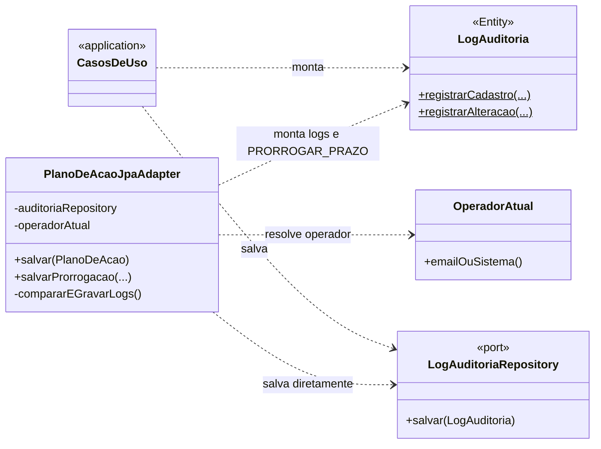

**Depois (#238).** Toda a auditoria do backend está concentrada na Facade `RegistradorAuditoria`. O adaptador `PlanoDeAcaoJpaAdapter` apenas persiste dados; o caso de uso `PlanoDeAcaoService` orquestra as regras de negócio e aciona a Facade.

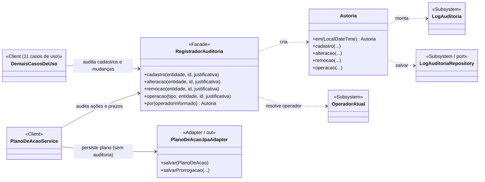

### Código antes × depois

`PlanoDeAcaoJpaAdapter`, antes (#238):

```java
// O adaptador de persistência inspecionava estados e decidia logs de auditoria:
@Override
public PlanoDeAcao salvar(PlanoDeAcao plano) {
    EstadoAnterior anterior = plano.getId() != null ? carregarEstadoAnterior(plano.getId()) : null;
    PlanoDeAcao salvo = repository.save(mapper.toEntity(plano));
    if (anterior == null) {
        auditoriaRepository.salvar(LogAuditoria.registrarCadastro(
                operador, "PlanoDeAcao", salvo.getId(), "Criação de ação vinculada à ocorrência " + salvo.getIdOcorrencia()));
    } else {
        if (!Objects.equals(anterior.status(), salvo.getStatus())) {
            auditoriaRepository.salvar(LogAuditoria.registrarAlteracao(
                    operador, "PlanoDeAcao", salvo.getId(), "Alteração de situação da ação..."));
        }
        // ... mais verificações de responsável e alerta
    }
    return salvo;
}
```

Depois (#238):

```java
// Adaptador de persistência limpo, focado puramente em mapear e salvar:
@Override
public PlanoDeAcao salvar(PlanoDeAcao plano) {
    Objects.requireNonNull(plano, "O plano de ação é obrigatório");
    PlanoDeAcaoEntity salva = planoDeAcaoRepository.save(planoDeAcaoMapper.toEntity(plano));
    return planoDeAcaoMapper.toDomain(salva);
}
```

E a auditoria em `PlanoDeAcaoService`, depois (#238):

```java
// No caso de uso, via Facade RegistradorAuditoria:
auditoria.por(operador).cadastro(
        "PlanoDeAcao",
        salvo.getId(),
        "Criação de ação vinculada à ocorrência " + salvo.getIdOcorrencia()
);

// Na prorrogação de prazo:
auditoria.por(operador).operacao(
        "PRORROGAR_PRAZO",
        "PlanoDeAcao",
        salvo.getId(),
        prorrogacao.justificativa()
);
```

`CadastrarCapacitacaoService`, antes e depois (#237):

```java
// antes
private void registrarAuditoria(String entidade, Integer entidadeId, String justificativa) {
    LogAuditoria log = LogAuditoria.registrarCadastro(
            operadorAtual.emailOuSistema(), entidade, entidadeId, justificativa);
    logAuditoriaRepository.salvar(log);
}
registrarAuditoria("Certificacao", salva.getId(), "Cadastro de certificação: " + salva.getNome());

// depois
auditoria.cadastro("Certificacao", salva.getId(), "Cadastro de certificação: " + salva.getNome());
```

`EmprestimoService.registrarEntrega`, antes e depois (#237):

```java
// antes
auditar(LogAuditoria.registrarCadastro(operadorEmail, ENTIDADE_AUDITADA, salvo.getId(),
        "Entrega do EPI " + epi.getNome() + " ao colaborador " + beneficiario.getNome()));
private void auditar(LogAuditoria log) {
    auditoria.salvar(log);
}

// depois
auditoria.por(operadorEmail).cadastro(ENTIDADE_AUDITADA, salvo.getId(),
        "Entrega do EPI " + epi.getNome() + " ao colaborador " + beneficiario.getNome());
```

### Benefício

A gravação de auditoria em todo o backend SafePlace foi 100% unificada na Facade `RegistradorAuditoria`. A violação arquitetural em `PlanoDeAcaoJpaAdapter` foi sanada: a persistência volta a ser puramente persistência (o arquivo encolheu de 320 para 203 linhas, -36%). A lógica de auditoria de planos de ação agora reside na camada de aplicação (`PlanoDeAcaoService`), na mesma transação de negócio. Nenhum caso de uso e nenhum adaptador de persistência monta `LogAuditoria` diretamente ou acopla-se a detalhes do repositório de log.

### Métricas locais

| Métrica | `dev` inicial | Parte 1 (#223) | Parte 2 (#237) | Parte 3 (#238) |
| --- | ---: | ---: | ---: | ---: |
| Chamadas a `LogAuditoria.registrar*` em `application/usecase` | 27 | 13 | 0 | **0** |
| Blocos manuais de auditoria em adaptadores de persistência | 5 | 5 | 5 | **0** |
| Classes de persistência que montam `LogAuditoria` | 1 | 1 | 1 | **0** |
| Linhas físicas em `PlanoDeAcaoJpaAdapter.java` | 320 | 320 | 320 | **203** (-36%) |
| Classes do sistema que constroem `LogAuditoria` diretamente | 12 | 9 | 1 | **1** (apenas a Facade `RegistradorAuditoria`) |
| Helpers privados de auditoria espalhados | 4 | 2 | 0 | **0** |

Medição verificada via `git grep "LogAuditoria\.registrar\|new LogAuditoria(" backend/src/main/` (apenas `RegistradorAuditoria.java` constrói o log em produção).

### Evidências

1. **Testes em `RegistradorAuditoriaTest`** (9 testes): cobertura completa dos métodos da Facade, precedência de operador, instante temporal e validação arquitetural contra chamadas diretas a `LogAuditoria.registrar*`;
2. **Testes em `PlanoDeAcaoAuditoriaTest`** (7 testes novos exercitando a Facade):
   - Gravação de log no cadastro de ação (`CADASTRO`);
   - Gravação de log na alteração de status (`ALTERACAO`);
   - Gravação de log na reatribuição de responsável (`ALTERACAO`);
   - Gravação de log na configuração de alertas (`ALTERACAO`);
   - Gravação de log na prorrogação de prazo (`PRORROGAR_PRAZO`);
   - Resolução correta do operador prioritário, fallback para gestor e fallback para `SISTEMA`.
3. **Testes em `PlanoDeAcaoJpaAdapterTest`**: suíte do adaptador de persistência simplificada, sem dependência de mocks de auditoria;
4. **Suíte completa** (`backend/mvnw.cmd test`): **1.329 testes executados, 0 falhas, 0 erros**.

---

## State — transições de `StatusEpi`

**Catálogo:** GoF, comportamental (máquina de estados via enum).

**Intenção:** concentrar as regras de transição do ciclo de vida do `Epi` nas constantes de `StatusEpi` (`podeTransicaoPara`), delegando a mudança de estado a `Epi.transicionarPara(StatusEpi)`.

**Issue:** [#224](https://github.com/yIuriy/rp-iv-grupo03-safeplace/issues/224), aplicada. Usa a mesma variante de `StatusOcorrencia` e `StatusPlanoDeAcao`: cada constante do enum declara as próprias transições.

### Problema (antes)

`StatusEpi` era um enum sem comportamento. As regras de mudança de situação estavam espalhadas em condicionais, cada uma atribuindo `this.status` por conta própria:

| Ponto | Regra embutida |
| --- | --- |
| `Epi.adicionarEstoque` | `ESGOTADO` vira `DISPONIVEL` |
| `Epi.removerEstoque` | `DISPONIVEL` com saldo zero vira `ESGOTADO` |
| `Epi.atualizarQuantidade` | as duas regras anteriores, repetidas |
| `Epi.enviarParaManutencao` | exige `DISPONIVEL` e vai para `EM_MANUTENCAO` |
| `Epi.concluirManutencao` | exige `EM_MANUTENCAO`; aprovada volta a `DISPONIVEL` |
| `Epi.registrarDevolucaoManutencao` | saldo zero vai para `EM_MANUTENCAO`, **sem guarda** |
| `Epi.registrarDevolucaoDescarte` | saldo zero vai para `DESCARTADO`, sem guarda |
| `ControlarManutencaoEpiService.concluirManutencao` | a aplicação decidia: `if (status == DISPONIVEL) enviarParaManutencao(...)` |

Incoerências reais: `enviarParaManutencao` exigia `DISPONIVEL`, mas `registrarDevolucaoManutencao` levava a `EM_MANUTENCAO` de qualquer situação, inclusive `DESCARTADO`, que deveria ser definitiva. E `EM_USO` nunca era atribuído.

### Por que State

O que é permitido depende da situação atual. Com o State, cada constante diz para onde pode ir (`podeTransicaoPara`) e como reage à mudança de saldo (`aposMudancaDeSaldo`), e o `Epi` muda de situação por um único ponto (`transicionarPara`), que recusa o destino proibido com `TransicaoStatusEpiInvalidaException` (HTTP 400, "Transição de Status Inválida").

Descartado: o State clássico, com uma classe por estado. É exagero para 5 estados sem dados próprios.

**Tabela de transições** (conferida com UC01, UC06, UC12 e a decisão #124):

| De \ Para | `DISPONIVEL` | `EM_USO` | `EM_MANUTENCAO` | `ESGOTADO` | `DESCARTADO` |
| --- | :---: | :---: | :---: | :---: | :---: |
| `DISPONIVEL` | | | UC01 envio | UC06 saldo zero | UC12 descarte |
| `EM_USO` (só registros antigos) | sim | | sim | sim | sim |
| `EM_MANUTENCAO` | #124 aprovada | | | | UC12 descarte |
| `ESGOTADO` | UC06 entrada | | UC12 devolução | | UC12 descarte |
| `DESCARTADO` (terminal) | | | | | |

**`EM_USO`.** Pela decisão #124, a situação vale para o registro inteiro, e o empréstimo debita o saldo (UC12) em vez de marcar o registro como em uso. Por isso nenhuma situação leva a `EM_USO`; a constante continua no enum (sem migração de banco) e um registro antigo nessa situação pode sair para qualquer situação ativa.

**Saldo.** Só `DISPONIVEL` e `ESGOTADO` acompanham o saldo (`aposMudancaDeSaldo`). Um EPI em manutenção que recebe entrada de estoque continua em manutenção, como antes.

**Pré-condições das operações.** `enviarParaManutencao` continua exigindo `DISPONIVEL` e `concluirManutencao` continua exigindo `EM_MANUTENCAO`, com a mesma `EpiIndisponivelParaManutencaoException` e a mesma mensagem de antes. São regras da operação, mais restritas que a tabela: um EPI esgotado chega à manutenção pela devolução (UC12), não pelo envio manual.

### Papéis do padrão

| Papel no padrão | Elemento no código | Responsabilidade |
| --- | --- | --- |
| Context | `Epi` | Manter o `StatusEpi` atual e mudá-lo só por `transicionarPara(StatusEpi)` |
| State | `StatusEpi` | Declarar `podeTransicaoPara(StatusEpi)` e `aposMudancaDeSaldo(int)` |
| ConcreteState | `DISPONIVEL`, `EM_MANUTENCAO`, `ESGOTADO`, `EM_USO`, `DESCARTADO` | Definir os destinos permitidos (`destinos()`) e a reação ao saldo de cada situação |
| Client | `ControlarManutencaoEpiService`, `EmprestimoService`, `EpiService` | Chamar operações de negócio do `Epi` (`registrarManutencao`, `removerEstoque`...) sem decidir a situação |

### Diagramas

**Antes.** O enum só lista valores; as regras ficam nos métodos do `Epi` e no caso de uso.

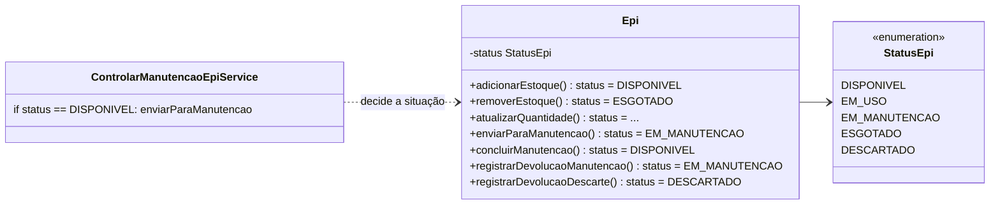

**Depois.** Cada situação declara os destinos; o `Epi` muda de situação por um único ponto.

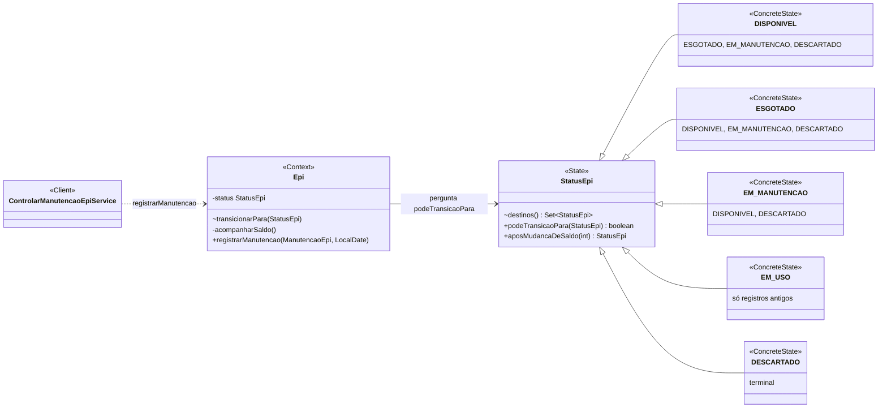

### Código antes × depois

Antes (`Epi`):

```java
// removerEstoque
if (novoSaldo == 0 && this.status == StatusEpi.DISPONIVEL) {
    this.status = StatusEpi.ESGOTADO;
}
// registrarDevolucaoManutencao: sem guarda, inclusive a partir de DESCARTADO
if (this.quantidade == 0) {
    this.status = StatusEpi.EM_MANUTENCAO;
}
```

Depois (`StatusEpi` e `Epi`):

```java
ESGOTADO {
    @Override
    Set<StatusEpi> destinos() {
        return EnumSet.of(DISPONIVEL, EM_MANUTENCAO, DESCARTADO);
    }

    @Override
    public StatusEpi aposMudancaDeSaldo(int saldo) {
        return saldo > 0 ? DISPONIVEL : this;
    }
},
...
void transicionarPara(StatusEpi novoStatus) {
    if (novoStatus == this.status) {
        return;
    }
    if (this.status != null && !this.status.podeTransicaoPara(novoStatus)) {
        throw new TransicaoStatusEpiInvalidaException(this.codigoEPI, this.status, novoStatus);
    }
    this.status = novoStatus;
}

private void acompanharSaldo() {
    if (this.status != null) {
        transicionarPara(this.status.aposMudancaDeSaldo(this.quantidade));
    }
}
```

Caso de uso, antes e depois (`ControlarManutencaoEpiService.concluirManutencao`):

```java
// antes: a aplicação decidia a situação
if (epi.getStatus() == StatusEpi.DISPONIVEL) {
    epi.enviarParaManutencao(dataReferencia);
}
...
epi.concluirManutencao(manutencao);

// depois: o Epi decide
epi.registrarManutencao(manutencao, dataReferencia);
```

### Benefício

As regras de situação do EPI estão numa tabela só, que se lê de uma vez e que os testes percorrem por inteiro (25 pares). Uma situação nova ou uma transição nova muda uma constante do enum, e não meia dúzia de `if` espalhados. Ficou mais seguro: um EPI descartado não volta mais à manutenção por uma devolução, e qualquer transição não prevista é recusada com uma mensagem clara em vez de gravada em silêncio. O caso de uso de manutenção deixou de conhecer as situações do EPI.

### Métricas locais

| Métrica | Antes | Depois |
| --- | ---: | ---: |
| Atribuições a `status` no `Epi` fora do construtor | 8 | 1 (`transicionarPara`) |
| Métodos com regras de transição de `StatusEpi` espalhadas | 8 | 0 |
| Casos de uso que decidem a situação do EPI | 1 | 0 |
| Transições sem guarda | 2 | 0 |
| Valores do enum / migrações novas | 5 / — | 5 / 0 |

A única outra atribuição é a do construtor, que define a situação inicial (não é uma transição). Medição por busca no código de `backend/src/main`.

### Evidências

Testes novos:

1. `StatusEpiTest` (papéis State e ConcreteState; 44 casos): todos os 25 pares origem × destino conferidos com a tabela acima; nenhuma situação vai para `null` nem para `EM_USO`; `DESCARTADO` é terminal; `aposMudancaDeSaldo` para cada situação; a situação depois do saldo é sempre uma transição permitida.
2. `EpiTransicaoStatusTest` (papel Context; 13 casos): transição permitida muda a situação; proibida lança `TransicaoStatusEpiInvalidaException` e não muda nada; pedir a mesma situação não muda nada; devolução para manutenção de EPI descartado é recusada; devolução com saldo zero leva a manutenção ou a descarte; entrada de estoque não tira o EPI da manutenção; `registrarManutencao` de EPI disponível passa por manutenção e volta se aprovada, e fica em manutenção se reprovada.

Os testes existentes de `EpiTest`, `ControlarManutencaoEpiServiceTest`, `EmprestimoServiceTest` e `EpiServiceTest` passam sem alteração, o que confirma as transições que já existiam.

Suíte existente (`./mvnw clean test` com PostgreSQL externo novo): **1186 testes, 0 falhas, 10 erros**, todos o problema anterior de limpeza entre classes de integração (`DELETE FROM epis` bloqueado por `projecoes_substituicao`), igual à `dev` sem esta mudança.

---

## Factory Method — criação de `Epi`

**Catálogo:** GoF, criacional, exposto por interface.

**Intenção:** criar um `Epi` novo por uma única porta, a interface `FabricaEpi` injetada pelo Spring, que recebe a `EspecificacaoEPI` inteira em vez de campos soltos. A criação da família de relato de ocorrências (`Acidente`/`Incidente`, notificação e auditoria), exigida como Abstract Factory pelo professor, fica na seção [Abstract Factory](#abstract-factory--família-de-relato-de-ocorrências) ([#239](https://github.com/yIuriy/rp-iv-grupo03-safeplace/issues/239)).

**Issue:** [#225](https://github.com/yIuriy/rp-iv-grupo03-safeplace/issues/225).

**Revisão após a avaliação do professor.** A versão anterior da #225 consolidava a criação em métodos **estáticos** (`Epi.novo`, `Epi.reconstituir`). O professor criticou a criação estática com parâmetros soltos, pediu programação orientada a interface e pediu para tirar a validação da criação do objeto. Com o `Epi` como entidade JPA ([#258](https://github.com/yIuriy/rp-iv-grupo03-safeplace/issues/258)), quem reconstitui o EPI lido do banco é o próprio JPA, então a distinção "novo × reconstituído" desaparece e só a criação de um EPI novo precisa de fábrica.

### Problema (antes)

O `Epi` tinha **10 formas de ser criado**: 4 construtores públicos, 5 sobrecargas estáticas de `novo` e 1 `reconstituir`.

- **Semântica escondida:** o mesmo construtor público servia para criar (sem id) e para reconstruir (com id), e o comentário dizia que só o primeiro caso exigia CA válido.
- **Dados inventados:** o construtor reduzido `Epi(int codigoEPI, String localizacao, int quantidade, StatusEpi status)` criava o nome `"EPI-" + id`, o CA `"1"` e a validade de hoje + 1 ano.
- **Parâmetros soltos:** as sobrecargas de `novo` recebiam descrição, estoque mínimo e classificação um a um (até 10 argumentos), embora a `EspecificacaoEPI` já agrupasse esses dados.
- **Criação estática:** o caso de uso chamava `Epi.novo(...)` diretamente, sem poder trocar a forma de criar.

### Papéis do padrão

| Papel no padrão | Elemento no código | Responsabilidade |
| --- | --- | --- |
| Creator | interface `FabricaEpi` (`domain/epi`) | Declarar a única operação de criação: `criar(nome, especificacao, lote, quantidade, vidaUtilDias, localizacao)` |
| ConcreteCreator | `FabricaEpiPadrao`, registrada como `@Bean` em `ServicosDominioConfig` | Montar o `Epi` novo, sem id, com a situação inicial definida pelo saldo; não valida |
| Product | `Epi` | Entidade com o construtor `protected` do JPA e um construtor de pacote usado só pela fábrica |
| Parameter Object | `EspecificacaoEPI` | Agrupar descrição, estoque mínimo e classificação |
| Client | `EpiService.cadastrarEpi` | Receber a `FabricaEpi` por injeção e validar o EPI criado antes do repository |

**A fábrica não valida.** CA, nome, quantidades e status são verificados pelo `EpiValidador` (Chain of Responsibility, #264), que o caso de uso chama antes de `repository.salvar`. A fábrica aceita até um CA vencido, e é o validador que o recusa.

**Testes.** Os testes criavam EPIs pelos construtores posicionais, inclusive em situações de registro já gravado (com id e status). Eles passaram a usar o `EpiDeTeste` (Test Data Builder em `src/test/.../suporte`), que cria o EPI pela `FabricaEpiPadrao`, como a produção, e só simula o id e a situação de um registro lido do banco por reflexão, que em produção são preenchidos pelo JPA.

### Diagramas

**Antes.** Dez portas de entrada, todas públicas e estáticas ou construtores.

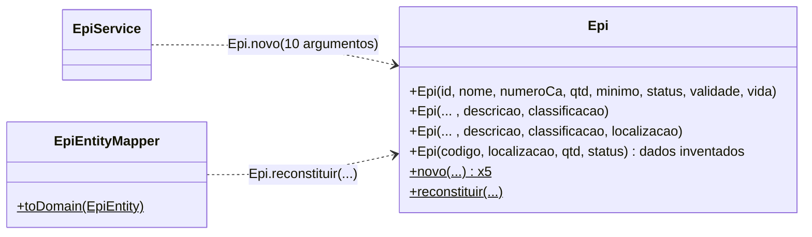

**Depois.** Uma interface de criação injetada; a leitura do banco é do JPA.

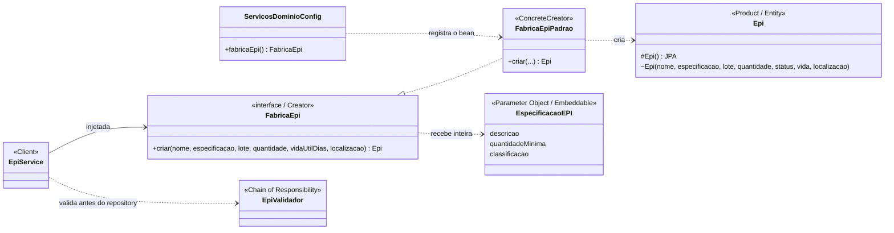

### Código antes × depois

`EpiService.cadastrarEpi`, antes:

```java
Epi novoEpi = Epi.novo(
        inputDTO.nome(),
        lote,
        inputDTO.quantidade(),
        inputDTO.estoqueMinimo(),
        inputDTO.vidaUtilDias(),
        inputDTO.descricao(),
        inputDTO.classificacao(), inputDTO.localizacao());
```

Depois:

```java
EspecificacaoEPI especificacao = new EspecificacaoEPI(
        inputDTO.descricao(), inputDTO.estoqueMinimo(), inputDTO.classificacao());
Epi novoEpi = fabricaEpi.criar(inputDTO.nome(), especificacao, lote, inputDTO.quantidade(),
        inputDTO.vidaUtilDias(), inputDTO.localizacao());
epiValidador.validar(novoEpi);
Epi salvo = repository.salvar(novoEpi);
```

A fábrica:

```java
public class FabricaEpiPadrao implements FabricaEpi {
    @Override
    public Epi criar(String nome, EspecificacaoEPI especificacao, LoteEPI lote, int quantidade,
            Integer vidaUtilDias, String localizacao) {
        StatusEpi situacaoInicial = quantidade > 0 ? StatusEpi.DISPONIVEL : StatusEpi.ESGOTADO;
        return new Epi(nome, especificacao, lote, quantidade, situacaoInicial, vidaUtilDias, localizacao);
    }
}
```

Um teste, antes e depois:

```java
// antes
Epi epi = new Epi(6, "Bota", "CA-600", 5, 1, StatusEpi.EM_USO, LocalDate.of(2030, 1, 1), 365);
// depois
Epi epi = EpiDeTeste.umEpi()
        .comId(6)
        .comNome("Bota")
        .comCa("CA-600")
        .comQuantidade(5)
        .comEstoqueMinimo(1)
        .comStatus(StatusEpi.EM_USO)
        .comValidadeCa(LocalDate.of(2030, 1, 1))
        .comVidaUtilDias(365)
        .build();
```

### Benefício

Há uma única forma de criar um EPI novo, e ela diz o que é: o caso de uso pede à fábrica, e a fábrica não esconde regra de validação nem inventa dados. Como o caso de uso depende da interface `FabricaEpi`, trocar a forma de criar (por exemplo, para registrar o lote com outra política) é trocar o bean, sem mexer no `EpiService`. Não há mais a ambiguidade "com id reconstrói, sem id cria": ler um EPI gravado é do JPA. Nos testes, cada cenário diz só o que importa (`comStatus(EM_USO)`), em vez de oito argumentos posicionais em que um `int` trocado de lugar não dava erro de compilação.

### Métricas locais

| Métrica | Antes (`dev` antes da #225) | Depois |
| --- | ---: | ---: |
| Formas de criar um `Epi` (construtores públicos + métodos estáticos) | 10 | 1 (`FabricaEpi.criar`) |
| Construtores públicos de `Epi` | 4 | 0 (fica o `protected` do JPA e um de pacote para a fábrica) |
| Métodos estáticos de criação em `Epi` | 6 | 0 |
| Construtor com dados inventados | 1 | 0 |
| Maior número de argumentos para criar um `Epi` | 10 | 6 |
| Linhas de teste que criavam `Epi` por construtor ou método estático | 98 | 0 (95 usos de `EpiDeTeste`) |

Medição por busca no código de `backend/src`.

### Evidências

Testes novos:

1. `FabricaEpiPadraoTest` (4 testes; papéis Creator, ConcreteCreator, Product e Parameter Object): a fábrica cria um EPI novo, sem id, guardando a própria instância da `EspecificacaoEPI` e do lote; a situação inicial acompanha o saldo (`DISPONIVEL` ou `ESGOTADO`); a fábrica não valida (CA vencido e mínimo negativo passam, para o validador recusar); o `Epi` não tem construtor público nem método estático que devolva `Epi`.
2. `EpiServiceTest.cadastroCriaOEpiPelaFabricaInjetada` (papel Client): o cadastro usa a fábrica injetada e entrega a ela a especificação montada a partir do `InputDTO`.

Testes ajustados: 31 classes passaram a criar EPIs pelo `EpiDeTeste`. Em `EpiTest` saíram os 4 testes do que deixou de existir (as duas sobrecargas de `novo`, que agora estão em `FabricaEpiPadraoTest`, o construtor público sem id e o construtor reduzido com dados inventados). Os dois testes do `EpiValidadorTest` que recusam status ausente usam `semStatus()`, porque a fábrica nunca cria um EPI sem situação.

Suíte existente (`./mvnw clean test` com PostgreSQL externo novo): **1199 testes, 0 falhas, 10 erros**, todos o problema anterior de limpeza entre classes de integração (`DELETE FROM epis` bloqueado por `projecoes_substituicao`).

---

## Factory Method — criação de capacitação (`FabricaCapacitacao`)

**Catálogo:** GoF, criacional, exposto por interface.

**Intenção:** expor a criação de `Certificacao`, `Treinamento` e `ExigenciaCapacitacao` pela interface `FabricaCapacitacao`, recebendo os objetos de entrada (`InputDTO`) inteiros para que o caso de uso não desmonte os dados nem chame métodos estáticos ou construtores diretamente.

**Issue:** [#268](https://github.com/yIuriy/rp-iv-grupo03-safeplace/issues/268) (depende de [#257](https://github.com/yIuriy/rp-iv-grupo03-safeplace/issues/257) e [#265](https://github.com/yIuriy/rp-iv-grupo03-safeplace/issues/265)).

**Revisão após a avaliação do professor.** Na avaliação presencial (`docs/revisões/alinhamento-avaliacao-professor.md`), o professor marcou `CadastrarCapacitacaoService.java:40`: a operação de cadastro era estática (`Certificacao.cadastrar(...)`) e recebia parâmetros soltos desmontados do `InputDTO`. O mesmo ocorria com `Treinamento.cadastrar(...)` (6 e 7 parâmetros) e com a instanciação direta `new ExigenciaCapacitacao(null, entrada.nomeCapacitacao(), ...)`.

### Problema (antes)

- `CadastrarCapacitacaoService` desmontava `CadastrarCertificacaoInputDTO` em 4 argumentos soltos e chamava o método estático `Certificacao.cadastrar(...)`.
- O mesmo serviço desmontava `CadastrarTreinamentoInputDTO` em 6 argumentos soltos e chamava `Treinamento.cadastrar(...)` (que possuía duas sobrecargas estáticas em `Treinamento.java`).
- Para exigências, o serviço desmontava `DefinirExigenciaInputDTO` e invocava `new ExigenciaCapacitacao(null, ...)` diretamente.

### Papéis do padrão

| Papel no padrão | Elemento no código | Responsabilidade |
| --- | --- | --- |
| Creator | interface `FabricaCapacitacao` (`domain/capacitacao`) | Declarar um método por produto (`criarCertificacao`, `criarTreinamento`, `criarExigencia`), cada um recebendo o objeto de entrada inteiro |
| ConcreteCreator | `FabricaCapacitacaoPadrao`, registrada como `@Bean` em `ServicosDominioConfig` | Instanciar `Certificacao`, `Treinamento` e `ExigenciaCapacitacao` a partir dos DTOs de entrada e associações resolvidas, sem validar regras de negócio |
| Products | `Certificacao`, `Treinamento`, `ExigenciaCapacitacao` | Entidades JPA do domínio de capacitação, sem métodos estáticos de criação |
| Client | `CadastrarCapacitacaoService` | Receber `FabricaCapacitacao` via interface, repassar o `InputDTO` inteiro e validar o produto na cadeia antes de `capacitacaoRepository.salvar` |

### Diagramas

**Antes.** O caso de uso desmontava os DTOs de entrada e acoplava-se a métodos estáticos de criação e ao construtor.

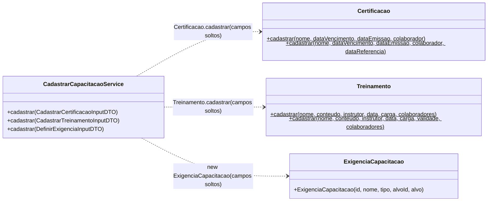

**Depois.** O caso de uso depende apenas da interface `FabricaCapacitacao` (Creator) e entrega o objeto de entrada inteiro.

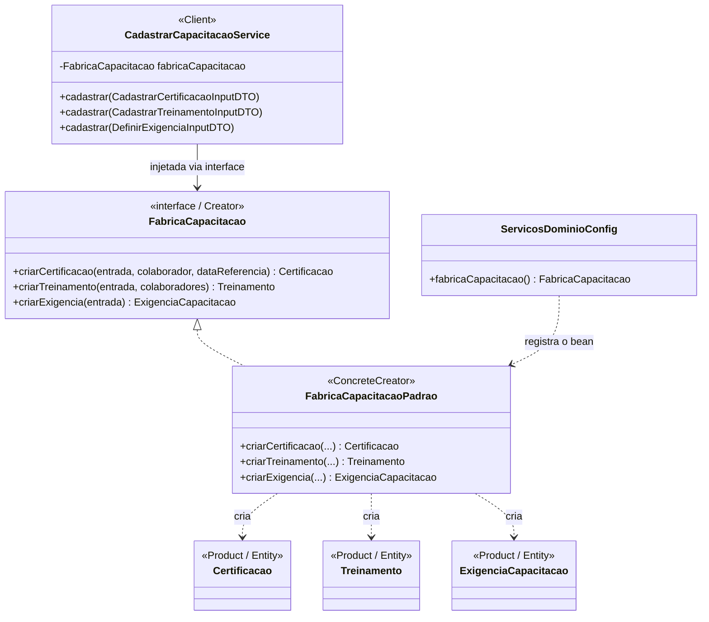

### Código antes × depois

`CadastrarCapacitacaoService`, antes:

```java
// Certificação: método estático desmontando o InputDTO
Certificacao nova = Certificacao.cadastrar(
        entrada.nome(), entrada.dataVencimento(), entrada.dataEmissao(), colaborador, hoje);

// Treinamento: método estático com 7 parâmetros soltos
Treinamento novo = Treinamento.cadastrar(entrada.nome(), entrada.conteudo(), entrada.instrutor(),
        entrada.dataRealizacao(), entrada.cargaHoraria(), entrada.validadeMeses(), colaboradores);

// Exigência: construtor direto desmontando o InputDTO
ExigenciaCapacitacao exigencia = new ExigenciaCapacitacao(null, entrada.nomeCapacitacao(),
        entrada.tipoCapacitacao(), entrada.alvoId(), entrada.alvo());
```

Depois:

```java
// O serviço repassa o objeto de entrada inteiro para a fábrica injetada pela interface
Certificacao nova = fabricaCapacitacao.criarCertificacao(entrada, colaborador, hoje);

Treinamento novo = fabricaCapacitacao.criarTreinamento(entrada, colaboradores);

ExigenciaCapacitacao exigencia = fabricaCapacitacao.criarExigencia(entrada);
```

### Benefício

O caso de uso `CadastrarCapacitacaoService` ficou mais simples e coeso por não desmontar mais os três DTOs de entrada em listas de argumentos posicionais nem conhecer construtores ou métodos estáticos das entidades: ele apenas resolve as associações, delega a montagem à `FabricaCapacitacao`, aciona os validadores da camada `validacao` (#265) e persiste no repositório. Ficou mais seguro e fácil de evoluir porque novos atributos nos DTOs de cadastro são absorvidos num único ponto (`FabricaCapacitacaoPadrao`), sem alterar a assinatura dos métodos da fábrica nem o código do serviço.

### Métricas locais

| Métrica | Antes | Depois |
| --- | ---: | ---: |
| Métodos estáticos de criação em `domain/capacitacao` | 4 (`Certificacao.cadastrar` x2, `Treinamento.cadastrar` x2) | **0** |
| Pontos em `CadastrarCapacitacaoService` que desmontam `InputDTO` para construir entidades | 3 | **0** |
| Maior lista de argumentos passada pelo serviço na criação | 7 | **3** (`entrada`, `colaborador`, `hoje`) |

### Evidências

Testes novos:

1. `FabricaCapacitacaoPadraoTest` (6 testes; papéis Creator, ConcreteCreator e Products): criação de `Certificacao`, `Treinamento` e `ExigenciaCapacitacao` a partir dos `InputDTO`s inteiros, verificação de que a fábrica não executa regras de validação de negócio, recusa de entrada nula e verificação por reflexão garantindo que nenhuma classe de `domain/capacitacao` possui métodos estáticos de criação.
2. `CadastrarCapacitacaoServiceTest.delegaCriacaoAFabricaInjetadaSemDesmontarInputDTO` (papel Client): verifica que o serviço delega a criação dos três produtos à `FabricaCapacitacao` injetada repassando a mesma instância de cada `InputDTO`.

Suíte de testes de capacitação (`FabricaCapacitacaoPadraoTest`, `CadastrarCapacitacaoServiceTest`, `ConsultarCapacitacaoServiceTest`, `CertificacaoVencimentoClockTest`, `TreinamentoTest`, `CapacitacaoValidadoresTest`): **59 testes executados, 0 falhas, 0 erros**.

---

## Abstract Factory — família de relato de ocorrências

**Catálogo:** GoF, criacional, exposto por interface.

**Intenção:** fornecer uma interface para criar famílias de objetos relacionados ou dependentes (a entidade de ocorrência, a notificação correspondente ao gestor e a descrição para auditoria) sem especificar suas classes concretas.

**Issue:** [#239](https://github.com/yIuriy/rp-iv-grupo03-safeplace/issues/239).

**Revisão após a avaliação do professor.** A versão anterior do projeto utilizava métodos estáticos e cogitava Factory Method simples. O professor questionou diretamente `Acidente.java:64-92`: *"Singleton? Por que é estático?"*. Resposta registrada: o trecho não era um Singleton, mas sim uma fábrica estática (`Acidente.novo`) com 10 parâmetros soltos que repassava para um construtor de 16 parâmetros. O professor exigiu **Abstract Factory** (um dos dois padrões obrigatórios), orientado a interfaces, com a passagem do objeto de entrada inteiro (`InputDTO`) e sem validações de negócio no construtor de domínio.

### Problema (antes)

Antes da aplicação do padrão:
- `Acidente.novo(...)` e `Incidente.novo(...)`: métodos estáticos com até 10 parâmetros soltos.
- A decisão de família entre `Acidente` e `Incidente` estava fragmentada e repetida:
  - No registro: `OcorrenciaService.registrarAcidente` e `registrarIncidente` montavam objetos manualmente;
  - Na notificação: `NotificacaoOcorrencia.deNovoRelato` continha `instanceof Acidente` para decidir se incluía ou não o protocolo CAT;
  - Na auditoria: `instanceof` para decidir a entidade e a descrição de cadastro;
  - No assembler e no filtro: checagens manuais de tipo.
- Não havia garantia em tempo de compilação de que a ocorrência, a notificação com/sem CAT e a descrição de auditoria combinavam entre si.

### Papéis do padrão

| Papel no padrão | Elemento no código | Responsabilidade |
| --- | --- | --- |
| AbstractFactory | interface `FabricaRelatoOcorrencia<I, O>` (`domain/ocorrencia`) | Declarar a criação da família: `criarOcorrencia`, `criarNotificacao`, `descricaoAuditoria` e `entidadeAuditoria` |
| ConcreteFactory (Acidente) | `FabricaRelatoAcidente` (`domain/ocorrencia`) | Instanciar `Acidente` (com CAT), `NotificacaoOcorrencia` (com protocolo) e descritor de auditoria de acidente |
| ConcreteFactory (Incidente) | `FabricaRelatoIncidente` (`domain/ocorrencia`) | Instanciar `Incidente` (sem CAT), `NotificacaoOcorrencia` (sem CAT) e descritor de auditoria de incidente |
| AbstractProduct A | `Ocorrencia` (`public abstract class`, com `getTipoOcorrencia()` abstrato) | Raiz da hierarquia de ocorrências |
| ConcreteProduct A1 | `Acidente` (`public class Acidente extends Ocorrencia`) | Produto concreto com gravidade, causa raiz e protocolo CAT |
| ConcreteProduct A2 | `Incidente` (`public class Incidente extends Ocorrencia`) | Produto concreto com situação de risco e potencial de dano |
| AbstractProduct B | `NotificacaoOcorrencia` | Alerta interno ao Gestor de Segurança |
| AbstractProduct C | Descrição e nome de entidade de auditoria (`String`) | Trilha de auditoria (RNF05) consistente por tipo |
| Client | `OcorrenciaService` (`application/usecase`) | Receber as fábricas injetadas via interface/mapa e delegar a criação da família sem `instanceof` |

### Diagramas

**Antes.** Métodos estáticos com múltiplos parâmetros e `instanceof` espalhado.

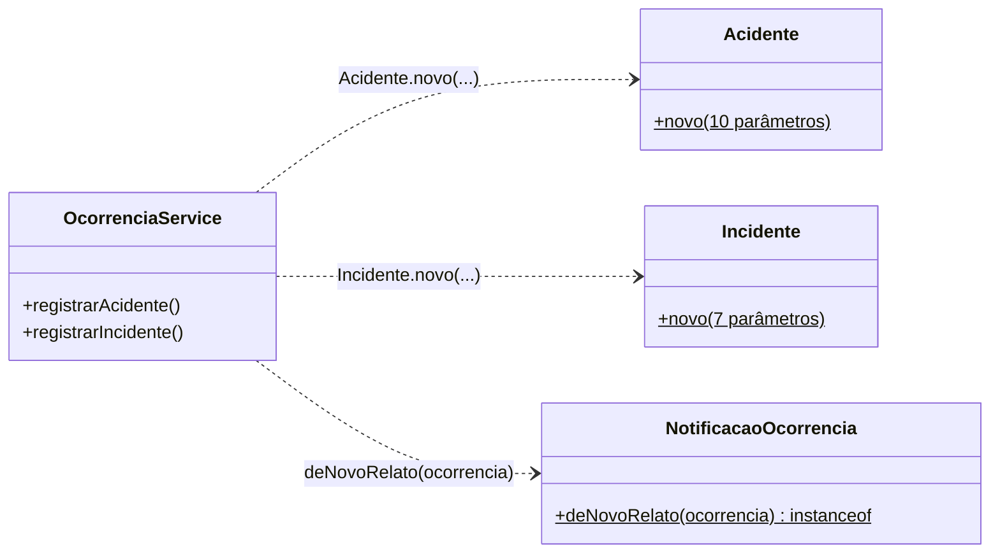

**Depois.** Abstract Factory orientada a interface produzindo a família completa de produtos.

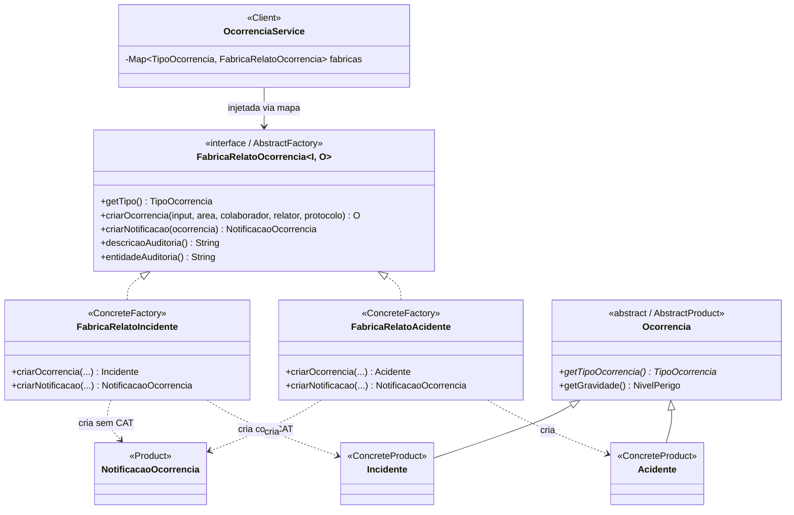

### Código antes × depois

Criação no caso de uso, antes:

```java
// antes: criação acoplada com parâmetros soltos e auditoria manual
Acidente acidente = new Acidente(null, inputDTO.descricao(), ... , 16 argumentos);
auditoria.cadastro("Acidente", salvo.getId(), "Registro de Acidente de Trabalho");
notificadorOcorrencia.notificarGestor(salvo); // NotificacaoOcorrencia.deNovoRelato usava instanceof
```

Depois:

```java
// depois: família criada pela fábrica concreta sem instanceof
FabricaRelatoOcorrencia<RegistrarAcidenteInputDTO, Acidente> fabrica =
        (FabricaRelatoOcorrencia<RegistrarAcidenteInputDTO, Acidente>) fabricas.get(TipoOcorrencia.ACIDENTE);

Acidente acidente = fabrica.criarOcorrencia(inputDTO, area, colaborador, relatorAutenticado(), numeroProtocolo);
validador.validar(acidente);
Acidente salvo = repository.salvarAcidente(acidente);

auditoria.cadastro(fabrica.entidadeAuditoria(), salvo.getId(), fabrica.descricaoAuditoria());
notificadorOcorrencia.notificarGestor(salvo);
```

Criação da notificação, antes:

```java
// antes: NotificacaoOcorrencia inspecionava com instanceof
TipoOcorrencia tipo = ocorrencia instanceof Acidente ? TipoOcorrencia.ACIDENTE : TipoOcorrencia.INCIDENTE;
NumeroProtocoloCAT protocolo = ocorrencia instanceof Acidente acidente ? acidente.getProtocoloCAT() : null;
```

Depois:

```java
// depois: delegada à fábrica correspondente ao tipo de ocorrência
FabricaRelatoOcorrencia<?, ?> fabrica = fabricas.get(ocorrencia.getTipoOcorrencia());
NotificacaoOcorrencia notificacao = fabrica.criarNotificacao(ocorrencia);
```

### Benefício

A criação de um relato agora produz uma família garantidamente consistente de objetos (entidade de domínio, notificação interna e texto de auditoria), eliminando métodos estáticos com dezenas de parâmetros soltos e extinguindo todo `instanceof` de `Acidente` e `Incidente` nas camadas de domínio e aplicação. Adicionar ou modificar regras de um novo tipo de relato exige apenas implementar uma nova fábrica concreta, sem tocar nas rotinas de auditoria, notificação ou orquestração do caso de uso. A hierarquia chegou a ser declarada `sealed`, mas foi reaberta no commit `01a0d18`: o Hibernate gera proxies como subclasses em tempo de execução, o que uma classe `sealed` não admite. A correspondência entre tipos, subclasses e fábricas passou a ser garantida por `getTipoOcorrencia()` abstrato, pelo enum `TipoOcorrencia`, pelo mapa de fábricas por tipo em `OcorrenciaService` e pelo teste `OcorrenciaOutputAssemblerTest.todoTipoDeOcorrenciaTemFabricaESubclasse`. Os `switch` por tipo mantêm um ramo `default`, que não é alcançado porque nenhuma associação aponta para `Ocorrencia` (logo não surge proxy da classe base).

### Métricas locais

| Métrica | Antes | Depois |
| --- | ---: | ---: |
| `instanceof Acidente` em `domain/` e `application/` | 8 | 0 |
| `instanceof Incidente` em `domain/` e `application/` | 5 | 0 |
| Métodos estáticos de criação em `domain/ocorrencia` | 3 (`Acidente.novo`, `Incidente.novo`, `NotificacaoOcorrencia.deNovoRelato`) | 0 |
| Maior quantidade de parâmetros soltos na criação de ocorrência | 16 | 5 (objeto `InputDTO` inteiro + associações obrigatórias) |
| Hierarquia de `Ocorrencia` | `abstract class` sem tipo declarado | `abstract class` com `getTipoOcorrencia()` abstrato e uma fábrica por `TipoOcorrencia` (`sealed` revertido por causa dos proxies do Hibernate) |

### Evidências

Testes novos:
1. `FabricaRelatoAcidenteTest` (5 testes): valida a criação de `Acidente` a partir do `InputDTO` inteiro, emissão de `NotificacaoOcorrencia` com número CAT e strings de auditoria da família.
2. `FabricaRelatoIncidenteTest` (5 testes): valida a criação de `Incidente`, notificação sem CAT e strings de auditoria correspondentes.

Suíte do backend:
- `1304 testes, 0 falhas, 0 erros` (`./mvnw test`).

---

## Builder — `Emprestimo.Builder`, `TarefaBuilder` e builders de ocorrência

**Catálogo:** GoF, criacional.

**Intenção:** separar a construção de entidades complexas da sua representação. Permite compor objetos com argumentos nomeados e opcionais sem recorrer a construtores telescópicos, argumentos posicionais do mesmo tipo ou longas listas de `null`. A entrega do UC12 é montada por `Emprestimo.Builder`, a gestão de tarefas por `TarefaBuilder`, e os relatos de ocorrência por `AcidenteBuilder` e `IncidenteBuilder`.

**Issues:** [#226](https://github.com/yIuriy/rp-iv-grupo03-safeplace/issues/226) (parte 1, aplicada: `Emprestimo`) e [#240](https://github.com/yIuriy/rp-iv-grupo03-safeplace/issues/240) (parte 2, aplicada: `Tarefa`, `Acidente` e `Incidente`).

**Revisão após a avaliação do professor.** A versão original criava Builders apenas em `src/test`. Na avaliação presencial (`docs/revisões/alinhamento-avaliacao-professor.md`), o professor solicitou avaliar o padrão Builder **no código de produção** para objetos complexos. Na [#226](https://github.com/yIuriy/rp-iv-grupo03-safeplace/issues/226), `Emprestimo` recebeu `Emprestimo.Builder` interno. Na [#240](https://github.com/yIuriy/rp-iv-grupo03-safeplace/issues/240), `Tarefa` (que possuía 4 construtores e aliases redundantes) e `Acidente`/`Incidente` (com construtores posicionais de 16 e 12 parâmetros) ganharam Builders em `src/main`, utilizados pelas fábricas da [#239](https://github.com/yIuriy/rp-iv-grupo03-safeplace/issues/239), pelos serviços de aplicação e reaproveitados nos testes.

### Problema (antes)

- **`Emprestimo` (parte 1):** `Emprestimo.registrarEntrega(...)`: método estático com 7 parâmetros delegando para um construtor público de 12 parâmetros preenchido com 4 `null`.
- **`Tarefa` (parte 2):** possuía 4 construtores públicos e métodos utilitários/aliases redundantes (`associarEPIs`, `verificarEPIsObrigatoriosTarefa`). Quem criava escolhia entre os construtores sem critério uniforme.
- **`Acidente` e `Incidente` (parte 2):** construtores de 16 e 12 parâmetros posicionais, com sequências de `null` (relator, local, planoDeAcao, protocolo CAT), repetidos em dezenas de testes de persistência, auditoria, notificação e validação.

### Papéis do padrão

| Papel no padrão | Elemento no código | Responsabilidade |
| --- | --- | --- |
| Builder | `Emprestimo.Builder` (`src/main`, classe aninhada) | Receber cada dado da entrega por método nomeado e montar o `Emprestimo` em `build()` |
| Builder | `TarefaBuilder` (`src/main`, com alias `Tarefa.Builder`) | Compor atributos da tarefa (descrição, nível de perigo, data/responsável de classificação, área, setores e EPIs) e instanciar `Tarefa` |
| Builder | `OcorrenciaBuilder` (`src/main`, classe base abstrata) | Centralizar atributos comuns de ocorrência (id, descrição, data, status, colaborador, área, relator, local, plano) e eliminar construtores telescópicos na superclasse `Ocorrencia` |
| Builder | `AcidenteBuilder` (`src/main`, herda de `OcorrenciaBuilder`, com alias `Acidente.Builder`) | Compor atributos próprios de acidente (causa raiz, CAT, gravidade, tipo, dano, destino) e delegar atributos comuns via `super(builder)` |
| Builder | `IncidenteBuilder` (`src/main`, herda de `OcorrenciaBuilder`, com alias `Incidente.Builder`) | Compor atributos próprios de incidente (situação de risco e potencial de dano) e delegar atributos comuns via `super(builder)` |
| Director | `EmprestimoService.registrarEntrega` | Orquestrar a montagem do empréstimo a partir do DTO e entidades de apoio |
| Director | `TarefaService` (`cadastrarTarefa`, `atualizarTarefa`) | Montar a tarefa via `TarefaBuilder` a partir de `CadastrarTarefaInputDTO` / `AtualizarTarefaInputDTO` |
| Director | `FabricaRelatoAcidente.criarOcorrencia` | Montar o `Acidente` via `AcidenteBuilder` a partir do `RegistrarAcidenteInputDTO` |
| Director | `FabricaRelatoIncidente.criarOcorrencia` | Montar o `Incidente` via `IncidenteBuilder` a partir do `RegistrarIncidenteInputDTO` |
| Director | `OcorrenciaService.atualizarOcorrencia` | Reconstruir `Acidente` e `Incidente` atualizados via seus respectivos Builders |
| Director | Testes unitários e de integração | Atuam como Directors especializados montando cenários de teste fluentes e legíveis |
| Product | `Emprestimo`, `Tarefa`, `Acidente`, `Incidente` | Entidades de domínio complexas com construtores que recebem seus Builders |
| Test Data Builder | `EmprestimoDeTeste`, `EpiDeTeste` (`src/test/.../suporte`) | Reaproveitar os Builders de produção nos testes e simular campos gerenciados por banco/JPA |

**O Builder não valida.** Conforme o critério de aceite, o Builder não contém regras de validação nem bloqueia dados parciais. As validações de negócio rodam estritamente na camada `validacao` (`EmprestimoValidador`, `TarefaValidador`, `OcorrenciaValidador`, `ProtocoloCATValidador`), garantindo que cenários inválidos possam ser montados nos testes para exercitar as cadeias de validação.

### Diagramas

**Antes.**

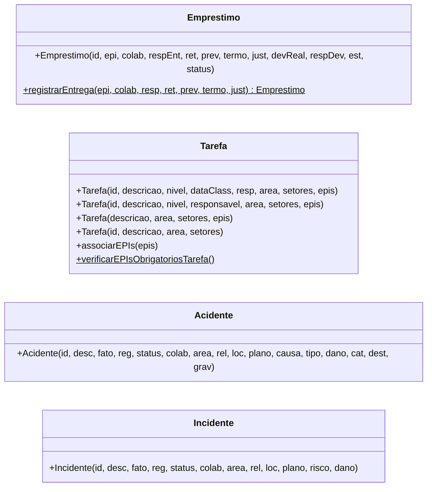

**Depois.**

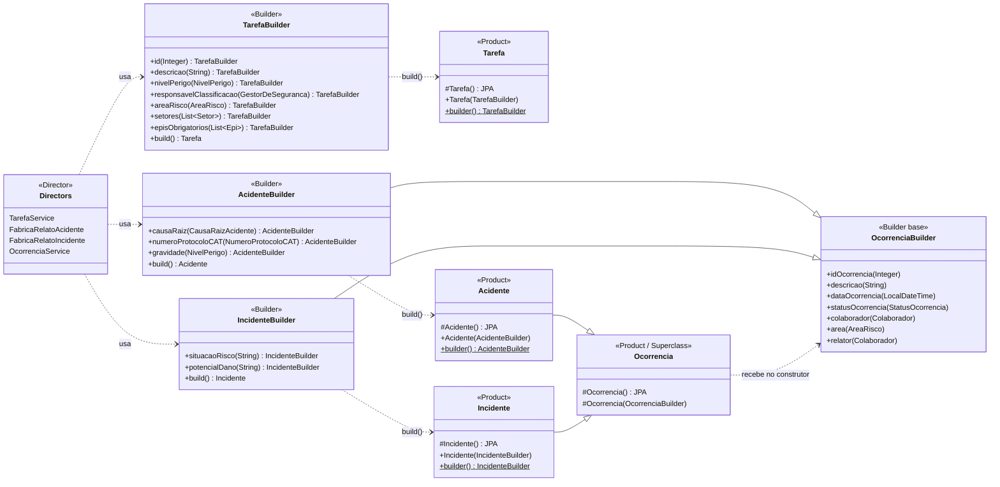

### Código antes × depois

`TarefaService.cadastrarTarefa`, antes:

```java
// antes: construtor longo de 8 argumentos posicionais
Tarefa novaTarefa = new Tarefa(
        null,
        inputDTO.descricao(),
        nivelPerigo,
        dataClassificacao,
        gestor,
        areaRisco,
        setores,
        epis
);
```

Depois:

```java
// depois: construção nomeada e fluente com TarefaBuilder
Tarefa novaTarefa = new TarefaBuilder()
        .descricao(inputDTO.descricao())
        .nivelPerigo(nivelPerigo)
        .responsavelClassificacao(gestor)
        .areaRisco(areaRisco)
        .setores(setores)
        .episObrigatorios(epis)
        .build();
```

`FabricaRelatoAcidente.criarOcorrencia`, antes:

```java
// antes: construtor posicional de 16 parâmetros com múltiplos nulls
return new Acidente(
        null,
        input.descricao(),
        input.dataOcorrencia(),
        LocalDateTime.now(),
        StatusOcorrencia.ABERTA,
        colaborador,
        area,
        relator,
        null,
        null,
        causaRaiz,
        input.tipo(),
        input.dano(),
        protocolo,
        input.destino(),
        gravidade
);
```

Depois:

```java
// depois: composição fluente com AcidenteBuilder
return new AcidenteBuilder()
        .descricao(input.descricao())
        .dataOcorrencia(input.dataOcorrencia())
        .dataRegistro(LocalDateTime.now())
        .statusOcorrencia(StatusOcorrencia.ABERTA)
        .colaborador(colaborador)
        .area(area)
        .relator(relator)
        .causaRaiz(causaRaiz)
        .tipo(input.tipo())
        .dano(input.dano())
        .numeroProtocoloCAT(protocolo)
        .destino(input.destino())
        .gravidade(gravidade)
        .build();
```

Montagem de cenário em testes de ocorrência, antes e depois:

```java
// antes: 16 argumentos posicionais
new Acidente(1, "Desc", fato, fato, StatusOcorrencia.ABERTA, null, area, null,
        null, null, CausaRaizAcidente.FALHA_EPI, null, null, protocolo, null, NivelPerigo.ALTO);

// depois: apenas os atributos relevantes ao teste
Acidente.builder()
        .idOcorrencia(1)
        .descricao("Desc")
        .dataOcorrencia(fato)
        .area(area)
        .causaRaiz(CausaRaizAcidente.FALHA_EPI)
        .numeroProtocoloCAT(protocolo)
        .gravidade(NivelPerigo.ALTO)
        .build();
```

### Benefício

A instanciação de entidades complexas como `Emprestimo`, `Tarefa`, `Acidente` e `Incidente` foi completamente padronizada. Cada dado passa por um método nomeado, eliminando erros silenciosos por inversão de tipos idênticos (como IDs, datas ou descrições) e tornando desnecessário preencher longas sequências de `null` para atributos opcionais. Os construtores telescópicos de 12 e 16 parâmetros foram eliminados do código, e o número de construtores de `Tarefa` foi reduzido de 4 para 3, removendo aliases e métodos utilitários sem uso. Nos testes, a montagem de cenários ganhou clareza, pois apenas os atributos pertinentes a cada asserção precisam ser declarados.

### Métricas locais

| Métrica | Antes (`dev` antes de #226 e #240) | Depois |
| --- | ---: | ---: |
| Maior número de argumentos posicionais para criar `Emprestimo` | 12 | 0 |
| Construtores públicos de `Tarefa` | 4 | 3 (Builder, 5-args, 4-args) |
| Métodos/aliases sem uso em `Tarefa` (`associarEPIs`, `verificarEPIsObrigatoriosTarefa`) | 2 | 0 (removidos) |
| Construtores protegidos de 9 ou 10 parâmetros na superclasse `Ocorrencia` | 2 | 0 (substituídos por `Ocorrencia(OcorrenciaBuilder)`) |
| Chamadas a construtores de 10, 12 ou 16 parâmetros em `backend/src` | 40 | 0 (construtores longos eliminados) |
| Builders em código de produção (`src/main`) | 0 | 5 (`Emprestimo.Builder`, `TarefaBuilder`, `OcorrenciaBuilder`, `AcidenteBuilder`, `IncidenteBuilder`) |
| `null` posicionais necessários na criação de um relato | até 6 | 0 (atributos ausentes mantêm valores padrão) |

### Evidências

Testes novos de Builders:
1. `EmprestimoBuilderTest` (5 testes): montagem fluente da entrega com dados nomeados, nascimento no estado ativo (`INDISPONIVEL`), independência entre instâncias e montagem não validadora.
2. `TarefaBuilderTest` (3 testes): montagem completa com coleções e objetos de domínio, atribuição automática de data de classificação e comportamento não validador.
3. `OcorrenciaBuilderTest` (2 testes): inicialização completa de todos os atributos comuns na superclasse `Ocorrencia` via builder e garantia de zero construtores telescópicos com 5 ou mais parâmetros.
4. `AcidenteBuilderTest` (3 testes): montagem completa com protocolo CAT e causa raiz, valores padrão de status e data de registro, e comportamento não validador.
5. `IncidenteBuilderTest` (3 testes): montagem completa com situação de risco e potencial de dano, valores padrão de status e data de registro, e comportamento não validador.

Papel Director validado nos serviços de domínio e aplicação:
- `EmprestimoServiceTest`, `TarefaServiceTest`, `FabricaRelatoAcidenteTest`, `FabricaRelatoIncidenteTest`, `OcorrenciaServiceTest`.

Suíte de testes do backend:
- `1390 testes, 0 falhas, 0 erros` (`./mvnw test`).

---

## Null Object — adaptador nulo de notificação e dependências opcionais

**Catálogo:** Woolf (PLoPD 3), comportamental.

**Intenção:** fornecer implementações neutras para portas opcionais (`NotificadorOcorrenciaNulo`, `OperadorAutenticadoNulo`), eliminando construtores secundários que repassam `null` e checagens `!= null` nos casos de uso.

**Issues:** [#227](https://github.com/yIuriy/rp-iv-grupo03-safeplace/issues/227) (parte 1) e [#241](https://github.com/yIuriy/rp-iv-grupo03-safeplace/issues/241) (parte 2), ambas aplicadas.

**Nome da classe nula:** a issue #227 e o esqueleto desta seção usavam `NotificacaoOcorrenciaNula`. Depois da [#269](https://github.com/yIuriy/rp-iv-grupo03-safeplace/issues/269), a porta passou a se chamar `NotificadorOcorrencia`, e `NotificacaoOcorrencia` já é a classe de domínio da notificação gravada. Por isso a classe nula se chama `NotificadorOcorrenciaNulo`: o nome segue a porta que ela implementa e não se confunde com o registro de domínio.

### Problema (antes)

**Parte 1 ([#227](https://github.com/yIuriy/rp-iv-grupo03-safeplace/issues/227)).** `OcorrenciaService` recebia a porta `NotificadorOcorrencia` com `@Autowired(required = false)`. A ausência do notificador chegava ao caso de uso como `null`, e o fluxo de negócio decidia o que fazer:

- `registrarAcidente` e `registrarIncidente` testavam `if (notificadorOcorrencia != null)` antes de notificar;
- um construtor de 4 parâmetros repassava `null` explicitamente ao construtor principal;
- quem escrevesse um novo fluxo de relato e esquecesse o `if` causaria um `NullPointerException`.

**Parte 2 ([#241](https://github.com/yIuriy/rp-iv-grupo03-safeplace/issues/241)).** Quatro casos de uso tinham construtores telescópicos que repassavam `null` para uma dependência "opcional", e cada `null` virava um `if` mais adiante:

| Caso de uso | Construtor que repassava `null` | Checagens decorrentes |
| --- | --- | --- |
| `UsuarioService` | `this(..., logAuditoriaRepository, null)` (sem operador) | `operadorAutenticado != null ? ... : new OperadorAutenticado() { ... }`, um Null Object improvisado como classe anônima |
| `EmprestimoService` | `this(..., auditoria, null)` (sem repositório de manutenções) | `if (manutencoes != null)` na devolução para manutenção |
| `TarefaService` | `this(..., setorRepository, null)` e `this(..., null, null, null)` | `if (epiRepository == null) return List.of();` e `usuarioRepositorio != null` |
| `PlanoDeAcaoService` | `this(..., notificadorAcao, null)`, com `@Autowired(required = false)` na consulta de ocorrências | `if (consultaOcorrencia != null)` com caminho alternativo pelo repositório, e quatro `usuarioRepository`/`setorRepository != null` |

Em produção nenhuma dessas dependências é ausente: o Spring sempre injeta todas. Os construtores curtos existiam só para os testes, mas abriam caminhos de código que a aplicação real nunca percorre.

### Por que Null Object

O padrão troca o "não há notificador" por um objeto que implementa a mesma interface e não faz nada. O caso de uso passa a chamar a porta sempre, sem condição. A decisão "notificar ou não" sai do fluxo de negócio e vai para a montagem dos objetos: em produção o Spring injeta o adaptador real; quem não quer notificação (por exemplo, um teste) entrega o objeto nulo.

O `NotificadorOcorrenciaNulo` não é um bean do Spring. Se fosse, o contexto teria duas implementações da mesma porta e a injeção ficaria ambígua. Ele fica em `adapters/out/notificacao`, ao lado do adaptador real, porque também é uma implementação da porta de saída.

**Onde o objeto nulo não se aplica (#241).** O padrão só vale quando "não fazer nada" é um comportamento correto. Isso acontece com o operador autenticado: sem sessão, não há identificador nem papel, e a auditoria registra `SISTEMA`. Por isso existe o `OperadorAutenticadoNulo`. Já para `ManutencaoEpiRepository`, `EpiRepository`, `UsuarioRepository`, `SetorRepository` e `GerenciarOcorrenciaUseCase`, um objeto que não faz nada perderia dados em silêncio (a manutenção da devolução não seria gravada) ou pularia uma regra (a visibilidade do plano para o Supervisor, issue #100). Nesses casos, a dependência passou a ser obrigatória (`requireNonNull`) e os testes informam um dublê explícito.

**Construtores que continuam.** Cada caso de uso ainda tem um segundo construtor que monta os validadores padrão da camada `validacao` (Chain of Responsibility, #228) para os testes sem Spring. Ele não repassa `null`: entrega objetos reais. Por isso ficou fora do escopo, que é eliminar os `this(..., null)`.

### Papéis do padrão

| Papel no padrão | Elemento no código | Responsabilidade |
| --- | --- | --- |
| AbstractObject | `NotificadorOcorrencia`, `OperadorAutenticado` | Contratos das portas de saída |
| RealObject | `NotificacaoOcorrenciaInternaAdapter`, `SpringSecurityOperadorAutenticadoAdapter` | Implementações reais das portas |
| NullObject | `NotificadorOcorrenciaNulo` (#227), `OperadorAutenticadoNulo` (#241) | Implementações neutras sem efeito colateral |
| Client | `OcorrenciaService` (#227); `EmprestimoService`, `PlanoDeAcaoService`, `TarefaService`, `UsuarioService` (#241) | Invocar as portas sem testar `!= null` |

### Diagramas

**Antes (#227).** A porta é opcional; o cliente testa `null` em cada uso.

```mermaid
classDiagram
  direction LR
  class NotificadorOcorrencia {
    <<AbstractObject / Interface>>
    +notificarGestor(ocorrencia)
    +listar() List~NotificacaoOcorrencia~
  }
  class NotificacaoOcorrenciaInternaAdapter {
    <<RealObject>>
    +notificarGestor(ocorrencia)
    +listar() List~NotificacaoOcorrencia~
  }
  class OcorrenciaService {
    <<Client>>
    -notificadorOcorrencia (pode ser null)
    +OcorrenciaService(notificador opcional)
    +OcorrenciaService(4 parâmetros) repassa null
    +registrarAcidente(dto) if != null
    +registrarIncidente(dto) if != null
  }
  NotificadorOcorrencia <|.. NotificacaoOcorrenciaInternaAdapter
  OcorrenciaService --> "0..1" NotificadorOcorrencia : usa se não for null
```

**Depois (#227).** A porta é obrigatória; a ausência é representada pelo `NotificadorOcorrenciaNulo`.

```mermaid
classDiagram
  direction LR
  class NotificadorOcorrencia {
    <<AbstractObject / Interface>>
    +notificarGestor(ocorrencia)
    +listar() List~NotificacaoOcorrencia~
  }
  class NotificacaoOcorrenciaInternaAdapter {
    <<RealObject>>
    +notificarGestor(ocorrencia) grava e registra log
    +listar() notificações gravadas
  }
  class NotificadorOcorrenciaNulo {
    <<NullObject>>
    +notificarGestor(ocorrencia) não faz nada
    +listar() List.of()
  }
  class OcorrenciaService {
    <<Client>>
    -notificadorOcorrencia (requireNonNull)
    +registrarAcidente(dto) sempre notifica
    +registrarIncidente(dto) sempre notifica
  }
  NotificadorOcorrencia <|.. NotificacaoOcorrenciaInternaAdapter
  NotificadorOcorrencia <|.. NotificadorOcorrenciaNulo
  OcorrenciaService --> "1" NotificadorOcorrencia : chama sem condição
```

**Antes (#241).** O `UsuarioService` improvisava o objeto nulo como classe anônima, e os demais clientes testavam `null`.

```mermaid
classDiagram
  direction LR
  class OperadorAutenticado {
    <<AbstractObject / Interface>>
    +obterIdentificadorOperador() Optional~String~
    +possuiPapel(papel) boolean
  }
  class SpringSecurityOperadorAutenticadoAdapter {
    <<RealObject>>
  }
  class ClasseAnonima {
    <<NullObject improvisado>>
    criada dentro do construtor
  }
  class UsuarioService {
    <<Client>>
    +UsuarioService(4 parâmetros) repassa null
    operador != null ? operador : new OperadorAutenticado()
  }
  class OutrosCasosDeUso {
    <<Client>>
    EmprestimoService, TarefaService, PlanoDeAcaoService
    construtores this(..., null)
    if (dependencia != null)
  }
  OperadorAutenticado <|.. SpringSecurityOperadorAutenticadoAdapter
  OperadorAutenticado <|.. ClasseAnonima
  UsuarioService --> "0..1" OperadorAutenticado
  UsuarioService ..> ClasseAnonima : cria se null
```

**Depois (#241).** O objeto nulo tem nome, arquivo e testes; as outras dependências são obrigatórias.

```mermaid
classDiagram
  direction LR
  class OperadorAutenticado {
    <<AbstractObject / Interface>>
    +obterIdentificadorOperador() Optional~String~
    +possuiPapel(papel) boolean
  }
  class SpringSecurityOperadorAutenticadoAdapter {
    <<RealObject>>
  }
  class OperadorAutenticadoNulo {
    <<NullObject>>
    +obterIdentificadorOperador() Optional.empty()
    +possuiPapel(papel) false
  }
  class UsuarioService {
    <<Client>>
    -operadorAutenticado (requireNonNull)
  }
  class OutrosCasosDeUso {
    <<Client>>
    EmprestimoService, TarefaService, PlanoDeAcaoService
    dependências com requireNonNull
    sem this(..., null) e sem if != null
  }
  OperadorAutenticado <|.. SpringSecurityOperadorAutenticadoAdapter
  OperadorAutenticado <|.. OperadorAutenticadoNulo
  UsuarioService --> "1" OperadorAutenticado : chama sem condição
```

### Código antes × depois

**Construtor de `OcorrenciaService` (#227).**

Antes:

```java
public OcorrenciaService(..., LogAuditoriaRepository logAuditoriaRepository,
        @Autowired(required = false) NotificadorOcorrencia notificadorOcorrencia,
        @Qualifier("ocorrenciaValidador") Validador<Ocorrencia> validador) {
    ...
    this.notificadorOcorrencia = notificadorOcorrencia;
}

public OcorrenciaService(OcorrenciaRepository repository, AreaRiscoRepository areaRiscoRepository,
        UsuarioRepository usuarioRepository, LogAuditoriaRepository logAuditoriaRepository) {
    this(repository, areaRiscoRepository, usuarioRepository, logAuditoriaRepository, null);
}
```

Depois:

```java
public OcorrenciaService(..., LogAuditoriaRepository logAuditoriaRepository,
        NotificadorOcorrencia notificadorOcorrencia,
        @Qualifier("ocorrenciaValidador") Validador<Ocorrencia> validador) {
    ...
    // Null Object (#227): a porta é obrigatória; sem notificação, injeta-se NotificadorOcorrenciaNulo.
    this.notificadorOcorrencia = Objects.requireNonNull(
            notificadorOcorrencia, "Notificador de ocorrência é obrigatório.");
}
```

**Ponto de uso em `registrarAcidente` e `registrarIncidente` (#227).**

Antes:

```java
if (notificadorOcorrencia != null) {
    notificadorOcorrencia.notificarGestor(salvo);
}
```

Depois:

```java
notificadorOcorrencia.notificarGestor(salvo);
```

**Objeto nulo (`NotificadorOcorrenciaNulo.java`, novo).**

```java
public final class NotificadorOcorrenciaNulo implements NotificadorOcorrencia {
    @Override
    public void notificarGestor(Ocorrencia ocorrencia) {
        // Intencionalmente vazio: é o comportamento neutro do Null Object.
    }

    @Override
    public List<NotificacaoOcorrencia> listar() {
        return List.of();
    }
}
```

**Operador em `UsuarioService` (#241).**

Antes:

```java
public UsuarioService(UsuarioRepository repositorioPorta, CodificadorSenha codificadorSenha,
        GeradorSenha geradorSenha, LogAuditoriaRepository logAuditoriaRepository) {
    this(repositorioPorta, codificadorSenha, geradorSenha, logAuditoriaRepository, null);
}
...
this.operadorAutenticado = operadorAutenticado != null
        ? operadorAutenticado
        : new OperadorAutenticado() {
            public Optional<String> obterIdentificadorOperador() { return Optional.empty(); }
            public boolean possuiPapel(String papel) { return false; }
        };
```

Depois:

```java
// Null Object (#241): sem sessão, quem monta o serviço passa OperadorAutenticadoNulo, não null.
this.operadorAutenticado = Objects.requireNonNull(
        operadorAutenticado, "Porta do operador autenticado é obrigatória.");
```

**Visibilidade do plano em `PlanoDeAcaoService` (#241).**

Antes:

```java
private void garantirOcorrenciaVisivel(Integer idOcorrencia) {
    if (consultaOcorrencia != null) {
        consultaOcorrencia.buscarPorId(idOcorrencia);
        return;
    }
    ocorrenciaRepository.buscarPorId(idOcorrencia)
            .orElseThrow(() -> new OcorrenciaNaoEncontradaException(idOcorrencia));
}
```

Depois:

```java
private void garantirOcorrenciaVisivel(Integer idOcorrencia) {
    consultaOcorrencia.buscarPorId(idOcorrencia);
}
```

### Benefício

**Parte 1 (#227).** A pergunta "existe notificador?" deixou de ser respondida dentro do fluxo de relato. Ela é respondida uma única vez, na montagem do serviço: o construtor recusa `null` e o caso de uso confia na porta. Um novo fluxo que precise notificar o gestor chama a porta direto, sem o risco de esquecer o `if` e gerar `NullPointerException`. Os testes que não querem notificação deixam isso explícito ao passar `new NotificadorOcorrenciaNulo()`, em vez de esconder a escolha num construtor que repassava `null`.

**Parte 2 (#241).** Cada caso de uso passou a ter um único caminho de execução para cada dependência: o mesmo que roda em produção. Antes, `PlanoDeAcaoService` tinha duas regras de visibilidade (a do caso de uso de ocorrências e um atalho pelo repositório, usado só nos testes), e os testes podiam passar verificando o atalho. O Null Object improvisado como classe anônima ganhou nome (`OperadorAutenticadoNulo`), arquivo próprio e testes. Um teste que monta o serviço agora mostra, na própria linha, qual dependência está sendo substituída e por quê.

### Métricas locais

| Métrica | Antes (v1.0.0) | `dev` antes da #227 | Depois da #227 | Depois da #241 |
| --- | ---: | ---: | ---: | ---: |
| `comparacao_null` no backend (`backend_main`) | 578 | 597 | 595 | 586 |
| `@Autowired(required = false)` em `application/usecase` | 2 | 2 | 1 | 0 |
| `this(..., null)` em `application/usecase` | 6 | 6 | 5 | 0 |
| Construtores de `OcorrenciaService` | 3 | 3 | 2 | 2 |
| Construtores de `UsuarioService` / `EmprestimoService` / `TarefaService` / `PlanoDeAcaoService` | | 3 / 3 / 4 / 3 | 3 / 3 / 4 / 3 | 2 / 2 / 2 / 2 |

O valor de `dev` antes da #227 é maior que o da v1.0.0 porque outras funcionalidades entraram entre a release e esta refatoração. Medição: `python scripts/metricas/coletar_metricas.py`.

### Evidências

**Parte 1 (#227).**

Testes novos:

1. `NotificadorOcorrenciaNuloTest` (2 testes): o objeto nulo aceita um relato sem efeito e sem exceção, e `listar()` devolve uma lista vazia e imutável, nunca `null`.
2. `OcorrenciaServiceNotificadorTest` (3 testes): o construtor recusa notificador `null`; com um dublê escrito à mão que registra a chamada (papel RealObject), o caso de uso notifica uma vez com a ocorrência gravada; com o `NotificadorOcorrenciaNulo`, o relato é gravado e devolvido normalmente e a consulta de notificações fica vazia.

Testes ajustados: `OcorrenciaConsultaUseCaseTest` e `OcorrenciaUseCaseAuditoriaTest` usavam o construtor de 4 parâmetros e agora passam `new NotificadorOcorrenciaNulo()`.

Suíte existente (`TESTCONTAINERS_RYUK_DISABLED=true ./mvnw clean test -Dapi.version=1.44`, banco PostgreSQL novo): **1139 testes, 0 falhas, 6 erros**. Os 6 erros (`EpiEstoqueConcorrenciaIntegracaoTest` 4, `EstoqueCriticoPersistenciaIntegracaoTest` 2) são anteriores à #227: a `dev` sem esta mudança (`f78f2c3`) dá 1134 testes com os mesmos 6 erros, causados por `DELETE FROM epis` bloqueado por linhas de `projecoes_substituicao` que outro teste de integração não limpa.

**Parte 2 (#241).**

Testes novos:

1. `OperadorAutenticadoNuloTest` (6 testes): sem identificador (`Optional` vazio, nunca `null`) e sem papel algum, inclusive para papel nulo ou vazio.
2. `DependenciasObrigatoriasCasosDeUsoTest` (7 testes): `UsuarioService`, `EmprestimoService`, `TarefaService` e `PlanoDeAcaoService` recusam `null` na dependência antes opcional, com mensagem clara; com `OperadorAutenticadoNulo` (NullObject), a auditoria do cadastro registra `SISTEMA`; com um dublê de operador identificado (RealObject), registra o e-mail dele.

Testes ajustados (só a linha que montava o serviço, porque o construtor curto foi removido): `UsuarioServiceTest`, `UsuarioServiceAtualizacaoTest`, `UsuarioServiceAuditoriaTest`, `UsuarioServiceBuscaPorCpfTest`, `UsuarioServiceCadastroPorPapelTest`, `UsuarioServicePerfilProprioTest`, `UsuarioServiceSenhaInicialTest` e `AuditoriaEvidenciaIntegracaoTest` passam `new OperadorAutenticadoNulo()`; `HistoricoAreaRiscoTarefaUseCaseTest` e `AuditoriaEvidenciaIntegracaoTest` passam um `EpiRepository` de teste; `PlanoDeAcaoServiceTest` passa um dublê de `GerenciarOcorrenciaUseCase` e deixou de preparar `ocorrenciaRepository.buscarPorId(2)` em `alertaEAtrasoCalculadosNoServidor`, que só servia ao atalho removido.

Suíte existente (mesmo comando da parte 1): **1152 testes, 0 falhas, 6 erros**, os mesmos 6 erros anteriores descritos na parte 1. Os 13 testes a mais em relação à #227 (1139) são os novos desta parte.

---

## Chain of Responsibility — camada de validação

**Catálogo:** GoF, comportamental.

**Intenção:** evitar acoplar quem envia uma requisição a quem a trata, dando a vários objetos a chance de tratá-la. Os objetos são encadeados, e a requisição passa pela cadeia.

**Issue:** [#228](https://github.com/yIuriy/rp-iv-grupo03-safeplace/issues/228). Primeira de seis: as issues [#263](https://github.com/yIuriy/rp-iv-grupo03-safeplace/issues/263) a [#267](https://github.com/yIuriy/rp-iv-grupo03-safeplace/issues/267) seguem a convenção criada aqui. A [#297](https://github.com/yIuriy/rp-iv-grupo03-safeplace/issues/297) aplica a mesma convenção ao `LogAuditoria`, criado depois delas.

**Origem:** avaliação do professor. Ele pediu para tirar a validação do domínio, criar uma camada de validação no mesmo nível do domínio, com uma validação para cada classe, e chamá-la antes do repository, lançando a exceção nesse ponto. Citou `AlocarColaboradorTarefaService` e `TarefaService`, os dois na linha 87. Chain of Responsibility é um dos dois padrões que ele exigiu.

### Problema (antes)

**1. A regra de aptidão existia duas vezes.** `domain/capacitacao/ValidadorAptidaoColaboradorService` tinha dois métodos com as mesmas verificações:

```java
// Usado na alocação: lança exceção.
public void validarAptidaoParaTarefa(Colaborador colaborador, Tarefa tarefa,
        List<Certificacao> certificacoes, List<Treinamento> treinamentos,
        List<ExigenciaCapacitacao> exigencias, LocalDate dataReferencia) {
    if (colaborador == null) { throw new IllegalArgumentException(...); }
    if (tarefa == null) { throw new IllegalArgumentException(...); }
    if (!colaborador.podeSerAlocado()) { throw new ColaboradorNaoAlocavelException(...); }
    tarefa.validarClassificacaoParaAlocacao();
    List<String> impedimentos = verificarPendenciasNormativas(...);
    if (!impedimentos.isEmpty()) { throw new AlocacaoBloqueadaException(impedimentos); }
}

// Usado na consulta de aptidão: devolve a lista. Mesmas regras, escritas de novo.
public List<String> obterImpedimentos(Colaborador colaborador, Tarefa tarefa, ...) {
    if (tarefa == null) { impedimentos.add("tarefa não informada"); return impedimentos; }
    if (colaborador == null) { impedimentos.add("colaborador não informado"); return impedimentos; }
    if (!colaborador.podeSerAlocado()) { ... return ...; }
    if (!tarefa.estaClassificada()) { impedimentos.add("tarefa '...' sem grau de periculosidade classificado"); }
    impedimentos.addAll(verificarPendenciasNormativas(...));
    return impedimentos;
}
```

Se uma regra mudasse num método e não no outro, a tela "Consultar aptidão" e o bloqueio da alocação passariam a discordar: a tela diria "apto" e a alocação recusaria, ou o contrário. As cópias já divergiam na ordem das verificações de nulo.

**2. O caso de uso criava o validador com `new`**, em vez de recebê-lo por interface:

```java
this(..., auditoriaRepository, new ValidadorAptidaoColaboradorService());
```

**3. A tarefa validava na própria criação.** O construtor de `Tarefa` e `Tarefa.atualizar` lançavam `IllegalArgumentException` para descrição vazia, e `TarefaService.validarRelacoes` verificava área e setores num método privado. As regras da tarefa ficavam espalhadas entre a entidade e o caso de uso.

### Por que Chain of Responsibility

As regras de validação são independentes entre si e têm ordem. Cada uma decide sozinha se há problema e, em alguns casos, se a validação deve parar (sem colaborador não há certificação a conferir). É exatamente o formato de uma cadeia: cada regra vira um elo, e a cadeia é montada uma vez.

Os elos registram os problemas num acumulador, `ResultadoValidacao`, em vez de lançar exceção na hora. Com isso, a **mesma cadeia** atende os dois usos:

- `verificar(alvo)` devolve todos os problemas, para a consulta de aptidão listar;
- `validar(alvo)` lança a exceção do primeiro problema, para bloquear a alocação.

Descartados:

- **Notification sozinho** (escopo original desta issue): unificava a coleta, mas mantinha as regras num método único de complexidade alta e não atendia o padrão exigido pelo professor.
- **Bean Validation (`@NotNull`, `@Valid`):** cobre campos isolados, mas não regras que consultam o banco (área e setores existentes) nem regras que dependem de vários objetos (aptidão).

### Papéis do padrão

| Papel GoF | Elemento no código | Responsabilidade |
| --- | --- | --- |
| Handler | `validacao/EloValidacao<T>` | Guarda o próximo elo; `processar` verifica e repassa, a menos que a cadeia tenha sido interrompida |
| ConcreteHandlers (aptidão) | `DadosInformadosElo`, `ColaboradorAlocavelElo`, `TarefaClassificadaElo`, `ExigenciasCapacitacaoElo` | Uma regra de aptidão cada |
| ConcreteHandlers (tarefa) | `AreaRiscoExistenteElo`, `SetoresInformadosElo`, `SetoresExistentesElo`, `DescricaoObrigatoriaElo` | Uma regra da tarefa cada |
| Montagem da cadeia | `ValidadorEmCadeia<T>` e as subclasses `AptidaoColaboradorValidador`, `TarefaValidador` | Uma classe por objeto validado; monta a cadeia no construtor e define a exceção padrão |
| Interface usada pelo cliente | `validacao/Validador<T>` | `verificar` e `validar`; os casos de uso dependem só dela |
| Acumulador | `ResultadoValidacao`, `Problema` | Guardam os problemas e a exceção própria de cada um |
| Client | `AlocarColaboradorTarefaService`, `TarefaService` | Chamam `validar` antes do repository |

`AptidaoParaTarefa` é um objeto de contexto: reúne colaborador, tarefa, certificações, treinamentos, exigências e data, que antes eram 6 parâmetros soltos.

**Convenção para as próximas issues (#263 a #267):**

- o pacote `br.edu.safeplace.backend.validacao` fica ao lado de `domain`, `application` e `adapters`, com um subpacote por objeto validado;
- cada objeto validado tem um `XxxValidador extends ValidadorEmCadeia<Xxx>`, anotado com `@Component`, e um elo por regra (`XxxElo`, visível só no pacote);
- o caso de uso recebe `Validador<Xxx>` pelo construtor e chama `validar` antes de `repository.salvar`;
- a mensagem e o tipo da exceção continuam os mesmos de antes; o problema leva a exceção própria em `Problema.comExcecao`, ou usa a exceção padrão do validador;
- os elos podem consultar portas de saída (`AreaRiscoRepository`, `SetorRepository`), nunca adaptadores.

### Diagramas

**Antes.** Duas cópias das regras no mesmo serviço; o caso de uso o criava com `new`.

```mermaid
classDiagram
  direction LR
  class ValidadorAptidaoColaboradorService {
    +validarAptidaoParaTarefa(colaborador, tarefa, certificacoes, treinamentos, exigencias, data)
    +obterImpedimentos(colaborador, tarefa, certificacoes, treinamentos, exigencias, data) List~String~
    -verificarPendenciasNormativas(...) List~String~
  }
  class AlocarColaboradorTarefaService {
    +alocar()
    +consultarAptidao()
  }
  class Tarefa {
    +Tarefa(...) lança se descrição vazia
    +atualizar(...) lança se descrição vazia
  }
  class TarefaService {
    +cadastrarTarefa()
    -validarRelacoes(areaRiscoId, setoresIds)
  }
  AlocarColaboradorTarefaService ..> ValidadorAptidaoColaboradorService : new
  TarefaService ..> Tarefa : valida no construtor
```

**Depois.** Uma cadeia por objeto validado; os casos de uso conhecem só a interface.

```mermaid
classDiagram
  direction TB
  class Validador~T~ {
    <<interface>>
    +verificar(alvo) ResultadoValidacao
    +validar(alvo)
  }
  class ValidadorEmCadeia~T~ {
    <<abstract>>
    -primeiro EloValidacao~T~
    #excecaoPadrao(mensagens) RuntimeException
  }
  class EloValidacao~T~ {
    <<Handler>>
    -proximo EloValidacao~T~
    +encadear(proximo) EloValidacao~T~
    +processar(alvo, resultado)
    #verificar(alvo, resultado)
  }
  class ResultadoValidacao {
    +adicionar(problema)
    +interromper(problema)
    +mensagens() List~String~
  }
  class AptidaoColaboradorValidador
  class TarefaValidador
  class DadosInformadosElo { <<ConcreteHandler>> }
  class ColaboradorAlocavelElo { <<ConcreteHandler>> }
  class TarefaClassificadaElo { <<ConcreteHandler>> }
  class ExigenciasCapacitacaoElo { <<ConcreteHandler>> }
  class AlocarColaboradorTarefaService { <<Client>> }
  class TarefaService { <<Client>> }
  Validador <|.. ValidadorEmCadeia
  ValidadorEmCadeia <|-- AptidaoColaboradorValidador
  ValidadorEmCadeia <|-- TarefaValidador
  ValidadorEmCadeia o-- EloValidacao : primeiro elo
  EloValidacao o-- EloValidacao : próximo
  EloValidacao <|-- DadosInformadosElo
  EloValidacao <|-- ColaboradorAlocavelElo
  EloValidacao <|-- TarefaClassificadaElo
  EloValidacao <|-- ExigenciasCapacitacaoElo
  EloValidacao ..> ResultadoValidacao : registra problemas
  AlocarColaboradorTarefaService --> Validador : Validador~AptidaoParaTarefa~
  TarefaService --> Validador : Validador~Tarefa~
```

**Execução** de uma alocação de colaborador com certificação vencida:

```mermaid
sequenceDiagram
  participant UC as AlocarColaboradorTarefaService
  participant V as AptidaoColaboradorValidador
  participant E1 as DadosInformadosElo
  participant E2 as ColaboradorAlocavelElo
  participant E3 as TarefaClassificadaElo
  participant E4 as ExigenciasCapacitacaoElo
  participant R as AlocacaoTarefaRepository
  UC->>V: validar(AptidaoParaTarefa)
  V->>E1: processar
  E1->>E2: tarefa e colaborador informados
  E2->>E3: perfil de colaborador
  E3->>E4: tarefa classificada
  E4-->>V: "certificação obrigatória 'NR-35' ausente ou vencida"
  V-->>UC: AlocacaoBloqueadaException
  Note over UC,R: salvar não é chamado: nada é gravado
```

### Depois (código)

A consulta e o bloqueio usam a mesma cadeia:

```java
// AlocarColaboradorTarefaService.alocar: valida antes do repository.
validadorAptidao.validar(new AptidaoParaTarefa(
        colaborador, tarefa, certificacoes, treinamentos, exigencias, LocalDate.now()));
AlocacaoTarefa salva = alocacaoTarefaRepository.salvar(alocacao);

// AlocarColaboradorTarefaService.consultarAptidao: mesma cadeia, sem exceção.
List<String> impedimentos = validadorAptidao.verificar(new AptidaoParaTarefa(
        colaborador, tarefa, certificacoes, treinamentos, exigencias, LocalDate.now())).mensagens();
```

A cadeia é montada uma vez, na ordem das regras:

```java
@Component
public class AptidaoColaboradorValidador extends ValidadorEmCadeia<AptidaoParaTarefa> {

    private static EloValidacao<AptidaoParaTarefa> montarCadeia() {
        EloValidacao<AptidaoParaTarefa> primeiro = new DadosInformadosElo();
        primeiro.encadear(new ColaboradorAlocavelElo())
                .encadear(new TarefaClassificadaElo())
                .encadear(new ExigenciasCapacitacaoElo());
        return primeiro;
    }

    @Override
    protected RuntimeException excecaoPadrao(List<String> impedimentos) {
        return new AlocacaoBloqueadaException(impedimentos);
    }
}
```

Cada elo cuida de uma regra:

```java
class ColaboradorAlocavelElo extends EloValidacao<AptidaoParaTarefa> {
    @Override
    protected void verificar(AptidaoParaTarefa aptidao, ResultadoValidacao resultado) {
        if (!aptidao.colaborador().podeSerAlocado()) {
            ColaboradorNaoAlocavelException excecao = new ColaboradorNaoAlocavelException(aptidao.colaborador().getNome());
            resultado.interromper(Problema.comExcecao(excecao.getMessage(), () -> excecao));
        }
    }
}
```

Na tarefa, a validação saiu do construtor e passou a rodar no caso de uso, antes do repository:

```java
Tarefa novaTarefa = Tarefa.cadastrarComRelacoes(
        inputDTO.descricao(), inputDTO.areaRiscoId(), inputDTO.setoresIds());
validador.validar(novaTarefa);
...
Tarefa salva = repository.salvar(novaTarefa);
```

### Benefício

- **Uma implementação das regras de aptidão.** A consulta e a alocação passam pela mesma cadeia e não podem mais discordar.
- **Validação fora do domínio e antes do repository**, como pediu o professor. Nada é gravado quando a validação falha.
- **Uma regra por classe.** Incluir uma regra é criar um elo e encadeá-lo, sem mexer nos outros (aberto/fechado). Cada elo é testável sozinho.
- **Programação por interface.** Os casos de uso recebem `Validador<T>` e não criam mais o validador com `new`.
- **Comportamento preservado.** Mensagens, tipos de exceção e respostas HTTP são os mesmos de antes, e a ordem dos elos repete a ordem antiga das verificações.

### Métricas locais

Medidas com `scripts/metricas/coletar_metricas.py` (complexidade ciclomática por método):

| Métrica | Antes (v1.0.0) | Depois |
| --- | ---: | ---: |
| Implementações das regras de aptidão | 2 (`validarAptidaoParaTarefa` e `obterImpedimentos`) | 1 (a cadeia) |
| Maior complexidade de método nas regras de aptidão | 13 (`verificarPendenciasNormativas`) | 9 (`ExigenciasCapacitacaoElo.verificar`) |
| Complexidade dos elos de regra única | — | 2 a 4 |
| Parâmetros da validação de aptidão | 6 | 1 (`AptidaoParaTarefa`) |
| Validadores criados com `new` nos casos de uso | 1 | 0 |
| `throw` de validação de entrada em `Tarefa` | 2 (construtor e `atualizar`) | 0 |

### Evidências

- Testes da cadeia de aptidão: `validacao/aptidao/AptidaoColaboradorValidadorTest`, com os 13 casos do antigo `ValidadorAptidaoColaboradorServiceTest` e as mesmas asserções, além de um caso provando que a consulta e o bloqueio concordam.
- Testes da cadeia da tarefa: `validacao/tarefa/TarefaValidadorTest`, um caso por elo e a ordem dos problemas.
- `TarefaServiceTest` e `AlocarColaboradorTarefaUseCaseTest` sem alteração de asserções; o teste de descrição vazia saiu de `TarefaTest` e passou para `TarefaValidadorTest`.


### Aplicação 2/6: pré-condições da projeção de substituição (#267)

**Issue:** [#267](https://github.com/yIuriy/rp-iv-grupo03-safeplace/issues/267). O professor marcou `SubstituicaoInteligenteService.java:53` sem descrever o problema. No código havia dois:

- `calcularProjecao(Epi epi, NivelPerigo periculosidadeSetor, List<Emprestimo> emprestimos, LocalDate dataReferencia, Integer diasAmostragem)` recebia **5 parâmetros soltos**;
- antes do cálculo, o mesmo método tinha **4 blocos de validação em sequência**: vida útil, periculosidade do setor, CA ausente ou vencido e histórico de empréstimos. Cada bloco lançava `DadosInsuficientesParaProjecaoException`.

Além disso, `PlanejarSubstituicaoService` criava o serviço de cálculo com `new SubstituicaoInteligenteService()`.

**Antes:**

```java
public ProjecaoSubstituicao calcularProjecao(Epi epi, NivelPerigo periculosidadeSetor,
        List<Emprestimo> emprestimos, LocalDate dataReferencia, Integer diasAmostragem) {
    if (epi == null) { throw new IllegalArgumentException(...); }
    // 1. Validação de durabilidade nominal
    if (epi.getVidaUtilDias() == null || epi.getVidaUtilDias() <= 0) { throw new DadosInsuficientes...(...); }
    // 2. Validação de condições ambientais do setor
    if (periculosidadeSetor == null) { throw new DadosInsuficientes...(...); }
    // 3. Validação do CA
    if (validadeCa == null) { throw ... }
    if (validadeCa.isBefore(dataReferencia)) { throw ... }
    // 4. Validação do histórico
    if (historico.isEmpty()) { throw ... }
    // 5. em diante: o cálculo
}
```

**Depois:** o caso de uso valida e só então calcula.

```java
ContextoProjecao contexto = new ContextoProjecao(epi, perigo, emprestimos, dataReferencia, diasAmostragem);
validadorProjecao.validar(contexto);
ProjecaoSubstituicao projecao = calculoService.calcularProjecao(contexto);
```

| Papel | Elemento |
| --- | --- |
| ConcreteHandlers | `EpiInformadoElo`, `DurabilidadeNominalElo`, `PericulosidadeSetorElo`, `CertificadoAprovacaoElo`, `HistoricoEmprestimosElo` |
| Montagem da cadeia | `ProjecaoValidador` (`validacao/projecao`) |
| Objeto de contexto | `ContextoProjecao` (`domain/epi`), no lugar dos 5 parâmetros |
| Client | `PlanejarSubstituicaoService`, que recebe `Validador<ContextoProjecao>` e `CalculoProjecaoSubstituicao` por interface |

Decisões:

- **A pendência "sem uso no período" continua no cálculo.** Ela depende do período de amostragem, que só existe depois de calculado; não é pré-condição.
- **A mensagem e a exceção são as mesmas**, e a ordem dos elos é a ordem antiga. O caso de uso continua transformando a `DadosInsuficientesParaProjecaoException` em pendência do EPI e seguindo para o próximo.
- **`ContextoProjecao` fica em `domain/epi`**, e não em `validacao`, porque o cálculo do domínio também o recebe. O domínio não depende da camada de validação.
- **O cálculo virou a interface `CalculoProjecaoSubstituicao`**, registrada como bean em `config/ServicosDominioConfig`, sem anotação do Spring na classe de domínio.

| Métrica | Antes | Depois |
| --- | ---: | ---: |
| Complexidade ciclomática de `calcularProjecao` | 21 | 10 |
| Parâmetros de `calcularProjecao` | 5 | 1 |
| Linhas de código de `SubstituicaoInteligenteService` | 143 | 112 |
| Complexidade dos elos | — | 2 a 3 |
| Serviços de cálculo criados com `new` no caso de uso | 1 | 0 |

**Evidências:** `validacao/projecao/ProjecaoValidadorTest` recebeu os 5 testes de pré-condição de `SubstituicaoInteligenteServiceTest` com as mesmas asserções, além de casos para a ordem das pendências, o empréstimo posterior à data de referência e a falta de EPI. Os demais testes do cálculo continuam em `SubstituicaoInteligenteServiceTest`, só com a chamada trocada para `ContextoProjecao`.

### Aplicação 3/6: área de risco, setor, inspeção e pessoas (#263)

**Issue:** [#263](https://github.com/yIuriy/rp-iv-grupo03-safeplace/issues/263). As regras de cadastro e atualização desses módulos estavam espalhadas em três lugares:

- nos construtores e fábricas do domínio (`AreaRisco`, `Setor`, `Inspecao.registrar`, `ItemVerificado`, `Colaborador`, `Supervisor`, `GestorDeSeguranca`);
- na classe estática `domain.usuario.CpfValidador`, chamada dentro do construtor de `Colaborador`;
- nos casos de uso, para as regras que consultam o banco: código de área duplicado e setor existente em `AreaRiscoService`, CPF e e-mail já cadastrados em `UsuarioService`.

**Antes** (um exemplo de cada lugar):

```java
// Domínio: o construtor lançava.
public Colaborador(Integer id, String cpf, String nome, LocalDate dataNascimento, ...) {
    if (nome == null || nome.isBlank()) { throw new IllegalArgumentException("Nome é obrigatório."); }
    if (dataNascimento == null) { throw ... }
    if (dataNascimento.isAfter(LocalDate.now())) { throw ... }
    CpfValidador.validar(cpf);            // classe estática
    ...
}

// Caso de uso: validação antes do salvar, mas escrita à mão em cada serviço.
if (repositorioPorta.buscarPorCpf(cpfSanitizado).isPresent()) {
    throw new CpfJaCadastradoException("CPF já cadastrado no sistema: " + cpfSanitizado);
}
```

**Depois:** o objeto é montado sem validar, e o caso de uso chama o validador da classe antes do repository.

```java
Colaborador novoColaborador = Colaborador.novo(entrada.nome(), cpfSanitizado, entrada.dataNascimento(), entrada.email());
validador.validar(novoColaborador);
Colaborador salvo = repositorioPorta.salvar(novoColaborador);
```

| Validador (uma classe por objeto) | Elos, na ordem | Caso de uso |
| --- | --- | --- |
| `AreaRiscoValidador` | código único, setor existente, código, nível, agentes, limites, EPIs obrigatórios (RN1), nome | `AreaRiscoService` (cadastro e atualização) |
| `SetorValidador` | nome, status | `SetorService` (cadastro e atualização) |
| `InspecaoValidador` | itens completos, área, responsável, data, data não futura, ao menos um item | `InspecaoService` |
| `ColaboradorValidador` | CPF válido (interrompe), CPF e e-mail disponíveis, nome, nascimento, nascimento não futuro, credenciais do perfil | `UsuarioService` (cadastros e atualizações das três pessoas) |
| `CpfValidador` | 11 dígitos (interrompe), sem dígitos repetidos | usado pelo `ColaboradorValidador` e pela busca por CPF |

**Elo genérico para regras simples.** Muitas regras são "campo obrigatório" e só mudam o campo e a mensagem. Para não criar uma classe quase vazia por campo, `validacao/RegraElo` é um ConcreteHandler parametrizado: recebe a condição, a mensagem e a exceção. Regras com lógica própria (unicidade, CPF, itens da inspeção, credenciais por perfil) continuam como classes.

Decisões:

- **Unicidade entrou na cadeia.** "Código já existe", "CPF já cadastrado" e "e-mail já cadastrado" também são validação antes do repository. Os elos ignoram o próprio registro, então servem ao cadastro e à atualização.
- **Uma cadeia para cadastro e atualização da área de risco.** Antes, a atualização tinha mensagens próprias ("... na atualização da área de risco" e "Dados de alteração da área de risco são inválidos."). Agora as duas operações usam as mensagens do cadastro. É a única mudança de texto; os tipos de exceção e os status HTTP não mudaram.
- **EPIs da área são resolvidos antes da validação.** O caso de uso converte os ids em EPIs antes de montar a área, então um EPI inexistente é recusado antes de código duplicado ou setor inexistente. Antes, a ordem era a inversa; só muda qual erro aparece primeiro quando há mais de um.
- **CPF:** a normalização (só dígitos) ficou no domínio, em `domain/usuario/Cpf`; a validação virou o componente `CpfValidador`, injetado por interface.
- **Operações do diagrama removidas:** `AreaRisco.validarDadosAreaRisco()`, `salvarAreaRisco()` e `validarAlteracoes(...)` não eram usadas em nenhum lugar e repetiam as regras. Elas correspondem agora a `AreaRiscoValidador.verificar` (validar dados e alterações) e ao `validar` seguido de `AreaRiscoRepository.salvar` (salvar).
- **`ItemVerificado.conformidade`** passou de `boolean` para `Boolean`, para que o resultado ausente chegue ao validador em vez de quebrar no construtor.
- **`Inspecao.registrar`** perdeu o parâmetro `hoje`, que só servia à validação da data; o `InspecaoValidador` recebe a data de hoje (`Supplier<LocalDate>`), o que mantém a regra testável.

| Métrica | Antes | Depois |
| --- | ---: | ---: |
| `throw` de validação nas 7 classes de domínio do escopo | 27 | 0 |
| Classe estática de validação no domínio (`CpfValidador`) | 1 | 0 |
| Validações escritas à mão nos casos de uso (`validarIdentificacaoDisponivel`, `validarEmailDisponivelPara`, consultas de código e setor) | 4 | 0 |
| Linhas no código de produção alterado (domínio e casos de uso) | — | −140 |

**Evidências:**

- `validacao/arearisco/AreaRiscoValidadorTest`, `validacao/setor/SetorValidadorTest`, `validacao/inspecao/InspecaoValidadorTest`, `validacao/usuario/ColaboradorValidadorTest` e `validacao/usuario/CpfValidadorTest` receberam os testes de recusa de `AreaRiscoTest`, `SetorTest`, `InspecaoTest`, `ColaboradorTest`, `GestorDeSegurancaTest`, `SupervisorTest`, `AtualizacaoCadastralTest` e do antigo `CpfValidadorTest`, com as mesmas asserções.
- Casos novos: código e CPF/e-mail duplicados ignorando o próprio registro, setor inexistente, ordem dos problemas, itens da inspeção verificados antes da data e CPF inválido interrompendo a cadeia.
- Testes dos casos de uso (`AreaRiscoServiceTest`, `SetorServiceTest`, `InspecaoServiceTest`, `UsuarioService*Test`) sem alteração.

### Aplicação 4/6: EPI, estoque, manutenção e projeção (#264)

**Issue:** [#264](https://github.com/yIuriy/rp-iv-grupo03-safeplace/issues/264). As classes do módulo de EPI validavam na criação: construtores e fábricas de `Epi`, `ModeloEPI`, `LoteEPI`, `EspecificacaoEPI`, `MovimentacaoEstoque`, `ManutencaoEpi`, `ProjecaoSubstituicao` e `AlertaSubstituicaoEpi`. O número do CA era validado dentro de `ModeloEPI.deCadastroLegado`, durante a conversão do texto ("CA-12345") para o CA inteiro.

**Critério usado:** sai do domínio o que valida a **criação** do objeto. Ficam no domínio as regras das **operações**, que protegem uma mudança de estado: `adicionarEstoque`/`removerEstoque` (quantidade positiva, saldo insuficiente, motivo), `validarCaValido`, `enviarParaManutencao`, `concluirManutencao` e `ModeloEPI.reutilizarPara`. Foi o mesmo critério de `Tarefa.classificar` na #228.

**Antes:**

```java
private Epi(Integer id, String nome, LoteEPI lote, int quantidade, EspecificacaoEPI especificacao, ...) {
    if (nome == null || nome.isBlank()) { throw new IllegalArgumentException("Nome do EPI é obrigatório."); }
    if (quantidade < 0) { throw ... }
    if (especificacao == null) { throw ... }
    if (status == null) { throw ... }
    if (lote == null) { throw ... }
    ...
}

public static Epi novo(String nome, LoteEPI lote, ...) {
    lote.getModelo().validarParaCadastroEm(LocalDate.now());   // CA vencido
    return new Epi(...);
}
```

**Depois** (`EpiService.cadastrarEpi`):

```java
numeroCaValidador.validar(inputDTO.numeroCa());
ModeloEPI informado = ModeloEPI.deCadastroLegado(inputDTO.numeroCa(), inputDTO.marca(), inputDTO.dataValidadeCa());
modeloValidador.validar(informado);
ModeloEPI modelo = repository.buscarModeloPorCa(informado.getCa())
        .map(existente -> existente.reutilizarPara(informado))
        .orElse(informado);
...
epiValidador.validar(novoEpi);
Epi salvo = repository.salvar(novoEpi);
```

| Validador | Elos, na ordem | Onde é chamado |
| --- | --- | --- |
| `NumeroCaValidador` | obrigatório (interrompe), só dígitos com prefixo `CA-` opcional, limite inteiro | `EpiService`, antes da conversão |
| `ModeloEpiValidador` | CA maior que zero, validade obrigatória | `EpiService`, antes de buscar o CA existente |
| `EpiValidador` | modelo do lote, CA, validade, quantidade mínima, nome, quantidade, especificação, status, lote, CA vigente no cadastro | `EpiService`, antes de salvar |
| `MovimentacaoEstoqueValidador` | tipo, quantidade, data e hora, motivo | `EpiService` e `EmprestimoService`, antes de gravar cada movimentação |
| `ManutencaoEpiValidador` | EPI, data, descrição, resultado, responsável | `ControlarManutencaoEpiService` e `EmprestimoService` (devolução para manutenção) |
| `ProjecaoSubstituicaoValidador` | EPI, data da projeção, data de descarte, justificativa | `PlanejarSubstituicaoService`, antes de gravar o lote de projeções |
| `AlertaSubstituicaoValidador` | EPI, nome, tipo, mensagem | `PlanejarSubstituicaoService`, antes de devolver o alerta (o alerta não é gravado) |

Decisões:

- **Conversão do CA sem exceção.** `ModeloEPI.deCadastroLegado` só converte: texto fora do formato vira CA 0, recusado pelo validador como "CA inválido.". O formato é conferido antes, pelo `NumeroCaValidador`, com as mensagens de antes. É o mesmo arranjo do CPF na #263: normalização no domínio, validação na camada de validação.
- **Regras de `LoteEPI` e `EspecificacaoEPI` no `EpiValidador`.** As duas classes só existem dentro do EPI, então as regras delas viraram elos da cadeia do EPI, na posição em que eram verificadas antes (o lote e a especificação eram montados antes do EPI).
- **CA vencido só no cadastro.** O elo `CA vigente` só se aplica a EPI sem id; um EPI gravado pode ter o CA vencido depois, como antes. O validador recebe a data de hoje (`Supplier<LocalDate>`), o que mantém a regra testável; o parâmetro `dataCadastro` de `Epi.novo` deixou de ser usado e será removido com as sobrecargas em #225.
- **O motivo ficou também na operação de estoque.** Antes, um motivo vazio quebrava a criação da movimentação **antes** de o saldo mudar. Para não perder essa garantia ("o saldo nunca muda sem uma movimentação válida"), `adicionarEstoque` e `removerEstoque` conferem o motivo antes de alterar o saldo. O elo de motivo continua cobrindo quem cria a movimentação diretamente, como a baixa por descarte no empréstimo.
- **Dois `Validador<String>`.** `CpfValidador` e `NumeroCaValidador` validam texto; os pontos de injeção usam `@Qualifier` para escolher o certo.

| Métrica | Antes | Depois |
| --- | ---: | ---: |
| `throw` de validação na criação (8 classes do escopo) | 29 | 0 |
| `throw` em regras de operação (mantidos no domínio) | 17 | 18 |
| Validadores criados | — | 7 |

O `throw` a mais nas operações é o `exigirMotivo`, que substituiu a verificação do motivo que acontecia no construtor da movimentação.

**Evidências:** `validacao/epi/EpiValidadorTest`, `CadastroEpiValidadoresTest` e `RegistrosEpiValidadoresTest` receberam os testes de recusa de `EpiTest`, `EspecificacaoEPITest`, `LoteEPITest`, `ModeloEPITest`, `MovimentacaoEstoqueTest`, `ManutencaoEpiTest` e `ProjecaoSubstituicaoTest`, com as mesmas mensagens. O teste `EpiTest.devePreservarSaldoEStatusQuandoEntradaTiverMotivoInvalido` continua passando sem alteração.

### Aplicação 5/6: empréstimo, alocação e capacitação (#265)

**Issue:** [#265](https://github.com/yIuriy/rp-iv-grupo03-safeplace/issues/265). As regras de criação estavam nos construtores de `Emprestimo` (11 verificações), `AlocacaoTarefa`, `Certificacao`, `Treinamento` e `ExigenciaCapacitacao`, e em `Certificacao.cadastrar` (vencimento no futuro). `ExigenciaCapacitacao` não estava listada na issue, mas é do mesmo módulo e é criada no mesmo serviço.

**Fica no domínio:** `Emprestimo.devolver`, que encerra um empréstimo ativo e recusa devolução duplicada ou anterior à retirada. É regra da operação, pelo mesmo critério da #264.

**Antes:**

```java
public Emprestimo(Integer id, Integer epiId, Integer colaboradorId, Integer responsavelEntregaId, ...) {
    exigir(epiId != null, "EPI é obrigatório.");
    exigir(colaboradorId != null, "Colaborador é obrigatório.");
    ... // 11 verificações
}
```

**Depois** (`EmprestimoService.registrarEntrega`):

```java
Emprestimo emprestimo = Emprestimo.registrarEntrega(epi.getId(), beneficiario.getId(), operador.getId(),
        agora, entrada.dataDevolucaoPrevista(), termo, entrada.justificativaSubstituicao());
emprestimoValidador.validar(emprestimo);          // antes de baixar o estoque e de gravar
MovimentacaoEstoque saida = epi.removerEstoque(...);
```

| Validador | Elos, na ordem | Onde é chamado |
| --- | --- | --- |
| `EmprestimoValidador` | EPI, colaborador, responsável, retirada, devolução prevista, previsão não anterior à retirada, termo, status, coerência status × devolução, estado e responsável da devolução | `EmprestimoService`: na entrega, logo após criar; na devolução, antes de gravar |
| `AlocacaoTarefaValidador` | tarefa, colaborador, responsável | `AlocarColaboradorTarefaService`, depois da cadeia de aptidão (#228) |
| `CertificacaoValidador` | vencimento futuro no cadastro, nome, emissão, vencimento, emissão não futura, emissão não posterior ao vencimento, colaborador | `CadastrarCapacitacaoService` |
| `TreinamentoValidador` | nome, data, data não futura, validade de ao menos 1 mês, colaboradores | `CadastrarCapacitacaoService` |
| `ExigenciaCapacitacaoValidador` | nome, campos de vínculo | `CadastrarCapacitacaoService` |

Decisões:

- **Vencimento futuro só no cadastro.** O elo só se aplica a certificação sem id, como fazia `Certificacao.cadastrar`; uma certificação gravada pode vencer depois. Os validadores de certificação e treinamento recebem a data de hoje (`Supplier<LocalDate>`), o que torna as regras de data testáveis.
- **Correção de passagem:** `Certificacao.cadastrar` com vencimento nulo lançava `NullPointerException` antes de chegar à mensagem "Data de vencimento é obrigatória."; agora a mensagem aparece.
- **A devolução também é validada antes de gravar**, porque o validador confere a coerência entre o status e os dados da devolução, que antes o construtor conferia ao reconstruir o empréstimo.

| Métrica | Antes | Depois |
| --- | ---: | ---: |
| Validações na criação (5 classes do escopo) | 28 | 0 |
| Validações na operação `Emprestimo.devolver` (mantidas) | 6 | 6 |
| Validadores criados | — | 5 |

**Evidências:** `validacao/emprestimo/EmprestimoValidadorTest` e `validacao/capacitacao/CapacitacaoValidadoresTest` receberam os testes de recusa de `EmprestimoTest`, `CertificacaoTest` e `TreinamentoTest`, com as mesmas asserções; `validacao/tarefa/AlocacaoTarefaValidadorTest` e os casos de exigência e de vencimento no cadastro são novos. Os testes de `EmprestimoService`, `AlocarColaboradorTarefaService` e `CadastrarCapacitacaoService` não mudaram.

### Aplicação 6/6: ocorrência e plano de ação (#266)

**Issue:** [#266](https://github.com/yIuriy/rp-iv-grupo03-safeplace/issues/266). Era o módulo com mais validação na criação:

- `PlanoDeAcao.definir` e o construtor (ocorrência registrada, medidas, responsável único e cadastrado, prazo, alerta);
- o método estático `PlanoDeAcao.validarPlano`, que confere o conjunto de ações da ocorrência;
- os construtores de `Ocorrencia`, `Acidente` e `Incidente`;
- o Value Object `NumeroProtocoloCAT`, que recusava formato inválido na criação;
- as fábricas `NotificacaoAcao.deAviso` e `NotificacaoOcorrencia.deNovoRelato`.

**Ficam no domínio** as operações: `atualizarStatus`, `prorrogarPrazo`, `atualizarResponsavel`, `configurarAlerta` (13 `throw` em `PlanoDeAcao`), `Acidente.consolidarCAT`, `Acidente.lerGravidade` (conversão do texto da gravidade) e `NumeroProtocoloCAT.gerar`, que monta o número a partir da sequência do banco.

**Antes** (`PlanoDeAcaoService.cadastrarAcao`):

```java
PlanoDeAcao acao = PlanoDeAcao.definir(ocorrencia, ..., gestor, LocalDate.now());   // lançava aqui
...
PlanoDeAcao.validarPlano(ocorrencia, todasAcoes);                                   // estático no domínio
PlanoDeAcao salvo = planoDeAcaoRepository.salvar(acao);
```

**Depois:**

```java
PlanoDeAcao acao = PlanoDeAcao.definir(ocorrencia, ..., gestor, hoje);
acaoValidador.validar(new AcaoDoPlano(acao, ocorrencia, hoje));
...
planoValidador.validar(new PlanoDaOcorrencia(ocorrencia, todasAcoes));
PlanoDeAcao salvo = planoDeAcaoRepository.salvar(acao);
```

| Validador | Elos, na ordem | Onde é chamado |
| --- | --- | --- |
| `OcorrenciaValidador` | data, data não futura, descrição; acidente: causa raiz, gravidade, formato do protocolo; incidente: situação de risco, potencial de dano | `OcorrenciaService`, no registro e na atualização |
| `AcaoPlanoValidador` | ocorrência registrada, medida, responsável único, responsável cadastrado, prazo, prazo não anterior a hoje nem à ocorrência, antecedência do alerta | `PlanoDeAcaoService.cadastrarAcao` |
| `PlanoValidador` | ocorrência registrada (interrompe), ao menos uma ação, ações da própria ocorrência, ação preventiva em ocorrência grave | `PlanoDeAcaoService.cadastrarAcao` |
| `AvisoAcaoValidador` | ação registrada (interrompe), prazo e data do aviso, responsável único | `NotificacaoAcaoInternaAdapter`, antes de montar e gravar a notificação |
| `NotificacaoOcorrenciaValidador` | ocorrência registrada | `NotificacaoOcorrenciaInternaAdapter`, antes de montar e gravar a notificação |

Decisões:

- **Objetos de contexto.** O prazo da ação é comparado com a data da ocorrência, que a ação guarda só pelo id. Por isso o validador recebe `AcaoDoPlano` (ação, ocorrência e data de hoje). O conjunto do plano vira `PlanoDaOcorrencia`. O mesmo arranjo de `AptidaoParaTarefa` na #228.
- **Operação `validarPlano` do diagrama.** Era um método estático só de validação; agora é a cadeia `PlanoValidador`. A correspondência foi atualizada em `correspondencia-classes-plano-de-acao.md`.
- **Value Object do protocolo.** `NumeroProtocoloCAT` só normaliza o texto e informa `formatoValido()`; a recusa ("Formato de protocolo CAT inválido") é um elo do `OcorrenciaValidador`. Isso adianta a parte de validação da #230, que depois passou a guardar o VO em `Acidente` (ver [Value Object](#value-object--protocolo-cat-em-acidente)).
- **Notificações validadas no adaptador.** As duas notificações são montadas e gravadas pelos adaptadores de saída (`NotificadorAcao`, `NotificadorOcorrencia`), que são o "repository" delas. A validação roda ali, antes de gravar.
- **Regras repetidas de propósito.** "Responsável único e cadastrado" e "antecedência do alerta" valem tanto na criação (validador) quanto nas operações `atualizarResponsavel` e `configurarAlerta` (domínio), como o motivo da movimentação na #264.
- **`RegraElo.interrompendo()`.** Uma regra simples pode agora interromper a cadeia, para os elos seguintes não receberem um objeto nulo (usado no aviso).
- **Dois `Validador<Ocorrencia>`.** `OcorrenciaValidador` e `NotificacaoOcorrenciaValidador` validam o mesmo tipo; os pontos de injeção usam `@Qualifier`.

| Métrica | Antes | Depois |
| --- | ---: | ---: |
| `throw` de validação na criação (7 classes do escopo) | 23 | 0 |
| `throw` nas operações (mantidos no domínio) | 16 | 16 |
| Validação estática no domínio (`PlanoDeAcao.validarPlano`) | 1 | 0 |
| Validadores criados | — | 5 |

**Evidências:** `validacao/ocorrencia/OcorrenciaValidadorTest` e `PlanoDeAcaoValidadoresTest` receberam os testes de recusa de `OcorrenciaTest`, `AcidenteTest`, `IncidenteTest`, `NotificacaoAcaoTest`, `NotificacaoOcorrenciaTest` e `PlanoDeAcaoTest`, com as mesmas asserções, além de casos para a ordem dos problemas. Em `NumeroProtocoloCATTest`, os casos de formato inválido passaram a conferir `formatoValido()`, com os mesmos valores.

### Complemento: trilha de auditoria (#297)

**Issue:** [#297](https://github.com/yIuriy/rp-iv-grupo03-safeplace/issues/297). O `LogAuditoria` virou entidade JPA na #256, depois das seis aplicações, e ainda validava no construtor.

**Antes** (`domain/comum/LogAuditoria.java`):

```java
public LogAuditoria(Integer id, String tipoOperacao, LocalDateTime dataHora, String responsavel, ...) {
    if (tipoOperacao == null || tipoOperacao.isBlank()) {
        throw new IllegalArgumentException("Tipo de operação é obrigatório.");
    }
    if (responsavel == null || responsavel.isBlank()) {
        throw new IllegalArgumentException("Responsável pela operação é obrigatório.");
    }
    this.tipoOperacao = tipoOperacao.trim();
    this.responsavel = responsavel.trim();
    ...
}
```

**Depois:** o construtor só monta o registro (o `trim` passou a aceitar nulo, como em `Setor`), e o `RegistradorAuditoria` valida antes do repository:

```java
// RegistradorAuditoria.Autoria.gravar
LogAuditoria log = new LogAuditoria(null, tipoOperacao, dataHora, responsavel, justificativa, entidade, entidadeId);
validador.validar(log);   // Chain of Responsibility (#297): se falhar, nada é gravado
repository.salvar(log);
```

| Validador | Elos, na ordem | Onde é chamado |
| --- | --- | --- |
| `LogAuditoriaValidador` | tipo de operação, responsável | `RegistradorAuditoria`, antes de `LogAuditoriaRepository.salvar` |

Decisões:

- **Um único ponto de chamada.** Desde a Facade da auditoria (#223, #237 e #238), o `RegistradorAuditoria` é o único código que grava na trilha; os casos de uso que recebem o `LogAuditoriaRepository` só o usam para ler (histórico) ou para montar o registrador. Validar ali cobre todos os registros.
- **Mesmo comportamento.** As duas regras usam `RegraElo.exigir`, com `IllegalArgumentException` e as mensagens de antes. Sem tipo e sem responsável, a recusa continua sendo pelo tipo, como no construtor.
- **Injeção como nos outros validadores.** O Spring injeta o `Validador<LogAuditoria>` no construtor completo do `RegistradorAuditoria`; os construtores usados pelos casos de uso e testes sem contexto Spring usam `new LogAuditoriaValidador()`. Por isso nenhum caso de uso mudou.

| Métrica | Antes | Depois |
| --- | ---: | ---: |
| `throw` de validação no construtor de `LogAuditoria` | 2 | 0 |
| Validadores criados | 0 | 1 |

**Evidências:** `validacao/auditoria/LogAuditoriaValidadorTest` recebeu os dois testes de recusa de `LogAuditoriaTest`, com as mesmas asserções, além do caso válido e da ordem dos problemas. Em `LogAuditoriaTest`, um teste confere que o construtor não valida mais. Em `RegistradorAuditoriaTest`, três testes novos: o registro inválido é recusado e nada é gravado, o registrador usa o validador recebido antes do repository e o validador é obrigatório; nesse arquivo só houve acréscimos. Os testes dos demais casos de uso não mudaram.

### Resultado das aplicações

| Issue | Escopo | Validadores | `throw` de criação removidos do domínio |
| --- | --- | ---: | ---: |
| #228 | Camada `validacao`, aptidão e tarefa | 2 | 2 (+ a regra de aptidão duplicada) |
| #267 | Pré-condições da projeção | 1 | 4 blocos de `if` saíram do cálculo |
| #263 | Área de risco, setor, inspeção e pessoas | 5 | 27 |
| #264 | EPI, estoque, manutenção e projeção | 7 | 29 |
| #265 | Empréstimo, alocação e capacitação | 5 | 28 |
| #266 | Ocorrência e plano de ação | 5 | 23 |
| #297 | Trilha de auditoria (`LogAuditoria`) | 1 | 2 |

As regras que continuam no domínio são das **operações** que mudam o estado de um objeto já criado (baixa de estoque, devolução, transição de situação, prorrogação, reatribuição). A **criação** de objetos não valida mais nada, como pediu o professor, e todo caso de uso valida antes de chamar o repository.

### Bibliotecas prontas nos elos (#308)

**Issue:** [#308](https://github.com/yIuriy/rp-iv-grupo03-safeplace/issues/308). O professor pediu uma biblioteca pronta de validação no lugar das checagens escritas à mão. A cadeia continua, porque cada elo é uma regra do negócio e a ordem dos elos decide qual erro aparece primeiro. Mudou o teste dentro de cada elo. A parte de formato passou a chamar o Apache Commons Validator (`commons-validator` 1.10.1) ou o Bean Validation.

| Checagem | Antes | Depois | Onde |
| --- | --- | --- | --- |
| Texto vazio | `RegraElo.vazio` e `x == null \|\| x.isBlank()` | `GenericValidator.isBlankOrNull` | 26 chamadas em 18 arquivos, e `RegraElo.vazio` foi removido |
| Limite numérico | `<= 0` e `< 0` | `GenericValidator.minValue` | 8 chamadas em 6 arquivos |
| Número do CA | `String.matches` e conversão com `try/catch` | `GenericValidator.matchRegexp` e `isInt` | `NumeroCaValidador` |
| CPF (11 dígitos, dígitos repetidos) | `length()` e laço `allMatch` | `GenericValidator.matchRegexp` com dois regex | `CpfValidador` |
| Formato do e-mail de Supervisor e Gestor | não havia | `@Email` do Bean Validation, por `Validator.validateValue` | `CredenciaisDoPerfilElo` |

Decisões:

- **E-mail com `@Email` do Bean Validation.** O `EmailValidator` do Commons recusa domínios como `safeplace.test` e `safeplace.local`, que os testes usam, e seria mais rígido que o `@Email` dos Requests. Com a mesma anotação, a regra é igual na entrada HTTP e no domínio.
- **CPF sem dígitos verificadores no domínio.** O `@CPF` dos Requests já confere os dígitos na entrada HTTP. Levar essa regra ao `CpfValidador` recusaria 24 CPFs fictícios usados nos testes do backend.
- **Relógio único.** `TreinamentoValidador`, `InspecaoValidador`, `OcorrenciaValidador` e `ColaboradorValidador` usavam `LocalDate.now()` ou `LocalDateTime.now()` do sistema. Agora o Spring injeta o `Clock` da Strategy Clock (#247), como já faziam `EpiValidador` e `CertificacaoValidador`. `AcaoDoPlano` e `AptidaoParaTarefa` não completam mais a data nula com `LocalDate.now()`, porque todo chamador já passa a data do relógio.
- **`@PastOrPresent` avaliado e não adotado.** As classes do domínio são entidades JPA. Com a anotação nelas, o Hibernate também validaria cada `persist` com o relógio do sistema, e os testes com data fixa precisariam de um `ClockProvider`. A comparação `isAfter(hoje.get())` já usa o relógio injetado em uma linha.
- **Regras de negócio continuam escritas.** Setor existente, CPF e e-mail disponíveis, prazos comparados com a ocorrência e aptidão para a tarefa consultam o banco ou comparam objetos. Nenhuma biblioteca cobre essas regras.

No frontend, os oito arquivos `validacao*.ts` viraram esquemas zod, que já estava no `package.json` sem uso. Cada função manteve a assinatura e as mensagens, então os formulários e o Template Method de envio (#233) não mudaram. `shared/formularios/errosDoEsquema.ts` converte o resultado do zod no objeto de erros por campo. O CPF passou a conferir os dígitos verificadores com `isValidCPF`, da biblioteca `@brazilian-utils/brazilian-utils`, como o `@CPF` do backend. O `react-hook-form` saiu do `package.json`, porque nunca foi importado e duplicaria o Template Method.

| Métrica | Antes | Depois |
| --- | ---: | ---: |
| `if`/`else if` nos `validacao*.ts` do frontend | 68 | 8 |
| Linhas nos `validacao*.ts` e no adaptador do zod | 443 | 563 |
| Bundle de produção (minificado / gzip) | 544 kB / 156 kB | 627 kB / 180 kB |

**Evidências:** `ColaboradorValidadorTest` ganhou dois testes, um para a data de nascimento com relógio fixo e outro para o formato do e-mail. As funções antigas e as novas do frontend foram comparadas em 5.665 combinações de entrada, com o mesmo resultado em todas.
---

## Data Mapper — mapeadores de persistência

**Catálogo:** PoEAA (Fowler) — Data Mapper.

**Situação:** não aplicado. A [decisão #254](decisao-entidades-jpa-dominio.md) substituiu o padrão, e as issues [#229](https://github.com/yIuriy/rp-iv-grupo03-safeplace/issues/229) e [#242](https://github.com/yIuriy/rp-iv-grupo03-safeplace/issues/242) saíram do plano.

O plano original era centralizar a conversão entre as classes espelho de persistência (`*Entity`) e o domínio em mapeadores únicos (`EpiEntityMapper`, `AreaRiscoEntityMapper`, `PlanoDeAcaoEntityMapper`). A decisão #254 mapeia o próprio domínio com JPA ([#255](https://github.com/yIuriy/rp-iv-grupo03-safeplace/issues/255) a [#262](https://github.com/yIuriy/rp-iv-grupo03-safeplace/issues/262)): cada módulo migrado perde a classe espelho e a conversão, e o adaptador passa a delegar ao `JpaRepository` da entidade de domínio. Sem duas representações, não há conversão a centralizar. As últimas classes espelho (`ManutencaoEpiEntity`, `ProjecaoSubstituicaoEntity`, `PlanoDeAcaoEntity`, `ProrrogacaoPrazoEntity` e `NotificacaoAcaoEntity`) saem em [#259](https://github.com/yIuriy/rp-iv-grupo03-safeplace/issues/259) e [#262](https://github.com/yIuriy/rp-iv-grupo03-safeplace/issues/262).

O relatório comparativo da [#235](https://github.com/yIuriy/rp-iv-grupo03-safeplace/issues/235) trata esse ponto como decisão de arquitetura, não como padrão aplicado.

---

## Value Object — protocolo CAT em `Acidente`

**Catálogo:** Fowler (PoEAA) e Evans (DDD), Value Object.

**Intenção:** guardar o protocolo CAT como `NumeroProtocoloCAT` dentro de `Acidente` durante todo o ciclo de vida da entidade, para que o número circule como um tipo próprio, comparado por valor, e não como texto solto que precisa ser reconvertido a cada uso.

**Issue:** [#230](https://github.com/yIuriy/rp-iv-grupo03-safeplace/issues/230), aplicada. Depende da validação feita em [#266](https://github.com/yIuriy/rp-iv-grupo03-safeplace/issues/266) e segue a convenção de objeto de valor da [decisão de JPA no domínio](decisao-entidades-jpa-dominio.md) (#254, seção 2.2).

### Problema (antes)

O VO existia, mas não era guardado. `Acidente` tinha o campo `private final String numeroProtocoloCAT`, e o construtor criava o VO só para validar e normalizar o texto, descartando-o na mesma linha: `NumeroProtocoloCAT.de(numeroProtocoloCAT).getValor()`. Na v1.0.0 essa chamada lançava exceção para formato inválido; depois da #266, o construtor do VO deixou de validar, e a chamada passou a servir só para normalizar.

O mesmo vaivém entre texto e objeto aparecia em quatro pontos de produção:

| Ponto | Código antes |
| --- | --- |
| Construtor de `Acidente` | `NumeroProtocoloCAT.de(numeroProtocoloCAT).getValor()` |
| `Acidente.consolidarCAT` | gerava o VO e passava `protocolo.getValor()` ao construtor |
| `OcorrenciaService.registrarAcidente` | `NumeroProtocoloCAT.gerar(dataRef, sequencial).getValor()` |
| `OcorrenciaValidador` (elo do formato) | `new NumeroProtocoloCAT(acidente.getNumeroProtocoloCAT()).formatoValido()` |

Havia também uma lacuna de validação: `OcorrenciaService.consolidarCAT`, que emite a CAT dos acidentes antigos, gravava o protocolo novo sem passar pelo elo do formato.

Além disso, o protocolo circulava como `String` em `NotificacaoOcorrencia` e nas classes de persistência (`AcidenteEntity`, `NotificacaoOcorrenciaEntity`). Qualquer código podia montar um `Acidente` com um texto qualquer no lugar do protocolo, e a igualdade entre dois protocolos dependia de quem lembrasse de normalizar (maiúsculas e espaços) antes de comparar.

### Por que Value Object

O protocolo CAT não tem identidade própria: dois protocolos com o mesmo número são o mesmo protocolo. É o caso típico de Value Object. O VO já sabia normalizar o texto, gerar o número a partir da sequência e informar se o formato é válido; faltava a entidade guardá-lo. Com o VO como atributo:

- a normalização acontece uma vez, quando o VO é criado, e não a cada conversão;
- a igualdade é por valor (`record`), então `CAT-2026-09-0001` e ` cat-2026-09-0001 ` são iguais;
- o elo do formato consulta o objeto guardado, sem recriá-lo a partir do texto;
- a notificação recebe o mesmo objeto do acidente, sem revalidar.

**Validação fora do domínio.** Conforme a avaliação do professor, o VO não recusa nada na criação. A verificação do formato é o elo "Formato de protocolo CAT inválido" (Chain of Responsibility, #266), que roda no caso de uso antes do repository. O VO continua responsável pela igualdade por valor e pela geração do número.

**Elo do formato reaproveitado.** O elo saiu do corpo do `OcorrenciaValidador` para `ProtocoloCATValidador.eloFormato()`, sem mudar mensagem, exceção nem posição na cadeia. O `OcorrenciaValidador` continua encadeando o elo no registro e na atualização. O `ProtocoloCATValidador` usa o mesmo elo sozinho em `consolidarCAT`, antes de `salvarAcidente`. A cadeia completa não foi usada ali porque a consolidação atende acidentes antigos, e o banco aceita `causa_raiz` nula (V32): reaplicar as regras do relato passaria a recusar consolidações que hoje funcionam. Como só o protocolo muda nessa operação, só ele é conferido.

**Mapeamento JPA.** O VO recebeu `@Embeddable`, como define a decisão #254. Enquanto a ocorrência não migra para o domínio (#261), ele é embutido com `@Embedded` nas classes de persistência que ainda existem, na mesma coluna de antes, via `@AttributeOverride`: `acidentes.numero_protocolo` em `AcidenteEntity` e `notificacoes_ocorrencia.numero_protocolo_cat` em `NotificacaoOcorrenciaEntity`. Quando a #261 anotar `Acidente` com `@Entity`, o campo `@Embedded` passa para a classe de domínio sem mudar o VO nem o banco. A consulta por protocolo compara o texto do VO (`a.numeroProtocolo.valor`), com a mesma regra de busca de antes.

**Contrato preservado.** `Acidente.getNumeroProtocoloCAT()` e `getNumeroProtocolo()` continuam devolvendo `String`. O VO é exposto por `getProtocoloCAT()`. Os DTOs e as respostas HTTP continuam com o protocolo em texto, e nenhuma migração Flyway foi criada.

### Papéis do padrão

| Papel no padrão | Elemento no código | Responsabilidade |
| --- | --- | --- |
| Value Object | `NumeroProtocoloCAT` (`record`, `@Embeddable`) | Normalizar o texto, gerar o número pela sequência, informar `formatoValido()` e comparar por valor |
| Entity que o contém | `Acidente` | Guardar o VO como atributo (`getProtocoloCAT()`) e manter o getter em `String` |
| Outros usuários do VO | `NotificacaoOcorrencia`, `AcidenteEntity`, `NotificacaoOcorrenciaEntity` | Receber o mesmo VO, sem reconverter; as duas entidades o embutem na coluna de hoje |
| Validação do formato | `ProtocoloCATValidador.eloFormato()`, encadeado no `OcorrenciaValidador` (#266) e usado sozinho pelo `ProtocoloCATValidador` | Recusar o formato inválido antes do repository, consultando o VO guardado, no registro, na atualização e na consolidação da CAT |

### Diagramas

**Antes.** `Acidente` guarda texto; o VO é criado e descartado em cada ponto de uso.

```mermaid
classDiagram
  direction LR
  class NumeroProtocoloCAT {
    <<Value Object>>
    +valor String
    +de(texto) NumeroProtocoloCAT
    +gerar(data, sequencial) NumeroProtocoloCAT
    +formatoValido() boolean
    +getValor() String
  }
  class Acidente {
    <<Entity>>
    -numeroProtocoloCAT String
    +Acidente(..., String numeroProtocoloCAT, ...)
    +consolidarCAT(sequencial) Acidente
    +getNumeroProtocoloCAT() String
  }
  class NotificacaoOcorrencia {
    +numeroProtocoloCAT String
    +deNovoRelato(ocorrencia)
  }
  class OcorrenciaValidador {
    <<Chain of Responsibility>>
    elo do formato: new NumeroProtocoloCAT(texto)
  }
  class AcidenteEntity {
    -numeroProtocolo String
  }
  Acidente ..> NumeroProtocoloCAT : cria, chama getValor() e descarta
  OcorrenciaValidador ..> NumeroProtocoloCAT : recria a partir do texto
  NotificacaoOcorrencia ..> Acidente : copia o texto
  AcidenteEntity ..> Acidente : texto
```

**Depois.** `Acidente` guarda o VO; os demais recebem o mesmo objeto.

```mermaid
classDiagram
  direction LR
  class NumeroProtocoloCAT {
    <<Value Object / Embeddable>>
    +valor String
    +de(texto) NumeroProtocoloCAT
    +gerar(data, sequencial) NumeroProtocoloCAT
    +formatoValido() boolean
    +semValor() boolean
    +equals() por valor
  }
  class Acidente {
    <<Entity>>
    -numeroProtocoloCAT NumeroProtocoloCAT
    +Acidente(..., NumeroProtocoloCAT protocolo, ...)
    +consolidarCAT(sequencial) Acidente
    +getProtocoloCAT() NumeroProtocoloCAT
    +getNumeroProtocoloCAT() String
  }
  class NotificacaoOcorrencia {
    +numeroProtocoloCAT NumeroProtocoloCAT
    +deNovoRelato(ocorrencia)
  }
  class OcorrenciaValidador {
    <<Chain of Responsibility>>
    relato + ProtocoloCATValidador.eloFormato()
  }
  class ProtocoloCATValidador {
    <<Chain of Responsibility>>
    +eloFormato() getProtocoloCAT().formatoValido()
  }
  class OcorrenciaService {
    registrar e atualizar: OcorrenciaValidador
    consolidarCAT: ProtocoloCATValidador
  }
  class AcidenteEntity {
    -numeroProtocolo NumeroProtocoloCAT
    embutido na coluna numero_protocolo
  }
  class NotificacaoOcorrenciaEntity {
    -numeroProtocoloCAT NumeroProtocoloCAT
    embutido na coluna numero_protocolo_cat
  }
  Acidente *-- "0..1" NumeroProtocoloCAT : guarda
  NotificacaoOcorrencia o-- "0..1" NumeroProtocoloCAT : mesmo objeto do acidente
  OcorrenciaValidador ..> ProtocoloCATValidador : encadeia o elo do formato
  ProtocoloCATValidador ..> Acidente : consulta o VO guardado
  OcorrenciaService ..> OcorrenciaValidador
  OcorrenciaService ..> ProtocoloCATValidador : antes do repository
  AcidenteEntity *-- "0..1" NumeroProtocoloCAT
  NotificacaoOcorrenciaEntity *-- "0..1" NumeroProtocoloCAT
```

### Código antes × depois

**Campo e construtor de `Acidente`.**

Antes:

```java
private final String numeroProtocoloCAT;
...
if (numeroProtocoloCAT != null && !numeroProtocoloCAT.isBlank()) {
    this.numeroProtocoloCAT = NumeroProtocoloCAT.de(numeroProtocoloCAT).getValor();
} else {
    this.numeroProtocoloCAT = null;
}
...
public String getNumeroProtocoloCAT() {
    return numeroProtocoloCAT;
}
```

Depois:

```java
private final NumeroProtocoloCAT numeroProtocoloCAT;
...
// Value Object (#230): o protocolo é guardado como veio, sem revalidar; sem texto, não foi emitido.
this.numeroProtocoloCAT = numeroProtocoloCAT != null && !numeroProtocoloCAT.semValor()
        ? numeroProtocoloCAT
        : null;
...
public NumeroProtocoloCAT getProtocoloCAT() {
    return numeroProtocoloCAT;
}

public String getNumeroProtocoloCAT() {
    return numeroProtocoloCAT != null ? numeroProtocoloCAT.getValor() : null;
}
```

**Elo do formato.**

Antes (`OcorrenciaValidador`):

```java
.encadear(exigirComMensagem(OcorrenciaValidador::protocoloInvalido,
        o -> "Formato de protocolo CAT inválido: " + ((Acidente) o).getNumeroProtocoloCAT(),
        ProtocoloCATInvalidoException::new))
...
return ocorrencia instanceof Acidente acidente
        && acidente.getNumeroProtocoloCAT() != null
        && !new NumeroProtocoloCAT(acidente.getNumeroProtocoloCAT()).formatoValido();
```

Depois (`OcorrenciaValidador` e `ProtocoloCATValidador`):

```java
// OcorrenciaValidador: mesmo elo, mesma posição na cadeia.
.encadear(ProtocoloCATValidador.<Ocorrencia>eloFormato())

// ProtocoloCATValidador
public static <T extends Ocorrencia> RegraElo<T> eloFormato() {
    return exigirComMensagem(ProtocoloCATValidador::protocoloInvalido,
            o -> "Formato de protocolo CAT inválido: " + ((Acidente) o).getNumeroProtocoloCAT(),
            ProtocoloCATInvalidoException::new);
}

private static boolean protocoloInvalido(Ocorrencia ocorrencia) {
    if (!(ocorrencia instanceof Acidente acidente)) {
        return false;
    }
    NumeroProtocoloCAT protocolo = acidente.getProtocoloCAT();
    return protocolo != null && !protocolo.formatoValido();
}
```

**Consolidação da CAT em `OcorrenciaService`.**

Antes:

```java
Acidente consolidado = acidente.consolidarCAT(sequencial);
Acidente salvo = repository.salvarAcidente(consolidado);
```

Depois:

```java
Acidente consolidado = acidente.consolidarCAT(sequencial);
protocoloValidador.validar(consolidado);
Acidente salvo = repository.salvarAcidente(consolidado);
```

**Mapeamento em `AcidenteEntity` (mesma coluna).**

Antes:

```java
@Column(name = "numero_protocolo")
private String numeroProtocolo;
```

Depois:

```java
@Embedded
@AttributeOverride(name = "valor", column = @Column(name = "numero_protocolo", length = 80))
private NumeroProtocoloCAT numeroProtocolo;
```

### Benefício

O protocolo deixou de ser um texto que cada ponto do código precisava reconverter e normalizar por conta própria. Ele é criado uma vez (gerado pela sequência no registro e na consolidação, ou lido do banco), guardado no acidente e repassado como o mesmo objeto à notificação e ao validador. Comparar dois protocolos ficou seguro, porque a igualdade é do próprio tipo e já considera a normalização. A assinatura do construtor de `Acidente` agora diz o que espera: um `NumeroProtocoloCAT`, e não uma `String` qualquer. E, como o VO já é `@Embeddable`, a migração da ocorrência para JPA no domínio (#261) só precisa mover o campo `@Embedded`, sem tocar no VO, no banco ou no contrato HTTP.

### Métricas locais

| Métrica | Antes (v1.0.0) | `dev` antes da #230 | Depois |
| --- | ---: | ---: | ---: |
| Descarte imediato do VO no construtor de `Acidente` (`de(...).getValor()`) | 1 | 1 | 0 |
| Conversões VO → `String` → VO em produção (tabela do problema) | 3 | 4 | 0 |
| Campos de domínio com o protocolo em `String` (`Acidente`, `NotificacaoOcorrencia`) | 2 | 2 | 0 |
| Colunas de protocolo mapeadas pelo VO embutido | 0 | 0 | 2 |
| Fluxos que gravam protocolo novo sem o elo do formato (`consolidarCAT`) | 1 | 1 | 0 |
| Construtores de `OcorrenciaService` | 3 | 2 | 2 |
| Migrações Flyway novas | | | 0 |

Na v1.0.0 o elo do formato não existia (a validação estava no construtor do VO), por isso a contagem é 3. Medição por busca no código de `backend/src/main`.

### Evidências

Testes novos:

1. `AcidenteProtocoloCATTest` (6 testes, 7 casos; papéis Entity e Value Object): `Acidente` guarda a própria instância do VO recebido e o getter em texto devolve o valor dele; formato inválido fica guardado, sem revalidar, para o validador recusar; protocolo ausente ou sem texto significa CAT não emitida; `consolidarCAT` guarda o VO gerado pela sequência; dois acidentes com o mesmo número têm protocolos iguais vindos de instâncias diferentes; a `NotificacaoOcorrencia` recebe o mesmo objeto do acidente (`isSameAs`).
2. `NumeroProtocoloCATTest` (4 testes novos, 7 casos; igualdade por valor): protocolos com valores diferentes não são iguais, nem iguais ao texto; o número gerado é igual ao lido do texto e conta como um só elemento num `HashSet`; espaços e caixa não mudam a identidade; `semValor()` distingue protocolo não emitido de protocolo com texto, mesmo inválido.
3. `ProtocoloCATValidadorTest` (3 testes, 5 casos; elo do formato sozinho): aceita protocolo no formato e acidente sem protocolo; recusa formato inválido com a mesma exceção e mensagem do `OcorrenciaValidador`; não reaplica as regras do relato (o mesmo acidente incompleto passa no `ProtocoloCATValidador` e é recusado pelo `OcorrenciaValidador`).
4. `OcorrenciaServiceConsolidacaoCATTest` (3 testes; Client da validação): o validador do protocolo recebe o acidente já com o VO gerado e roda antes de `salvarAcidente`; se o formato for recusado, nada é salvo e a exceção do elo chega ao cliente; um acidente antigo sem causa raiz continua sendo consolidado.

Testes ajustados (só a forma de informar o protocolo, agora `NumeroProtocoloCAT.de(...)`): `AcidenteTest`, `NotificacaoOcorrenciaTest`, `OcorrenciaValidadorTest`, `OcorrenciaServiceTest`, `OcorrenciaConsultaUseCaseTest`, `PlanoDeAcaoServiceTest`, `OcorrenciaJpaAdapterTest` e `SegurancaOcorrenciaPlanoRbacTest`. Em `OcorrenciaPersistenciaIntegracaoTest`, a notificação lida do banco é comparada pelo valor do VO. As asserções de `OcorrenciaControllerTest` e `SegurancaOcorrenciaPlanoRbacTest` sobre `numeroProtocoloCAT` no JSON não mudaram, o que confirma o contrato HTTP. Os testes de integração com PostgreSQL (`ddl-auto: validate`) confirmam que o VO embutido corresponde às colunas atuais.

Suíte existente (`TESTCONTAINERS_RYUK_DISABLED=true ./mvnw clean test -Dapi.version=1.44`, banco PostgreSQL novo): **1174 testes, 0 falhas, 4 erros**. Os 15 testes de `OcorrenciaPersistenciaIntegracaoTest` passam com o VO embutido. Os 4 erros (`SetorAreaRiscoPersistenciaIntegracaoTest`) são anteriores à #230: a `dev` sem esta mudança (`5b7ad04`) dá 1152 testes com os mesmos 4 erros, causados por `DELETE FROM epis` bloqueado por linhas de `projecoes_substituicao` que outro teste de integração não limpa (o mesmo problema descrito no Null Object). A classe executada sozinha passa (4 testes, 0 erros). Os 22 testes a mais em relação à `dev` são os novos desta issue.

---

## DTO Assembler — `OcorrenciaOutputDTO`

**Catálogo:** Fowler (PoEAA) — Data Transfer Object + Assembler.

**Intenção:** montar `OcorrenciaOutputDTO` por meio de um Assembler dedicado (`OcorrenciaOutputAssembler`) usando `PlanoDeAcaoOutputDTO` em vez de expor a entidade de domínio `PlanoDeAcao`.

**Issue:** [#245](https://github.com/yIuriy/rp-iv-grupo03-safeplace/issues/245), aplicada.

### Problema (antes)

- **Entidade de domínio na fronteira.** `OcorrenciaOutputDTO` tinha o campo `PlanoDeAcao planoDeAcao`. O DTO, que deveria só carregar dados, carregava a entidade inteira, e quem convertia o plano para a resposta HTTP era o adaptador web (`PlanoDeAcaoResponse.fromDomain(dto.planoDeAcao())`). Uma mudança no domínio do plano chegava à camada `adapters/in/web`.
- **Montagem repetida.** O método estático `OcorrenciaOutputDTO.deDominio` tinha dois `new OcorrenciaOutputDTO(...)` de 24 argumentos, um para `Acidente` e outro para `Incidente`, repetindo os 15 campos comuns e preenchendo à mão com `null` os campos do outro tipo. Na v1.0.0: complexidade 15 e 63 linhas.
- **DTO com regra de montagem.** O próprio record conhecia `Acidente`, `Incidente`, `PlanoDeAcao` e `Colaborador`, ou seja, o pacote `application/dto/output` dependia do domínio.

### Por que DTO + Assembler

O DTO só transporta dados para a fronteira. Quem sabe montá-lo a partir do domínio é um único objeto, o Assembler:

- a parte comum (id, datas, status, área, colaborador, relator, plano) é montada uma vez;
- a parte de acidente e a de incidente vêm de métodos separados (`deAcidente`, `deIncidente`), que devolvem um record privado só com os campos de cada tipo;
- o plano de ação sai como `PlanoDeAcaoOutputDTO`, montado pelo `deDominio` que o próprio plano já tinha.

O Assembler é uma classe de instância, guardada como campo do caso de uso, e não um método estático no DTO. Ele não tem estado nem dependências, então não precisou entrar no construtor do `OcorrenciaService`.

**Contrato preservado.** `OcorrenciaResponse` continua com os mesmos campos. A conversão do plano passou de `PlanoDeAcaoResponse.fromDomain(plano)` para `PlanoDeAcaoResponse.fromOutputDTO(dto)`, e `fromDomain` já fazia exatamente `fromOutputDTO(PlanoDeAcaoOutputDTO.deDominio(plano))`. O JSON não muda. Com isso, `fromDomain` ficou sem uso e foi removido, e o adaptador web deixou de importar `PlanoDeAcao`.

### Papéis do padrão

| Papel no padrão | Elemento no código | Responsabilidade |
| --- | --- | --- |
| DTO | `OcorrenciaOutputDTO`, `PlanoDeAcaoOutputDTO` | Transportar dados para a camada web sem expor entidades de domínio |
| Assembler | `OcorrenciaOutputAssembler` (`application/assembler`) | Montar a parte comum uma vez e a específica de `Acidente` e `Incidente` em métodos separados |
| Domain | `Ocorrencia`, `Acidente`, `Incidente`, `PlanoDeAcao` | Modelo de domínio isolado da serialização HTTP |
| Client | `OcorrenciaService` | Pedir ao Assembler o DTO de cada ocorrência devolvida |

### Diagramas

**Antes.** O DTO guarda a entidade e se monta sozinho; o adaptador web converte o plano a partir do domínio.

```mermaid
classDiagram
  direction LR
  class OcorrenciaOutputDTO {
    <<DTO>>
    +planoDeAcao PlanoDeAcao
    +deDominio(Ocorrencia)$ OcorrenciaOutputDTO
  }
  class OcorrenciaService
  class OcorrenciaResponse
  class PlanoDeAcaoResponse {
    +fromDomain(PlanoDeAcao)$
    +fromOutputDTO(PlanoDeAcaoOutputDTO)$
  }
  class PlanoDeAcao {
    <<Entity>>
  }
  class Acidente {
    <<Entity>>
  }
  class Incidente {
    <<Entity>>
  }
  OcorrenciaService ..> OcorrenciaOutputDTO : deDominio
  OcorrenciaOutputDTO --> PlanoDeAcao : campo de domínio
  OcorrenciaOutputDTO ..> Acidente : 24 argumentos
  OcorrenciaOutputDTO ..> Incidente : 24 argumentos
  OcorrenciaResponse ..> PlanoDeAcaoResponse : fromDomain
  PlanoDeAcaoResponse ..> PlanoDeAcao
```

**Depois.** O Assembler é o único que conhece o domínio; DTO e resposta só trocam dados.

```mermaid
classDiagram
  direction LR
  class OcorrenciaOutputAssembler {
    <<Assembler>>
    +montar(Ocorrencia) OcorrenciaOutputDTO
    -deAcidente(Acidente) DadosDoTipo
    -deIncidente(Incidente) DadosDoTipo
  }
  class OcorrenciaOutputDTO {
    <<DTO>>
    +planoDeAcao PlanoDeAcaoOutputDTO
  }
  class PlanoDeAcaoOutputDTO {
    <<DTO>>
  }
  class OcorrenciaService {
    <<Client>>
  }
  class OcorrenciaResponse
  class PlanoDeAcaoResponse {
    +fromOutputDTO(PlanoDeAcaoOutputDTO)$
  }
  class Ocorrencia {
    <<Domain>>
  }
  class Acidente {
    <<Domain>>
  }
  class Incidente {
    <<Domain>>
  }
  OcorrenciaService --> OcorrenciaOutputAssembler : montar
  OcorrenciaOutputAssembler ..> Ocorrencia : parte comum
  OcorrenciaOutputAssembler ..> Acidente : parte de acidente
  OcorrenciaOutputAssembler ..> Incidente : parte de incidente
  OcorrenciaOutputAssembler ..> OcorrenciaOutputDTO : cria
  OcorrenciaOutputDTO --> PlanoDeAcaoOutputDTO
  OcorrenciaResponse ..> PlanoDeAcaoResponse : fromOutputDTO
```

### Código antes × depois

Antes (`OcorrenciaOutputDTO`, trecho de acidente; o de incidente repetia os mesmos campos comuns):

```java
public record OcorrenciaOutputDTO(..., PlanoDeAcao planoDeAcao, ...) {
    public static OcorrenciaOutputDTO deDominio(Ocorrencia ocorrencia) {
        Integer areaId = ocorrencia.getArea() != null ? ocorrencia.getArea().getId() : null;
        ...
        if (ocorrencia instanceof Acidente a) {
            return new OcorrenciaOutputDTO(
                    a.getIdOcorrencia(), "ACIDENTE", a.getDataOcorrencia(), a.getDataRegistro(),
                    a.getStatusOcorrencia() != null ? a.getStatusOcorrencia().name() : null,
                    a.getLocal(), a.getDescricao(), a.getPlanoDeAcao(),
                    a.getCausaRaiz() != null ? a.getCausaRaiz().name() : null,
                    ..., null, null, ..., areaId, areaNome, colaboradorId, ...);
        } else if (ocorrencia instanceof Incidente i) {
            return new OcorrenciaOutputDTO(i.getIdOcorrencia(), "INCIDENTE", ..., null, null, null, ...);
        }
        throw new IllegalArgumentException("Tipo de ocorrência não suportado");
    }
}
```

Depois (`OcorrenciaOutputAssembler`):

```java
public OcorrenciaOutputDTO montar(Ocorrencia ocorrencia) {
    DadosDoTipo tipo = dadosDoTipo(ocorrencia);
    Colaborador relator = ocorrencia.getRelator();
    return new OcorrenciaOutputDTO(
            ocorrencia.getIdOcorrencia(),
            tipo.tipoOcorrencia(),
            ...
            PlanoDeAcaoOutputDTO.deDominio(ocorrencia.getPlanoDeAcao()),
            tipo.causaRaiz(),
            ...
            se(relator, r -> se(r.getPerfil(), Enum::name)));
}

private static DadosDoTipo deIncidente(Incidente incidente) {
    return new DadosDoTipo("INCIDENTE", null, null, null, null, null,
            incidente.getSituacaoRisco(), incidente.getPotencialDano(), null);
}
```

E o caso de uso (`OcorrenciaService`, 9 pontos):

```java
// antes
return OcorrenciaOutputDTO.deDominio(salvo);
// depois
return assembler.montar(salvo);
```

### Benefício

A API deixou de depender do formato interno do plano de ação: o que sai da aplicação são só DTOs, e o adaptador web não importa mais nenhuma classe de `domain/ocorrencia`. A montagem ficou num único lugar, sem a lista de 24 argumentos repetida: um campo novo comum às duas ocorrências entra em uma linha, e um campo novo de acidente só toca `deAcidente`. A escolha entre `deAcidente` e `deIncidente` é um `switch` por padrão de tipo; como `Ocorrencia` não é `sealed` (ver Abstract Factory, #239), ele mantém um ramo `default`.

### Métricas locais

| Métrica | Antes (v1.0.0) | Depois |
| --- | ---: | ---: |
| Tipos de `domain/` nos campos de `OcorrenciaOutputDTO` | 1 (`PlanoDeAcao`) | 0 |
| Imports de `domain/` em `OcorrenciaOutputDTO` | 5 | 0 |
| Chamadas `new OcorrenciaOutputDTO(...)` em produção | 2 | 1 |
| Complexidade ciclomática do método de montagem | 15 (`deDominio`) | 1 (`montar`) + 3 (`dadosDoTipo`) |
| Linhas do método de montagem | 63 (`deDominio`) | 28 (`montar`) |
| Classes de `adapters/in/web` que importam `PlanoDeAcao` | 1 (`PlanoDeAcaoResponse`) | 0 |

Complexidade contada por decisões (`if`, `?:`, `&&`) no corpo do método; as lambdas de `se(...)` não contam no método. Medição por leitura do código de `backend/src/main`.

### Evidências

Testes novos: `OcorrenciaOutputAssemblerTest` (5 testes; papéis DTO e Assembler):

1. nenhum componente do record `OcorrenciaOutputDTO` é um tipo de `domain/`;
2. o acidente sai com a parte comum, os campos de acidente, os de incidente nulos e o plano como `PlanoDeAcaoOutputDTO`;
3. o incidente sai com situação de risco e potencial de dano, sem campos de acidente e sem plano;
4. área, colaborador e relator ausentes viram `null`, sem `NullPointerException`;
5. um subtipo desconhecido de `Ocorrencia` é recusado com a mesma mensagem de antes.

Contrato HTTP: `OcorrenciaControllerTest` (22 testes) e `SegurancaOcorrenciaPlanoRbacTest` passam sem mudança nas asserções de JSON; só o tipo do campo `planoDeAcao` nos DTOs montados à mão mudou de `PlanoDeAcao` para `PlanoDeAcaoOutputDTO` (eles passam `null`, então nada foi alterado). `OcorrenciaPersistenciaIntegracaoTest` registra e lê acidentes e incidentes no PostgreSQL pelo caso de uso, passando pelo Assembler.

Suíte existente (`./mvnw clean test` com PostgreSQL externo novo, `-Dsafeplace.test.datasource.url`): **1129 testes, 0 falhas, 10 erros**. Os 10 erros são o problema anterior de limpeza entre classes de integração (`DELETE FROM epis` bloqueado por `projecoes_substituicao`), o mesmo da `dev` sem esta mudança (`a529667`: 1121 testes, só erros desse tipo, cuja quantidade e classe variam com a ordem de execução).

---

## Strategy — fonte de tempo (`Clock`)

**Catálogo:** GoF, comportamental.

**Intenção:** injetar `java.time.Clock` como estratégia de obtenção da data/hora atual nas regras de vencimento e nos casos de uso, desacoplando o domínio de chamadas estáticas `LocalDate.now()` e viabilizando testes 100% determinísticos em fronteiras temporais.

**Issue:** [#247](https://github.com/yIuriy/rp-iv-grupo03-safeplace/issues/247).

### Problema (antes)

As regras de negócio relacionadas a prazos e expiração consultavam o relógio do sistema operacional diretamente dentro do domínio por meio de chamadas estáticas a `LocalDate.now()`.

| Classe | Chamadas a `now()` no domínio |
| --- | ---: |
| `Epi` | 4 (em `validarCaValido`, `enviarParaManutencao`, `validarVinculoEPIsObrigatorios`) |
| `ModeloEPI` | 1 (em `verificarCA()`) |
| `Certificacao` | 1 (no construtor ao calcular `status`) |

Consequências no projeto:
1. **Testes não-determinísticos e frágeis:** Asserções de teste dependiam da data de execução na máquina do desenvolvedor ou no CI (como evidenciado pelo teste corrigido na [#199](https://github.com/yIuriy/rp-iv-grupo03-safeplace/issues/199)).
2. **Impossibilidade de testar limites na virada do dia:** Verificar se um CA que vence "hoje" é aceito e se um que venceu "ontem" é rejeitado exigia alterar dados dinamicamente com base no instante da execução.
3. **Inconsistência arquitetural:** Entidades como `PlanoDeAcao` e `Inspecao` já recebiam datas de referência por parâmetro, enquanto `Epi`, `ModeloEPI` e `Certificacao` consultavam o relógio estaticamente no corpo de seus métodos.

### Por que Strategy

A regra de negócio "o item está vencido?" é invariável:
- Em `ModeloEPI`: `!validadeCA.isBefore(dataReferencia)`.
- Em `Certificacao`: comparação contra `dataVencimento` e limite de 30 dias de alerta (`PrazoVencimento`).

O que varia é exclusivamente a **fonte temporal**. Em produção, deve-se usar o relógio real do sistema operacional; em testes, deve-se fixar um instante arbitrário (`Clock.fixed(...)`) para testar com precisão cirúrgica a virada de prazos.

Com a injeção de `java.time.Clock` na camada de aplicação (`Context`) e o repasse explícito de `LocalDate.now(clock)` ao domínio, o domínio permanece puro e livre de acoplamento temporal, enquanto a aplicação decide qual estratégia temporal adotar.

### Papéis do padrão

| Papel no padrão | Elemento no código | Responsabilidade |
| --- | --- | --- |
| **Strategy** | `java.time.Clock` | Interface abstrata da fonte temporal do sistema. |
| **ConcreteStrategy** | `Clock.systemDefaultZone()` | Estratégia de produção provida pelo Spring Bean `ClockConfig`. |
| **ConcreteStrategy** | `Clock.fixed(Instant, ZoneId)` | Estratégia determinística para testes unitários e de integração. |
| **Context** | Casos de uso (`ControlarManutencaoEpiService`, `ConsultarCapacitacaoService`, `CadastrarCapacitacaoService`, `EmprestimoService`, `AcompanharCapacitacoesService`, `AlocarColaboradorTarefaService`) e validadores (`EpiValidador`, `CertificacaoValidador`) | Injetam a estratégia `Clock` e extraem a data de referência (`LocalDate.now(clock)`) para fornecer às regras de domínio. |

### Diagramas

**Antes.** Casos de uso e entidades do domínio acoplados a chamadas estáticas a `LocalDate.now()`, dependendo rigidamente do relógio do sistema operacional:

```mermaid
classDiagram
  direction TB
  class SistemaOperacional {
    <<Hardware/OS>>
    +relogioDoSistema
  }
  class LocalDate {
    <<Static Utility>>
    +now()$ LocalDate
  }
  class Epi {
    <<Domain>>
    +validarCaValido()
    +enviarParaManutencao()
    +validarVinculoEPIsObrigatorios()
  }
  class ModeloEPI {
    <<Domain>>
    +verificarCA()
  }
  class Certificacao {
    <<Domain>>
    -status
    +Certificacao(...)
  }
  class ControlarManutencaoEpiService {
    <<Use Case>>
    +enviarParaManutencao()
    +concluirManutencao()
  }
  class ConsultarCapacitacaoService {
    <<Use Case>>
    +listarCertificacoesDoColaborador()
    +listarTodasCertificacoes()
  }

  SistemaOperacional <.. LocalDate : consulta relogio real
  Epi ..> LocalDate : now()
  ModeloEPI ..> LocalDate : now()
  Certificacao ..> LocalDate : now()
  ControlarManutencaoEpiService ..> LocalDate : now()
  ConsultarCapacitacaoService ..> LocalDate : now()
```

**Depois.** `Clock` como Strategy injetável na aplicação; produção usa relógio do sistema e testes usam relógio fixo; domínio recebe `dataReferencia`:

```mermaid
classDiagram
  direction TB
  class Clock {
    <<Strategy>>
    +instant()* Instant
    +getZone()* ZoneId
    +systemDefaultZone()$ Clock
    +fixed(Instant, ZoneId)$ Clock
  }
  class ClockSistemaProducao {
    <<ConcreteStrategy>>
    Clock.systemDefaultZone()
  }
  class ClockFixoTestes {
    <<ConcreteStrategy>>
    Clock.fixed(instante, fuso)
  }
  class ClockConfig {
    <<Configuration>>
    +clock() Clock
  }
  class ControlarManutencaoEpiService {
    <<Context>>
    -clock: Clock
    +enviarParaManutencao(epiId)
    +concluirManutencao(dto)
  }
  class ConsultarCapacitacaoService {
    <<Context>>
    -clock: Clock
    +listarCertificacoesDoColaborador(id)
    +listarTodasCertificacoes()
  }
  class EpiValidador {
    <<Context>>
    -hoje: Supplier~LocalDate~
    +validar(epi)
  }
  class CertificacaoValidador {
    <<Context>>
    -hoje: Supplier~LocalDate~
    +validar(certificacao)
  }
  class Epi {
    <<Domain Entity>>
    +validarCaValido(dataReferencia)
    +enviarParaManutencao(dataReferencia)
    +validarVinculoEPIsObrigatorios(dataReferencia)
  }
  class ModeloEPI {
    <<Domain Entity>>
    +verificarCA(dataReferencia)
  }
  class Certificacao {
    <<Domain Entity>>
    +Certificacao(..., dataReferencia)
    +calcularStatus(dataReferencia)
    +reavaliarStatus(dataReferencia)
  }

  Clock <|.. ClockSistemaProducao
  Clock <|.. ClockFixoTestes
  ClockConfig ..> ClockSistemaProducao : provê Bean
  ControlarManutencaoEpiService --> Clock : injeta
  ConsultarCapacitacaoService --> Clock : injeta
  EpiValidador --> Clock : injeta
  CertificacaoValidador --> Clock : injeta

  ControlarManutencaoEpiService ..> Epi : passa LocalDate.now(clock)
  Epi ..> ModeloEPI : repassa data
  ConsultarCapacitacaoService ..> Certificacao : reavaliarStatus(LocalDate.now(clock))
```

### Código antes × depois

**1. Domínio (`Epi.java` e `ModeloEPI.java`):**

Antes:
```java
// ModeloEPI.java
public boolean verificarCA() {
    return verificarCA(LocalDate.now());
}

// Epi.java
public void validarCaValido() {
    validarCaValido(LocalDate.now());
}

public void enviarParaManutencao() {
    enviarParaManutencao(LocalDate.now());
}

public boolean validarVinculoEPIsObrigatorios() {
    return status != StatusEpi.DESCARTADO && lote.getModelo().verificarCA(LocalDate.now());
}
```

Depois:
```java
// ModeloEPI.java: método sem parâmetro removido
public boolean verificarCA(LocalDate data) {
    if (data == null) throw new IllegalArgumentException("Data de referência é obrigatória.");
    return !validadeCA.isBefore(data);
}

// Epi.java: exige dataReferencia, sem fallback para LocalDate.now()
public void validarCaValido(LocalDate dataReferencia) {
    if (dataReferencia == null) throw new IllegalArgumentException("Data de referência é obrigatória.");
    if (!lote.getModelo().verificarCA(dataReferencia)) {
        throw new CertificadoAprovacaoVencidoException(this.codigoEPI, this.nome, getNumeroCa(), getDataValidadeCa());
    }
}

public void enviarParaManutencao(LocalDate dataReferencia) {
    validarCaValido(dataReferencia);
    if (this.status != StatusEpi.DISPONIVEL) {
        throw new EpiIndisponivelParaManutencaoException(this.codigoEPI, this.status, "Apenas EPIs com status DISPONIVEL...");
    }
    transicionarPara(StatusEpi.EM_MANUTENCAO);
}

public boolean validarVinculoEPIsObrigatorios(LocalDate dataReferencia) {
    if (dataReferencia == null) throw new IllegalArgumentException("Data de referência é obrigatória.");
    return status != StatusEpi.DESCARTADO && lote.getModelo().verificarCA(dataReferencia);
}
```

**2. Domínio (`Certificacao.java`):**

Antes:
```java
public Certificacao(Integer id, String nome, LocalDate dataVencimento, LocalDate dataEmissao, Integer colaboradorId) {
    ...
    this.status = dataVencimento != null ? calcularStatus(LocalDate.now()) : null;
}
```

Depois:
```java
public Certificacao(Integer id, String nome, LocalDate dataVencimento, LocalDate dataEmissao, Integer colaboradorId, LocalDate dataReferencia) {
    ...
    this.status = (dataVencimento != null && dataReferencia != null) ? calcularStatus(dataReferencia) : null;
}
```

**3. Caso de Uso (`ControlarManutencaoEpiService.java`):**

Antes:
```java
@Transactional
public EpiOutputDTO enviarParaManutencao(Integer epiId) {
    Epi epi = epiRepository.buscarPorId(epiId).orElseThrow(...);
    epi.enviarParaManutencao(); // chamava LocalDate.now() internamente
    return EpiOutputDTO.deDominio(epiRepository.salvar(epi));
}
```

Depois:
```java
@Autowired
public ControlarManutencaoEpiService(..., Clock clock) {
    this.clock = Objects.requireNonNull(clock, "Clock é obrigatório.");
}

@Transactional
public EpiOutputDTO enviarParaManutencao(Integer epiId) {
    Epi epi = epiRepository.buscarPorId(epiId).orElseThrow(...);
    epi.enviarParaManutencao(LocalDate.now(clock)); // estratégia injetada
    return EpiOutputDTO.deDominio(epiRepository.salvar(epi));
}
```

### Benefício

O desacoplamento do tempo eliminou o não-determinismo dos testes e tornou a arquitetura uniforme com `PlanoDeAcao` e `Inspecao`. O domínio não assume mais qual é a data atual; ele apenas aplica as regras de validade sobre a data recebida. Nos testes, é possível validar com precisão as fronteiras de expiração (vencimento hoje, ontem ou no limite de 30 dias de antecedência) usando `Clock.fixed(...)`, garantindo que a suíte passe de forma estável independentemente do dia, mês ou horário de execução.

### Métricas locais

| Métrica | Antes (v1.0.0) | Depois |
| --- | ---: | ---: |
| Chamadas diretas a `LocalDate.now()` nas regras de vencimento de `Epi` e `Certificacao` | 6 | 0 |
| Métodos de vencimento em `Epi` e `ModeloEPI` com dependência oculta de relógio | 4 | 0 |
| Testes determinísticos cobrindo fronteiras com `Clock.fixed(...)` | 0 | 12 |
| Total de testes da suíte de backend passando sem falhas | 1304 | 1316 |

### Evidências

Testes novos exercitando a Strategy de tempo:
1. `EpiVencimentoClockTest` (6 testes):
   - `deveRecusarCaVencidoOntem`: valida recusa de CA vencido ontem com `Clock.fixed`.
   - `deveAceitarCaQueVenceHoje`: valida que CA com vencimento hoje ainda é aceito.
   - `deveAceitarCaQueVenceAmanha`: valida CA vigente.
   - `serviceDeveRecusarManutencaoDeEpiComCaVencidoOntem`: valida caso de uso com relógio fixado.
   - `serviceDeveAceitarManutencaoDeEpiComCaQueVenceHoje`: valida caso de uso com CA expirando na data atual.
   - `validadorDeveVerificarCaNoCadastroUsandoClock`: valida que a cadeia de validação de cadastro respeita o relógio injetado.
2. `CertificacaoVencimentoClockTest` (6 testes):
   - `deveEstarVencidaQuandoVenceuOntem`: certificação vencida ontem fica `VENCIDA`.
   - `deveEstarVencidaQuandoVenceHoje`: regra UC02 (no próprio dia de vencimento já está vencida).
   - `deveEstarProximaDoVencimentoQuandoVenceAmanha`: entra na janela de alerta.
   - `deveRespeitarLimiteTrintaDiasParaAlerta`: testa o limite exato de 30 dias (`PROXIMA_DO_VENCIMENTO`) versus 31 dias (`EM_DIA`).
   - `serviceDeveReavaliarStatusUsandoClockInjetado`: `ConsultarCapacitacaoService` reavaliando status via `Clock` fixado.
   - `validadorDeveRecusarVencimentoPresenteOuPassadoNoCadastroUsandoClock`: `CertificacaoValidador` com `Clock` rejeitando vencimento no presente ou passado.

Suíte existente (`./backend/mvnw.cmd test`): **1316 testes, 0 falhas, 0 erros, 131 ignorados**.

---

## Adapter — leitura da API e contrato de `Epi`

**Catálogo:** GoF, estrutural.

**Intenção:** centralizar as primitivas de leitura de JSON da API (`shared/api/leitura.ts`) e unificar o adaptador `lerEpi` e o tipo `Epi` no frontend.

**Issues:** [#244](https://github.com/yIuriy/rp-iv-grupo03-safeplace/issues/244) (parte 1, aplicada: primitivas de leitura) e [#231](https://github.com/yIuriy/rp-iv-grupo03-safeplace/issues/231) (parte 2, aplicada: tipo `Epi` e adaptador `lerEpi` únicos).

### Problema (antes)

**Parte 1 ([#244](https://github.com/yIuriy/rp-iv-grupo03-safeplace/issues/244)).** Cada `api.ts` tem funções `lerX` que convertem o JSON da API (`unknown`) nos tipos da feature. Elas já eram adaptadores, mas cada arquivo reimplementava as primitivas que usam:

| Primitiva | Cópias locais | Onde |
| --- | ---: | --- |
| `textoOuNulo` | 4 | `emprestimos/api.ts`, `emprestimos/apiProjecoes.ts`, `estoque/api.ts`, `ocorrencias/apiPlanos.ts` |
| `texto` | 3 | `capacitacoes/api.ts` e `usuarios/apiHistorico.ts` (mesma regra do `textoOuNulo`, com outro nome); `emprestimos/apiProjecoes.ts` (com valor reserva) |
| `numeroOuNulo` | 2 | `emprestimos/api.ts`, `emprestimos/apiProjecoes.ts` |
| `objeto` / `registro` | 2 | `capacitacoes/api.ts`, `emprestimos/apiProjecoes.ts` |
| `lista` / `lerLista` / `lerListaObrigatoria` | 6 | `capacitacoes/api.ts`, `emprestimos/api.ts`, `emprestimos/apiProjecoes.ts` (duas), `estoque/api.ts`, `usuarios/api.ts` |

Além das 17 funções, a mesma lógica aparecia escrita na linha: 22 verificações de objeto (`dado === null || typeof dado !== 'object'`), 17 de lista (`if (!Array.isArray(...)) throw`) e 14 leituras de número (`typeof x === 'number' ? x : null`).

As cópias não eram iguais. A de `estoque/api.ts` aceitava texto em branco (`typeof valor === 'string' ? valor : null`), enquanto as outras três o trocavam por `null`. Assim, o mesmo campo vazio aparecia como célula em branco no catálogo do estoque e como "Não informado" nas demais telas. As verificações de objeto também divergiam: só a de `capacitacoes` recusava uma lista no lugar do objeto.

**Parte 2 ([#231](https://github.com/yIuriy/rp-iv-grupo03-safeplace/issues/231)).** O mesmo recurso, `GET /api/epis`, tinha dois clientes completos: dois `export type Epi`, dois adaptadores `lerEpi`, duas funções `listarEpis`, dois `StatusEpi` e dois mapas de rótulos de classificação, em `features/epis/api.ts` e `features/estoque/api.ts`. Os consumidores se misturavam: `EpiPage.tsx`, da feature `epis`, importava o tipo e a listagem de `estoque`, enquanto áreas de risco, capacitações e tarefas importavam de `epis`. Os dois adaptadores liam o mesmo JSON de formas diferentes:

| Aspecto | `epis/api.ts` | `estoque/api.ts` |
| --- | --- | --- |
| Campos do tipo `Epi` | 8 (sem `estoqueCritico`, `descricao` e `localizacao`; `classificacao` opcional) | 11 |
| CA ausente | recusava o registro e, com ele, a lista inteira | virava texto vazio |
| Classificação | tipada (9 valores do enum); valor desconhecido virava `null` | texto livre |
| Validade do CA em branco | mantida como `""` | `null` |
| Mensagens de erro | `EPI inválido na resposta da API` | `Registro de EPI inválido` |
| Consumidores | `RiskAreasPage`, `AreaRiscoFormDialog`, `ExigenciaForm`, `VincularEpisTarefaDialog` | `EpiPage`, `EpisUnificadosPage`, as telas de estoque, `emprestimos/api.ts`, `EntregaDialog`, `emprestimos/formatos.ts` |

Na prática, eram dois contratos para o mesmo recurso. Diante da mesma resposta, as telas podiam discordar: um EPI sem CA apareceria no catálogo do estoque e, ao mesmo tempo, faria o cadastro de área de risco mostrar "Nenhum EPI disponível no catálogo", porque o adaptador de `epis` recusava a lista inteira. Um campo novo do `EpiResponse` precisaria ser lido em dois lugares, e nada garantia que as duas leituras continuassem iguais.

### Por que Adapter

O Adapter converte a interface de uma fonte (Adaptee) na interface que o cliente espera (Target). Aqui o Adaptee é o JSON sem tipo devolvido pelo axios, e o Target são os tipos das features (`Epi`, `Emprestimo`, `AcaoPlano`...). As funções `lerX` já faziam esse papel; o problema era que cada uma carregava a sua própria versão das regras de leitura. Com as primitivas num módulo único, os adaptadores passam a dizer só **quais** campos ler e **qual** reserva usar, e a regra de **como** ler um texto, um número, um objeto ou uma lista fica num lugar só. Uma mudança no formato do JSON, ou na regra de leitura, afeta um arquivo, e o comportamento fica igual em todas as telas.

**Semântica única, documentada em `shared/api/leitura.ts`:**

| Primitiva | Devolve | Recusa ou troca |
| --- | --- | --- |
| `textoOuNulo(valor)` | o texto com conteúdo, exatamente como veio (sem `trim`) | vazio, só espaços, ausência e outros tipos viram `null` |
| `texto(valor, reserva)` | o texto com conteúdo | a reserva da tela no lugar de `null` |
| `numeroOuNulo(valor)` | o número como veio | texto numérico, ausência e outros tipos viram `null` |
| `objeto(dado, mensagem)` | o objeto JSON (`Bruto`) | `null`, lista e valor simples lançam `Error(mensagem)` |
| `lista(dado, ler, mensagem)` | cada item passado por `ler` | o que não é lista lança `Error(mensagem)` |
| `listaOuVazia(dado, ler)` | cada item passado por `ler` | ausência ou outro tipo vira lista vazia |

As mensagens de erro continuam sendo do adaptador (cada `lerX` passa a sua), então nenhum texto mudou.

**O que ficou fora da parte 1, de propósito:**

- **35 leituras de "texto como veio"** (`typeof x === 'string' ? x : null` ou `: ''`), a maioria em `ocorrencias/api.ts`. Elas mantêm texto em branco, enquanto `textoOuNulo` o troca por `null`. Trocá-las mudaria o que aparece na tela quando a API devolve um campo vazio, e a issue pede nenhuma mudança visível. Ficam registradas para uma revisão futura.
- **Leitura de formulário.** `validacaoPlano.ts` e `validacaoRelato.ts` têm uma função `texto(form, campo)` com o mesmo nome, mas ela lê `FormData`, não o JSON da API. Não é uma primitiva de leitura da resposta e não entrou no escopo.
- **Filtros de lista por tipo** (`agentesRisco`, `setoresIds`, `episIds`, `textos` da capacitação), que filtram itens em vez de convertê-los.

**Parte 2 (#231): um Adapter por Adaptee.** Um Adapter existe para dar ao cliente uma interface estável sobre uma fonte. Com dois adaptadores para o mesmo Adaptee, o cliente recebia duas interfaces, e cada tela via o recurso de um jeito. A parte 2 deixa um único Adapter (`lerEpi`) e um único Target (`Epi`) em `features/epis/epi.ts`, ao lado de um único `listarEpis` em `features/epis/api.ts`. O módulo `epi.ts` não importa o cliente `http`, então o adaptador pode ser testado diretamente, sem o Vite. As telas que antes divergiam passam a ler o recurso pela mesma regra.

O tipo único é a união dos dois anteriores, para que nenhuma tela perca campo. Onde os adaptadores discordavam, a regra escolhida foi:

| Campo | Regra única | Motivo |
| --- | --- | --- |
| `numeroCa` | `texto(valor, '')`: ausente ou em branco vira `''` | Um registro sem CA não pode derrubar a lista inteira; as telas já mostram "não informado" para o texto vazio |
| `classificacao` | `ClassificacaoEpi \| null`: valor fora dos 9 do enum vira `null` | As telas indexam `rotuloClassificacaoEpi[classificacao]`; o tipo garante que o rótulo existe. O backend só serializa os 9 valores de `ClassificacaoEPI` |
| `dataValidadeCa`, `descricao`, `localizacao` | `textoOuNulo` | Mesma semântica de texto em branco das primitivas da parte 1 |
| `estoqueCritico` | `true` só quando a API envia `true` | Vem calculado pelo backend; as respostas reduzidas, sem o campo, não ficam críticas |
| `id`, `nome`, `quantidade`, `estoqueMinimo`, `status` | obrigatórios; fora disso, `Registro de EPI incompatível com o contrato da API` | Os dois adaptadores já os exigiam |

Os campos de lote e modelo do `EpiResponse` (`loteId`, `numeroLote`, `marca`...) continuam sem leitura, porque nenhuma tela os exibe. `EpiResumo`, de `areas-risco/api.ts`, não entrou no escopo, porque não é um segundo `Epi` para `GET /api/epis`. Ele modela outro contrato do backend, o `EpiResumoResponse` (os EPIs obrigatórios aninhados na resposta da área, com id, nome, CA e situação). As tarefas o reaproveitam para ler `GET /api/tarefas/{id}/epis` e as exigências da tarefa, que devolvem o `EpiResponse` completo, mas só usam esses quatro campos. É uma projeção de leitura de outros recursos; trocá-la pelo `Epi` mudaria as telas de tarefas e fica registrada para uma revisão futura.

### Papéis do padrão

| Papel no padrão | Elemento no código | Responsabilidade |
| --- | --- | --- |
| Adaptee | JSON bruto (`unknown`) retornado pelo axios | Dados recebidos da API HTTP |
| Adapter | funções `lerX` de cada `api.ts` (`lerEmprestimo`, `lerAcao`...) e o `lerEpi` único de `features/epis/epi.ts` (#231), apoiadas nas primitivas de `shared/api/leitura.ts` (`textoOuNulo`, `texto`, `numeroOuNulo`, `objeto`, `lista`, `listaOuVazia`) | Converter o payload da API no tipo da feature; as primitivas guardam a regra única de leitura de cada tipo de campo |
| Target | tipos das features (`Emprestimo`, `AcaoPlano`, `Projecao`...) e o `export type Epi` único de `features/epis/epi.ts` (#231) | Contratos tipados consumidos pelas telas |
| Client | telas e hooks das features (`EstoquePage`, `EpiDetalheDialog`, `AreaRiscoFormDialog`, `VincularEpisTarefaDialog`, `useConsulta`...) | Usar só o Target, sem conhecer o JSON |

### Diagramas

**Antes (#244).** Cada adaptador carrega a sua cópia das regras de leitura; a de `estoque` diverge.

```mermaid
flowchart LR
  API["JSON da API (unknown)<br/>«Adaptee»"]
  subgraph estoque["estoque/api.ts"]
    LE["lerEpi, lerMovimentacao<br/>«Adapter»"]
    CE["textoOuNulo sem checar branco<br/>lerLista"]
  end
  subgraph emprestimos["emprestimos/api.ts e apiProjecoes.ts"]
    LP["lerEmprestimo, lerProjecao...<br/>«Adapter»"]
    CP["textoOuNulo, texto, numeroOuNulo<br/>registro, lerLista (x2)"]
  end
  subgraph outras["capacitacoes, ocorrencias, usuarios..."]
    LO["lerX<br/>«Adapter»"]
    CO["texto, objeto, lista<br/>verificações na linha"]
  end
  T["Tipos das features<br/>«Target»"]
  API --> LE & LP & LO
  LE --- CE
  LP --- CP
  LO --- CO
  LE & LP & LO --> T
```

**Depois (#244).** Os adaptadores se apoiam nas mesmas primitivas.

```mermaid
flowchart LR
  API["JSON da API (unknown)<br/>«Adaptee»"]
  subgraph features["features/*/api*.ts"]
    LE["estoque: lerEpi, lerMovimentacao"]
    LP["emprestimos: lerEmprestimo, lerProjecao..."]
    LO["capacitacoes, ocorrencias, usuarios, tarefas, areas-risco, epis: lerX"]
  end
  L["shared/api/leitura.ts<br/>textoOuNulo · texto · numeroOuNulo<br/>objeto · lista · listaOuVazia"]
  T["Tipos das features<br/>«Target»"]
  C["Telas e hooks<br/>«Client»"]
  API --> LE & LP & LO
  LE & LP & LO -->|usam| L
  LE & LP & LO --> T
  C --> T
  classDef adapter stroke-width:2px
  class LE,LP,LO,L adapter
```

**Antes (#231).** Dois adaptadores e dois tipos `Epi` para o mesmo `GET /api/epis`, com consumidores misturados.

```mermaid
flowchart LR
  API["GET /api/epis<br/>POST /api/epis<br/>GET /api/emprestimos/epis-disponiveis<br/>«Adaptee»"]
  subgraph epis["epis/api.ts"]
    A1["lerEpi, listarEpis<br/>«Adapter»"]
    T1["type Epi (8 campos)<br/>StatusEpi, ClassificacaoEpi<br/>rotuloClassificacaoEpi<br/>«Target»"]
  end
  subgraph estoque["estoque/api.ts e formatos.ts"]
    A2["lerEpi, listarEpis<br/>«Adapter»"]
    T2["type Epi (11 campos)<br/>StatusEpi, classificação string<br/>rotulosDeClassificacao<br/>«Target»"]
  end
  C1["RiskAreasPage, AreaRiscoFormDialog<br/>ExigenciaForm, VincularEpisTarefaDialog<br/>«Client»"]
  C2["EpiPage, EpisUnificadosPage, telas de estoque<br/>emprestimos/api.ts, EntregaDialog<br/>«Client»"]
  API --> A1 & A2
  A1 --> T1
  A2 --> T2
  C1 --> T1
  C2 --> T2
  EP["EpiPage (feature epis)"] -.importa de estoque.-> T2
```

**Depois (#231).** Um Adapter e um Target no módulo do recurso; `epis/api.ts` e `emprestimos/api.ts` só fazem as chamadas HTTP.

```mermaid
flowchart LR
  API["GET /api/epis<br/>POST /api/epis<br/>GET /api/emprestimos/epis-disponiveis<br/>«Adaptee»"]
  subgraph contrato["features/epis/epi.ts (sem http)"]
    A["lerEpi<br/>«Adapter»"]
    T["type Epi (11 campos)<br/>StatusEpi, ClassificacaoEpi<br/>rotuloClassificacaoEpi<br/>«Target»"]
  end
  L["shared/api/leitura.ts<br/>objeto · texto · textoOuNulo"]
  H["epis/api.ts: listarEpis, cadastrarEpi<br/>emprestimos/api.ts: listarEpisDisponiveis"]
  C["Telas de EPI, estoque, empréstimos,<br/>áreas de risco, tarefas e capacitações<br/>«Client»"]
  API --> H
  H -->|"lista(data, lerEpi)"| A
  A -->|usa| L
  A --> T
  C --> T
  classDef adapter stroke-width:2px
  class A,L adapter
```

### Código antes × depois

**Adaptador `lerEpi` do estoque.**

Antes:

```ts
function textoOuNulo(valor: unknown): string | null {
  return typeof valor === 'string' ? valor : null     // aceitava texto em branco
}

function lerMovimentacao(dado: unknown): Movimentacao {
  if (dado === null || typeof dado !== 'object') throw new Error('Movimentação inválida')
  const bruto = dado as Record<string, unknown>
  ...
  responsavelId: typeof bruto.responsavelId === 'number' ? bruto.responsavelId : null,
  motivo: textoOuNulo(bruto.motivo),
}

function lerLista<T>(dados: unknown, ler: (dado: unknown) => T, descricao: string): T[] {
  if (!Array.isArray(dados)) throw new Error(`Esperava uma lista de ${descricao}`)
  return dados.map(ler)
}
```

Depois:

```ts
import { lista, numeroOuNulo, objeto, texto, textoOuNulo } from '../../shared/api/leitura'

function lerMovimentacao(dado: unknown): Movimentacao {
  const bruto = objeto(dado, 'Movimentação inválida')
  ...
  responsavelId: numeroOuNulo(bruto.responsavelId),
  motivo: textoOuNulo(bruto.motivo),                  // texto em branco vira null, como nas outras telas
}

export async function listarHistorico(epiId: number, signal?: AbortSignal) {
  const { data } = await http.get<unknown>(`/epis/${epiId}/movimentacoes`, { signal })
  const movimentacoes = lista(data, lerMovimentacao, 'Esperava uma lista de movimentações')
  ...
}
```

**Primitivas (`shared/api/leitura.ts`, novo).**

```ts
export function textoOuNulo(valor: unknown): string | null {
  return typeof valor === 'string' && valor.trim() ? valor : null
}

export function texto(valor: unknown, reserva: string): string {
  return textoOuNulo(valor) ?? reserva
}

export function numeroOuNulo(valor: unknown): number | null {
  return typeof valor === 'number' ? valor : null
}

export function objeto(dado: unknown, mensagem: string): Bruto {
  if (dado === null || typeof dado !== 'object' || Array.isArray(dado)) throw new Error(mensagem)
  return dado as Bruto
}

export function lista<T>(dado: unknown, ler: (item: unknown) => T, mensagem: string): T[] {
  if (!Array.isArray(dado)) throw new Error(mensagem)
  return dado.map(ler)
}

export function listaOuVazia<T>(dado: unknown, ler: (item: unknown) => T): T[] {
  return Array.isArray(dado) ? dado.map(ler) : []
}
```

**Parte 2 (#231): tipo e adaptador `Epi`.**

Antes, dois clientes para o mesmo recurso:

```ts
// features/epis/api.ts
export type Epi = {
  id: number; nome: string; numeroCa: string; quantidade: number; estoqueMinimo: number
  status: StatusEpi; dataValidadeCa: string | null; classificacao?: ClassificacaoEpi | null
}

function lerEpi(dado: unknown): Epi {
  const bruto = objeto(dado, 'EPI inválido na resposta da API')
  if (... || typeof bruto.numeroCa !== 'string' || ...) {   // sem CA: recusa a lista inteira
    throw new Error('EPI incompatível com contrato da API')
  }
  ...
  dataValidadeCa: typeof bruto.dataValidadeCa === 'string' ? bruto.dataValidadeCa : null,
  classificacao: ehClassificacao(bruto.classificacao) ? bruto.classificacao : null,
}

export async function listarEpis(signal?: AbortSignal): Promise<Epi[]> { ... }   // GET /epis

// features/estoque/api.ts
export type Epi = {
  id: number; nome: string; numeroCa: string; quantidade: number; estoqueMinimo: number
  estoqueCritico: boolean; status: StatusEpi; dataValidadeCa: string | null
  descricao: string | null; classificacao: string | null; localizacao: string | null
}

export function lerEpi(dado: unknown): Epi {
  const bruto = objeto(dado, 'Registro de EPI inválido')
  ...
  numeroCa: typeof bruto.numeroCa === 'string' ? bruto.numeroCa : '',   // sem CA: texto vazio
  classificacao: textoOuNulo(bruto.classificacao),                      // qualquer texto
}

export async function listarEpis(signal?: AbortSignal): Promise<Epi[]> { ... }   // GET /epis, de novo

// features/epis/EpiPage.tsx (feature epis lendo o Epi do estoque)
import { listarEpis, type Epi, type StatusEpi } from '../estoque/api'
```

Depois, um contrato único em `features/epis/epi.ts`, sem dependência do cliente `http`:

```ts
export type Epi = {
  id: number
  nome: string
  numeroCa: string
  quantidade: number
  estoqueMinimo: number
  estoqueCritico: boolean
  status: StatusEpi
  dataValidadeCa: string | null
  descricao: string | null
  classificacao: ClassificacaoEpi | null
  localizacao: string | null
}

export function lerEpi(dado: unknown): Epi {
  const bruto = objeto(dado, 'Registro de EPI inválido')
  if (typeof bruto.id !== 'number' || typeof bruto.nome !== 'string' || typeof bruto.quantidade !== 'number'
    || typeof bruto.estoqueMinimo !== 'number' || !ehStatusEpi(bruto.status)) {
    throw new Error('Registro de EPI incompatível com o contrato da API')
  }
  return {
    id: bruto.id,
    nome: bruto.nome,
    numeroCa: texto(bruto.numeroCa, ''),
    quantidade: bruto.quantidade,
    estoqueMinimo: bruto.estoqueMinimo,
    estoqueCritico: bruto.estoqueCritico === true,
    status: bruto.status,
    dataValidadeCa: textoOuNulo(bruto.dataValidadeCa),
    descricao: textoOuNulo(bruto.descricao),
    classificacao: ehClassificacaoEpi(bruto.classificacao) ? bruto.classificacao : null,
    localizacao: textoOuNulo(bruto.localizacao),
  }
}
```

Os clientes HTTP só chamam o adaptador:

```ts
// features/epis/api.ts: a única listagem de GET /api/epis
export async function listarEpis(signal?: AbortSignal): Promise<Epi[]> {
  const { data } = await http.get<unknown>('/epis', { signal })
  return lista(data, lerEpi, 'Esperava uma lista de EPIs')
}

// features/emprestimos/api.ts: mesmo contrato EpiResponse, mesmo adaptador
import { lerEpi, type Epi } from '../epis/epi'

// features/estoque/formatos.ts: rótulo vindo do mapa único
export function rotuloDaClassificacao(valor: ClassificacaoEpi | null): string {
  return valor ? rotuloClassificacaoEpi[valor] : 'Não informada'
}
```

### Benefício

**Parte 1 (#244).** A regra de leitura de cada tipo de campo passou a existir uma vez. Antes, "o que é um texto vazio" tinha duas respostas no frontend, e um campo em branco aparecia de jeitos diferentes conforme a tela; agora a resposta é única e documentada, e o catálogo do estoque mostra "Não informada" como as demais telas. Os adaptadores ficaram mais curtos (cerca de 100 linhas a menos nos `api*.ts`) e dizem só o que é próprio de cada recurso: quais campos ler, qual reserva usar e qual mensagem mostrar. Uma mudança na regra, por exemplo passar a aparar espaços, é feita em `leitura.ts` e vale para todas as telas, com os testes das primitivas mostrando o efeito.

**Parte 2 (#231).** O EPI passou a ter um contrato só no frontend. Ficou mais simples porque um campo novo do `EpiResponse` é lido em um lugar e chega a todas as telas, e o mesmo registro aparece do mesmo jeito no catálogo, no estoque, nos empréstimos, nas áreas de risco, nas tarefas e nas capacitações. Ficou mais seguro em dois pontos: um registro sem CA deixaria de apagar a lista inteira no cadastro de área de risco, na vinculação de tarefas e nas exigências de capacitação, e a classificação passou a ser tipada em todas as telas, então o compilador recusa um rótulo inexistente. Também ficou mais fácil de testar: como `epi.ts` não depende do cliente `http`, o adaptador é testado diretamente, sem navegador, o que a parte 1 não conseguia fazer com os adaptadores das features.

**Nenhuma mudança visível.** Para respostas dentro do contrato, nenhuma tela mudou: os campos exibidos, os textos de reserva ("não informado", "Não informada") e os rótulos de classificação são os mesmos, e as mensagens dos adaptadores não aparecem na tela (`mensagemDaApi` só lê o corpo de erros HTTP). A regra única só difere da anterior em dois casos fora do contrato, e nos dois passa a valer a regra que já valia em parte das telas: EPI sem CA (antes recusado pelo adaptador de `epis`, agora lido como no estoque) e classificação fora do enum (antes exibida "legível" no detalhe do estoque, agora "Não informada", como na vinculação de tarefas). Nenhum dos dois ocorre com a API atual: o CA vem de `modelos_epi.ca`, `INTEGER NOT NULL` (V9), e `Epi.getNumeroCa()` sempre devolve os dígitos; a classificação é serializada a partir do enum `ClassificacaoEPI`, que tem os mesmos 9 valores.

### Métricas locais

| Métrica | Antes (`dev`, `a5aa9be`) | Depois da #244 |
| --- | ---: | ---: |
| Cópias locais de primitivas de leitura (funções) | 17 | 0 |
| Cópias de `textoOuNulo` nas features | 4 | 0 (1 em `shared/api/leitura.ts`) |
| Semânticas de texto em branco entre as cópias de `textoOuNulo` | 2 | 1 |
| Verificações de objeto escritas na linha | 22 | 0 |
| Verificações de lista obrigatória escritas na linha | 17 | 0 |
| Leituras de número escritas na linha | 14 | 0 |
| Leituras de "texto como veio" (fora do escopo, ver acima) | 36 | 35 |
| Linhas dos `features/*/api*.ts` | 1984 | 1883 |
| Tipos e adaptadores `Epi` duplicados para `GET /api/epis` (#231) | 2 | 2 |

Medição por busca nos arquivos `frontend/src/features/*/api*.ts`. A contagem de verificações de lista inclui as que estavam dentro das funções locais. A leitura de "texto como veio" a menos é a cópia de `textoOuNulo` do estoque, que passou à semântica única.

**Parte 2 (#231).**

| Métrica | Antes (`dev`, `e338bc0`) | Depois da #231 |
| --- | ---: | ---: |
| `export type Epi` | 2 | 1 |
| Adaptadores `lerEpi` | 2 | 1 |
| Funções `listarEpis` para `GET /api/epis` | 2 | 1 |
| `export type StatusEpi` | 2 | 1 |
| Mapas de rótulos de classificação de EPI | 2 | 1 |
| Módulos de onde as telas importam o tipo `Epi` | 2 | 1 (`features/epis/epi.ts`) |
| Regras de leitura para CA ausente | 2 | 1 |
| Linhas de `epis/api.ts`, `estoque/api.ts` e `estoque/formatos.ts` (mais `epis/epi.ts` depois) | 318 | 299 |
| Linhas dos `features/*/api*.ts` | 1883 | 1784 |
| Bundle JS de produção (`npm run build`) | 537,50 kB | 536,20 kB |

Medição por busca em `frontend/src`. O contrato saiu dos `api*.ts` para `epis/epi.ts` (97 linhas), por isso a contagem dos `api*.ts` cai mais que o total. As duas medidas de bundle foram feitas na mesma máquina, com o mesmo comando.

### Evidências

**Parte 1 (#244).**

Testes novos:

1. `tests/leitura.spec.ts` (11 testes, sem navegador; papel Adapter): `textoOuNulo` devolve o texto como veio e troca vazio, espaços, ausência e outros tipos por `null`; `texto` usa a reserva nos mesmos casos; `numeroOuNulo` aceita zero e negativos e recusa texto numérico; `objeto` recusa `null`, lista e valor simples com a mensagem do adaptador; `lista` aplica o leitor, recusa o que não é lista e propaga a recusa de um item inválido; `listaOuVazia` troca ausência por lista vazia.
2. `tests/estoque.spec.ts`, teste "blank text from the API reads as missing" (Client e Target): com a API devolvendo localização em branco, descrição vazia e motivo só com espaços, o catálogo mostra "Não informada", o detalhe não mostra a descrição e o histórico mostra "Motivo: não informado". Executado contra o `estoque/api.ts` anterior, o teste falha: a célula fica em branco.

Os adaptadores das features não são importados direto no `leitura.spec.ts` porque dependem do cliente `http`, que lê o `import.meta.env` do Vite. Eles são exercitados pelas specs de cada tela, que simulam as respostas da API e não mudaram.

Suíte existente (`npm run lint`, `npm run build` e `npx playwright test`, 301 testes): lint e build sem erros. Em duas execuções completas, 300 testes passaram e 1 falhou, e o teste que falhou não foi o mesmo. Na primeira, falhou o "fluxo completo pelo teclado" de `capacitacoes.spec.ts` (foco depois de `Tab`), que passa nas três execuções isoladas. Na segunda, falhou "Gestor cadastra nova tarefa" de `tarefas.spec.ts` (botão do diálogo instável). Executado sozinho, ele falha também na `dev` sem esta mudança (`a5aa9be`), então a instabilidade é anterior à #244.

**Parte 2 (#231).**

Testes novos:

1. `tests/leitura-epi.spec.ts` (11 testes, sem navegador; papéis Adapter e Target): `lerEpi` converte o `EpiResponse` completo no `Epi` único e ignora lote e modelo; lê o `estoqueCritico` do backend sem recalcular; aceita a resposta reduzida das specs de áreas e capacitações com as reservas de cada campo; troca CA ausente, nulo ou em branco por `''`; troca textos em branco por `null`; aceita as 9 classificações e as 5 situações e troca classificação desconhecida por `null`; recusa o que não é objeto e o registro sem `id`, `nome`, `quantidade`, `estoqueMinimo` ou com situação desconhecida, com as mensagens do adaptador. Também verifica que `rotuloDaClassificacao` (estoque) usa o mesmo mapa de rótulos da vinculação de tarefas.
2. `tests/areas-risco.spec.ts`, teste "EPI sem CA no catálogo não esconde os demais EPIs do cadastro de área" (papel Client): com `GET /api/epis` devolvendo um EPI sem CA, o cadastro de área lista os dois EPIs e não mostra "Nenhum EPI disponível no catálogo", como o catálogo do estoque já fazia com a mesma resposta. Executado contra o código anterior (`e338bc0`), o teste falha: o adaptador de `epis` recusava a lista e nenhum EPI aparecia. A resposta é simulada fora do contrato de propósito, para mostrar que as telas passaram a seguir uma regra só.

Linha de base antes da mudança (`e338bc0`): `npm run lint` e `npm run build` sem erros; as specs de EPI, estoque, áreas de risco, empréstimos, capacitações, tarefas, acessibilidade e leitura com 190 testes passando. Depois da mudança: lint e build sem erros e a suíte completa (`npx playwright test`) com **313 testes passando e 0 falhas**, sendo 301 anteriores e 12 novos. Nenhum teste existente foi alterado.

---

## Template Method (hook) — envio de formulário

**Catálogo:** GoF, comportamental (implementado como React Hook).

**Intenção:** definir o esqueleto da submissão de formulários (`executarEnvio`, usado pelo hook `useEnvioFormulario`), delegando leitura, validação, ordem de foco, envio e descrição de falha por parâmetros.

**Issues:** [#233](https://github.com/yIuriy/rp-iv-grupo03-safeplace/issues/233) (parte 1) e [#243](https://github.com/yIuriy/rp-iv-grupo03-safeplace/issues/243) (parte 2), ambas aplicadas.

### Problema (antes)

**Parte 1 ([#233](https://github.com/yIuriy/rp-iv-grupo03-safeplace/issues/233)).** Na `dev` antes desta issue, 19 componentes declaravam `const [enviando, setEnviando] = useState(false)` e repetiam à mão o mesmo algoritmo de envio:

1. `preventDefault`;
2. ignorar envio duplo;
3. ler os dados;
4. validar;
5. focar o primeiro campo inválido;
6. limpar a falha anterior;
7. `try/catch` com a descrição da falha;
8. `enviando = false` quando a API falha.

As cópias já tinham divergido. Nos 5 formulários desta parte havia duas variantes:

| Formulário | Envio duplo | Foco no primeiro erro | Falha da API |
| --- | --- | --- | --- |
| `SetorFormDialog`, `PessoaFormulario` | bloqueado | `focarCampo` local (uma cópia em cada arquivo) | `descreverFalha` (Strategy, #232) |
| `InspecaoFormDialog` | bloqueado | `document.getElementById` | `descreverFalha` |
| `AreaRiscoFormDialog`, `TarefaFormDialog` | **não bloqueado** | nenhum | `mensagemDaApi(err) \|\| texto` |

### Por que Template Method

O algoritmo de envio é invariante; só mudam as etapas (ler, validar, ordenar os campos, enviar e descrever a falha). O Template Method fixa o esqueleto num lugar e deixa as etapas como ganchos. Em React, a forma idiomática é um hook que recebe as etapas como funções, em vez de uma classe abstrata com subclasses.

O esqueleto ficou em duas peças:

- `executarEnvio` (`shared/formularios/envioFormulario.ts`): o método-modelo, uma função assíncrona sem React. Ela recebe as etapas e as ações sobre a tela (`definirErros`, `definirFalha`, `definirEnviando`, `focar`). Por não depender do React, é testada sem navegador, como o `erros.ts` da #232.
- `useEnvioFormulario` (`shared/formularios/useEnvioFormulario.ts`): guarda `erros`, `falha` e `enviando` no estado do React, bloqueia o envio duplo com uma referência (`useRef`) e entrega `onSubmit`.

Decisões de comportamento:

- **Sucesso mantém `enviando`.** Depois do sucesso o diálogo fecha; o botão continua em carregamento até sumir, como já faziam setor, inspeção e pessoa. Área e tarefa voltavam o botão no `finally`, mas também fechavam o diálogo logo em seguida, então a tela não muda.
- **Envio duplo bloqueado em todos.** Área e tarefa ganharam o bloqueio que não tinham.
- **Mensagem única continua única.** Área e tarefa mostram uma mensagem por vez, não erros por campo. A validação delas devolve `{ geral: '...' }`, com `ordem: []`, e a tela mostra `erros.geral || falha` no mesmo alerta de antes. Os textos não mudaram, porque os specs dependem deles.
- **Foco por `name` ou por `id`.** `focarCampo` procura o campo pelo `name` e, sem ele (grupos de rádio e campos controlados, como os itens da inspeção), pelo `id` dentro do formulário.

Descartado: `react-hook-form`, que estava instalado sem uso e exigiria reescrever todos os formulários. A #308 o removeu do `package.json` e passou as regras dos formulários para esquemas zod, sem mudar este esqueleto.

**Parte 2 ([#243](https://github.com/yIuriy/rp-iv-grupo03-safeplace/issues/243)).** Os formulários restantes trouxeram dois casos que o esqueleto da parte 1 não cobria, e ele ganhou três peças:

- **Hook operation `liberarAposSucesso`.** No Template Method do GoF, uma *hook operation* é um passo opcional com comportamento padrão. O padrão continua sendo manter `enviando` depois do sucesso, porque o formulário é desmontado. Com `liberarAposSucesso: true`, o botão é liberado. Usam a opção os formulários que continuam montados: os três de capacitações (seções da página, que limpam o rascunho e aceitam o próximo cadastro), os dois diálogos de `EpiPage` e os dois de tarefas (que liberavam o botão no `finally`).
- **`ordemPorId`.** Os formulários de capacitações identificam os campos por `id` com prefixo (`certificacao-nome`). A função monta a `ordem` a partir da lista de campos e do prefixo.
- **Foco em grupo de rádio.** `focarCampo` passou a focar a primeira opção quando o `name` é de um grupo de rádio (`RadioNodeList`), como já faziam `RelatoFormDialog` e `PlanoAcaoPainel`.

`MovimentacaoDialog` guardava o estado de envio no componente do diálogo, que fica montado entre uma abertura e outra, e zerava esse estado à mão ao fechar. O formulário foi para um componente interno (`MovimentacaoFormulario`) que só existe com o diálogo aberto, como os demais diálogos do projeto.

**Formulários que não entraram (4 de 19), com a justificativa:**

| Componente | Por que não usa o hook |
| --- | --- |
| `EntregaDialog` | Fluxo em etapas (`formulario` → `duplicidade` → `concluida`): quando o servidor aponta duplicidade de tipo de EPI, o diálogo troca de etapa e pede confirmação com justificativa, em vez de mostrar uma falha. As cópias locais do foco (`EntregaDialog` e `EntregaEtapas`) foram trocadas pelo `focarCampo` compartilhado. |
| `AcaoPlanoItem` | Vários envios no mesmo item (concluir, prorrogar, reatribuir, configurar alerta), todos pelo mesmo `executar`. As três cópias locais do foco foram trocadas pelo `focarCampo` compartilhado. |
| `OcorrenciaDetalheDialog` | Não é um formulário: são botões de ação (enviar para triagem e arquivar) que chamam a API, sem leitura nem validação de campos. |
| `LoginPage` | Depois de uma falha da API devolve o foco ao campo de senha, um passo a mais no ramo de falha. O foco usa `ref` do React, sem cópia de `focarCampo`. |

### Papéis do padrão

| Papel no padrão | Elemento no código | Responsabilidade |
| --- | --- | --- |
| Template Method (método-modelo) | `executarEnvio` | Sequência fixa: ler, validar, focar, limpar falha, enviar, descrever falha |
| Template Method (hook) | `useEnvioFormulario` → `{ enviando, erros, falha, temPendencias, onSubmit }` | Ligar o método-modelo ao estado do React e bloquear envio duplo |
| Primitive Operations | `ler`, `validar`, `ordem`, `enviar`, `descreverFalha` | Passos variáveis fornecidos por cada formulário |
| Hook operation | `liberarAposSucesso` (#243) | Passo opcional: liberar o botão depois do sucesso nos formulários que continuam montados |
| ConcreteClasses | `SetorFormDialog`, `AreaRiscoFormDialog`, `InspecaoFormDialog`, `TarefaFormDialog`, `PessoaFormulario` (#233); `CertificacaoForm`, `ExigenciaForm`, `TreinamentoForm`, `MovimentacaoDialog`, `DevolucaoDialog`, `RelatoFormDialog`, `PlanoAcaoPainel` (nova ação), `EpiPage` (cadastro e manutenção), `ClassificarTarefaDialog`, `VincularEpisTarefaDialog` (#243) | Preencher as operações primitivas |

### Diagramas

**Antes (#233).** Cada formulário tinha a sua cópia do algoritmo, com variações.

```mermaid
classDiagram
  direction LR
  class SetorFormDialog {
    <<ConcreteClass>>
    useState enviando, erros, falha
    focarCampo (cópia local)
    enviar(event) algoritmo completo
  }
  class PessoaFormulario {
    <<ConcreteClass>>
    useState enviando, erros, falha
    focarCampo (cópia local)
    enviar(event) algoritmo completo
  }
  class InspecaoFormDialog {
    <<ConcreteClass>>
    useState enviando, erros, falha
    document.getElementById(...).focus()
    enviar(event) algoritmo completo
  }
  class AreaRiscoFormDialog {
    <<ConcreteClass>>
    useState enviando, erro
    submeter(event) sem bloqueio de envio duplo
  }
  class TarefaFormDialog {
    <<ConcreteClass>>
    useState enviando, erro
    submeter(event) sem bloqueio de envio duplo
  }
```

**Depois (#233).** O algoritmo existe uma vez; os formulários só informam as etapas.

```mermaid
classDiagram
  direction TB
  class executarEnvio {
    <<Template Method>>
    ler → validar → focar → limpar falha → enviar → descrever falha
  }
  class useEnvioFormulario {
    <<Hook>>
    +enviando
    +erros
    +falha
    +temPendencias
    +onSubmit(event)
  }
  class EtapasDoEnvio {
    <<Primitive Operations>>
    +ler(form)
    +validar(lido)
    +ordem
    +enviar(dados)
    +descreverFalha(erro)
  }
  class Formularios {
    <<ConcreteClasses>>
    SetorFormDialog
    AreaRiscoFormDialog
    InspecaoFormDialog
    TarefaFormDialog
    PessoaFormulario
  }
  useEnvioFormulario --> executarEnvio : executa
  executarEnvio --> EtapasDoEnvio : chama os ganchos
  Formularios --> useEnvioFormulario : usa
  Formularios ..> EtapasDoEnvio : fornece
```

**Depois (#243).** O esqueleto ganhou a hook operation opcional; 15 dos 19 componentes usam o hook.

```mermaid
classDiagram
  direction TB
  class executarEnvio {
    <<Template Method>>
    ler → validar → focar → limpar falha → enviar → descrever falha
    se liberarAposSucesso: libera o botão
  }
  class EtapasDoEnvio {
    <<Primitive Operations + Hook operation>>
    +ler(form)
    +validar(lido)
    +ordem
    +enviar(dados)
    +descreverFalha(erro)
    +liberarAposSucesso? (opcional)
  }
  class FormulariosQueFecham {
    <<ConcreteClasses>>
    Setor, Área, Inspeção, Tarefa, Pessoa
    Movimentação, Devolução, Relato, Nova ação
  }
  class FormulariosQueContinuamMontados {
    <<ConcreteClasses>>
    Certificação, Exigência, Treinamento
    Cadastro de EPI, Manutenção de EPI
    Classificar tarefa, Vincular EPIs
    liberarAposSucesso: true
  }
  class ForaDoHook {
    <<Justificados>>
    EntregaDialog, AcaoPlanoItem
    OcorrenciaDetalheDialog, LoginPage
  }
  executarEnvio --> EtapasDoEnvio : chama os ganchos
  FormulariosQueFecham ..> EtapasDoEnvio : fornece
  FormulariosQueContinuamMontados ..> EtapasDoEnvio : fornece
  ForaDoHook ..> focarCampo : só o foco compartilhado
```

### Código antes × depois

**`SetorFormDialog` (#233).**

Antes:

```tsx
const [erros, setErros] = useState<ErrosSetor>({})
const [falha, setFalha] = useState('')
const [enviando, setEnviando] = useState(false)

async function enviar(event: FormEvent<HTMLFormElement>) {
  event.preventDefault()
  if (enviando) return
  const form = event.currentTarget
  const { dados, erros: pendencias } = lerDadosSetor(new FormData(form))
  setErros(pendencias)
  const primeiroInvalido = ordemDosCamposSetor.find(campo => pendencias[campo])
  if (primeiroInvalido || !dados) {
    if (primeiroInvalido) focarCampo(form, primeiroInvalido)
    return
  }
  setFalha('')
  setEnviando(true)
  try {
    if (editando && setor) {
      aoSalvar(await atualizarSetor(setor.id, dados))
    } else {
      aoSalvar(await cadastrarSetor(dados))
    }
  } catch (erro) {
    setFalha(descreverFalha(erro))
    setEnviando(false)
  }
}
```

Depois:

```tsx
const { enviando, erros, falha, temPendencias, onSubmit } = useEnvioFormulario({
  ler: form => new FormData(form),
  validar: lerDadosSetor,
  ordem: ordemDosCamposSetor,
  enviar: async dados => aoSalvar(editando && setor ? await atualizarSetor(setor.id, dados) : await cadastrarSetor(dados)),
  descreverFalha,
}, {} as ErrosSetor)
```

**Método-modelo (`envioFormulario.ts`, novo).**

```ts
export async function executarEnvio<L, D, E>(form, etapas, acoes): Promise<ResultadoDoEnvio> {
  const { dados, erros } = etapas.validar(etapas.ler(form))
  acoes.definirErros(erros)
  if (dados === null || dados === undefined) {
    const [primeiro] = camposInvalidos(etapas.ordem, erros)
    if (primeiro) acoes.focar(primeiro)
    return 'invalido'
  }
  acoes.definirFalha('')
  acoes.definirEnviando(true)
  try {
    await etapas.enviar(dados)
    return 'enviado'
  } catch (erro) {
    acoes.definirFalha(etapas.descreverFalha(erro))
    acoes.definirEnviando(false)
    return 'falhou'
  }
}
```

**`CertificacaoForm` (#243), formulário que continua aberto.**

Antes:

```tsx
async function enviar(event: FormEvent<HTMLFormElement>) {
  event.preventDefault()
  if (enviando) return
  const { dados, erros: pendencias } = validarCertificacao(rascunho, hoje)
  setErros(pendencias)
  if (!dados) {
    const primeiro = ordemDeFoco.find(campo => pendencias[campo])
    if (primeiro) document.getElementById(`certificacao-${primeiro}`)?.focus()
    return
  }
  setFalha('')
  setEnviando(true)
  try {
    const salva = await cadastrarCertificacao(dados)
    setSucesso(`Certificação "${salva.nome}" cadastrada.`)
    setRascunho(vazio)
  } catch (erro) {
    setFalha(descreverFalhaCadastro(erro))
  } finally {
    setEnviando(false)
  }
}
```

Depois:

```tsx
const { enviando, erros, falha, onSubmit } = useEnvioFormulario({
  ler: () => rascunho,
  validar: atual => validarCertificacao(atual, hoje),
  ordem: ordemPorId<Erros<CampoCertificacao>>('certificacao', ordemDeFoco),
  enviar: async dados => {
    const salva = await cadastrarCertificacao(dados)
    setSucesso(`Certificação "${salva.nome}" cadastrada.`)
    setRascunho(vazio)
  },
  descreverFalha: descreverFalhaCadastro,
  liberarAposSucesso: true,
}, {} as Erros<CampoCertificacao>)
```

### Benefício

**Parte 1 (#233).** A regra de envio passou a existir em um lugar só, com testes próprios. Corrigir ou melhorar o envio (por exemplo, o bloqueio de envio duplo) vale para todos os formulários migrados de uma vez: área e tarefa ganharam esse bloqueio sem nenhuma linha específica. Cada formulário ficou com o que é dele (como ler, validar e chamar a API), e não com a mecânica de `try/catch` e de estado de carregamento. Um formulário novo não precisa copiar o fluxo de outro, que era como as cópias divergiam.

**Parte 2 (#243).** A regra ficou com uma variação explícita e nomeada (`liberarAposSucesso`) em vez de variações acidentais. Antes, uns formulários liberavam o botão no `finally` e outros não, sem que o código dissesse por quê; agora a escolha aparece numa linha e tem teste. Dez componentes a mais deixaram de repetir o fluxo, e o código do frontend diminuiu. Os quatro que ficaram de fora estão justificados e já usam o `focarCampo` compartilhado onde focavam campos por `name`; o mesmo vale para `ConsultaOcorrenciasForm`, que só repassa os critérios de busca à tela (`aoConsultar`) e não tem estado de envio.

### Métricas locais

| Métrica | Antes (v1.0.0) | `dev` antes da #233 | Depois da #233 | Depois da #243 |
| --- | ---: | ---: | ---: | ---: |
| Componentes com `useState` próprio de `enviando` | 19 | 19 | 14 | 4 (justificados) |
| Componentes que usam `useEnvioFormulario` | 0 | 0 | 5 | 15 |
| Cópias locais da lógica de foco por `name` | | 2 funções + 9 trechos inline | 9 trechos inline | 0 (uma função em `shared/formularios`) |
| `useState` no frontend | | 202 | 192 | 164 |
| Linhas de código TS/TSX do frontend | 9.140 | 9.142 | 9.152 | 9.044 |

Na parte 1 as linhas subiram 10, porque o hook e o método-modelo são novos e só 5 formulários tinham sido migrados. Na parte 2 o código do frontend ficou 96 linhas abaixo da linha de base (9.140) e 108 abaixo da parte 1. Medição: `python scripts/metricas/coletar_metricas.py` (`frontend.linhas_ts_tsx.codigo`, `frontend.useState`).

### Evidências

**Parte 1 (#233).**

Testes novos: `tests/envio-formulario.spec.ts` (7 testes, sem navegador) exercita o método-modelo e a operação primitiva `ordem`. Dados inválidos mostram os erros, focam o primeiro campo da ordem e não enviam; o sucesso limpa a falha anterior e mantém `enviando`; a falha da API é descrita e libera o botão; dados `undefined` contam como inválidos; validação de mensagem única não tenta focar; `ordem` funciona como lista de chaves e como função (erros aninhados da inspeção).

Os specs de tela dos 5 formulários (`setores`, `areas-risco`, `inspecoes`, `tarefas`, `users`) continuam passando sem alteração, o que mostra que rótulos, papéis e textos foram mantidos.

Suíte do frontend: `npm ci && npm run lint && npm run build` sem erros; Playwright `--workers=2` em servidor isolado: **287 testes, 287 aprovados** (280 existentes e 7 novos).

**Parte 2 (#243).**

Testes novos em `tests/envio-formulario.spec.ts` (agora 9): a hook operation `liberarAposSucesso` libera o botão depois do sucesso; `ordemPorId` monta a ordem dos campos com prefixo. O foco em grupo de rádio é exercitado pelos specs de tela de relato e de plano de ação.

Os specs de tela dos componentes migrados (`capacitacoes`, `estoque`, `emprestimos`, `ocorrencias`, `ocorrencias-acompanhamento`, `epis`, `tarefas`) continuam passando sem alteração.

Suíte do frontend: `npm ci && npm run lint && npm run build` sem erros; Playwright `--workers=2` em servidor isolado: **289 testes, 289 aprovados** (287 da parte 1 e 2 novos).

---

## State — diálogos de `TasksPage`

**Catálogo:** GoF, comportamental (união discriminada em TypeScript).

**Intenção:** substituir múltiplos `useState<Tarefa | null>` independentes em `TasksPage` por um estado único discriminado (`DialogoTarefa`), impedindo estados simultâneos inválidos.

**Issue:** [#246](https://github.com/yIuriy/rp-iv-grupo03-safeplace/issues/246), aplicada.

### Problema (antes)

`features/tarefas/TasksPage.tsx`, o maior arquivo do frontend (347 linhas, 321 de código), controlava os seus diálogos com seis estados independentes:

| Estado | Diálogo |
| --- | --- |
| `formularioAberto: boolean` | cadastro de nova tarefa |
| `tarefaEmEdicao: Tarefa \| null` | edição |
| `tarefaExigencias: Tarefa \| null` | exigências de capacitação |
| `tarefaClassificando: Tarefa \| null` | classificação de periculosidade |
| `tarefaEpis: Tarefa \| null` | vínculo de EPIs |
| `tarefaHistorico: Tarefa \| null` | histórico de alterações |

Cada combinação desses seis valores era um estado possível para o React, mas só sete delas fazem sentido (nenhum diálogo ou exatamente um). Nada no código impedia, por exemplo, `formularioAberto = true` e `tarefaEpis` preenchida ao mesmo tempo; a exclusão dependia apenas de o diálogo modal cobrir os botões. Cada diálogo tinha o próprio `setX(null)` no fechamento.

A reação ao salvar também estava repetida: três funções (`aoSalvarNovaTarefa`, `aoSalvarClassificacao`, `aoSalvarEpis`) e uma função anônima na edição faziam o mesmo `setMensagemSucesso(...)` seguido de `consultaTarefas.recarregar()`, mudando só o texto. O cadastro e a edição usavam duas instâncias de `TarefaFormDialog`.

### Por que State

A tela tem estados mutuamente exclusivos: nenhum diálogo, novo, editar, exigências, classificar, EPIs e histórico. O comportamento que depende do estado (qual diálogo recebe a tarefa e que mensagem aparece ao salvar) muda junto com ele. O State resolve exatamente isso: o objeto de estado diz o que vale agora, e o Context (`TasksPage`) só reage.

Em TypeScript, a forma idiomática é a **união discriminada**: `DialogoTarefa` tem um campo `tipo` que distingue as variantes, e só as variantes que agem sobre uma tarefa carregam `tarefa`. O estado inválido (dois diálogos abertos, ou `editar` sem tarefa) não cabe no tipo, e o compilador recusa o código que tentar criá-lo. Uma classe por estado, como no State clássico do GoF, seria exagero para sete estados sem regras próprias além da mensagem.

O estado ficou num módulo próprio, `features/tarefas/dialogoTarefa.ts`, sem React e sem chamadas à API, como o `erros.ts` (#232) e o `envioFormulario.ts` (#233). Por isso ele é testado sem navegador. O rótulo do grau de perigo é recebido por parâmetro (`rotuloNivelPerigo`), porque o módulo que o define também cria o cliente HTTP.

Fora do escopo: as outras páginas têm no máximo dois diálogos, e a mudança não compensa nelas. `normalizar` e `formatarDataHora`, que continuam na `TasksPage`, serão unificados pela [#250](https://github.com/yIuriy/rp-iv-grupo03-safeplace/issues/250).

### Papéis do padrão

| Papel no padrão | Elemento no código | Responsabilidade |
| --- | --- | --- |
| Context | `TasksPage` | Guardar o único `DialogoTarefa` (`useState`) e renderizar cada diálogo a partir dele |
| State | `DialogoTarefa` (união discriminada) | Representar de forma mutuamente exclusiva o diálogo aberto e a tarefa dele |
| ConcreteStates | `nenhum`, `novo`, `editar`, `exigencias`, `classificar`, `epis`, `historico` | Cada variante; só as cinco de `DialogoDaTarefa` carregam `tarefa` |
| Comportamento dependente do estado | `tarefaDoDialogo(dialogo, tipo)`, `mensagemAoSalvar(dialogo, salva, rotulos)` | Entregar a tarefa só ao diálogo aberto; escolher a mensagem de sucesso do diálogo que salvou |
| Transições | `abrir(tipo, tarefa)`, `setDialogo({ tipo: 'novo' })`, `fechar()`, `aoSalvar(salva)` | Trocar o estado inteiro de uma vez; `aoSalvar` mostra a mensagem e recarrega a matriz |

### Diagramas

**Antes.** Seis estados independentes e quatro reações ao salvar com a mesma estrutura.

```mermaid
classDiagram
  direction LR
  class TasksPage {
    <<Context sem State>>
    formularioAberto: boolean
    tarefaEmEdicao: Tarefa ou null
    tarefaExigencias: Tarefa ou null
    tarefaClassificando: Tarefa ou null
    tarefaEpis: Tarefa ou null
    tarefaHistorico: Tarefa ou null
    aoSalvarNovaTarefa(tarefa)
    aoSalvarClassificacao(tarefa)
    aoSalvarEpis(tarefa)
    aoSalvarEdicao_anonima(tarefa)
  }
  TasksPage --> TarefaFormDialog : formularioAberto (instância 1)
  TasksPage --> TarefaFormDialog : tarefaEmEdicao (instância 2)
  TasksPage --> ExigenciasTarefaDialog : tarefaExigencias
  TasksPage --> ClassificarTarefaDialog : tarefaClassificando
  TasksPage --> VincularEpisTarefaDialog : tarefaEpis
  TasksPage --> HistoricoTarefaDialog : tarefaHistorico
```

**Depois.** Um estado; cada diálogo recebe a tarefa só quando é o aberto.

```mermaid
classDiagram
  direction LR
  class TasksPage {
    <<Context>>
    dialogo: DialogoTarefa
    abrir(tipo, tarefa)
    fechar()
    aoSalvar(salva)
  }
  class DialogoTarefa {
    <<State: união discriminada>>
    tipo: 'nenhum'
    tipo: 'novo'
    tipo: DialogoDaTarefa, tarefa: Tarefa
  }
  class DialogoDaTarefa {
    <<ConcreteStates com tarefa>>
    editar
    exigencias
    classificar
    epis
    historico
  }
  class ModuloDialogoTarefa {
    <<dialogoTarefa.ts>>
    +nenhumDialogo
    +tarefaDoDialogo(dialogo, tipo) Tarefa ou null
    +mensagemAoSalvar(dialogo, salva, rotulos) string
  }
  TasksPage --> DialogoTarefa : guarda um
  DialogoTarefa ..> DialogoDaTarefa : tipo
  TasksPage ..> ModuloDialogoTarefa : consulta
  TasksPage --> TarefaFormDialog : novo ou editar
  TasksPage --> ExigenciasTarefaDialog : exigencias
  TasksPage --> ClassificarTarefaDialog : classificar
  TasksPage --> VincularEpisTarefaDialog : epis
  TasksPage --> HistoricoTarefaDialog : historico
```

### Código antes × depois

**Estado da tela.**

Antes:

```tsx
const [formularioAberto, setFormularioAberto] = useState(false)
const [tarefaEmEdicao, setTarefaEmEdicao] = useState<Tarefa | null>(null)
const [tarefaExigencias, setTarefaExigencias] = useState<Tarefa | null>(null)
const [tarefaClassificando, setTarefaClassificando] = useState<Tarefa | null>(null)
const [tarefaEpis, setTarefaEpis] = useState<Tarefa | null>(null)
const [tarefaHistorico, setTarefaHistorico] = useState<Tarefa | null>(null)
```

Depois:

```tsx
// dialogoTarefa.ts
export type DialogoDaTarefa = 'editar' | 'exigencias' | 'classificar' | 'epis' | 'historico'

export type DialogoTarefa =
  | { tipo: 'nenhum' }
  | { tipo: 'novo' }
  | { tipo: DialogoDaTarefa; tarefa: Tarefa }

// TasksPage.tsx
const [dialogo, setDialogo] = useState<DialogoTarefa>(nenhumDialogo)
```

**Reação ao salvar.**

Antes:

```tsx
function aoSalvarNovaTarefa(tarefa: Tarefa) {
  setMensagemSucesso(`Tarefa cadastrada com sucesso: "${tarefa.descricao}".`)
  consultaTarefas.recarregar()
}

function aoSalvarClassificacao(tarefa: Tarefa) {
  const grau = tarefa.nivelPerigo ? rotuloNivelPerigo[tarefa.nivelPerigo] : ''
  setMensagemSucesso(`Grau de periculosidade atualizado para ${grau}.`)
  consultaTarefas.recarregar()
}

function aoSalvarEpis(tarefa: Tarefa) { /* ... */ }
// e mais uma função anônima no TarefaFormDialog de edição
```

Depois:

```tsx
function aoSalvar(salva: Tarefa) {
  setMensagemSucesso(mensagemAoSalvar(dialogo, salva, rotuloNivelPerigo))
  consultaTarefas.recarregar()
}
```

**Diálogos.**

Antes:

```tsx
<TarefaFormDialog open={formularioAberto} aoFechar={() => setFormularioAberto(false)} aoSalvar={aoSalvarNovaTarefa} />
<TarefaFormDialog open={!!tarefaEmEdicao} tarefa={tarefaEmEdicao} aoFechar={() => setTarefaEmEdicao(null)} aoSalvar={...} />
<ClassificarTarefaDialog tarefa={tarefaClassificando} aoFechar={() => setTarefaClassificando(null)} aoSalvar={aoSalvarClassificacao} />
```

Depois:

```tsx
<TarefaFormDialog
  open={dialogo.tipo === 'novo' || dialogo.tipo === 'editar'}
  tarefa={tarefaDoDialogo(dialogo, 'editar')}
  aoFechar={fechar}
  aoSalvar={aoSalvar}
/>
<ClassificarTarefaDialog tarefa={tarefaDoDialogo(dialogo, 'classificar')} aoFechar={fechar} aoSalvar={aoSalvar} />
```

Os componentes dos diálogos não mudaram: continuam recebendo `tarefa: Tarefa | null` (ou `open`), `aoFechar` e `aoSalvar`.

### Benefício

O estado inválido deixou de ser representável: a tela tem um único `dialogo`, e abrir um diálogo substitui o anterior inteiro. Fechar é sempre a mesma transição (`fechar`), em vez de seis `setX(null)` diferentes. A reação ao salvar existe uma vez; o texto vem do estado que salvou, numa função com teste próprio. Acrescentar um diálogo novo exige uma variante em `DialogoDaTarefa`, uma linha no `switch` de `mensagemAoSalvar` (se ele salvar) e o componente, sem outro `useState`. O cadastro e a edição passaram a usar a mesma instância de `TarefaFormDialog`, que já sabia distinguir os dois casos pela presença da tarefa.

### Métricas locais

| Métrica | Antes (v1.0.0) | `dev` antes da #246 | Depois da #246 |
| --- | ---: | ---: | ---: |
| Hooks `useState` para controle de diálogos em `TasksPage` | 6 | 6 | 1 |
| `useState` em `TasksPage` | 9 | 9 | 4 |
| Funções de reação ao salvar em `TasksPage` | 4 (3 nomeadas + 1 anônima) | 4 | 1 |
| Instâncias de `TarefaFormDialog` | 2 | 2 | 1 |
| Linhas de código de `TasksPage.tsx` | 321 | 321 | 303 |
| Linhas de código de `dialogoTarefa.ts` (novo) | | | 32 |
| `useState` no frontend | 202 | 173 | 168 |
| Linhas de código TS/TSX do frontend | 9.140 | 9.238 | 9.252 |

A `TasksPage` não mudou entre a v1.0.0 e a `dev` anterior a esta issue, por isso as duas primeiras colunas são iguais nas linhas dela. O frontend como um todo ganhou 14 linhas de código, porque o módulo de estado é novo (32 linhas, com os tipos) e a página perdeu 18. Medição: `contar_linhas` de `scripts/metricas/coletar_metricas.py` (`frontend.linhas_ts_tsx.codigo`, `frontend.useState`); a coluna v1.0.0 vem de `docs/metricas/metricas-v1.0.0.json`.

### Evidências

Testes novos:

- `tests/dialogo-tarefa.spec.ts` (6 testes, sem navegador) exercita o State e o comportamento que depende dele: sem diálogo e no cadastro nenhum diálogo recebe tarefa; com um diálogo aberto, só ele recebe a tarefa; cada diálogo que salva tem a sua mensagem, inclusive a concordância de "vinculado(s)" nos EPIs; exigências e histórico não têm mensagem.
- `tests/tarefas.spec.ts` ganhou dois testes de tela, cobrindo os três diálogos que nenhum spec abria:
  - a Gestora edita uma tarefa e depois vincula EPIs. Em cada passo há um único diálogo aberto, cada diálogo mostra a própria mensagem ao salvar e as chamadas à API são `PUT /api/tarefas/1` e `PUT /api/tarefas/1/epis`;
  - o Supervisor abre as exigências de uma tarefa (um único diálogo aberto) e, ao fechar, a tela volta ao estado `nenhum` (nenhum diálogo aberto).

Com isso, os sete estados têm teste de tela: novo e classificar (`tarefas.spec.ts`, já existentes), histórico (`historico.spec.ts`, já existente), editar, EPIs e exigências (novos).

Os specs de tela que já existiam (`tarefas`, `historico`, `capacitacoes`, `acessibilidade`) continuam passando sem alteração, o que mostra que rótulos, papéis e textos foram mantidos.

Suíte do frontend: `npm run lint && npm run build` sem erros; Playwright `--workers=2`: **327 testes, 327 aprovados** (319 existentes e 8 novos).

---

## Bridge — relatórios estatísticos e formatos de arquivo

**Catálogo:** GoF, estrutural.

**Intenção:** separar uma abstração da sua implementação para que as duas possam variar de forma independente.

**Issue:** [#299](https://github.com/yIuriy/rp-iv-grupo03-safeplace/issues/299) (RF18, US18).

### Problema

O RF18 pede três relatórios (acidentes, treinamentos realizados e áreas de maior risco) em dois formatos (CSV e PDF). Com herança simples, cada combinação vira uma classe: `RelatorioAcidentesPdf`, `RelatorioAcidentesCsv`, `RelatorioTreinamentosPdf` e assim por diante, 3 × 2 = 6 classes. Um quarto relatório traria duas classes novas, e um terceiro formato (XLSX, por exemplo) traria mais três. O código de PDF (fontes, quebra de página, cabeçalho de tabela) se repetiria em cada relatório, e a regra de cada relatório se repetiria em cada formato.

As duas dimensões mudam por motivos diferentes: o relatório muda quando muda a regra de negócio (o que conta como área de maior risco, por exemplo); o formato muda quando muda a biblioteca ou o layout do arquivo.

### Por que Bridge

O Bridge separa as duas hierarquias e liga uma à outra por composição. O relatório (Abstraction) descreve o conteúdo em termos de operações primitivas (seção, indicador, tabela, aviso) e as entrega a um formato (Implementor), que só sabe escrever essas operações no seu tipo de arquivo. Com isso, 3 relatórios e 2 formatos são 5 classes, e cada dimensão cresce sem tocar na outra.

O Implementor é uma porta de saída (`FormatoRelatorio`), e as implementações ficam em `adapters/out/relatorio`. Assim, a dependência do Apache PDFBox fica fora da camada de aplicação, como pede a arquitetura hexagonal.

A escrita passo a passo lembra o Builder do GoF (um diretor que chama `buildPart` em construtores diferentes). O que caracteriza o Bridge aqui é a existência de duas hierarquias que variam: os relatórios também formam uma família com subclasses (as abstrações refinadas), e não há um único diretor fixo.

### Papéis do padrão

| Papel no padrão | Elemento no código | Responsabilidade |
| --- | --- | --- |
| Abstraction | `Relatorio<D>` (`application/relatorio`) | Mantém o algoritmo do relatório e, em `exportar(periodo, geradoEm, formato)`, percorre o documento chamando as operações primitivas do formato |
| RefinedAbstraction | `RelatorioAcidentes`, `RelatorioTreinamentos`, `RelatorioAreasRisco` | Definem o conteúdo de cada relatório (busca, resumo e seções) |
| Implementor | `FormatoRelatorio` e `EscritaRelatorio` (`application/port/out`) | `iniciar(titulo, subtitulo)` abre um arquivo; `secao`, `indicador`, `tabela`, `aviso` e `concluir` são as operações primitivas |
| ConcreteImplementor | `FormatoCsv`, `FormatoPdf` (`adapters/out/relatorio`) | Escrevem as operações em CSV (separador `;`, BOM UTF-8) ou PDF (A4, tabelas, paginação e rodapé) |
| Client | `RelatorioService` | Escolhe o relatório e o formato pelos mapas `Map<TipoRelatorio, Relatorio<?>>` e `Map<TipoFormato, FormatoRelatorio>` e chama `exportar` |

### Diagramas

**Sem o padrão (alternativa descartada).** Uma classe por combinação.

```mermaid
classDiagram
  direction TB
  class RelatorioAcidentesPdf
  class RelatorioAcidentesCsv
  class RelatorioTreinamentosPdf
  class RelatorioTreinamentosCsv
  class RelatorioAreasRiscoPdf
  class RelatorioAreasRiscoCsv
```

**Com o padrão.**

```mermaid
classDiagram
  direction LR
  class Relatorio~D~ {
    <<abstract / Abstraction>>
    +gerar(periodo, geradoEm) RelatorioOutputDTO
    +exportar(periodo, geradoEm, formato) byte[]
  }
  class RelatorioAcidentes { <<RefinedAbstraction>> }
  class RelatorioTreinamentos { <<RefinedAbstraction>> }
  class RelatorioAreasRisco { <<RefinedAbstraction>> }
  class FormatoRelatorio {
    <<interface / Implementor>>
    +tipo() TipoFormato
    +iniciar(titulo, subtitulo) EscritaRelatorio
  }
  class EscritaRelatorio {
    <<interface>>
    +secao(titulo)
    +indicador(rotulo, valor)
    +tabela(colunas, linhas)
    +aviso(texto)
    +concluir() byte[]
  }
  class FormatoCsv { <<ConcreteImplementor>> }
  class FormatoPdf { <<ConcreteImplementor>> }
  Relatorio <|-- RelatorioAcidentes
  Relatorio <|-- RelatorioTreinamentos
  Relatorio <|-- RelatorioAreasRisco
  Relatorio ..> FormatoRelatorio : exportar(..., formato)
  FormatoRelatorio <|.. FormatoCsv
  FormatoRelatorio <|.. FormatoPdf
  FormatoRelatorio ..> EscritaRelatorio : cria
```

### Trecho principal

```java
// Relatorio.java: a Abstraction só conhece as operações primitivas do Implementor.
public final byte[] exportar(PeriodoRelatorio periodo, LocalDateTime geradoEm, FormatoRelatorio formato) {
    RelatorioOutputDTO documento = gerar(periodo, geradoEm);
    EscritaRelatorio escrita = formato.iniciar(documento.titulo(), "Período: " + periodo.descrever() + ...);
    for (Secao secao : documento.secoes()) {
        escrita.secao(secao.titulo());
        secao.indicadores().forEach(indicador -> escrita.indicador(indicador.rotulo(), indicador.valor()));
        ...
            escrita.tabela(tabela.colunas(), tabela.linhas());
    }
    return escrita.concluir();
}
```

O formato não guarda estado: `iniciar` devolve uma `EscritaRelatorio` nova a cada arquivo, que guarda o texto do CSV ou o documento PDF em construção. Por isso `FormatoCsv` e `FormatoPdf` podem ser beans compartilhados pelo Spring.

### Decisão sobre o Composite

A #299 previa avaliar o Composite para o documento do relatório. As seções não se aninham (cada uma tem indicadores e, no máximo, uma tabela), então uma lista de seções basta. O Composite só se justificaria com subseções.

### Benefício

- Um formato novo (XLSX) é uma classe em `adapters/out/relatorio` que implementa `FormatoRelatorio`; nenhum relatório muda.
- Um relatório novo é uma subclasse de `Relatorio` e uma constante em `TipoRelatorio`; nenhum formato muda.
- A biblioteca de PDF não aparece fora de `FormatoPdf`.
- Faltar um relatório ou um formato para alguma constante impede a aplicação de subir (`RelatorioService` confere os mapas na criação), e há teste para isso.

### Métricas locais

| Métrica | Herança por combinação | Bridge |
| --- | ---: | ---: |
| Classes para 3 relatórios × 2 formatos | 6 | 5 |
| Classes a criar para um 3º formato | 3 | 1 |
| Classes a criar para um 4º relatório | 2 | 1 |
| Classes que importam o PDFBox | 3 | 1 (`FormatoPdf`) |

### Evidências

- `FormatosRelatorioTest` (4 testes): cada formato cobre um `TipoFormato`; CSV com BOM, `;` e aspas só quando preciso; PDF válido, com acentos, várias páginas numeradas para tabela longa e `?` no lugar de caractere sem glifo.
- `RelatorioServiceTest` (5 testes): exportação no formato pedido, nome do arquivo, auditoria da emissão, recusa de tipo ou formato desconhecido e mapas completos.

---

## Template Method (Backend) — esqueleto dos relatórios estatísticos

**Catálogo:** GoF, comportamental.

**Intenção:** definir o esqueleto de um algoritmo numa operação, deixando alguns passos para as subclasses, que os redefinem sem mudar a estrutura do algoritmo.

**Issue:** [#299](https://github.com/yIuriy/rp-iv-grupo03-safeplace/issues/299) (RF18, US18).

No frontend o padrão já aparece na forma de hook (`useEnvioFormulario`, #233). Aqui ele aparece na forma clássica do GoF: classe abstrata com o método-template `final` e operações primitivas `abstract`.

### Problema

Os três relatórios seguem o mesmo roteiro: buscar os dados do período uma vez, montar a seção "Resumo" com indicadores, montar as seções de detalhe e embalar tudo com título, período e instante de geração. Sem um esqueleto comum, cada relatório repetiria o roteiro e poderia se desviar dele (um relatório sem resumo, outro com o resumo no fim, outro buscando os dados duas vezes).

### Papéis do padrão

| Papel no padrão | Elemento no código | Responsabilidade |
| --- | --- | --- |
| AbstractClass | `Relatorio<D>` | `gerar(periodo, geradoEm)` é o método-template, `final`: busca, resume, detalha e monta o `RelatorioOutputDTO` |
| Operações primitivas | `buscar(periodo)`, `resumir(dados, periodo)`, `detalhar(dados, periodo)` | Passos `abstract` que cada relatório implementa |
| Hook | `semRegistros(dados)` | Tem implementação padrão (`false`); cada relatório redefine o que significa "nenhum registro" no seu assunto. A tela mostra um aviso, e o arquivo traz a mesma frase logo após o cabeçalho |
| ConcreteClass | `RelatorioAcidentes` | Ocorrências do período por mês, por gravidade e por área |
| ConcreteClass | `RelatorioTreinamentos` | Treinamentos realizados e certificações vencidas ou a vencer no fim do período |
| ConcreteClass | `RelatorioAreasRisco` | Ranking das áreas por ocorrências, nível de perigo e não conformidades das inspeções |

O parâmetro de tipo `D` é o dado que cada relatório busca uma vez e reaproveita nos passos seguintes: `List<Ocorrencia>`, um record com treinamentos, certificações e nomes, ou a lista de `SituacaoArea`.

### Diagrama

```mermaid
classDiagram
  direction TB
  class Relatorio~D~ {
    <<abstract / AbstractClass>>
    +gerar(periodo, geradoEm) RelatorioOutputDTO
    #buscar(periodo)* D
    #resumir(dados, periodo)* List~Indicador~
    #detalhar(dados, periodo)* List~Secao~
    #semRegistros(dados) boolean
  }
  class RelatorioAcidentes {
    #buscar(periodo) List~Ocorrencia~
  }
  class RelatorioTreinamentos {
    #buscar(periodo) Dados
  }
  class RelatorioAreasRisco {
    #buscar(periodo) List~SituacaoArea~
  }
  Relatorio <|-- RelatorioAcidentes
  Relatorio <|-- RelatorioTreinamentos
  Relatorio <|-- RelatorioAreasRisco
```

### Trecho principal

```java
// Relatorio.java
public final RelatorioOutputDTO gerar(PeriodoRelatorio periodo, LocalDateTime geradoEm) {
    D dados = buscar(periodo);
    List<Secao> secoes = new ArrayList<>();
    secoes.add(new Secao("Resumo", resumir(dados, periodo)));
    secoes.addAll(detalhar(dados, periodo));
    return new RelatorioOutputDTO(tipo().name(), tipo().titulo(), periodo.inicio(), periodo.fim(),
            geradoEm, semRegistros(dados), List.copyOf(secoes));
}

/** Hook: padrão "nunca vazio"; RelatorioAcidentes, por exemplo, devolve dados.isEmpty(). */
protected boolean semRegistros(D dados) {
    return false;
}
```

O hook surgiu no primeiro teste com dados reais: a tela abria no mês corrente, as ocorrências cadastradas eram de meses anteriores e o relatório mostrava só zeros, sem dizer por quê.

### Alinhamento com as demais refatorações

- **Sem SQL escrito à mão:** os relatórios usam as portas que já existem (`OcorrenciaRepository.listar(filtro)`, `CapacitacaoRepository`, `AreaRiscoRepository`, `InspecaoRepository`, `UsuarioRepository`) e agregam em memória. Quando a capacitação virar JPA (#257), nada muda nos relatórios.
- **Chain of Responsibility:** o período passa pelo `PeriodoRelatorioValidador` (datas obrigatórias, ordem e no máximo um ano) antes de qualquer busca.
- **Strategy de tempo (#247):** o mês corrente e o instante de geração vêm do `Clock` injetado.
- **Facade de auditoria (#223):** a emissão do arquivo é registrada por `RegistradorAuditoria.operacao("EMISSAO", "Relatorio", ...)`.
- **Mapas por tipo, como as fábricas de ocorrência (#239):** sem criação estática e sem `switch` de escolha.

### Benefício

- O roteiro do relatório existe em um só lugar e não pode ser alterado pelas subclasses.
- Cada relatório concreto tem só a regra própria.
- A pré-visualização na tela (`gerar`) e o arquivo (`exportar`) usam o mesmo conteúdo, então o PDF nunca diverge do que o usuário conferiu.

### Evidências

- `RelatorioAcidentesTest` (6 testes): hook `semRegistros` e aviso no topo do CSV; o esqueleto começa pelo Resumo e mantém título, período e instante; contagens do resumo; uma linha por mês, inclusive meses sem ocorrência; gravidade com todos os níveis; ordenação por área; aviso sem acidentes.
- `RelatorioTreinamentosTest` (3 testes): hook `semRegistros`; só treinamentos do período, em ordem de data; certificações avaliadas no último dia do período, vencidas primeiro.
- `RelatorioAreasRiscoTest` (1 teste): ranking por ocorrências e nível de perigo, com inspeções e não conformidades só do período.
- `PeriodoRelatorioValidadorTest` (4 testes): períodos válidos, datas obrigatórias interrompendo a cadeia, período invertido e maior que um ano.
