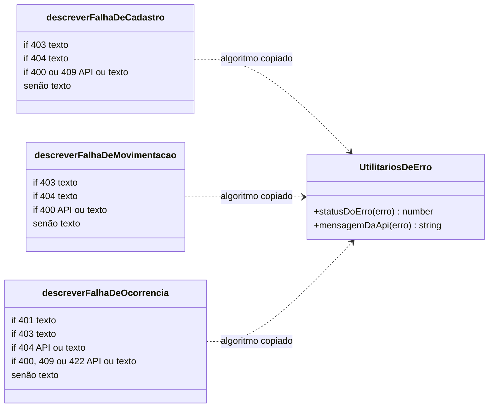
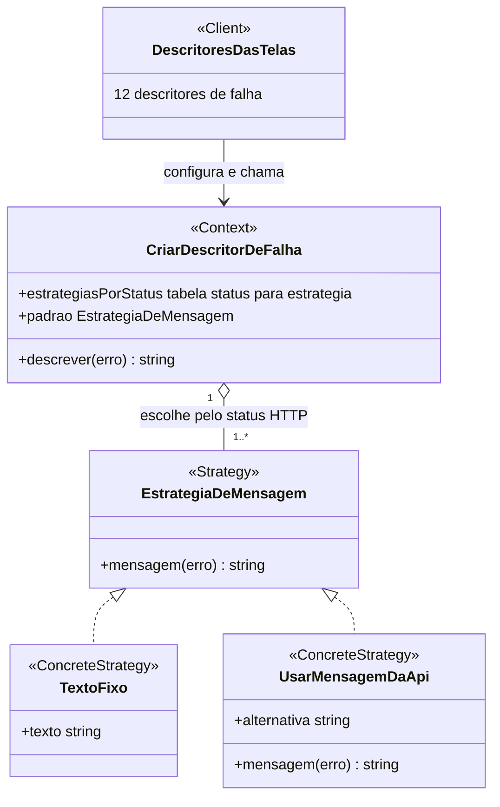
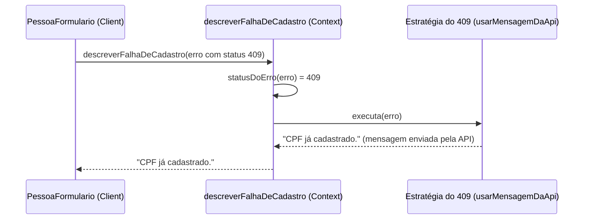
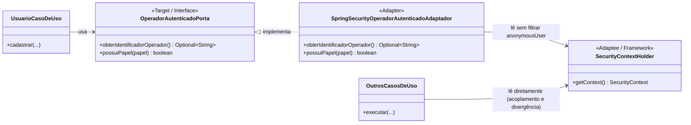
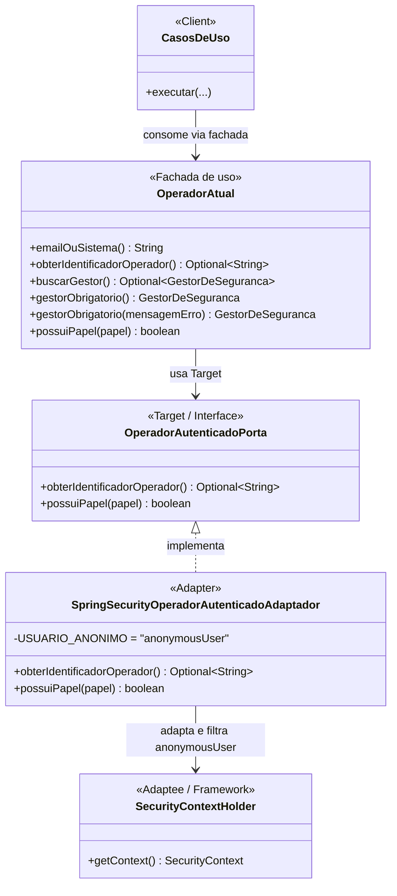

# Padrões de Projeto Aplicados

Este documento registra os padrões de projeto aplicados ao SafePlace depois da release [v1.0.0](https://github.com/yIuriy/rp-iv-grupo03-safeplace/releases/tag/v1.0.0), que é a linha de base. A escolha de cada padrão segue a [análise de padrões](../revisões/analise-padroes-projeto-v1.0.0.md): um padrão só é aplicado quando resolve um problema medido no código.

Cada seção traz:

- o problema encontrado;
- por que o padrão escolhido resolve esse problema;
- a correspondência entre os papéis do padrão e as classes ou funções do código;
- os diagramas antes e depois;
- as evidências de que o comportamento foi preservado.

As métricas gerais da refatoração são comparadas uma única vez, no fim, com a [linha de base](../metricas/relatorio-metricas-v1.0.0.md) ([#235](https://github.com/yIuriy/rp-iv-grupo03-safeplace/issues/235)). Os números citados em cada seção medem apenas o ponto alterado.

As classes e funções técnicas criadas pelos padrões não fazem parte do diagrama de classes do domínio. Elas ficam registradas aqui ([#220](https://github.com/yIuriy/rp-iv-grupo03-safeplace/issues/220)).

## Índice

| Padrão | Catálogo | Onde | Issue | Situação |
| --- | --- | --- | --- | --- |
| [Strategy](#strategy--mensagens-de-falha-http) | GoF, comportamental | Frontend: mensagens de falha HTTP | [#232](https://github.com/yIuriy/rp-iv-grupo03-safeplace/issues/232) | Aplicado |
| [Adapter](#adapter--porta-de-operador-autenticado) | GoF, estrutural | Backend: operador autenticado | Parte 1 (preparação para [#236](https://github.com/yIuriy/rp-iv-grupo03-safeplace/issues/236)) | Aplicado |

---

## Strategy — mensagens de falha HTTP

**Catálogo:** GoF, comportamental.

**Intenção:** definir uma família de algoritmos, encapsular cada um e torná-los intercambiáveis. O cliente escolhe o algoritmo sem alterar o código que o executa.

**Issue:** [#232](https://github.com/yIuriy/rp-iv-grupo03-safeplace/issues/232).

### Problema (antes)

Quando uma chamada à API falha, cada tela precisa mostrar uma mensagem. Na v1.0.0, isso era feito por **12 funções** espalhadas em 10 arquivos, todas com o mesmo esqueleto:

1. ler o status HTTP do erro;
2. comparar o status com uma sequência de `if`;
3. devolver um texto fixo, ou a mensagem enviada pelo backend com um texto alternativo;
4. sem nenhum `if` correspondente, devolver um texto padrão.

Exemplo real, `frontend/src/features/usuarios/api.ts` na v1.0.0:

```ts
export function descreverFalhaDeCadastro(erro: unknown): string {
  const status = statusDoErro(erro)
  if (status === 403) return 'Seu perfil não tem permissão para esta operação.'
  if (status === 404) return 'Cadastro não encontrado. Ele pode ter sido alterado por outra pessoa; recarregue a lista.'
  if (status === 409 || status === 400) {
    return mensagemDaApi(erro) ?? 'Os dados informados conflitam com um cadastro existente ou são inválidos.'
  }
  return 'Não foi possível concluir a operação agora. Os dados preenchidos foram mantidos; tente novamente.'
}
```

O algoritmo — ler o status, escolher a regra e cair na regra padrão — estava copiado 12 vezes, misturado às mensagens de cada tela. Consequências:

- **Corrigir ou mudar o tratamento de um status exigia procurar 12 lugares**, e as cópias já divergiam. Só ocorrências tratava 401. O 422 era tratado em umas telas e não em outras. O 404 usava a mensagem do backend em ocorrências, mas um texto fixo em estoque.
- **A forma de usar a mensagem do backend era reescrita à mão** em cada tela (`mensagemDaApi(erro) ?? '...'`).
- **Não havia como testar o algoritmo de escolha isoladamente**, porque ele não existia separado das mensagens.

Medição nas features do frontend (`frontend/src/features`), v1.0.0:

| Medida | Valor |
| --- | ---: |
| Chamadas a `statusDoErro(` | 18 |
| Chamadas a `mensagemDaApi(` | 22 |
| Comparações `status === 4xx` | 36 |
| Arquivos que chamam `statusDoErro(` | 13 |

### Por que Strategy

O problema tem as forças típicas do Strategy:

- **uma parte fixa:** o algoritmo de escolha;
- **uma parte que varia:** a regra de mensagem de cada status, em cada tela;
- **essa variação aparece como condicionais copiadas.**

Separando as duas, o algoritmo passa a existir uma vez, como **Context**. Cada tela só **declara** suas estratégias, numa tabela de status → estratégia.

Analisando as 12 funções, as regras se reduzem a **duas estratégias concretas**:

- **texto fixo**, por exemplo `403 → 'Seu perfil não tem permissão…'`;
- **mensagem da API, com texto alternativo**, por exemplo `400 → mensagemDaApi(erro) ?? 'Os dados…'`.

Alternativas descartadas:

| Alternativa | Por que foi descartada |
| --- | --- |
| Uma única função global com todas as mensagens | As mensagens são próprias de cada tela ("…para registrar devoluções", "…para gerenciar setores"). Centralizar os textos misturaria as features. |
| Uma classe por estratégia, no estilo GoF clássico | Em TypeScript, funções são valores. Um tipo de função já é o contrato da estratégia, e criar classes só acrescentaria cerimônia, sem ganho. |
| Biblioteca de validação ou de tratamento de erros | Não resolve a escolha de mensagem por status e acrescentaria uma dependência. |

### Papéis do padrão

| Papel (GoF) | Elemento no código | Arquivo |
| --- | --- | --- |
| **Strategy** | tipo `EstrategiaDeMensagem = string \| ((erro: unknown) => string)` | `frontend/src/shared/api/erros.ts` |
| **ConcreteStrategy** | texto fixo (`string`) | declarado em cada tela |
| **ConcreteStrategy** | `usarMensagemDaApi(alternativa)` | `frontend/src/shared/api/erros.ts` |
| **Context** | `criarDescritorDeFalha(estrategiasPorStatus, padrao)` | `frontend/src/shared/api/erros.ts` |
| **Client** | os 12 descritores de falha (tabela a seguir) | features do frontend |

O Context recebe a tabela de estratégias por status e a estratégia padrão. Ele devolve a função `(erro) => string` que a tela chama. Ao ser chamada, essa função:

1. lê o status;
2. escolhe a estratégia do status ou, se não houver, a padrão;
3. executa a estratégia escolhida.

O Context não conhece nenhuma mensagem.

Clientes, com as estratégias que cada um declara:

| Descritor | Arquivo | Estratégias por status | Estratégia padrão |
| --- | --- | --- | --- |
| `descreverFalhaDeCadastro` | `usuarios/api.ts` | 403, 404 texto; 400, 409 API | texto |
| `descreverFalha` | `autenticacao/LoginPage.tsx` | 401 texto | texto |
| `descreverFalha` | `areas-risco/SetorFormDialog.tsx` | 403 texto | API |
| `descreverFalha` | `areas-risco/InspecaoFormDialog.tsx` | 403 texto | API |
| `descreverFalhaDeAnalise` | `emprestimos/apiProjecoes.ts` | 403 texto | API |
| `descreverErro` | `epis/EpiPage.tsx` | 403, 404 texto | API |
| `descreverFalhaCadastro` | `capacitacoes/api.ts` | 403 texto; 400 API | texto |
| `descreverFalha` | `capacitacoes/api.ts` | 403 texto; 400 API; 404 API com texto informado por quem chama | texto |
| `descreverFalhaDeMovimentacao` | `estoque/api.ts` | 403, 404 texto; 400 API | texto |
| `descreverFalhaDeEntrega` | `emprestimos/api.ts` | 403 texto; 400, 404, 422 API | texto |
| `descreverFalhaDeDevolucao` | `emprestimos/api.ts` | 403 texto; 400 API; 404, 409 API (outro texto) | texto |
| `descreverFalhaDeOcorrencia` | `ocorrencias/api.ts` | 401, 403 texto; 404 API; 400, 409, 422 API | texto |

Na tabela, "texto" é a estratégia de texto fixo e "API" é `usarMensagemDaApi`.

### Diagramas

**Antes.** Cada tela tinha a própria cópia do algoritmo e dependia diretamente dos utilitários de erro. O diagrama mostra 3 das 12 funções.



**Depois.** O algoritmo está só no Context. As telas configuram o Context com as estratégias.



**Execução** de uma falha 409 no cadastro de colaborador:



### Depois (código)

O Context e as estratégias, em `frontend/src/shared/api/erros.ts`:

```ts
export type EstrategiaDeMensagem = string | ((erro: unknown) => string)

export function usarMensagemDaApi(alternativa: string): EstrategiaDeMensagem {
  return (erro) => mensagemDaApi(erro) ?? alternativa
}

export function criarDescritorDeFalha(
  estrategiasPorStatus: Readonly<Partial<Record<number, EstrategiaDeMensagem>>>,
  padrao: EstrategiaDeMensagem,
): (erro: unknown) => string {
  return (erro) => {
    const status = statusDoErro(erro)
    const escolhida = (status !== undefined && estrategiasPorStatus[status]) || padrao
    return typeof escolhida === 'string' ? escolhida : escolhida(erro)
  }
}
```

O mesmo cliente do exemplo inicial, agora apenas declarando as estratégias:

```ts
const dadosRecusados = usarMensagemDaApi(
  'Os dados informados conflitam com um cadastro existente ou são inválidos.')

export const descreverFalhaDeCadastro = criarDescritorDeFalha({
  400: dadosRecusados,
  403: 'Seu perfil não tem permissão para esta operação.',
  404: 'Cadastro não encontrado. Ele pode ter sido alterado por outra pessoa; recarregue a lista.',
  409: dadosRecusados,
}, 'Não foi possível concluir a operação agora. Os dados preenchidos foram mantidos; tente novamente.')
```

O mesmo Context também atende uma regra conhecida só na hora da chamada. Em `capacitacoes/api.ts`, o texto do 404 é informado por quem chama, então o descritor é montado e executado na mesma chamada:

```ts
export function descreverFalha(erro: unknown, naoEncontrado: string): string {
  return criarDescritorDeFalha({
    400: usarMensagemDaApi('A consulta foi recusada pelo servidor. Revise os dados e tente novamente.'),
    403: 'Seu perfil não tem permissão para consultar capacitações.',
    404: usarMensagemDaApi(naoEncontrado),
  }, 'Não foi possível consultar agora. Verifique sua conexão ou tente novamente em alguns instantes.')(erro)
}
```

**Nenhuma tela precisou mudar a forma de chamar.** Os descritores mantiveram nome e assinatura, por exemplo `setFalha(descreverFalhaDeCadastro(erro))`, e todos os textos exibidos ao usuário continuaram idênticos.

### Trechos que não entraram no padrão

Três trechos parecidos ficaram de fora porque não cumprem o contrato da estratégia, que é receber um erro e devolver uma mensagem:

| Trecho | Motivo |
| --- | --- |
| `duplicidadeDaFalha` (`emprestimos/api.ts`) | Devolve `null` quando a falha não é duplicidade de posse. O `EntregaDialog` usa esse `null` para decidir se pede a confirmação de substituição. |
| `ProtocoloBusca.tsx` | Monta um objeto `{ titulo, texto }`, não uma mensagem. |
| `interceptadores.ts` | Encerra a sessão no 401. É controle de sessão, não descrição de falha. |

### Benefício

O algoritmo que transforma uma falha HTTP em mensagem passou a existir **num único lugar, testado**. Cada tela deixou de reimplementá-lo e passou a **declarar** apenas suas regras.

Na prática:

- mudar o comportamento geral, como a forma de ler a mensagem do backend, é uma alteração no Context;
- tratar um novo status numa tela é acrescentar uma linha na tabela dela, sem tocar na lógica (aberto para extensão, fechado para modificação);
- as diferenças entre telas, como o 404 com texto fixo no estoque e com mensagem da API em ocorrências, ficaram explícitas na tabela de cada uma, em vez de escondidas em `if`s diferentes.

O que **não** mudou foi o que o usuário vê: as mensagens são as mesmas e os testes das telas continuam passando.

Medição nas features do frontend:

| Medida | v1.0.0 | Depois |
| --- | ---: | ---: |
| Chamadas a `statusDoErro(` | 18 | 5 |
| Chamadas a `mensagemDaApi(` | 22 | 8 |
| Comparações `status === 4xx` | 36 | 4 |
| Arquivos que chamam `statusDoErro(` | 13 | 5 |
| Implementações do algoritmo de escolha | 12 | 1 |

O total de linhas quase não muda: o Context e os comentários ocupam o espaço das cópias removidas. O ganho está em ter uma única implementação, não em ter menos código. As chamadas que restam a `statusDoErro(` e `mensagemDaApi(` estão nos trechos da seção anterior e na alocação de capacitações, que lê o corpo do erro 422.

### Evidências

**Teste do Context:** `frontend/tests/erros.spec.ts`, com 6 casos que exercitam os papéis do padrão sem abrir navegador:

1. estratégia de texto fixo escolhida pelo status;
2. `usarMensagemDaApi` devolvendo a mensagem do backend;
3. `usarMensagemDaApi` caindo no texto alternativo (sem mensagem, mensagem em branco ou corpo HTML);
4. status sem estratégia usando a padrão;
5. falha de rede ou erro que não veio do axios usando a padrão;
6. estratégia padrão que também consulta a API, com prioridade da regra do status.

**Comportamento preservado:** os specs Playwright das telas migradas passaram (126 testes, incluindo os do Context):

- `users`, `login`, `setores` e `inspecoes`;
- `emprestimos`, `epis` e `estoque`;
- `capacitacoes`, `ocorrencias` e `ocorrencias-acompanhamento`.

Dois exemplos mostram que a estratégia `usarMensagemDaApi` funciona dentro do Context: o conflito de CPF em `users.spec.ts` e a recusa com mensagem do servidor em `setores.spec.ts`.

**Verificação estática:** `npx tsc -b` e `npx eslint .` sem erros.

---

## Adapter — porta de operador autenticado

**Catálogo:** GoF, estrutural.

**Intenção:** converter a interface de uma classe na interface esperada pelos clientes. O Adapter permite que classes com interfaces incompatíveis trabalhem juntas, desacoplando o núcleo da aplicação dos detalhes e classes estáticas do framework de segurança.

**Issue:** Parte 1 de 2 (a parte 2 é [#236](https://github.com/yIuriy/rp-iv-grupo03-safeplace/issues/236)).

### Problema (antes)

A porta `application/port/out/OperadorAutenticadoPorta.java` e o adaptador `adapters/out/seguranca/SpringSecurityOperadorAutenticadoAdaptador.java` já existiam, mas apenas `UsuarioCasoDeUso` os utilizava. Os demais casos de uso (`OcorrenciaUseCase`, `TarefaUseCase`, `EpiUseCase`, `ControlarManutencaoEpiService`, `CadastrarCapacitacaoService`, `InspecaoUseCase`, `PlanoDeAcaoUseCase` e `PlanoDeAcaoJpaAdapter`) acessavam o `SecurityContextHolder` diretamente.

Medição na release v1.0.0:

| Medida | Valor v1.0.0 |
| --- | ---: |
| `violacoes_camadas.application_importa_spring_security` | 7 |
| `contagens.security_context_holder` | 27 |

Além do acoplamento ao Spring Security, havia dois problemas de consistência:

1. **Defeito no descarte de `"anonymousUser"`:** o adaptador não filtrava o usuário anônimo fornecido pelo Spring Security quando não autenticado, retornando `Optional.of("anonymousUser")`. Apenas 4 locais (`OcorrenciaUseCase`, `TarefaUseCase`, `InspecaoUseCase` e `PlanoDeAcaoJpaAdapter`) descartavam esse valor manualmente; nos demais fluxos, a auditoria podia gravar `responsavel = "anonymousUser"` em vez de `SISTEMA`.
2. **Regra divergente para recuperação do Gestor:** a busca do Gestor de Segurança pelo e-mail autenticado possuía comportamentos diferentes no sistema. `TarefaUseCase` e `InspecaoUseCase` lançavam `AccessDeniedException` quando não havia gestor autenticado, enquanto `PlanoDeAcaoUseCase` devolvia `null`.

### Por que Adapter

A camada de aplicação precisa saber **quem está operando** e quais os seus papéis ou entidades de domínio associadas, e não como o Spring Security armazena o token na thread (`SecurityContextHolder`).

O padrão Adapter permite:

- Isolar a dependência de `org.springframework.security` no adaptador de infraestrutura (`SpringSecurityOperadorAutenticadoAdaptador`);
- Centralizar o filtro de `"anonymousUser"` em um único local, garantindo que usuários anônimos resultem em `Optional.empty()`;
- Fornecer uma fachada na camada de aplicação (`OperadorAtual`) que padroniza o fallback para `"SISTEMA"` e unifica a busca do Gestor de Segurança com regras explícitas (`buscarGestor()` para fluxos opcionais e `gestorObrigatorio()` para fluxos restritos);
- Testar casos de uso com dublês de teste simples (mocks da interface `OperadorAutenticadoPorta`), sem necessidade de montar ou limpar o contexto estático do Spring Security.

### Papéis do padrão

| Papel (GoF) | Elemento no código | Arquivo |
| --- | --- | --- |
| **Target** | `OperadorAutenticadoPorta` | `backend/src/main/java/br/edu/safeplace/backend/application/port/out/OperadorAutenticadoPorta.java` |
| **Adapter** | `SpringSecurityOperadorAutenticadoAdaptador` | `backend/src/main/java/br/edu/safeplace/backend/adapters/out/seguranca/SpringSecurityOperadorAutenticadoAdaptador.java` |
| **Adaptee** | `SecurityContextHolder` / `Authentication` | `org.springframework.security.core` |
| **Fachada de uso** | `OperadorAtual` | `backend/src/main/java/br/edu/safeplace/backend/application/usecase/OperadorAtual.java` |
| **Client** | `UsuarioCasoDeUso` (e os demais use cases na Parte 2) | `backend/src/main/java/br/edu/safeplace/backend/application/usecase/*` |

### Diagramas

**Antes.** Casos de uso liam diretamente a classe estática do Spring Security, duplicando a regra de filtragem de `"anonymousUser"` ou omitindo o tratamento.



**Depois.** O adaptador encapsula a leitura do Spring Security e filtra `"anonymousUser"`. Os casos de uso consomem a fachada de aplicação `OperadorAtual`, que se apoia na porta `OperadorAutenticadoPorta`.



**Execução:** resolução de operador anônimo com fallback para `"SISTEMA"`:


### Código antes × depois

**Adaptador (`SpringSecurityOperadorAutenticadoAdaptador.java`):**

Antes:
```java
@Override
public Optional<String> obterIdentificadorOperador() {
    Authentication auth = SecurityContextHolder.getContext().getAuthentication();
    if (auth != null && auth.getName() != null && !auth.getName().isBlank()) {
        return Optional.of(auth.getName().trim());
    }
    return Optional.empty();
}
```

Depois (descarte centralizado de `"anonymousUser"`):
```java
private static final String USUARIO_ANONIMO = "anonymousUser";

@Override
public Optional<String> obterIdentificadorOperador() {
    Authentication auth = SecurityContextHolder.getContext().getAuthentication();
    if (auth != null && auth.getName() != null && !auth.getName().isBlank()) {
        String identificador = auth.getName().trim();
        if (USUARIO_ANONIMO.equalsIgnoreCase(identificador)) {
            return Optional.empty();
        }
        return Optional.of(identificador);
    }
    return Optional.empty();
}
```

**Fachada de uso (`OperadorAtual.java`):**

Criação da fachada na camada de aplicação para abstrair o acesso e unificar a regra do Gestor:
```java
@Service
public class OperadorAtual {

    public static final String SISTEMA = "SISTEMA";
    private static final String MENSAGEM_GESTOR_PADRAO = "Operação exige um Gestor de Segurança autenticado.";

    private final OperadorAutenticadoPorta operadorPorta;
    private final UsuarioRepositorioPorta usuarioRepository;

    public OperadorAtual(OperadorAutenticadoPorta operadorPorta, UsuarioRepositorioPorta usuarioRepository) {
        this.operadorPorta = Objects.requireNonNull(operadorPorta, "operadorPorta não pode ser nula.");
        this.usuarioRepository = Objects.requireNonNull(usuarioRepository, "usuarioRepository não pode ser nulo.");
    }

    public String emailOuSistema() {
        return operadorPorta.obterIdentificadorOperador().orElse(SISTEMA);
    }

    public Optional<GestorDeSeguranca> buscarGestor() {
        return operadorPorta.obterIdentificadorOperador()
                .flatMap(usuarioRepository::buscarPorEmail)
                .filter(GestorDeSeguranca.class::isInstance)
                .map(GestorDeSeguranca.class::cast);
    }

    public GestorDeSeguranca gestorObrigatorio() {
        return gestorObrigatorio(MENSAGEM_GESTOR_PADRAO);
    }

    public GestorDeSeguranca gestorObrigatorio(String mensagemErro) {
        return buscarGestor()
                .orElseThrow(() -> new AcessoNegadoException(
                        mensagemErro != null && !mensagemErro.isBlank() ? mensagemErro : MENSAGEM_GESTOR_PADRAO
                ));
    }

    public boolean possuiPapel(String papel) {
        return operadorPorta.possuiPapel(papel);
    }
}
```

### Benefício

A identificação do operador autenticado e o descarte de `"anonymousUser"` passaram a existir **em um ponto único e testado**. A auditoria fica protegida contra a gravação de `"anonymousUser"` como responsável, e a busca por Gestor de Segurança foi padronizada: fluxos que exigem gestor usam `gestorObrigatorio()` (lançando `AcessoNegadoException`), enquanto fluxos opcionais usam `buscarGestor()`. A camada de aplicação permanece desacoplada do Spring Security, simplificando os testes unitários.

### Evidências

**Testes unitários novos:**

1. `SpringSecurityOperadorAutenticadoAdaptadorTest`: 10 testes cobrindo contexto sem autenticação, nome em branco, descarte de `"anonymousUser"`, verificação de papéis com/sem prefixo `ROLE_` e negação de papéis para anônimos.
2. `OperadorAtualTest`: 13 testes cobrindo fallback de `emailOuSistema()` para `"SISTEMA"`, delegação de papéis, resolução de `buscarGestor()` com usuário inexistente, colaborador comum e gestor válido, além de `gestorObrigatorio()` lançando `AcessoNegadoException` com mensagem padrão ou personalizada.

**Suíte de testes existente:**
- Execução de `./mvnw test` concluída com sucesso: **1094 testes executados, 0 falhas, 0 erros**.
- Cobertura mantida em conformidade com as metas do projeto.
