# Padrões de Projeto Aplicados

Este documento registra os padrões de projeto aplicados ao SafePlace depois da release [v1.0.0](https://github.com/yIuriy/rp-iv-grupo03-safeplace/releases/tag/v1.0.0), que é a linha de base. A escolha de cada padrão segue a [análise de padrões](../revisões/analise-padroes-projeto-v1.0.0.md): um padrão só é aplicado quando resolve um problema medido no código.

Cada seção traz:

- o problema encontrado;
- por que o padrão escolhido resolve esse problema;
- a correspondência entre os papéis do padrão e as classes ou funções do código;
- os diagramas antes e depois;
- as evidências de que o comportamento foi preservado.

As métricas gerais da refatoração são comparadas uma única vez, no fim, com a [linha de base](../metricas/relatorio-metricas-v1.0.0.md) ([#235](https://github.com/yIuriy/rp-iv-grupo03-safeplace/issues/235)). Os números citados em cada seção medem apenas o ponto alterado.

As classes e funções técnicas criadas pelos padrões (`OperadorAtual`, `RegistradorAuditoria`, mapeadores, builders de teste, adaptadores nulos e outras) não fazem parte do diagrama de classes do domínio. Elas ficam registradas aqui ([#220](https://github.com/yIuriy/rp-iv-grupo03-safeplace/issues/220)).

## Índice

| Padrão | Catálogo | Onde | Issue | Situação |
| --- | --- | --- | --- | --- |
| [Strategy](#strategy--mensagens-de-falha-http) | GoF, comportamental | Frontend: mensagens de falha HTTP | [#232](https://github.com/yIuriy/rp-iv-grupo03-safeplace/issues/232) | Aplicado |
| [Adapter](#adapter--porta-de-operador-autenticado) | GoF, estrutural | Backend: operador autenticado | Parte 1 ([#222](https://github.com/yIuriy/rp-iv-grupo03-safeplace/issues/222); preparação para [#236](https://github.com/yIuriy/rp-iv-grupo03-safeplace/issues/236)) | Aplicado |
| [Facade](#facade--registrador-de-auditoria) | GoF, estrutural | Backend: registro de auditoria (`RegistradorAuditoria`) | [#223](https://github.com/yIuriy/rp-iv-grupo03-safeplace/issues/223), [#237](https://github.com/yIuriy/rp-iv-grupo03-safeplace/issues/237), [#238](https://github.com/yIuriy/rp-iv-grupo03-safeplace/issues/238) | Pendente |
| [State (Backend)](#state--transicoes-de-statusepi) | GoF, comportamental | Backend: transições de `StatusEpi` | [#224](https://github.com/yIuriy/rp-iv-grupo03-safeplace/issues/224) | Pendente |
| [Factory Method](#factory-method--criacao-de-epi-e-ocorrencia) | GoF, criacional | Backend: criação de `Epi` e `Acidente`/`Incidente` (`Ocorrencia` `sealed`) | [#225](https://github.com/yIuriy/rp-iv-grupo03-safeplace/issues/225), [#239](https://github.com/yIuriy/rp-iv-grupo03-safeplace/issues/239) | Pendente |
| [Builder (Test Data Builder)](#builder--test-data-builders-de-epi-tarefa-e-ocorrencia) | GoF, criacional | Backend (`src/test`): builders de `Epi`, `Tarefa` e `Ocorrencia` | [#226](https://github.com/yIuriy/rp-iv-grupo03-safeplace/issues/226), [#240](https://github.com/yIuriy/rp-iv-grupo03-safeplace/issues/240) | Pendente |
| [Null Object](#null-object--adaptador-nulo-de-notificacao-e-dependencias-opcionais) | Woolf / PLoPD 3 | Backend: `NotificadorOcorrenciaNulo` e dependências opcionais | [#227](https://github.com/yIuriy/rp-iv-grupo03-safeplace/issues/227), [#241](https://github.com/yIuriy/rp-iv-grupo03-safeplace/issues/241) | Aplicado (2/2: #227, #241) |
| [Chain of Responsibility](#chain-of-responsibility--camada-de-validação) | GoF, comportamental | Backend: camada `validacao` (aptidão do colaborador e tarefa) | [#228](https://github.com/yIuriy/rp-iv-grupo03-safeplace/issues/228); continua em [#263](https://github.com/yIuriy/rp-iv-grupo03-safeplace/issues/263) a [#267](https://github.com/yIuriy/rp-iv-grupo03-safeplace/issues/267) | Aplicado (6/6: #228, #267, #263, #264, #265, #266) |
| [Data Mapper](#data-mapper--mapeadores-de-persistencia) | Fowler / PoEAA | Backend: `EpiEntityMapper`, `AreaRiscoEntityMapper` e `PlanoDeAcaoEntityMapper` | [#229](https://github.com/yIuriy/rp-iv-grupo03-safeplace/issues/229), [#242](https://github.com/yIuriy/rp-iv-grupo03-safeplace/issues/242) | Pendente |
| [Value Object](#value-object--protocolo-cat-em-acidente) | Fowler / DDD | Backend: `NumeroProtocoloCAT` dentro de `Acidente` | [#230](https://github.com/yIuriy/rp-iv-grupo03-safeplace/issues/230) | Aplicado |
| [DTO Assembler](#dto-assembler--ocorrenciaoutputdto) | Fowler / PoEAA | Backend: `OcorrenciaOutputAssembler` sem expor `PlanoDeAcao` | [#245](https://github.com/yIuriy/rp-iv-grupo03-safeplace/issues/245) | Pendente |
| [Strategy (Backend)](#strategy--fonte-de-tempo-clock) | GoF, comportamental | Backend: injeção de `java.time.Clock` nas regras de vencimento | [#247](https://github.com/yIuriy/rp-iv-grupo03-safeplace/issues/247) | Pendente |
| [Adapter (Frontend)](#adapter--leitura-da-api-e-contrato-de-epi) | GoF, estrutural | Frontend: primitivas de leitura da API e unificação de `Epi` | [#244](https://github.com/yIuriy/rp-iv-grupo03-safeplace/issues/244), [#231](https://github.com/yIuriy/rp-iv-grupo03-safeplace/issues/231) | Aplicado (1/2: #244) |
| [Template Method (hook)](#template-method-hook--envio-de-formulario) | GoF, comportamental | Frontend: submissão de formulários (`useEnvioFormulario`) | [#233](https://github.com/yIuriy/rp-iv-grupo03-safeplace/issues/233), [#243](https://github.com/yIuriy/rp-iv-grupo03-safeplace/issues/243) | Aplicado (2/2: #233, #243) |
| [State (Frontend)](#state--dialogos-de-taskspage) | GoF, comportamental | Frontend: estado único `DialogoTarefa` em `TasksPage` | [#246](https://github.com/yIuriy/rp-iv-grupo03-safeplace/issues/246) | Pendente |

---

## Strategy — mensagens de falha HTTP

**Catálogo:** GoF, comportamental.

**Intenção:** definir uma família de algoritmos, encapsular cada um e torná-los intercambiáveis. O cliente escolhe o algoritmo sem alterar o código que o executa.

**Issue:** [#232](https://github.com/yIuriy/rp-iv-grupo03-safeplace/issues/232).

### Problema (antes)

Quando uma chamada à API falha, cada tela precisa mostrar uma mensagem. Na v1.0.0, isso era feito por **12 funções** espalhadas em 10 arquivos, todas com o mesmo esqueleto:

1. ler o status HTTP do erro;
2. comparar o status com uma sequência de `if`;
3. devolver um texto fixo, ou a mensagem enviada pelo backend com um texto alternativo;
4. sem nenhum `if` correspondente, devolver um texto padrão.

Exemplo real, `frontend/src/features/usuarios/api.ts` na v1.0.0:

```ts
export function descreverFalhaDeCadastro(erro: unknown): string {
  const status = statusDoErro(erro)
  if (status === 403) return 'Seu perfil não tem permissão para esta operação.'
  if (status === 404) return 'Cadastro não encontrado. Ele pode ter sido alterado por outra pessoa; recarregue a lista.'
  if (status === 409 || status === 400) {
    return mensagemDaApi(erro) ?? 'Os dados informados conflitam com um cadastro existente ou são inválidos.'
  }
  return 'Não foi possível concluir a operação agora. Os dados preenchidos foram mantidos; tente novamente.'
}
```

O algoritmo — ler o status, escolher a regra e cair na regra padrão — estava copiado 12 vezes, misturado às mensagens de cada tela. Consequências:

- **Corrigir ou mudar o tratamento de um status exigia procurar 12 lugares**, e as cópias já divergiam. Só ocorrências tratava 401. O 422 era tratado em umas telas e não em outras. O 404 usava a mensagem do backend em ocorrências, mas um texto fixo em estoque.
- **A forma de usar a mensagem do backend era reescrita à mão** em cada tela (`mensagemDaApi(erro) ?? '...'`).
- **Não havia como testar o algoritmo de escolha isoladamente**, porque ele não existia separado das mensagens.

Medição nas features do frontend (`frontend/src/features`), v1.0.0:

| Medida | Valor |
| --- | ---: |
| Chamadas a `statusDoErro(` | 18 |
| Chamadas a `mensagemDaApi(` | 22 |
| Comparações `status === 4xx` | 36 |
| Arquivos que chamam `statusDoErro(` | 13 |

### Por que Strategy

O problema tem as forças típicas do Strategy:

- **uma parte fixa:** o algoritmo de escolha;
- **uma parte que varia:** a regra de mensagem de cada status, em cada tela;
- **essa variação aparece como condicionais copiadas.**

Separando as duas, o algoritmo passa a existir uma vez, como **Context**. Cada tela só **declara** suas estratégias, numa tabela de status → estratégia.

Analisando as 12 funções, as regras se reduzem a **duas estratégias concretas**:

- **texto fixo**, por exemplo `403 → 'Seu perfil não tem permissão…'`;
- **mensagem da API, com texto alternativo**, por exemplo `400 → mensagemDaApi(erro) ?? 'Os dados…'`.

Alternativas descartadas:

| Alternativa | Por que foi descartada |
| --- | --- |
| Uma única função global com todas as mensagens | As mensagens são próprias de cada tela ("…para registrar devoluções", "…para gerenciar setores"). Centralizar os textos misturaria as features. |
| Uma classe por estratégia, no estilo GoF clássico | Em TypeScript, funções são valores. Um tipo de função já é o contrato da estratégia, e criar classes só acrescentaria cerimônia, sem ganho. |
| Biblioteca de validação ou de tratamento de erros | Não resolve a escolha de mensagem por status e acrescentaria uma dependência. |

### Papéis do padrão

| Papel (GoF) | Elemento no código | Arquivo |
| --- | --- | --- |
| **Strategy** | tipo `EstrategiaDeMensagem = string \| ((erro: unknown) => string)` | `frontend/src/shared/api/erros.ts` |
| **ConcreteStrategy** | texto fixo (`string`) | declarado em cada tela |
| **ConcreteStrategy** | `usarMensagemDaApi(alternativa)` | `frontend/src/shared/api/erros.ts` |
| **Context** | `criarDescritorDeFalha(estrategiasPorStatus, padrao)` | `frontend/src/shared/api/erros.ts` |
| **Client** | os 12 descritores de falha (tabela a seguir) | features do frontend |

O Context recebe a tabela de estratégias por status e a estratégia padrão. Ele devolve a função `(erro) => string` que a tela chama. Ao ser chamada, essa função:

1. lê o status;
2. escolhe a estratégia do status ou, se não houver, a padrão;
3. executa a estratégia escolhida.

O Context não conhece nenhuma mensagem.

Clientes, com as estratégias que cada um declara:

| Descritor | Arquivo | Estratégias por status | Estratégia padrão |
| --- | --- | --- | --- |
| `descreverFalhaDeCadastro` | `usuarios/api.ts` | 403, 404 texto; 400, 409 API | texto |
| `descreverFalha` | `autenticacao/LoginPage.tsx` | 401 texto | texto |
| `descreverFalha` | `areas-risco/SetorFormDialog.tsx` | 403 texto | API |
| `descreverFalha` | `areas-risco/InspecaoFormDialog.tsx` | 403 texto | API |
| `descreverFalhaDeAnalise` | `emprestimos/apiProjecoes.ts` | 403 texto | API |
| `descreverErro` | `epis/EpiPage.tsx` | 403, 404 texto | API |
| `descreverFalhaCadastro` | `capacitacoes/api.ts` | 403 texto; 400 API | texto |
| `descreverFalha` | `capacitacoes/api.ts` | 403 texto; 400 API; 404 API com texto informado por quem chama | texto |
| `descreverFalhaDeMovimentacao` | `estoque/api.ts` | 403, 404 texto; 400 API | texto |
| `descreverFalhaDeEntrega` | `emprestimos/api.ts` | 403 texto; 400, 404, 422 API | texto |
| `descreverFalhaDeDevolucao` | `emprestimos/api.ts` | 403 texto; 400 API; 404, 409 API (outro texto) | texto |
| `descreverFalhaDeOcorrencia` | `ocorrencias/api.ts` | 401, 403 texto; 404 API; 400, 409, 422 API | texto |

Na tabela, "texto" é a estratégia de texto fixo e "API" é `usarMensagemDaApi`.

### Diagramas

**Antes.** Cada tela tinha a própria cópia do algoritmo e dependia diretamente dos utilitários de erro. O diagrama mostra 3 das 12 funções.

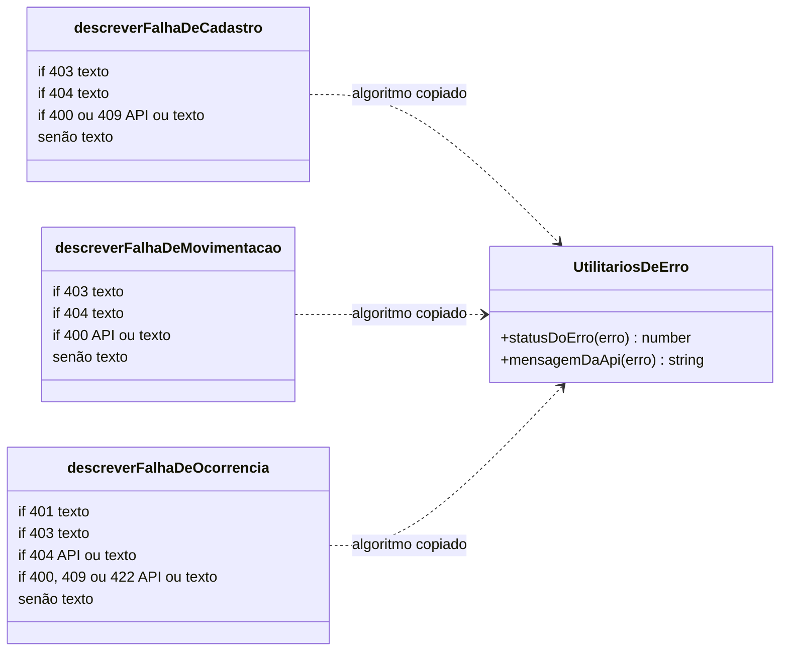

**Depois.** O algoritmo está só no Context. As telas configuram o Context com as estratégias.

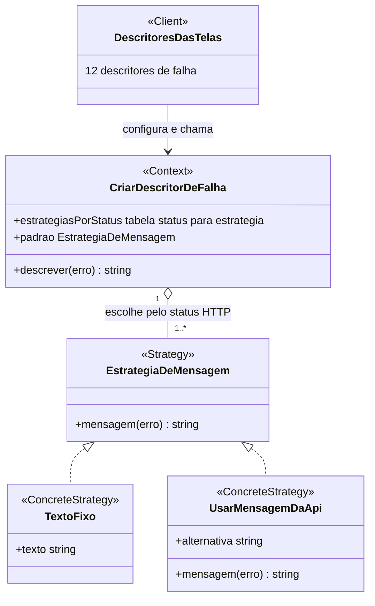

**Execução** de uma falha 409 no cadastro de colaborador:

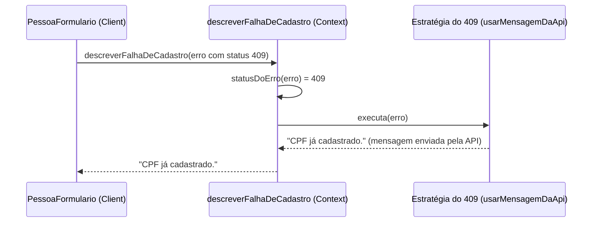

### Depois (código)

O Context e as estratégias, em `frontend/src/shared/api/erros.ts`:

```ts
export type EstrategiaDeMensagem = string | ((erro: unknown) => string)

export function usarMensagemDaApi(alternativa: string): EstrategiaDeMensagem {
  return (erro) => mensagemDaApi(erro) ?? alternativa
}

export function criarDescritorDeFalha(
  estrategiasPorStatus: Readonly<Partial<Record<number, EstrategiaDeMensagem>>>,
  padrao: EstrategiaDeMensagem,
): (erro: unknown) => string {
  return (erro) => {
    const status = statusDoErro(erro)
    const escolhida = (status !== undefined && estrategiasPorStatus[status]) || padrao
    return typeof escolhida === 'string' ? escolhida : escolhida(erro)
  }
}
```

O mesmo cliente do exemplo inicial, agora apenas declarando as estratégias:

```ts
const dadosRecusados = usarMensagemDaApi(
  'Os dados informados conflitam com um cadastro existente ou são inválidos.')

export const descreverFalhaDeCadastro = criarDescritorDeFalha({
  400: dadosRecusados,
  403: 'Seu perfil não tem permissão para esta operação.',
  404: 'Cadastro não encontrado. Ele pode ter sido alterado por outra pessoa; recarregue a lista.',
  409: dadosRecusados,
}, 'Não foi possível concluir a operação agora. Os dados preenchidos foram mantidos; tente novamente.')
```

O mesmo Context também atende uma regra conhecida só na hora da chamada. Em `capacitacoes/api.ts`, o texto do 404 é informado por quem chama, então o descritor é montado e executado na mesma chamada:

```ts
export function descreverFalha(erro: unknown, naoEncontrado: string): string {
  return criarDescritorDeFalha({
    400: usarMensagemDaApi('A consulta foi recusada pelo servidor. Revise os dados e tente novamente.'),
    403: 'Seu perfil não tem permissão para consultar capacitações.',
    404: usarMensagemDaApi(naoEncontrado),
  }, 'Não foi possível consultar agora. Verifique sua conexão ou tente novamente em alguns instantes.')(erro)
}
```

**Nenhuma tela precisou mudar a forma de chamar.** Os descritores mantiveram nome e assinatura, por exemplo `setFalha(descreverFalhaDeCadastro(erro))`, e todos os textos exibidos ao usuário continuaram idênticos.

### Trechos que não entraram no padrão

Três trechos parecidos ficaram de fora porque não cumprem o contrato da estratégia, que é receber um erro e devolver uma mensagem:

| Trecho | Motivo |
| --- | --- |
| `duplicidadeDaFalha` (`emprestimos/api.ts`) | Devolve `null` quando a falha não é duplicidade de posse. O `EntregaDialog` usa esse `null` para decidir se pede a confirmação de substituição. |
| `ProtocoloBusca.tsx` | Monta um objeto `{ titulo, texto }`, não uma mensagem. |
| `interceptadores.ts` | Encerra a sessão no 401. É controle de sessão, não descrição de falha. |

### Benefício

O algoritmo que transforma uma falha HTTP em mensagem passou a existir **num único lugar, testado**. Cada tela deixou de reimplementá-lo e passou a **declarar** apenas suas regras.

Na prática:

- mudar o comportamento geral, como a forma de ler a mensagem do backend, é uma alteração no Context;
- tratar um novo status numa tela é acrescentar uma linha na tabela dela, sem tocar na lógica (aberto para extensão, fechado para modificação);
- as diferenças entre telas, como o 404 com texto fixo no estoque e com mensagem da API em ocorrências, ficaram explícitas na tabela de cada uma, em vez de escondidas em `if`s diferentes.

O que **não** mudou foi o que o usuário vê: as mensagens são as mesmas e os testes das telas continuam passando.

Medição nas features do frontend:

| Medida | v1.0.0 | Depois |
| --- | ---: | ---: |
| Chamadas a `statusDoErro(` | 18 | 5 |
| Chamadas a `mensagemDaApi(` | 22 | 8 |
| Comparações `status === 4xx` | 36 | 4 |
| Arquivos que chamam `statusDoErro(` | 13 | 5 |
| Implementações do algoritmo de escolha | 12 | 1 |

O total de linhas quase não muda: o Context e os comentários ocupam o espaço das cópias removidas. O ganho está em ter uma única implementação, não em ter menos código. As chamadas que restam a `statusDoErro(` e `mensagemDaApi(` estão nos trechos da seção anterior e na alocação de capacitações, que lê o corpo do erro 422.

### Evidências

**Teste do Context:** `frontend/tests/erros.spec.ts`, com 6 casos que exercitam os papéis do padrão sem abrir navegador:

1. estratégia de texto fixo escolhida pelo status;
2. `usarMensagemDaApi` devolvendo a mensagem do backend;
3. `usarMensagemDaApi` caindo no texto alternativo (sem mensagem, mensagem em branco ou corpo HTML);
4. status sem estratégia usando a padrão;
5. falha de rede ou erro que não veio do axios usando a padrão;
6. estratégia padrão que também consulta a API, com prioridade da regra do status.

**Comportamento preservado:** os specs Playwright das telas migradas passaram (126 testes, incluindo os do Context):

- `users`, `login`, `setores` e `inspecoes`;
- `emprestimos`, `epis` e `estoque`;
- `capacitacoes`, `ocorrencias` e `ocorrencias-acompanhamento`.

Dois exemplos mostram que a estratégia `usarMensagemDaApi` funciona dentro do Context: o conflito de CPF em `users.spec.ts` e a recusa com mensagem do servidor em `setores.spec.ts`.

**Verificação estática:** `npx tsc -b` e `npx eslint .` sem erros.

---

## Adapter — porta de operador autenticado

**Catálogo:** GoF, estrutural.

**Intenção:** converter a interface de uma classe na interface esperada pelos clientes. O Adapter permite que classes com interfaces incompatíveis trabalhem juntas, desacoplando o núcleo da aplicação dos detalhes e classes estáticas do framework de segurança.

**Issue:** Parte 1 de 2 (a parte 2 é [#236](https://github.com/yIuriy/rp-iv-grupo03-safeplace/issues/236)).

### Problema (antes)

A porta `application/port/out/OperadorAutenticado.java` e o adaptador `adapters/out/seguranca/SpringSecurityOperadorAutenticadoAdapter.java` já existiam, mas apenas `UsuarioService` os utilizava. Os demais casos de uso (`OcorrenciaService`, `TarefaService`, `EpiService`, `ControlarManutencaoEpiService`, `CadastrarCapacitacaoService`, `InspecaoService`, `PlanoDeAcaoService` e `PlanoDeAcaoJpaAdapter`) acessavam o `SecurityContextHolder` diretamente.

Medição na release v1.0.0:

| Medida | Valor v1.0.0 |
| --- | ---: |
| `violacoes_camadas.application_importa_spring_security` | 7 |
| `contagens.security_context_holder` | 27 |

Além do acoplamento ao Spring Security, havia dois problemas de consistência:

1. **Defeito no descarte de `"anonymousUser"`:** o adaptador não filtrava o usuário anônimo fornecido pelo Spring Security quando não autenticado, retornando `Optional.of("anonymousUser")`. Apenas 4 locais (`OcorrenciaService`, `TarefaService`, `InspecaoService` e `PlanoDeAcaoJpaAdapter`) descartavam esse valor manualmente; nos demais fluxos, a auditoria podia gravar `responsavel = "anonymousUser"` em vez de `SISTEMA`.
2. **Regra divergente para recuperação do Gestor:** a busca do Gestor de Segurança pelo e-mail autenticado possuía comportamentos diferentes no sistema. `TarefaService` e `InspecaoService` lançavam `AccessDeniedException` quando não havia gestor autenticado, enquanto `PlanoDeAcaoService` devolvia `null`.

### Por que Adapter

A camada de aplicação precisa saber **quem está operando** e quais os seus papéis ou entidades de domínio associadas, e não como o Spring Security armazena o token na thread (`SecurityContextHolder`).

O padrão Adapter permite:

- Isolar a dependência de `org.springframework.security` no adaptador de infraestrutura (`SpringSecurityOperadorAutenticadoAdapter`);
- Centralizar o filtro de `"anonymousUser"` em um único local, garantindo que usuários anônimos resultem em `Optional.empty()`;
- Fornecer uma fachada na camada de aplicação (`OperadorAtual`) que padroniza o fallback para `"SISTEMA"` e unifica a busca do Gestor de Segurança com regras explícitas (`buscarGestor()` para fluxos opcionais e `gestorObrigatorio()` para fluxos restritos);
- Testar casos de uso com dublês de teste simples (mocks da interface `OperadorAutenticado`), sem necessidade de montar ou limpar o contexto estático do Spring Security.

### Papéis do padrão

| Papel (GoF) | Elemento no código | Arquivo |
| --- | --- | --- |
| **Target** | `OperadorAutenticado` | `backend/src/main/java/br/edu/safeplace/backend/application/port/out/OperadorAutenticado.java` |
| **Adapter** | `SpringSecurityOperadorAutenticadoAdapter` | `backend/src/main/java/br/edu/safeplace/backend/adapters/out/seguranca/SpringSecurityOperadorAutenticadoAdapter.java` |
| **Adaptee** | `SecurityContextHolder` / `Authentication` | `org.springframework.security.core` |
| **Fachada de uso** | `OperadorAtual` | `backend/src/main/java/br/edu/safeplace/backend/application/usecase/OperadorAtual.java` |
| **Client** | `UsuarioService` (e os demais use cases na Parte 2) | `backend/src/main/java/br/edu/safeplace/backend/application/usecase/*` |

### Diagramas

**Antes.** Casos de uso liam diretamente a classe estática do Spring Security, duplicando a regra de filtragem de `"anonymousUser"` ou omitindo o tratamento.


**Depois.** O adaptador encapsula a leitura do Spring Security e filtra `"anonymousUser"`. Os casos de uso consomem a fachada de aplicação `OperadorAtual`, que se apoia na porta `OperadorAutenticado`.

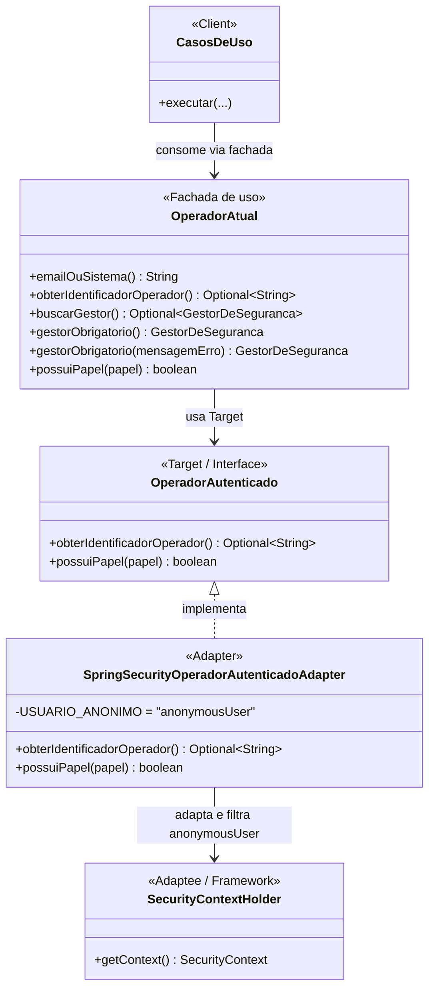

**Execução:** resolução de operador anônimo com fallback para `"SISTEMA"`:

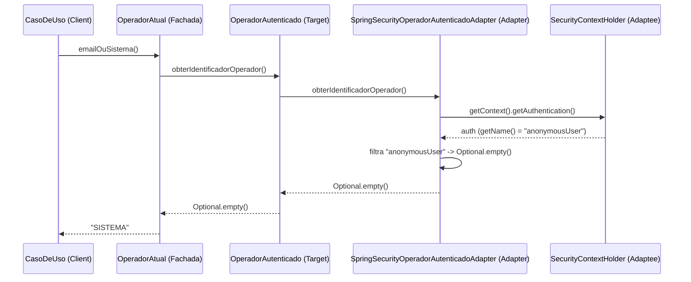

### Código antes × depois

**Adaptador (`SpringSecurityOperadorAutenticadoAdapter.java`):**

Antes:
```java
@Override
public Optional<String> obterIdentificadorOperador() {
    Authentication auth = SecurityContextHolder.getContext().getAuthentication();
    if (auth != null && auth.getName() != null && !auth.getName().isBlank()) {
        return Optional.of(auth.getName().trim());
    }
    return Optional.empty();
}
```

Depois (descarte centralizado de `"anonymousUser"`):
```java
private static final String USUARIO_ANONIMO = "anonymousUser";

@Override
public Optional<String> obterIdentificadorOperador() {
    Authentication auth = SecurityContextHolder.getContext().getAuthentication();
    if (auth != null && auth.getName() != null && !auth.getName().isBlank()) {
        String identificador = auth.getName().trim();
        if (USUARIO_ANONIMO.equalsIgnoreCase(identificador)) {
            return Optional.empty();
        }
        return Optional.of(identificador);
    }
    return Optional.empty();
}
```

**Fachada de uso (`OperadorAtual.java`):**

Criação da fachada na camada de aplicação para abstrair o acesso e unificar a regra do Gestor:
```java
@Service
public class OperadorAtual {

    public static final String SISTEMA = "SISTEMA";
    private static final String MENSAGEM_GESTOR_PADRAO = "Operação exige um Gestor de Segurança autenticado.";

    private final OperadorAutenticado operadorPorta;
    private final UsuarioRepository usuarioRepository;

    public OperadorAtual(OperadorAutenticado operadorPorta, UsuarioRepository usuarioRepository) {
        this.operadorPorta = Objects.requireNonNull(operadorPorta, "operadorPorta não pode ser nula.");
        this.usuarioRepository = Objects.requireNonNull(usuarioRepository, "usuarioRepository não pode ser nulo.");
    }

    public String emailOuSistema() {
        return operadorPorta.obterIdentificadorOperador().orElse(SISTEMA);
    }

    public Optional<GestorDeSeguranca> buscarGestor() {
        return operadorPorta.obterIdentificadorOperador()
                .flatMap(usuarioRepository::buscarPorEmail)
                .filter(GestorDeSeguranca.class::isInstance)
                .map(GestorDeSeguranca.class::cast);
    }

    public GestorDeSeguranca gestorObrigatorio() {
        return gestorObrigatorio(MENSAGEM_GESTOR_PADRAO);
    }

    public GestorDeSeguranca gestorObrigatorio(String mensagemErro) {
        return buscarGestor()
                .orElseThrow(() -> new AcessoNegadoException(
                        mensagemErro != null && !mensagemErro.isBlank() ? mensagemErro : MENSAGEM_GESTOR_PADRAO
                ));
    }

    public boolean possuiPapel(String papel) {
        return operadorPorta.possuiPapel(papel);
    }
}
```

### Benefício

A identificação do operador autenticado e o descarte de `"anonymousUser"` passaram a existir **em um ponto único e testado**. A auditoria fica protegida contra a gravação de `"anonymousUser"` como responsável, e a busca por Gestor de Segurança foi padronizada: fluxos que exigem gestor usam `gestorObrigatorio()` (lançando `AcessoNegadoException`), enquanto fluxos opcionais usam `buscarGestor()`. A camada de aplicação permanece desacoplada do Spring Security, simplificando os testes unitários.

### Evidências

**Testes unitários novos:**

1. `SpringSecurityOperadorAutenticadoAdapterTest`: 10 testes cobrindo contexto sem autenticação, nome em branco, descarte de `"anonymousUser"`, verificação de papéis com/sem prefixo `ROLE_` e negação de papéis para anônimos.
2. `OperadorAtualTest`: 13 testes cobrindo fallback de `emailOuSistema()` para `"SISTEMA"`, delegação de papéis, resolução de `buscarGestor()` com usuário inexistente, colaborador comum e gestor válido, além de `gestorObrigatorio()` lançando `AcessoNegadoException` com mensagem padrão ou personalizada.

**Suíte de testes existente:**
- Execução de `./mvnw test` concluída com sucesso: **1094 testes executados, 0 falhas, 0 erros**.
- Cobertura mantida em conformidade com as metas do projeto.

---

## Facade — registrador de auditoria

**Catálogo:** GoF, estrutural.

**Intenção:** fornecer uma interface simplificada (`RegistradorAuditoria`) para a montagem e gravação de registros de auditoria (`LogAuditoria`), ocultando a resolução do operador e os detalhes do repositório.

**Issues:** [#223](https://github.com/yIuriy/rp-iv-grupo03-safeplace/issues/223), [#237](https://github.com/yIuriy/rp-iv-grupo03-safeplace/issues/237) e [#238](https://github.com/yIuriy/rp-iv-grupo03-safeplace/issues/238).

### Problema (antes)

*A preencher nas issues [#223](https://github.com/yIuriy/rp-iv-grupo03-safeplace/issues/223), [#237](https://github.com/yIuriy/rp-iv-grupo03-safeplace/issues/237) e [#238](https://github.com/yIuriy/rp-iv-grupo03-safeplace/issues/238) (base: `docs/revisões/analise-padroes-projeto-v1.0.0.md`, R2).*

### Papéis do padrão

| Papel no padrão | Elemento no código | Responsabilidade |
| --- | --- | --- |
| Facade | `RegistradorAuditoria` | Expor `cadastro(...)`, `alteracao(...)` e `remocao(...)` para os casos de uso |
| Subsystem | `LogAuditoria`, `LogAuditoriaRepository`, `OperadorAtual` | Entidade de domínio, porta de persistência do log e identificação do operador |
| Client | Casos de uso da camada `application` | Registrar eventos de auditoria em uma única chamada |

### Diagramas

*Diagramas PlantUML antes e depois a preencher nas issues [#223](https://github.com/yIuriy/rp-iv-grupo03-safeplace/issues/223)–[#238](https://github.com/yIuriy/rp-iv-grupo03-safeplace/issues/238).*

### Métricas locais

| Métrica | Antes (v1.0.0) | Depois |
| --- | --- | --- |
| Classes que montam `LogAuditoria` manualmente | 11 | *A medir* |
| Blocos de construção manual de `LogAuditoria` | ~25 | *A medir* |

### Evidências

*A preencher nas issues [#223](https://github.com/yIuriy/rp-iv-grupo03-safeplace/issues/223)–[#238](https://github.com/yIuriy/rp-iv-grupo03-safeplace/issues/238).*

---

## State — transições de `StatusEpi`

**Catálogo:** GoF, comportamental (máquina de estados via enum).

**Intenção:** concentrar as regras de transição do ciclo de vida do `Epi` nas constantes de `StatusEpi` (`podeTransicaoPara`), delegando a mudança de estado a `Epi.transicionarPara(StatusEpi)`.

**Issue:** [#224](https://github.com/yIuriy/rp-iv-grupo03-safeplace/issues/224).

### Problema (antes)

*A preencher na issue [#224](https://github.com/yIuriy/rp-iv-grupo03-safeplace/issues/224) (base: `docs/revisões/analise-padroes-projeto-v1.0.0.md`, R4).*

### Papéis do padrão

| Papel no padrão | Elemento no código | Responsabilidade |
| --- | --- | --- |
| Context | `Epi` | Manter o `StatusEpi` atual e validar mudanças via `transicionarPara(StatusEpi)` |
| State | `StatusEpi` | Declarar `podeTransicaoPara(StatusEpi)` para o ciclo de vida do EPI |
| ConcreteState | `DISPONIVEL`, `EM_MANUTENCAO`, `ESGOTADO`, `EM_USO`, `DESCARTADO` | Definir as transições permitidas a partir de cada estado |

### Diagramas

*Diagramas PlantUML antes e depois a preencher na issue [#224](https://github.com/yIuriy/rp-iv-grupo03-safeplace/issues/224).*

### Métricas locais

| Métrica | Antes (v1.0.0) | Depois |
| --- | --- | --- |
| Métodos com regras de transição de `StatusEpi` espalhadas | 8 | *A medir* |

### Evidências

*A preencher na issue [#224](https://github.com/yIuriy/rp-iv-grupo03-safeplace/issues/224).*

---

## Factory Method — criação de `Epi` e `Ocorrencia`

**Catálogo:** GoF, criacional (fábricas nomeadas + polimorfismo com hierarquia `sealed`).

**Intenção:** consolidar a criação de `Epi` em fábricas nomeadas (`Epi.novo`, `Epi.reconstituir`) e a criação de `Acidente`/`Incidente` por fábrica com `Ocorrencia` `sealed` (`permits Acidente, Incidente`).

**Issues:** [#225](https://github.com/yIuriy/rp-iv-grupo03-safeplace/issues/225) e [#239](https://github.com/yIuriy/rp-iv-grupo03-safeplace/issues/239).

### Problema (antes)

*A preencher nas issues [#225](https://github.com/yIuriy/rp-iv-grupo03-safeplace/issues/225) e [#239](https://github.com/yIuriy/rp-iv-grupo03-safeplace/issues/239) (base: `docs/revisões/analise-padroes-projeto-v1.0.0.md`, R5 e R6, e `docs/arquitetura/correspondencia-classes-epi.md`).*

### Papéis do padrão

| Papel no padrão | Elemento no código | Responsabilidade |
| --- | --- | --- |
| Creator / Factory Methods | `Epi.novo(...)`, `Epi.reconstituir(...)`, fábrica de `Ocorrencia` por `TipoOcorrencia` | Distinguir criação inicial de reconstituição e instanciar o subtipo correto de `Ocorrencia` |
| Product | `Epi`, `Ocorrencia` (`sealed`) | Entidades de domínio com invariantes protegidas e `getTipo()` polimórfico |
| ConcreteProduct | `Acidente`, `Incidente` | Subtipos permitidos pela hierarquia selada de `Ocorrencia` |
| Parameter Object | `EspecificacaoEPI` | Agrupar os dados descritivos na criação do `Epi` |

### Diagramas

*Diagramas PlantUML antes e depois a preencher nas issues [#225](https://github.com/yIuriy/rp-iv-grupo03-safeplace/issues/225) e [#239](https://github.com/yIuriy/rp-iv-grupo03-safeplace/issues/239).*

### Métricas locais

| Métrica | Antes (v1.0.0) | Depois |
| --- | --- | --- |
| Portas de entrada de construção em `Epi` | 10 | 2 |
| Métodos legados sem uso em `Epi` | 8 | 0 |
| Checagens `instanceof Acidente` em `domain/` e `application/` | 5 | *A medir* |

### Evidências

*A preencher nas issues [#225](https://github.com/yIuriy/rp-iv-grupo03-safeplace/issues/225) e [#239](https://github.com/yIuriy/rp-iv-grupo03-safeplace/issues/239).*

---

## Builder — Test Data Builders de `Epi`, `Tarefa` e `Ocorrencia`

**Catálogo:** GoF, criacional (aplicado como Test Data Builder em `src/test`).

**Intenção:** separar a construção de objetos de domínio complexos nos testes por meio de builders fluentes com valores padrão válidos, eliminando chamadas a construtores posicionais longos na suíte de testes.

**Issues:** [#226](https://github.com/yIuriy/rp-iv-grupo03-safeplace/issues/226) e [#240](https://github.com/yIuriy/rp-iv-grupo03-safeplace/issues/240).

### Problema (antes)

*A preencher nas issues [#226](https://github.com/yIuriy/rp-iv-grupo03-safeplace/issues/226) e [#240](https://github.com/yIuriy/rp-iv-grupo03-safeplace/issues/240) (base: `docs/revisões/analise-padroes-projeto-v1.0.0.md`, R5).*

### Papéis do padrão

| Papel no padrão | Elemento no código | Responsabilidade |
| --- | --- | --- |
| Builder | `EpiBuilder`, `TarefaBuilder`, `AcidenteBuilder`, `IncidenteBuilder` (`src/test`) | Configurar apenas os atributos relevantes para cada cenário de teste |
| Product | `Epi`, `Tarefa`, `Acidente`, `Incidente` | Entidades de domínio construídas pelas fábricas de produção |
| Director | Classes de teste (`*Test`) | Descrever o cenário de teste de forma fluente |

### Diagramas

*Diagramas PlantUML antes e depois a preencher nas issues [#226](https://github.com/yIuriy/rp-iv-grupo03-safeplace/issues/226) e [#240](https://github.com/yIuriy/rp-iv-grupo03-safeplace/issues/240).*

### Métricas locais

| Métrica | Antes (v1.0.0) | Depois |
| --- | --- | --- |
| `classes_3_ou_mais_construtores` | 8 | *A medir* |
| `construtores` | 218 | *A medir* |

### Evidências

*A preencher nas issues [#226](https://github.com/yIuriy/rp-iv-grupo03-safeplace/issues/226) e [#240](https://github.com/yIuriy/rp-iv-grupo03-safeplace/issues/240).*

---

## Null Object — adaptador nulo de notificação e dependências opcionais

**Catálogo:** Woolf (PLoPD 3), comportamental.

**Intenção:** fornecer implementações neutras para portas opcionais (`NotificadorOcorrenciaNulo`, `OperadorAutenticadoNulo`), eliminando construtores secundários que repassam `null` e checagens `!= null` nos casos de uso.

**Issues:** [#227](https://github.com/yIuriy/rp-iv-grupo03-safeplace/issues/227) (parte 1) e [#241](https://github.com/yIuriy/rp-iv-grupo03-safeplace/issues/241) (parte 2), ambas aplicadas.

**Nome da classe nula:** a issue #227 e o esqueleto desta seção usavam `NotificacaoOcorrenciaNula`. Depois da [#269](https://github.com/yIuriy/rp-iv-grupo03-safeplace/issues/269), a porta passou a se chamar `NotificadorOcorrencia`, e `NotificacaoOcorrencia` já é a classe de domínio da notificação gravada. Por isso a classe nula se chama `NotificadorOcorrenciaNulo`: o nome segue a porta que ela implementa e não se confunde com o registro de domínio.

### Problema (antes)

**Parte 1 ([#227](https://github.com/yIuriy/rp-iv-grupo03-safeplace/issues/227)).** `OcorrenciaService` recebia a porta `NotificadorOcorrencia` com `@Autowired(required = false)`. A ausência do notificador chegava ao caso de uso como `null`, e o fluxo de negócio decidia o que fazer:

- `registrarAcidente` e `registrarIncidente` testavam `if (notificadorOcorrencia != null)` antes de notificar;
- um construtor de 4 parâmetros repassava `null` explicitamente ao construtor principal;
- quem escrevesse um novo fluxo de relato e esquecesse o `if` causaria um `NullPointerException`.

**Parte 2 ([#241](https://github.com/yIuriy/rp-iv-grupo03-safeplace/issues/241)).** Quatro casos de uso tinham construtores telescópicos que repassavam `null` para uma dependência "opcional", e cada `null` virava um `if` mais adiante:

| Caso de uso | Construtor que repassava `null` | Checagens decorrentes |
| --- | --- | --- |
| `UsuarioService` | `this(..., logAuditoriaRepository, null)` (sem operador) | `operadorAutenticado != null ? ... : new OperadorAutenticado() { ... }`, um Null Object improvisado como classe anônima |
| `EmprestimoService` | `this(..., auditoria, null)` (sem repositório de manutenções) | `if (manutencoes != null)` na devolução para manutenção |
| `TarefaService` | `this(..., setorRepository, null)` e `this(..., null, null, null)` | `if (epiRepository == null) return List.of();` e `usuarioRepositorio != null` |
| `PlanoDeAcaoService` | `this(..., notificadorAcao, null)`, com `@Autowired(required = false)` na consulta de ocorrências | `if (consultaOcorrencia != null)` com caminho alternativo pelo repositório, e quatro `usuarioRepository`/`setorRepository != null` |

Em produção nenhuma dessas dependências é ausente: o Spring sempre injeta todas. Os construtores curtos existiam só para os testes, mas abriam caminhos de código que a aplicação real nunca percorre.

### Por que Null Object

O padrão troca o "não há notificador" por um objeto que implementa a mesma interface e não faz nada. O caso de uso passa a chamar a porta sempre, sem condição. A decisão "notificar ou não" sai do fluxo de negócio e vai para a montagem dos objetos: em produção o Spring injeta o adaptador real; quem não quer notificação (por exemplo, um teste) entrega o objeto nulo.

O `NotificadorOcorrenciaNulo` não é um bean do Spring. Se fosse, o contexto teria duas implementações da mesma porta e a injeção ficaria ambígua. Ele fica em `adapters/out/notificacao`, ao lado do adaptador real, porque também é uma implementação da porta de saída.

**Onde o objeto nulo não se aplica (#241).** O padrão só vale quando "não fazer nada" é um comportamento correto. Isso acontece com o operador autenticado: sem sessão, não há identificador nem papel, e a auditoria registra `SISTEMA`. Por isso existe o `OperadorAutenticadoNulo`. Já para `ManutencaoEpiRepository`, `EpiRepository`, `UsuarioRepository`, `SetorRepository` e `GerenciarOcorrenciaUseCase`, um objeto que não faz nada perderia dados em silêncio (a manutenção da devolução não seria gravada) ou pularia uma regra (a visibilidade do plano para o Supervisor, issue #100). Nesses casos, a dependência passou a ser obrigatória (`requireNonNull`) e os testes informam um dublê explícito.

**Construtores que continuam.** Cada caso de uso ainda tem um segundo construtor que monta os validadores padrão da camada `validacao` (Chain of Responsibility, #228) para os testes sem Spring. Ele não repassa `null`: entrega objetos reais. Por isso ficou fora do escopo, que é eliminar os `this(..., null)`.

### Papéis do padrão

| Papel no padrão | Elemento no código | Responsabilidade |
| --- | --- | --- |
| AbstractObject | `NotificadorOcorrencia`, `OperadorAutenticado` | Contratos das portas de saída |
| RealObject | `NotificacaoOcorrenciaInternaAdapter`, `SpringSecurityOperadorAutenticadoAdapter` | Implementações reais das portas |
| NullObject | `NotificadorOcorrenciaNulo` (#227), `OperadorAutenticadoNulo` (#241) | Implementações neutras sem efeito colateral |
| Client | `OcorrenciaService` (#227); `EmprestimoService`, `PlanoDeAcaoService`, `TarefaService`, `UsuarioService` (#241) | Invocar as portas sem testar `!= null` |

### Diagramas

**Antes (#227).** A porta é opcional; o cliente testa `null` em cada uso.

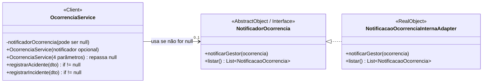

**Depois (#227).** A porta é obrigatória; a ausência é representada pelo `NotificadorOcorrenciaNulo`.

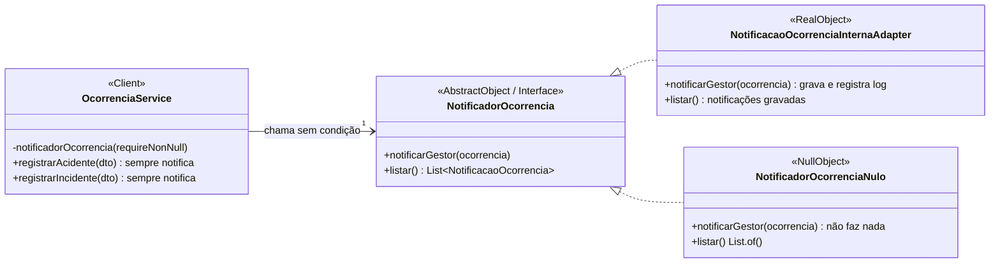

**Antes (#241).** O `UsuarioService` improvisava o objeto nulo como classe anônima, e os demais clientes testavam `null`.

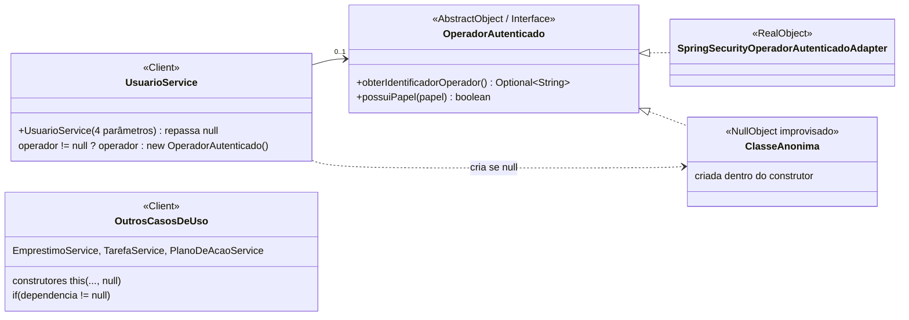

**Depois (#241).** O objeto nulo tem nome, arquivo e testes; as outras dependências são obrigatórias.

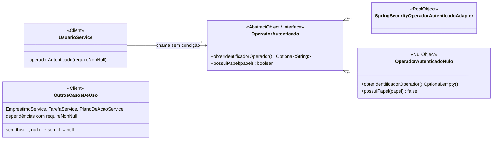

### Código antes × depois

**Construtor de `OcorrenciaService` (#227).**

Antes:

```java
public OcorrenciaService(..., LogAuditoriaRepository logAuditoriaRepository,
        @Autowired(required = false) NotificadorOcorrencia notificadorOcorrencia,
        @Qualifier("ocorrenciaValidador") Validador<Ocorrencia> validador) {
    ...
    this.notificadorOcorrencia = notificadorOcorrencia;
}

public OcorrenciaService(OcorrenciaRepository repository, AreaRiscoRepository areaRiscoRepository,
        UsuarioRepository usuarioRepository, LogAuditoriaRepository logAuditoriaRepository) {
    this(repository, areaRiscoRepository, usuarioRepository, logAuditoriaRepository, null);
}
```

Depois:

```java
public OcorrenciaService(..., LogAuditoriaRepository logAuditoriaRepository,
        NotificadorOcorrencia notificadorOcorrencia,
        @Qualifier("ocorrenciaValidador") Validador<Ocorrencia> validador) {
    ...
    // Null Object (#227): a porta é obrigatória; sem notificação, injeta-se NotificadorOcorrenciaNulo.
    this.notificadorOcorrencia = Objects.requireNonNull(
            notificadorOcorrencia, "Notificador de ocorrência é obrigatório.");
}
```

**Ponto de uso em `registrarAcidente` e `registrarIncidente` (#227).**

Antes:

```java
if (notificadorOcorrencia != null) {
    notificadorOcorrencia.notificarGestor(salvo);
}
```

Depois:

```java
notificadorOcorrencia.notificarGestor(salvo);
```

**Objeto nulo (`NotificadorOcorrenciaNulo.java`, novo).**

```java
public final class NotificadorOcorrenciaNulo implements NotificadorOcorrencia {
    @Override
    public void notificarGestor(Ocorrencia ocorrencia) {
        // Intencionalmente vazio: é o comportamento neutro do Null Object.
    }

    @Override
    public List<NotificacaoOcorrencia> listar() {
        return List.of();
    }
}
```

**Operador em `UsuarioService` (#241).**

Antes:

```java
public UsuarioService(UsuarioRepository repositorioPorta, CodificadorSenha codificadorSenha,
        GeradorSenha geradorSenha, LogAuditoriaRepository logAuditoriaRepository) {
    this(repositorioPorta, codificadorSenha, geradorSenha, logAuditoriaRepository, null);
}
...
this.operadorAutenticado = operadorAutenticado != null
        ? operadorAutenticado
        : new OperadorAutenticado() {
            public Optional<String> obterIdentificadorOperador() { return Optional.empty(); }
            public boolean possuiPapel(String papel) { return false; }
        };
```

Depois:

```java
// Null Object (#241): sem sessão, quem monta o serviço passa OperadorAutenticadoNulo, não null.
this.operadorAutenticado = Objects.requireNonNull(
        operadorAutenticado, "Porta do operador autenticado é obrigatória.");
```

**Visibilidade do plano em `PlanoDeAcaoService` (#241).**

Antes:

```java
private void garantirOcorrenciaVisivel(Integer idOcorrencia) {
    if (consultaOcorrencia != null) {
        consultaOcorrencia.buscarPorId(idOcorrencia);
        return;
    }
    ocorrenciaRepository.buscarPorId(idOcorrencia)
            .orElseThrow(() -> new OcorrenciaNaoEncontradaException(idOcorrencia));
}
```

Depois:

```java
private void garantirOcorrenciaVisivel(Integer idOcorrencia) {
    consultaOcorrencia.buscarPorId(idOcorrencia);
}
```

### Benefício

**Parte 1 (#227).** A pergunta "existe notificador?" deixou de ser respondida dentro do fluxo de relato. Ela é respondida uma única vez, na montagem do serviço: o construtor recusa `null` e o caso de uso confia na porta. Um novo fluxo que precise notificar o gestor chama a porta direto, sem o risco de esquecer o `if` e gerar `NullPointerException`. Os testes que não querem notificação deixam isso explícito ao passar `new NotificadorOcorrenciaNulo()`, em vez de esconder a escolha num construtor que repassava `null`.

**Parte 2 (#241).** Cada caso de uso passou a ter um único caminho de execução para cada dependência: o mesmo que roda em produção. Antes, `PlanoDeAcaoService` tinha duas regras de visibilidade (a do caso de uso de ocorrências e um atalho pelo repositório, usado só nos testes), e os testes podiam passar verificando o atalho. O Null Object improvisado como classe anônima ganhou nome (`OperadorAutenticadoNulo`), arquivo próprio e testes. Um teste que monta o serviço agora mostra, na própria linha, qual dependência está sendo substituída e por quê.

### Métricas locais

| Métrica | Antes (v1.0.0) | `dev` antes da #227 | Depois da #227 | Depois da #241 |
| --- | ---: | ---: | ---: | ---: |
| `comparacao_null` no backend (`backend_main`) | 578 | 597 | 595 | 586 |
| `@Autowired(required = false)` em `application/usecase` | 2 | 2 | 1 | 0 |
| `this(..., null)` em `application/usecase` | 6 | 6 | 5 | 0 |
| Construtores de `OcorrenciaService` | 3 | 3 | 2 | 2 |
| Construtores de `UsuarioService` / `EmprestimoService` / `TarefaService` / `PlanoDeAcaoService` | | 3 / 3 / 4 / 3 | 3 / 3 / 4 / 3 | 2 / 2 / 2 / 2 |

O valor de `dev` antes da #227 é maior que o da v1.0.0 porque outras funcionalidades entraram entre a release e esta refatoração. Medição: `python scripts/metricas/coletar_metricas.py`.

### Evidências

**Parte 1 (#227).**

Testes novos:

1. `NotificadorOcorrenciaNuloTest` (2 testes): o objeto nulo aceita um relato sem efeito e sem exceção, e `listar()` devolve uma lista vazia e imutável, nunca `null`.
2. `OcorrenciaServiceNotificadorTest` (3 testes): o construtor recusa notificador `null`; com um dublê escrito à mão que registra a chamada (papel RealObject), o caso de uso notifica uma vez com a ocorrência gravada; com o `NotificadorOcorrenciaNulo`, o relato é gravado e devolvido normalmente e a consulta de notificações fica vazia.

Testes ajustados: `OcorrenciaConsultaUseCaseTest` e `OcorrenciaUseCaseAuditoriaTest` usavam o construtor de 4 parâmetros e agora passam `new NotificadorOcorrenciaNulo()`.

Suíte existente (`TESTCONTAINERS_RYUK_DISABLED=true ./mvnw clean test -Dapi.version=1.44`, banco PostgreSQL novo): **1139 testes, 0 falhas, 6 erros**. Os 6 erros (`EpiEstoqueConcorrenciaIntegracaoTest` 4, `EstoqueCriticoPersistenciaIntegracaoTest` 2) são anteriores à #227: a `dev` sem esta mudança (`f78f2c3`) dá 1134 testes com os mesmos 6 erros, causados por `DELETE FROM epis` bloqueado por linhas de `projecoes_substituicao` que outro teste de integração não limpa.

**Parte 2 (#241).**

Testes novos:

1. `OperadorAutenticadoNuloTest` (6 testes): sem identificador (`Optional` vazio, nunca `null`) e sem papel algum, inclusive para papel nulo ou vazio.
2. `DependenciasObrigatoriasCasosDeUsoTest` (7 testes): `UsuarioService`, `EmprestimoService`, `TarefaService` e `PlanoDeAcaoService` recusam `null` na dependência antes opcional, com mensagem clara; com `OperadorAutenticadoNulo` (NullObject), a auditoria do cadastro registra `SISTEMA`; com um dublê de operador identificado (RealObject), registra o e-mail dele.

Testes ajustados (só a linha que montava o serviço, porque o construtor curto foi removido): `UsuarioServiceTest`, `UsuarioServiceAtualizacaoTest`, `UsuarioServiceAuditoriaTest`, `UsuarioServiceBuscaPorCpfTest`, `UsuarioServiceCadastroPorPapelTest`, `UsuarioServicePerfilProprioTest`, `UsuarioServiceSenhaInicialTest` e `AuditoriaEvidenciaIntegracaoTest` passam `new OperadorAutenticadoNulo()`; `HistoricoAreaRiscoTarefaUseCaseTest` e `AuditoriaEvidenciaIntegracaoTest` passam um `EpiRepository` de teste; `PlanoDeAcaoServiceTest` passa um dublê de `GerenciarOcorrenciaUseCase` e deixou de preparar `ocorrenciaRepository.buscarPorId(2)` em `alertaEAtrasoCalculadosNoServidor`, que só servia ao atalho removido.

Suíte existente (mesmo comando da parte 1): **1152 testes, 0 falhas, 6 erros**, os mesmos 6 erros anteriores descritos na parte 1. Os 13 testes a mais em relação à #227 (1139) são os novos desta parte.

---

## Chain of Responsibility — camada de validação

**Catálogo:** GoF, comportamental.

**Intenção:** evitar acoplar quem envia uma requisição a quem a trata, dando a vários objetos a chance de tratá-la. Os objetos são encadeados, e a requisição passa pela cadeia.

**Issue:** [#228](https://github.com/yIuriy/rp-iv-grupo03-safeplace/issues/228). Primeira de seis: as issues [#263](https://github.com/yIuriy/rp-iv-grupo03-safeplace/issues/263) a [#267](https://github.com/yIuriy/rp-iv-grupo03-safeplace/issues/267) seguem a convenção criada aqui.

**Origem:** avaliação do professor. Ele pediu para tirar a validação do domínio, criar uma camada de validação no mesmo nível do domínio, com uma validação para cada classe, e chamá-la antes do repository, lançando a exceção nesse ponto. Citou `AlocarColaboradorTarefaService` e `TarefaService`, os dois na linha 87. Chain of Responsibility é um dos dois padrões que ele exigiu.

### Problema (antes)

**1. A regra de aptidão existia duas vezes.** `domain/capacitacao/ValidadorAptidaoColaboradorService` tinha dois métodos com as mesmas verificações:

```java
// Usado na alocação: lança exceção.
public void validarAptidaoParaTarefa(Colaborador colaborador, Tarefa tarefa,
        List<Certificacao> certificacoes, List<Treinamento> treinamentos,
        List<ExigenciaCapacitacao> exigencias, LocalDate dataReferencia) {
    if (colaborador == null) { throw new IllegalArgumentException(...); }
    if (tarefa == null) { throw new IllegalArgumentException(...); }
    if (!colaborador.podeSerAlocado()) { throw new ColaboradorNaoAlocavelException(...); }
    tarefa.validarClassificacaoParaAlocacao();
    List<String> impedimentos = verificarPendenciasNormativas(...);
    if (!impedimentos.isEmpty()) { throw new AlocacaoBloqueadaException(impedimentos); }
}

// Usado na consulta de aptidão: devolve a lista. Mesmas regras, escritas de novo.
public List<String> obterImpedimentos(Colaborador colaborador, Tarefa tarefa, ...) {
    if (tarefa == null) { impedimentos.add("tarefa não informada"); return impedimentos; }
    if (colaborador == null) { impedimentos.add("colaborador não informado"); return impedimentos; }
    if (!colaborador.podeSerAlocado()) { ... return ...; }
    if (!tarefa.estaClassificada()) { impedimentos.add("tarefa '...' sem grau de periculosidade classificado"); }
    impedimentos.addAll(verificarPendenciasNormativas(...));
    return impedimentos;
}
```

Se uma regra mudasse num método e não no outro, a tela "Consultar aptidão" e o bloqueio da alocação passariam a discordar: a tela diria "apto" e a alocação recusaria, ou o contrário. As cópias já divergiam na ordem das verificações de nulo.

**2. O caso de uso criava o validador com `new`**, em vez de recebê-lo por interface:

```java
this(..., auditoriaRepository, new ValidadorAptidaoColaboradorService());
```

**3. A tarefa validava na própria criação.** O construtor de `Tarefa` e `Tarefa.atualizar` lançavam `IllegalArgumentException` para descrição vazia, e `TarefaService.validarRelacoes` verificava área e setores num método privado. As regras da tarefa ficavam espalhadas entre a entidade e o caso de uso.

### Por que Chain of Responsibility

As regras de validação são independentes entre si e têm ordem. Cada uma decide sozinha se há problema e, em alguns casos, se a validação deve parar (sem colaborador não há certificação a conferir). É exatamente o formato de uma cadeia: cada regra vira um elo, e a cadeia é montada uma vez.

Os elos registram os problemas num acumulador, `ResultadoValidacao`, em vez de lançar exceção na hora. Com isso, a **mesma cadeia** atende os dois usos:

- `verificar(alvo)` devolve todos os problemas, para a consulta de aptidão listar;
- `validar(alvo)` lança a exceção do primeiro problema, para bloquear a alocação.

Descartados:

- **Notification sozinho** (escopo original desta issue): unificava a coleta, mas mantinha as regras num método único de complexidade alta e não atendia o padrão exigido pelo professor.
- **Bean Validation (`@NotNull`, `@Valid`):** cobre campos isolados, mas não regras que consultam o banco (área e setores existentes) nem regras que dependem de vários objetos (aptidão).

### Papéis do padrão

| Papel GoF | Elemento no código | Responsabilidade |
| --- | --- | --- |
| Handler | `validacao/EloValidacao<T>` | Guarda o próximo elo; `processar` verifica e repassa, a menos que a cadeia tenha sido interrompida |
| ConcreteHandlers (aptidão) | `DadosInformadosElo`, `ColaboradorAlocavelElo`, `TarefaClassificadaElo`, `ExigenciasCapacitacaoElo` | Uma regra de aptidão cada |
| ConcreteHandlers (tarefa) | `AreaRiscoExistenteElo`, `SetoresInformadosElo`, `SetoresExistentesElo`, `DescricaoObrigatoriaElo` | Uma regra da tarefa cada |
| Montagem da cadeia | `ValidadorEmCadeia<T>` e as subclasses `AptidaoColaboradorValidador`, `TarefaValidador` | Uma classe por objeto validado; monta a cadeia no construtor e define a exceção padrão |
| Interface usada pelo cliente | `validacao/Validador<T>` | `verificar` e `validar`; os casos de uso dependem só dela |
| Acumulador | `ResultadoValidacao`, `Problema` | Guardam os problemas e a exceção própria de cada um |
| Client | `AlocarColaboradorTarefaService`, `TarefaService` | Chamam `validar` antes do repository |

`AptidaoParaTarefa` é um objeto de contexto: reúne colaborador, tarefa, certificações, treinamentos, exigências e data, que antes eram 6 parâmetros soltos.

**Convenção para as próximas issues (#263 a #267):**

- o pacote `br.edu.safeplace.backend.validacao` fica ao lado de `domain`, `application` e `adapters`, com um subpacote por objeto validado;
- cada objeto validado tem um `XxxValidador extends ValidadorEmCadeia<Xxx>`, anotado com `@Component`, e um elo por regra (`XxxElo`, visível só no pacote);
- o caso de uso recebe `Validador<Xxx>` pelo construtor e chama `validar` antes de `repository.salvar`;
- a mensagem e o tipo da exceção continuam os mesmos de antes; o problema leva a exceção própria em `Problema.comExcecao`, ou usa a exceção padrão do validador;
- os elos podem consultar portas de saída (`AreaRiscoRepository`, `SetorRepository`), nunca adaptadores.

### Diagramas

**Antes.** Duas cópias das regras no mesmo serviço; o caso de uso o criava com `new`.

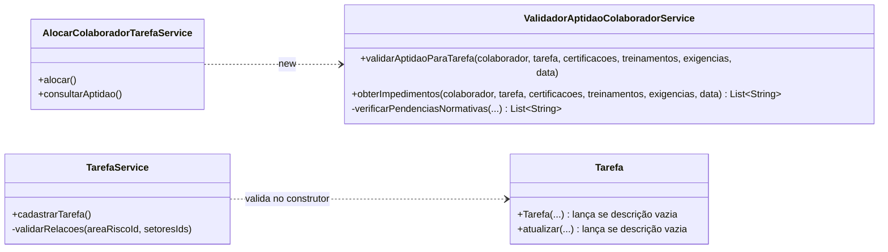

**Depois.** Uma cadeia por objeto validado; os casos de uso conhecem só a interface.

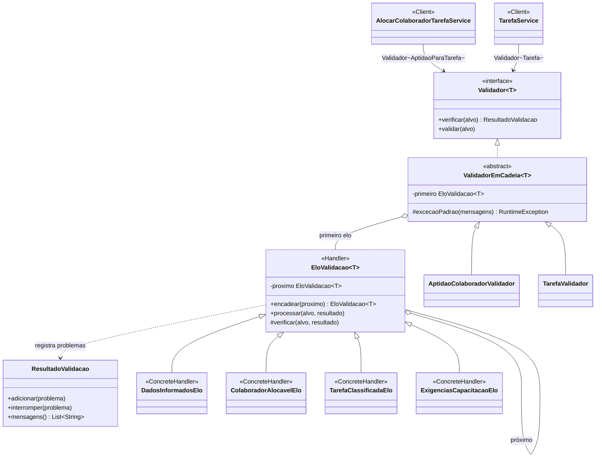

**Execução** de uma alocação de colaborador com certificação vencida:

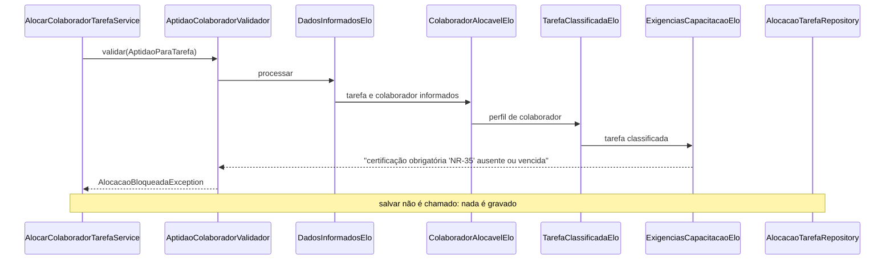

### Depois (código)

A consulta e o bloqueio usam a mesma cadeia:

```java
// AlocarColaboradorTarefaService.alocar: valida antes do repository.
validadorAptidao.validar(new AptidaoParaTarefa(
        colaborador, tarefa, certificacoes, treinamentos, exigencias, LocalDate.now()));
AlocacaoTarefa salva = alocacaoTarefaRepository.salvar(alocacao);

// AlocarColaboradorTarefaService.consultarAptidao: mesma cadeia, sem exceção.
List<String> impedimentos = validadorAptidao.verificar(new AptidaoParaTarefa(
        colaborador, tarefa, certificacoes, treinamentos, exigencias, LocalDate.now())).mensagens();
```

A cadeia é montada uma vez, na ordem das regras:

```java
@Component
public class AptidaoColaboradorValidador extends ValidadorEmCadeia<AptidaoParaTarefa> {

    private static EloValidacao<AptidaoParaTarefa> montarCadeia() {
        EloValidacao<AptidaoParaTarefa> primeiro = new DadosInformadosElo();
        primeiro.encadear(new ColaboradorAlocavelElo())
                .encadear(new TarefaClassificadaElo())
                .encadear(new ExigenciasCapacitacaoElo());
        return primeiro;
    }

    @Override
    protected RuntimeException excecaoPadrao(List<String> impedimentos) {
        return new AlocacaoBloqueadaException(impedimentos);
    }
}
```

Cada elo cuida de uma regra:

```java
class ColaboradorAlocavelElo extends EloValidacao<AptidaoParaTarefa> {
    @Override
    protected void verificar(AptidaoParaTarefa aptidao, ResultadoValidacao resultado) {
        if (!aptidao.colaborador().podeSerAlocado()) {
            ColaboradorNaoAlocavelException excecao = new ColaboradorNaoAlocavelException(aptidao.colaborador().getNome());
            resultado.interromper(Problema.comExcecao(excecao.getMessage(), () -> excecao));
        }
    }
}
```

Na tarefa, a validação saiu do construtor e passou a rodar no caso de uso, antes do repository:

```java
Tarefa novaTarefa = Tarefa.cadastrarComRelacoes(
        inputDTO.descricao(), inputDTO.areaRiscoId(), inputDTO.setoresIds());
validador.validar(novaTarefa);
...
Tarefa salva = repository.salvar(novaTarefa);
```

### Benefício

- **Uma implementação das regras de aptidão.** A consulta e a alocação passam pela mesma cadeia e não podem mais discordar.
- **Validação fora do domínio e antes do repository**, como pediu o professor. Nada é gravado quando a validação falha.
- **Uma regra por classe.** Incluir uma regra é criar um elo e encadeá-lo, sem mexer nos outros (aberto/fechado). Cada elo é testável sozinho.
- **Programação por interface.** Os casos de uso recebem `Validador<T>` e não criam mais o validador com `new`.
- **Comportamento preservado.** Mensagens, tipos de exceção e respostas HTTP são os mesmos de antes, e a ordem dos elos repete a ordem antiga das verificações.

### Métricas locais

Medidas com `scripts/metricas/coletar_metricas.py` (complexidade ciclomática por método):

| Métrica | Antes (v1.0.0) | Depois |
| --- | ---: | ---: |
| Implementações das regras de aptidão | 2 (`validarAptidaoParaTarefa` e `obterImpedimentos`) | 1 (a cadeia) |
| Maior complexidade de método nas regras de aptidão | 13 (`verificarPendenciasNormativas`) | 9 (`ExigenciasCapacitacaoElo.verificar`) |
| Complexidade dos elos de regra única | — | 2 a 4 |
| Parâmetros da validação de aptidão | 6 | 1 (`AptidaoParaTarefa`) |
| Validadores criados com `new` nos casos de uso | 1 | 0 |
| `throw` de validação de entrada em `Tarefa` | 2 (construtor e `atualizar`) | 0 |

### Evidências

- Testes da cadeia de aptidão: `validacao/aptidao/AptidaoColaboradorValidadorTest`, com os 13 casos do antigo `ValidadorAptidaoColaboradorServiceTest` e as mesmas asserções, além de um caso provando que a consulta e o bloqueio concordam.
- Testes da cadeia da tarefa: `validacao/tarefa/TarefaValidadorTest`, um caso por elo e a ordem dos problemas.
- `TarefaServiceTest` e `AlocarColaboradorTarefaUseCaseTest` sem alteração de asserções; o teste de descrição vazia saiu de `TarefaTest` e passou para `TarefaValidadorTest`.


### Aplicação 2/6: pré-condições da projeção de substituição (#267)

**Issue:** [#267](https://github.com/yIuriy/rp-iv-grupo03-safeplace/issues/267). O professor marcou `SubstituicaoInteligenteService.java:53` sem descrever o problema. No código havia dois:

- `calcularProjecao(Epi epi, NivelPerigo periculosidadeSetor, List<Emprestimo> emprestimos, LocalDate dataReferencia, Integer diasAmostragem)` recebia **5 parâmetros soltos**;
- antes do cálculo, o mesmo método tinha **4 blocos de validação em sequência**: vida útil, periculosidade do setor, CA ausente ou vencido e histórico de empréstimos. Cada bloco lançava `DadosInsuficientesParaProjecaoException`.

Além disso, `PlanejarSubstituicaoService` criava o serviço de cálculo com `new SubstituicaoInteligenteService()`.

**Antes:**

```java
public ProjecaoSubstituicao calcularProjecao(Epi epi, NivelPerigo periculosidadeSetor,
        List<Emprestimo> emprestimos, LocalDate dataReferencia, Integer diasAmostragem) {
    if (epi == null) { throw new IllegalArgumentException(...); }
    // 1. Validação de durabilidade nominal
    if (epi.getVidaUtilDias() == null || epi.getVidaUtilDias() <= 0) { throw new DadosInsuficientes...(...); }
    // 2. Validação de condições ambientais do setor
    if (periculosidadeSetor == null) { throw new DadosInsuficientes...(...); }
    // 3. Validação do CA
    if (validadeCa == null) { throw ... }
    if (validadeCa.isBefore(dataReferencia)) { throw ... }
    // 4. Validação do histórico
    if (historico.isEmpty()) { throw ... }
    // 5. em diante: o cálculo
}
```

**Depois:** o caso de uso valida e só então calcula.

```java
ContextoProjecao contexto = new ContextoProjecao(epi, perigo, emprestimos, dataReferencia, diasAmostragem);
validadorProjecao.validar(contexto);
ProjecaoSubstituicao projecao = calculoService.calcularProjecao(contexto);
```

| Papel | Elemento |
| --- | --- |
| ConcreteHandlers | `EpiInformadoElo`, `DurabilidadeNominalElo`, `PericulosidadeSetorElo`, `CertificadoAprovacaoElo`, `HistoricoEmprestimosElo` |
| Montagem da cadeia | `ProjecaoValidador` (`validacao/projecao`) |
| Objeto de contexto | `ContextoProjecao` (`domain/epi`), no lugar dos 5 parâmetros |
| Client | `PlanejarSubstituicaoService`, que recebe `Validador<ContextoProjecao>` e `CalculoProjecaoSubstituicao` por interface |

Decisões:

- **A pendência "sem uso no período" continua no cálculo.** Ela depende do período de amostragem, que só existe depois de calculado; não é pré-condição.
- **A mensagem e a exceção são as mesmas**, e a ordem dos elos é a ordem antiga. O caso de uso continua transformando a `DadosInsuficientesParaProjecaoException` em pendência do EPI e seguindo para o próximo.
- **`ContextoProjecao` fica em `domain/epi`**, e não em `validacao`, porque o cálculo do domínio também o recebe. O domínio não depende da camada de validação.
- **O cálculo virou a interface `CalculoProjecaoSubstituicao`**, registrada como bean em `config/ServicosDominioConfig`, sem anotação do Spring na classe de domínio.

| Métrica | Antes | Depois |
| --- | ---: | ---: |
| Complexidade ciclomática de `calcularProjecao` | 21 | 10 |
| Parâmetros de `calcularProjecao` | 5 | 1 |
| Linhas de código de `SubstituicaoInteligenteService` | 143 | 112 |
| Complexidade dos elos | — | 2 a 3 |
| Serviços de cálculo criados com `new` no caso de uso | 1 | 0 |

**Evidências:** `validacao/projecao/ProjecaoValidadorTest` recebeu os 5 testes de pré-condição de `SubstituicaoInteligenteServiceTest` com as mesmas asserções, além de casos para a ordem das pendências, o empréstimo posterior à data de referência e a falta de EPI. Os demais testes do cálculo continuam em `SubstituicaoInteligenteServiceTest`, só com a chamada trocada para `ContextoProjecao`.

### Aplicação 3/6: área de risco, setor, inspeção e pessoas (#263)

**Issue:** [#263](https://github.com/yIuriy/rp-iv-grupo03-safeplace/issues/263). As regras de cadastro e atualização desses módulos estavam espalhadas em três lugares:

- nos construtores e fábricas do domínio (`AreaRisco`, `Setor`, `Inspecao.registrar`, `ItemVerificado`, `Colaborador`, `Supervisor`, `GestorDeSeguranca`);
- na classe estática `domain.usuario.CpfValidador`, chamada dentro do construtor de `Colaborador`;
- nos casos de uso, para as regras que consultam o banco: código de área duplicado e setor existente em `AreaRiscoService`, CPF e e-mail já cadastrados em `UsuarioService`.

**Antes** (um exemplo de cada lugar):

```java
// Domínio: o construtor lançava.
public Colaborador(Integer id, String cpf, String nome, LocalDate dataNascimento, ...) {
    if (nome == null || nome.isBlank()) { throw new IllegalArgumentException("Nome é obrigatório."); }
    if (dataNascimento == null) { throw ... }
    if (dataNascimento.isAfter(LocalDate.now())) { throw ... }
    CpfValidador.validar(cpf);            // classe estática
    ...
}

// Caso de uso: validação antes do salvar, mas escrita à mão em cada serviço.
if (repositorioPorta.buscarPorCpf(cpfSanitizado).isPresent()) {
    throw new CpfJaCadastradoException("CPF já cadastrado no sistema: " + cpfSanitizado);
}
```

**Depois:** o objeto é montado sem validar, e o caso de uso chama o validador da classe antes do repository.

```java
Colaborador novoColaborador = Colaborador.novo(entrada.nome(), cpfSanitizado, entrada.dataNascimento(), entrada.email());
validador.validar(novoColaborador);
Colaborador salvo = repositorioPorta.salvar(novoColaborador);
```

| Validador (uma classe por objeto) | Elos, na ordem | Caso de uso |
| --- | --- | --- |
| `AreaRiscoValidador` | código único, setor existente, código, nível, agentes, limites, EPIs obrigatórios (RN1), nome | `AreaRiscoService` (cadastro e atualização) |
| `SetorValidador` | nome, status | `SetorService` (cadastro e atualização) |
| `InspecaoValidador` | itens completos, área, responsável, data, data não futura, ao menos um item | `InspecaoService` |
| `ColaboradorValidador` | CPF válido (interrompe), CPF e e-mail disponíveis, nome, nascimento, nascimento não futuro, credenciais do perfil | `UsuarioService` (cadastros e atualizações das três pessoas) |
| `CpfValidador` | 11 dígitos (interrompe), sem dígitos repetidos | usado pelo `ColaboradorValidador` e pela busca por CPF |

**Elo genérico para regras simples.** Muitas regras são "campo obrigatório" e só mudam o campo e a mensagem. Para não criar uma classe quase vazia por campo, `validacao/RegraElo` é um ConcreteHandler parametrizado: recebe a condição, a mensagem e a exceção. Regras com lógica própria (unicidade, CPF, itens da inspeção, credenciais por perfil) continuam como classes.

Decisões:

- **Unicidade entrou na cadeia.** "Código já existe", "CPF já cadastrado" e "e-mail já cadastrado" também são validação antes do repository. Os elos ignoram o próprio registro, então servem ao cadastro e à atualização.
- **Uma cadeia para cadastro e atualização da área de risco.** Antes, a atualização tinha mensagens próprias ("... na atualização da área de risco" e "Dados de alteração da área de risco são inválidos."). Agora as duas operações usam as mensagens do cadastro. É a única mudança de texto; os tipos de exceção e os status HTTP não mudaram.
- **EPIs da área são resolvidos antes da validação.** O caso de uso converte os ids em EPIs antes de montar a área, então um EPI inexistente é recusado antes de código duplicado ou setor inexistente. Antes, a ordem era a inversa; só muda qual erro aparece primeiro quando há mais de um.
- **CPF:** a normalização (só dígitos) ficou no domínio, em `domain/usuario/Cpf`; a validação virou o componente `CpfValidador`, injetado por interface.
- **Operações do diagrama removidas:** `AreaRisco.validarDadosAreaRisco()`, `salvarAreaRisco()` e `validarAlteracoes(...)` não eram usadas em nenhum lugar e repetiam as regras. Elas correspondem agora a `AreaRiscoValidador.verificar` (validar dados e alterações) e ao `validar` seguido de `AreaRiscoRepository.salvar` (salvar).
- **`ItemVerificado.conformidade`** passou de `boolean` para `Boolean`, para que o resultado ausente chegue ao validador em vez de quebrar no construtor.
- **`Inspecao.registrar`** perdeu o parâmetro `hoje`, que só servia à validação da data; o `InspecaoValidador` recebe a data de hoje (`Supplier<LocalDate>`), o que mantém a regra testável.

| Métrica | Antes | Depois |
| --- | ---: | ---: |
| `throw` de validação nas 7 classes de domínio do escopo | 27 | 0 |
| Classe estática de validação no domínio (`CpfValidador`) | 1 | 0 |
| Validações escritas à mão nos casos de uso (`validarIdentificacaoDisponivel`, `validarEmailDisponivelPara`, consultas de código e setor) | 4 | 0 |
| Linhas no código de produção alterado (domínio e casos de uso) | — | −140 |

**Evidências:**

- `validacao/arearisco/AreaRiscoValidadorTest`, `validacao/setor/SetorValidadorTest`, `validacao/inspecao/InspecaoValidadorTest`, `validacao/usuario/ColaboradorValidadorTest` e `validacao/usuario/CpfValidadorTest` receberam os testes de recusa de `AreaRiscoTest`, `SetorTest`, `InspecaoTest`, `ColaboradorTest`, `GestorDeSegurancaTest`, `SupervisorTest`, `AtualizacaoCadastralTest` e do antigo `CpfValidadorTest`, com as mesmas asserções.
- Casos novos: código e CPF/e-mail duplicados ignorando o próprio registro, setor inexistente, ordem dos problemas, itens da inspeção verificados antes da data e CPF inválido interrompendo a cadeia.
- Testes dos casos de uso (`AreaRiscoServiceTest`, `SetorServiceTest`, `InspecaoServiceTest`, `UsuarioService*Test`) sem alteração.

### Aplicação 4/6: EPI, estoque, manutenção e projeção (#264)

**Issue:** [#264](https://github.com/yIuriy/rp-iv-grupo03-safeplace/issues/264). As classes do módulo de EPI validavam na criação: construtores e fábricas de `Epi`, `ModeloEPI`, `LoteEPI`, `EspecificacaoEPI`, `MovimentacaoEstoque`, `ManutencaoEpi`, `ProjecaoSubstituicao` e `AlertaSubstituicaoEpi`. O número do CA era validado dentro de `ModeloEPI.deCadastroLegado`, durante a conversão do texto ("CA-12345") para o CA inteiro.

**Critério usado:** sai do domínio o que valida a **criação** do objeto. Ficam no domínio as regras das **operações**, que protegem uma mudança de estado: `adicionarEstoque`/`removerEstoque` (quantidade positiva, saldo insuficiente, motivo), `validarCaValido`, `enviarParaManutencao`, `concluirManutencao` e `ModeloEPI.reutilizarPara`. Foi o mesmo critério de `Tarefa.classificar` na #228.

**Antes:**

```java
private Epi(Integer id, String nome, LoteEPI lote, int quantidade, EspecificacaoEPI especificacao, ...) {
    if (nome == null || nome.isBlank()) { throw new IllegalArgumentException("Nome do EPI é obrigatório."); }
    if (quantidade < 0) { throw ... }
    if (especificacao == null) { throw ... }
    if (status == null) { throw ... }
    if (lote == null) { throw ... }
    ...
}

public static Epi novo(String nome, LoteEPI lote, ...) {
    lote.getModelo().validarParaCadastroEm(LocalDate.now());   // CA vencido
    return new Epi(...);
}
```

**Depois** (`EpiService.cadastrarEpi`):

```java
numeroCaValidador.validar(inputDTO.numeroCa());
ModeloEPI informado = ModeloEPI.deCadastroLegado(inputDTO.numeroCa(), inputDTO.marca(), inputDTO.dataValidadeCa());
modeloValidador.validar(informado);
ModeloEPI modelo = repository.buscarModeloPorCa(informado.getCa())
        .map(existente -> existente.reutilizarPara(informado))
        .orElse(informado);
...
epiValidador.validar(novoEpi);
Epi salvo = repository.salvar(novoEpi);
```

| Validador | Elos, na ordem | Onde é chamado |
| --- | --- | --- |
| `NumeroCaValidador` | obrigatório (interrompe), só dígitos com prefixo `CA-` opcional, limite inteiro | `EpiService`, antes da conversão |
| `ModeloEpiValidador` | CA maior que zero, validade obrigatória | `EpiService`, antes de buscar o CA existente |
| `EpiValidador` | modelo do lote, CA, validade, quantidade mínima, nome, quantidade, especificação, status, lote, CA vigente no cadastro | `EpiService`, antes de salvar |
| `MovimentacaoEstoqueValidador` | tipo, quantidade, data e hora, motivo | `EpiService` e `EmprestimoService`, antes de gravar cada movimentação |
| `ManutencaoEpiValidador` | EPI, data, descrição, resultado, responsável | `ControlarManutencaoEpiService` e `EmprestimoService` (devolução para manutenção) |
| `ProjecaoSubstituicaoValidador` | EPI, data da projeção, data de descarte, justificativa | `PlanejarSubstituicaoService`, antes de gravar o lote de projeções |
| `AlertaSubstituicaoValidador` | EPI, nome, tipo, mensagem | `PlanejarSubstituicaoService`, antes de devolver o alerta (o alerta não é gravado) |

Decisões:

- **Conversão do CA sem exceção.** `ModeloEPI.deCadastroLegado` só converte: texto fora do formato vira CA 0, recusado pelo validador como "CA inválido.". O formato é conferido antes, pelo `NumeroCaValidador`, com as mensagens de antes. É o mesmo arranjo do CPF na #263: normalização no domínio, validação na camada de validação.
- **Regras de `LoteEPI` e `EspecificacaoEPI` no `EpiValidador`.** As duas classes só existem dentro do EPI, então as regras delas viraram elos da cadeia do EPI, na posição em que eram verificadas antes (o lote e a especificação eram montados antes do EPI).
- **CA vencido só no cadastro.** O elo `CA vigente` só se aplica a EPI sem id; um EPI gravado pode ter o CA vencido depois, como antes. O validador recebe a data de hoje (`Supplier<LocalDate>`), o que mantém a regra testável; o parâmetro `dataCadastro` de `Epi.novo` deixou de ser usado e será removido com as sobrecargas em #225.
- **O motivo ficou também na operação de estoque.** Antes, um motivo vazio quebrava a criação da movimentação **antes** de o saldo mudar. Para não perder essa garantia ("o saldo nunca muda sem uma movimentação válida"), `adicionarEstoque` e `removerEstoque` conferem o motivo antes de alterar o saldo. O elo de motivo continua cobrindo quem cria a movimentação diretamente, como a baixa por descarte no empréstimo.
- **Dois `Validador<String>`.** `CpfValidador` e `NumeroCaValidador` validam texto; os pontos de injeção usam `@Qualifier` para escolher o certo.

| Métrica | Antes | Depois |
| --- | ---: | ---: |
| `throw` de validação na criação (8 classes do escopo) | 29 | 0 |
| `throw` em regras de operação (mantidos no domínio) | 17 | 18 |
| Validadores criados | — | 7 |

O `throw` a mais nas operações é o `exigirMotivo`, que substituiu a verificação do motivo que acontecia no construtor da movimentação.

**Evidências:** `validacao/epi/EpiValidadorTest`, `CadastroEpiValidadoresTest` e `RegistrosEpiValidadoresTest` receberam os testes de recusa de `EpiTest`, `EspecificacaoEPITest`, `LoteEPITest`, `ModeloEPITest`, `MovimentacaoEstoqueTest`, `ManutencaoEpiTest` e `ProjecaoSubstituicaoTest`, com as mesmas mensagens. O teste `EpiTest.devePreservarSaldoEStatusQuandoEntradaTiverMotivoInvalido` continua passando sem alteração.

### Aplicação 5/6: empréstimo, alocação e capacitação (#265)

**Issue:** [#265](https://github.com/yIuriy/rp-iv-grupo03-safeplace/issues/265). As regras de criação estavam nos construtores de `Emprestimo` (11 verificações), `AlocacaoTarefa`, `Certificacao`, `Treinamento` e `ExigenciaCapacitacao`, e em `Certificacao.cadastrar` (vencimento no futuro). `ExigenciaCapacitacao` não estava listada na issue, mas é do mesmo módulo e é criada no mesmo serviço.

**Fica no domínio:** `Emprestimo.devolver`, que encerra um empréstimo ativo e recusa devolução duplicada ou anterior à retirada. É regra da operação, pelo mesmo critério da #264.

**Antes:**

```java
public Emprestimo(Integer id, Integer epiId, Integer colaboradorId, Integer responsavelEntregaId, ...) {
    exigir(epiId != null, "EPI é obrigatório.");
    exigir(colaboradorId != null, "Colaborador é obrigatório.");
    ... // 11 verificações
}
```

**Depois** (`EmprestimoService.registrarEntrega`):

```java
Emprestimo emprestimo = Emprestimo.registrarEntrega(epi.getId(), beneficiario.getId(), operador.getId(),
        agora, entrada.dataDevolucaoPrevista(), termo, entrada.justificativaSubstituicao());
emprestimoValidador.validar(emprestimo);          // antes de baixar o estoque e de gravar
MovimentacaoEstoque saida = epi.removerEstoque(...);
```

| Validador | Elos, na ordem | Onde é chamado |
| --- | --- | --- |
| `EmprestimoValidador` | EPI, colaborador, responsável, retirada, devolução prevista, previsão não anterior à retirada, termo, status, coerência status × devolução, estado e responsável da devolução | `EmprestimoService`: na entrega, logo após criar; na devolução, antes de gravar |
| `AlocacaoTarefaValidador` | tarefa, colaborador, responsável | `AlocarColaboradorTarefaService`, depois da cadeia de aptidão (#228) |
| `CertificacaoValidador` | vencimento futuro no cadastro, nome, emissão, vencimento, emissão não futura, emissão não posterior ao vencimento, colaborador | `CadastrarCapacitacaoService` |
| `TreinamentoValidador` | nome, data, data não futura, validade de ao menos 1 mês, colaboradores | `CadastrarCapacitacaoService` |
| `ExigenciaCapacitacaoValidador` | nome, campos de vínculo | `CadastrarCapacitacaoService` |

Decisões:

- **Vencimento futuro só no cadastro.** O elo só se aplica a certificação sem id, como fazia `Certificacao.cadastrar`; uma certificação gravada pode vencer depois. Os validadores de certificação e treinamento recebem a data de hoje (`Supplier<LocalDate>`), o que torna as regras de data testáveis.
- **Correção de passagem:** `Certificacao.cadastrar` com vencimento nulo lançava `NullPointerException` antes de chegar à mensagem "Data de vencimento é obrigatória."; agora a mensagem aparece.
- **A devolução também é validada antes de gravar**, porque o validador confere a coerência entre o status e os dados da devolução, que antes o construtor conferia ao reconstruir o empréstimo.

| Métrica | Antes | Depois |
| --- | ---: | ---: |
| Validações na criação (5 classes do escopo) | 28 | 0 |
| Validações na operação `Emprestimo.devolver` (mantidas) | 6 | 6 |
| Validadores criados | — | 5 |

**Evidências:** `validacao/emprestimo/EmprestimoValidadorTest` e `validacao/capacitacao/CapacitacaoValidadoresTest` receberam os testes de recusa de `EmprestimoTest`, `CertificacaoTest` e `TreinamentoTest`, com as mesmas asserções; `validacao/tarefa/AlocacaoTarefaValidadorTest` e os casos de exigência e de vencimento no cadastro são novos. Os testes de `EmprestimoService`, `AlocarColaboradorTarefaService` e `CadastrarCapacitacaoService` não mudaram.

### Aplicação 6/6: ocorrência e plano de ação (#266)

**Issue:** [#266](https://github.com/yIuriy/rp-iv-grupo03-safeplace/issues/266). Era o módulo com mais validação na criação:

- `PlanoDeAcao.definir` e o construtor (ocorrência registrada, medidas, responsável único e cadastrado, prazo, alerta);
- o método estático `PlanoDeAcao.validarPlano`, que confere o conjunto de ações da ocorrência;
- os construtores de `Ocorrencia`, `Acidente` e `Incidente`;
- o Value Object `NumeroProtocoloCAT`, que recusava formato inválido na criação;
- as fábricas `NotificacaoAcao.deAviso` e `NotificacaoOcorrencia.deNovoRelato`.

**Ficam no domínio** as operações: `atualizarStatus`, `prorrogarPrazo`, `atualizarResponsavel`, `configurarAlerta` (13 `throw` em `PlanoDeAcao`), `Acidente.consolidarCAT`, `Acidente.lerGravidade` (conversão do texto da gravidade) e `NumeroProtocoloCAT.gerar`, que monta o número a partir da sequência do banco.

**Antes** (`PlanoDeAcaoService.cadastrarAcao`):

```java
PlanoDeAcao acao = PlanoDeAcao.definir(ocorrencia, ..., gestor, LocalDate.now());   // lançava aqui
...
PlanoDeAcao.validarPlano(ocorrencia, todasAcoes);                                   // estático no domínio
PlanoDeAcao salvo = planoDeAcaoRepository.salvar(acao);
```

**Depois:**

```java
PlanoDeAcao acao = PlanoDeAcao.definir(ocorrencia, ..., gestor, hoje);
acaoValidador.validar(new AcaoDoPlano(acao, ocorrencia, hoje));
...
planoValidador.validar(new PlanoDaOcorrencia(ocorrencia, todasAcoes));
PlanoDeAcao salvo = planoDeAcaoRepository.salvar(acao);
```

| Validador | Elos, na ordem | Onde é chamado |
| --- | --- | --- |
| `OcorrenciaValidador` | data, data não futura, descrição; acidente: causa raiz, gravidade, formato do protocolo; incidente: situação de risco, potencial de dano | `OcorrenciaService`, no registro e na atualização |
| `AcaoPlanoValidador` | ocorrência registrada, medida, responsável único, responsável cadastrado, prazo, prazo não anterior a hoje nem à ocorrência, antecedência do alerta | `PlanoDeAcaoService.cadastrarAcao` |
| `PlanoValidador` | ocorrência registrada (interrompe), ao menos uma ação, ações da própria ocorrência, ação preventiva em ocorrência grave | `PlanoDeAcaoService.cadastrarAcao` |
| `AvisoAcaoValidador` | ação registrada (interrompe), prazo e data do aviso, responsável único | `NotificacaoAcaoInternaAdapter`, antes de montar e gravar a notificação |
| `NotificacaoOcorrenciaValidador` | ocorrência registrada | `NotificacaoOcorrenciaInternaAdapter`, antes de montar e gravar a notificação |

Decisões:

- **Objetos de contexto.** O prazo da ação é comparado com a data da ocorrência, que a ação guarda só pelo id. Por isso o validador recebe `AcaoDoPlano` (ação, ocorrência e data de hoje). O conjunto do plano vira `PlanoDaOcorrencia`. O mesmo arranjo de `AptidaoParaTarefa` na #228.
- **Operação `validarPlano` do diagrama.** Era um método estático só de validação; agora é a cadeia `PlanoValidador`. A correspondência foi atualizada em `correspondencia-classes-plano-de-acao.md`.
- **Value Object do protocolo.** `NumeroProtocoloCAT` só normaliza o texto e informa `formatoValido()`; a recusa ("Formato de protocolo CAT inválido") é um elo do `OcorrenciaValidador`. Isso adianta a parte de validação da #230, que depois passou a guardar o VO em `Acidente` (ver [Value Object](#value-object--protocolo-cat-em-acidente)).
- **Notificações validadas no adaptador.** As duas notificações são montadas e gravadas pelos adaptadores de saída (`NotificadorAcao`, `NotificadorOcorrencia`), que são o "repository" delas. A validação roda ali, antes de gravar.
- **Regras repetidas de propósito.** "Responsável único e cadastrado" e "antecedência do alerta" valem tanto na criação (validador) quanto nas operações `atualizarResponsavel` e `configurarAlerta` (domínio), como o motivo da movimentação na #264.
- **`RegraElo.interrompendo()`.** Uma regra simples pode agora interromper a cadeia, para os elos seguintes não receberem um objeto nulo (usado no aviso).
- **Dois `Validador<Ocorrencia>`.** `OcorrenciaValidador` e `NotificacaoOcorrenciaValidador` validam o mesmo tipo; os pontos de injeção usam `@Qualifier`.

| Métrica | Antes | Depois |
| --- | ---: | ---: |
| `throw` de validação na criação (7 classes do escopo) | 23 | 0 |
| `throw` nas operações (mantidos no domínio) | 16 | 16 |
| Validação estática no domínio (`PlanoDeAcao.validarPlano`) | 1 | 0 |
| Validadores criados | — | 5 |

**Evidências:** `validacao/ocorrencia/OcorrenciaValidadorTest` e `PlanoDeAcaoValidadoresTest` receberam os testes de recusa de `OcorrenciaTest`, `AcidenteTest`, `IncidenteTest`, `NotificacaoAcaoTest`, `NotificacaoOcorrenciaTest` e `PlanoDeAcaoTest`, com as mesmas asserções, além de casos para a ordem dos problemas. Em `NumeroProtocoloCATTest`, os casos de formato inválido passaram a conferir `formatoValido()`, com os mesmos valores.

### Resultado das seis aplicações

| Issue | Escopo | Validadores | `throw` de criação removidos do domínio |
| --- | --- | ---: | ---: |
| #228 | Camada `validacao`, aptidão e tarefa | 2 | 2 (+ a regra de aptidão duplicada) |
| #267 | Pré-condições da projeção | 1 | 4 blocos de `if` saíram do cálculo |
| #263 | Área de risco, setor, inspeção e pessoas | 5 | 27 |
| #264 | EPI, estoque, manutenção e projeção | 7 | 29 |
| #265 | Empréstimo, alocação e capacitação | 5 | 28 |
| #266 | Ocorrência e plano de ação | 5 | 23 |

As regras que continuam no domínio são das **operações** que mudam o estado de um objeto já criado (baixa de estoque, devolução, transição de situação, prorrogação, reatribuição). A **criação** de objetos não valida mais nada, como pediu o professor, e todo caso de uso valida antes de chamar o repository.
---

## Data Mapper — mapeadores de persistência

**Catálogo:** PoEAA (Fowler) — Data Mapper.

**Intenção:** centralizar a conversão entre entidades JPA (`*Entity`) e entidades de domínio (`domain`) em mapeadores únicos (`EpiEntityMapper`, `AreaRiscoEntityMapper`, `PlanoDeAcaoEntityMapper`), eliminando mapeamentos duplicados e divergentes entre adaptadores.

**Issues:** [#229](https://github.com/yIuriy/rp-iv-grupo03-safeplace/issues/229) e [#242](https://github.com/yIuriy/rp-iv-grupo03-safeplace/issues/242).

### Problema (antes)

*A preencher nas issues [#229](https://github.com/yIuriy/rp-iv-grupo03-safeplace/issues/229) e [#242](https://github.com/yIuriy/rp-iv-grupo03-safeplace/issues/242) (base: `docs/revisões/analise-padroes-projeto-v1.0.0.md`, §4).*

### Papéis do padrão

| Papel no padrão | Elemento no código | Responsabilidade |
| --- | --- | --- |
| Domain Model | `Epi`, `AreaRisco`, `PlanoDeAcao` | Entidades do domínio |
| Persistence Entity | `EpiEntity`, `AreaRiscoEntity`, `PlanoDeAcaoEntity` | Entidades relacionais mapeadas com JPA |
| Data Mapper | `EpiEntityMapper`, `AreaRiscoEntityMapper`, `PlanoDeAcaoEntityMapper` | Converter entre `*Entity` e o domínio em um único ponto |

### Diagramas

*Diagramas PlantUML antes e depois a preencher nas issues [#229](https://github.com/yIuriy/rp-iv-grupo03-safeplace/issues/229) e [#242](https://github.com/yIuriy/rp-iv-grupo03-safeplace/issues/242).*

### Métricas locais

| Métrica | Antes (v1.0.0) | Depois |
| --- | --- | --- |
| Conversões duplicadas de `AreaRiscoEntity` e `PlanoDeAcaoEntity` | 4 | 2 |

### Evidências

*A preencher nas issues [#229](https://github.com/yIuriy/rp-iv-grupo03-safeplace/issues/229) e [#242](https://github.com/yIuriy/rp-iv-grupo03-safeplace/issues/242).*

---

## Value Object — protocolo CAT em `Acidente`

**Catálogo:** Fowler (PoEAA) e Evans (DDD), Value Object.

**Intenção:** guardar o protocolo CAT como `NumeroProtocoloCAT` dentro de `Acidente` durante todo o ciclo de vida da entidade, para que o número circule como um tipo próprio, comparado por valor, e não como texto solto que precisa ser reconvertido a cada uso.

**Issue:** [#230](https://github.com/yIuriy/rp-iv-grupo03-safeplace/issues/230), aplicada. Depende da validação feita em [#266](https://github.com/yIuriy/rp-iv-grupo03-safeplace/issues/266) e segue a convenção de objeto de valor da [decisão de JPA no domínio](decisao-entidades-jpa-dominio.md) (#254, seção 2.2).

### Problema (antes)

O VO existia, mas não era guardado. `Acidente` tinha o campo `private final String numeroProtocoloCAT`, e o construtor criava o VO só para validar e normalizar o texto, descartando-o na mesma linha: `NumeroProtocoloCAT.de(numeroProtocoloCAT).getValor()`. Na v1.0.0 essa chamada lançava exceção para formato inválido; depois da #266, o construtor do VO deixou de validar, e a chamada passou a servir só para normalizar.

O mesmo vaivém entre texto e objeto aparecia em quatro pontos de produção:

| Ponto | Código antes |
| --- | --- |
| Construtor de `Acidente` | `NumeroProtocoloCAT.de(numeroProtocoloCAT).getValor()` |
| `Acidente.consolidarCAT` | gerava o VO e passava `protocolo.getValor()` ao construtor |
| `OcorrenciaService.registrarAcidente` | `NumeroProtocoloCAT.gerar(dataRef, sequencial).getValor()` |
| `OcorrenciaValidador` (elo do formato) | `new NumeroProtocoloCAT(acidente.getNumeroProtocoloCAT()).formatoValido()` |

Havia também uma lacuna de validação: `OcorrenciaService.consolidarCAT`, que emite a CAT dos acidentes antigos, gravava o protocolo novo sem passar pelo elo do formato.

Além disso, o protocolo circulava como `String` em `NotificacaoOcorrencia` e nas classes de persistência (`AcidenteEntity`, `NotificacaoOcorrenciaEntity`). Qualquer código podia montar um `Acidente` com um texto qualquer no lugar do protocolo, e a igualdade entre dois protocolos dependia de quem lembrasse de normalizar (maiúsculas e espaços) antes de comparar.

### Por que Value Object

O protocolo CAT não tem identidade própria: dois protocolos com o mesmo número são o mesmo protocolo. É o caso típico de Value Object. O VO já sabia normalizar o texto, gerar o número a partir da sequência e informar se o formato é válido; faltava a entidade guardá-lo. Com o VO como atributo:

- a normalização acontece uma vez, quando o VO é criado, e não a cada conversão;
- a igualdade é por valor (`record`), então `CAT-2026-09-0001` e ` cat-2026-09-0001 ` são iguais;
- o elo do formato consulta o objeto guardado, sem recriá-lo a partir do texto;
- a notificação recebe o mesmo objeto do acidente, sem revalidar.

**Validação fora do domínio.** Conforme a avaliação do professor, o VO não recusa nada na criação. A verificação do formato é o elo "Formato de protocolo CAT inválido" (Chain of Responsibility, #266), que roda no caso de uso antes do repository. O VO continua responsável pela igualdade por valor e pela geração do número.

**Elo do formato reaproveitado.** O elo saiu do corpo do `OcorrenciaValidador` para `ProtocoloCATValidador.eloFormato()`, sem mudar mensagem, exceção nem posição na cadeia. O `OcorrenciaValidador` continua encadeando o elo no registro e na atualização. O `ProtocoloCATValidador` usa o mesmo elo sozinho em `consolidarCAT`, antes de `salvarAcidente`. A cadeia completa não foi usada ali porque a consolidação atende acidentes antigos, e o banco aceita `causa_raiz` nula (V32): reaplicar as regras do relato passaria a recusar consolidações que hoje funcionam. Como só o protocolo muda nessa operação, só ele é conferido.

**Mapeamento JPA.** O VO recebeu `@Embeddable`, como define a decisão #254. Enquanto a ocorrência não migra para o domínio (#261), ele é embutido com `@Embedded` nas classes de persistência que ainda existem, na mesma coluna de antes, via `@AttributeOverride`: `acidentes.numero_protocolo` em `AcidenteEntity` e `notificacoes_ocorrencia.numero_protocolo_cat` em `NotificacaoOcorrenciaEntity`. Quando a #261 anotar `Acidente` com `@Entity`, o campo `@Embedded` passa para a classe de domínio sem mudar o VO nem o banco. A consulta por protocolo compara o texto do VO (`a.numeroProtocolo.valor`), com a mesma regra de busca de antes.

**Contrato preservado.** `Acidente.getNumeroProtocoloCAT()` e `getNumeroProtocolo()` continuam devolvendo `String`. O VO é exposto por `getProtocoloCAT()`. Os DTOs e as respostas HTTP continuam com o protocolo em texto, e nenhuma migração Flyway foi criada.

### Papéis do padrão

| Papel no padrão | Elemento no código | Responsabilidade |
| --- | --- | --- |
| Value Object | `NumeroProtocoloCAT` (`record`, `@Embeddable`) | Normalizar o texto, gerar o número pela sequência, informar `formatoValido()` e comparar por valor |
| Entity que o contém | `Acidente` | Guardar o VO como atributo (`getProtocoloCAT()`) e manter o getter em `String` |
| Outros usuários do VO | `NotificacaoOcorrencia`, `AcidenteEntity`, `NotificacaoOcorrenciaEntity` | Receber o mesmo VO, sem reconverter; as duas entidades o embutem na coluna de hoje |
| Validação do formato | `ProtocoloCATValidador.eloFormato()`, encadeado no `OcorrenciaValidador` (#266) e usado sozinho pelo `ProtocoloCATValidador` | Recusar o formato inválido antes do repository, consultando o VO guardado, no registro, na atualização e na consolidação da CAT |

### Diagramas

**Antes.** `Acidente` guarda texto; o VO é criado e descartado em cada ponto de uso.

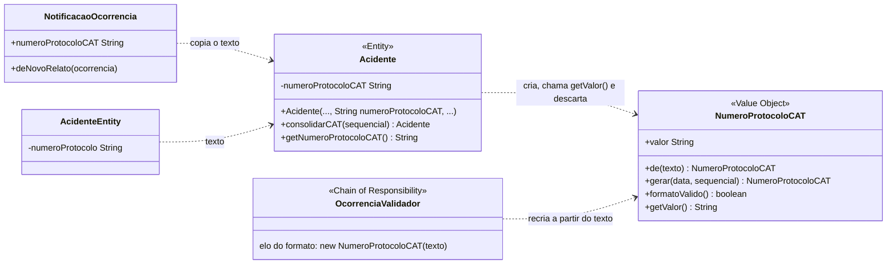

**Depois.** `Acidente` guarda o VO; os demais recebem o mesmo objeto.

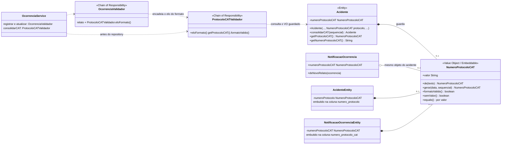

### Código antes × depois

**Campo e construtor de `Acidente`.**

Antes:

```java
private final String numeroProtocoloCAT;
...
if (numeroProtocoloCAT != null && !numeroProtocoloCAT.isBlank()) {
    this.numeroProtocoloCAT = NumeroProtocoloCAT.de(numeroProtocoloCAT).getValor();
} else {
    this.numeroProtocoloCAT = null;
}
...
public String getNumeroProtocoloCAT() {
    return numeroProtocoloCAT;
}
```

Depois:

```java
private final NumeroProtocoloCAT numeroProtocoloCAT;
...
// Value Object (#230): o protocolo é guardado como veio, sem revalidar; sem texto, não foi emitido.
this.numeroProtocoloCAT = numeroProtocoloCAT != null && !numeroProtocoloCAT.semValor()
        ? numeroProtocoloCAT
        : null;
...
public NumeroProtocoloCAT getProtocoloCAT() {
    return numeroProtocoloCAT;
}

public String getNumeroProtocoloCAT() {
    return numeroProtocoloCAT != null ? numeroProtocoloCAT.getValor() : null;
}
```

**Elo do formato.**

Antes (`OcorrenciaValidador`):

```java
.encadear(exigirComMensagem(OcorrenciaValidador::protocoloInvalido,
        o -> "Formato de protocolo CAT inválido: " + ((Acidente) o).getNumeroProtocoloCAT(),
        ProtocoloCATInvalidoException::new))
...
return ocorrencia instanceof Acidente acidente
        && acidente.getNumeroProtocoloCAT() != null
        && !new NumeroProtocoloCAT(acidente.getNumeroProtocoloCAT()).formatoValido();
```

Depois (`OcorrenciaValidador` e `ProtocoloCATValidador`):

```java
// OcorrenciaValidador: mesmo elo, mesma posição na cadeia.
.encadear(ProtocoloCATValidador.<Ocorrencia>eloFormato())

// ProtocoloCATValidador
public static <T extends Ocorrencia> RegraElo<T> eloFormato() {
    return exigirComMensagem(ProtocoloCATValidador::protocoloInvalido,
            o -> "Formato de protocolo CAT inválido: " + ((Acidente) o).getNumeroProtocoloCAT(),
            ProtocoloCATInvalidoException::new);
}

private static boolean protocoloInvalido(Ocorrencia ocorrencia) {
    if (!(ocorrencia instanceof Acidente acidente)) {
        return false;
    }
    NumeroProtocoloCAT protocolo = acidente.getProtocoloCAT();
    return protocolo != null && !protocolo.formatoValido();
}
```

**Consolidação da CAT em `OcorrenciaService`.**

Antes:

```java
Acidente consolidado = acidente.consolidarCAT(sequencial);
Acidente salvo = repository.salvarAcidente(consolidado);
```

Depois:

```java
Acidente consolidado = acidente.consolidarCAT(sequencial);
protocoloValidador.validar(consolidado);
Acidente salvo = repository.salvarAcidente(consolidado);
```

**Mapeamento em `AcidenteEntity` (mesma coluna).**

Antes:

```java
@Column(name = "numero_protocolo")
private String numeroProtocolo;
```

Depois:

```java
@Embedded
@AttributeOverride(name = "valor", column = @Column(name = "numero_protocolo", length = 80))
private NumeroProtocoloCAT numeroProtocolo;
```

### Benefício

O protocolo deixou de ser um texto que cada ponto do código precisava reconverter e normalizar por conta própria. Ele é criado uma vez (gerado pela sequência no registro e na consolidação, ou lido do banco), guardado no acidente e repassado como o mesmo objeto à notificação e ao validador. Comparar dois protocolos ficou seguro, porque a igualdade é do próprio tipo e já considera a normalização. A assinatura do construtor de `Acidente` agora diz o que espera: um `NumeroProtocoloCAT`, e não uma `String` qualquer. E, como o VO já é `@Embeddable`, a migração da ocorrência para JPA no domínio (#261) só precisa mover o campo `@Embedded`, sem tocar no VO, no banco ou no contrato HTTP.

### Métricas locais

| Métrica | Antes (v1.0.0) | `dev` antes da #230 | Depois |
| --- | ---: | ---: | ---: |
| Descarte imediato do VO no construtor de `Acidente` (`de(...).getValor()`) | 1 | 1 | 0 |
| Conversões VO → `String` → VO em produção (tabela do problema) | 3 | 4 | 0 |
| Campos de domínio com o protocolo em `String` (`Acidente`, `NotificacaoOcorrencia`) | 2 | 2 | 0 |
| Colunas de protocolo mapeadas pelo VO embutido | 0 | 0 | 2 |
| Fluxos que gravam protocolo novo sem o elo do formato (`consolidarCAT`) | 1 | 1 | 0 |
| Construtores de `OcorrenciaService` | 3 | 2 | 2 |
| Migrações Flyway novas | | | 0 |

Na v1.0.0 o elo do formato não existia (a validação estava no construtor do VO), por isso a contagem é 3. Medição por busca no código de `backend/src/main`.

### Evidências

Testes novos:

1. `AcidenteProtocoloCATTest` (6 testes, 7 casos; papéis Entity e Value Object): `Acidente` guarda a própria instância do VO recebido e o getter em texto devolve o valor dele; formato inválido fica guardado, sem revalidar, para o validador recusar; protocolo ausente ou sem texto significa CAT não emitida; `consolidarCAT` guarda o VO gerado pela sequência; dois acidentes com o mesmo número têm protocolos iguais vindos de instâncias diferentes; a `NotificacaoOcorrencia` recebe o mesmo objeto do acidente (`isSameAs`).
2. `NumeroProtocoloCATTest` (4 testes novos, 7 casos; igualdade por valor): protocolos com valores diferentes não são iguais, nem iguais ao texto; o número gerado é igual ao lido do texto e conta como um só elemento num `HashSet`; espaços e caixa não mudam a identidade; `semValor()` distingue protocolo não emitido de protocolo com texto, mesmo inválido.
3. `ProtocoloCATValidadorTest` (3 testes, 5 casos; elo do formato sozinho): aceita protocolo no formato e acidente sem protocolo; recusa formato inválido com a mesma exceção e mensagem do `OcorrenciaValidador`; não reaplica as regras do relato (o mesmo acidente incompleto passa no `ProtocoloCATValidador` e é recusado pelo `OcorrenciaValidador`).
4. `OcorrenciaServiceConsolidacaoCATTest` (3 testes; Client da validação): o validador do protocolo recebe o acidente já com o VO gerado e roda antes de `salvarAcidente`; se o formato for recusado, nada é salvo e a exceção do elo chega ao cliente; um acidente antigo sem causa raiz continua sendo consolidado.

Testes ajustados (só a forma de informar o protocolo, agora `NumeroProtocoloCAT.de(...)`): `AcidenteTest`, `NotificacaoOcorrenciaTest`, `OcorrenciaValidadorTest`, `OcorrenciaServiceTest`, `OcorrenciaConsultaUseCaseTest`, `PlanoDeAcaoServiceTest`, `OcorrenciaJpaAdapterTest` e `SegurancaOcorrenciaPlanoRbacTest`. Em `OcorrenciaPersistenciaIntegracaoTest`, a notificação lida do banco é comparada pelo valor do VO. As asserções de `OcorrenciaControllerTest` e `SegurancaOcorrenciaPlanoRbacTest` sobre `numeroProtocoloCAT` no JSON não mudaram, o que confirma o contrato HTTP. Os testes de integração com PostgreSQL (`ddl-auto: validate`) confirmam que o VO embutido corresponde às colunas atuais.

Suíte existente (`TESTCONTAINERS_RYUK_DISABLED=true ./mvnw clean test -Dapi.version=1.44`, banco PostgreSQL novo): **1174 testes, 0 falhas, 4 erros**. Os 15 testes de `OcorrenciaPersistenciaIntegracaoTest` passam com o VO embutido. Os 4 erros (`SetorAreaRiscoPersistenciaIntegracaoTest`) são anteriores à #230: a `dev` sem esta mudança (`5b7ad04`) dá 1152 testes com os mesmos 4 erros, causados por `DELETE FROM epis` bloqueado por linhas de `projecoes_substituicao` que outro teste de integração não limpa (o mesmo problema descrito no Null Object). A classe executada sozinha passa (4 testes, 0 erros). Os 22 testes a mais em relação à `dev` são os novos desta issue.

---

## DTO Assembler — `OcorrenciaOutputDTO`

**Catálogo:** Fowler (PoEAA) — Data Transfer Object + Assembler.

**Intenção:** montar `OcorrenciaOutputDTO` por meio de um Assembler dedicado (`OcorrenciaOutputAssembler`) usando `PlanoDeAcaoOutputDTO` em vez de expor a entidade de domínio `PlanoDeAcao`.

**Issue:** [#245](https://github.com/yIuriy/rp-iv-grupo03-safeplace/issues/245).

### Problema (antes)

*A preencher na issue [#245](https://github.com/yIuriy/rp-iv-grupo03-safeplace/issues/245) (base: `docs/revisões/analise-padroes-projeto-v1.0.0.md`, §5).*

### Papéis do padrão

| Papel no padrão | Elemento no código | Responsabilidade |
| --- | --- | --- |
| DTO | `OcorrenciaOutputDTO`, `PlanoDeAcaoOutputDTO` | Transportar dados para a camada web sem expor entidades de domínio |
| Assembler | `OcorrenciaOutputAssembler` | Concentrar a montagem dos campos comuns e específicos de `Acidente` e `Incidente` |
| Domain | `Ocorrencia`, `Acidente`, `Incidente`, `PlanoDeAcao` | Modelo de domínio isolado da serialização HTTP |

### Diagramas

*Diagramas PlantUML antes e depois a preencher na issue [#245](https://github.com/yIuriy/rp-iv-grupo03-safeplace/issues/245).*

### Métricas locais

| Métrica | Antes (v1.0.0) | Depois |
| --- | --- | --- |
| Complexidade ciclomática de `OcorrenciaOutputDTO.deDominio` | 15 | *A medir* |

### Evidências

*A preencher na issue [#245](https://github.com/yIuriy/rp-iv-grupo03-safeplace/issues/245).*

---

## Strategy — fonte de tempo (`Clock`)

**Catálogo:** GoF, comportamental.

**Intenção:** injetar `java.time.Clock` como estratégia de obtenção da data/hora atual nas regras de vencimento do domínio, permitindo testes determinísticos em fronteiras de data.

**Issue:** [#247](https://github.com/yIuriy/rp-iv-grupo03-safeplace/issues/247).

### Problema (antes)

*A preencher na issue [#247](https://github.com/yIuriy/rp-iv-grupo03-safeplace/issues/247) (base: `docs/revisões/analise-padroes-projeto-v1.0.0.md`, §4).*

### Papéis do padrão

| Papel no padrão | Elemento no código | Responsabilidade |
| --- | --- | --- |
| Strategy | `java.time.Clock` | Abstrair a fonte de tempo |
| ConcreteStrategy | `Clock.systemDefaultZone()`, `Clock.fixed(...)` | Prover o relógio real em produção e o relógio fixo nos testes |
| Context | Casos de uso e regras de vencimento do domínio | Receber a data de referência obtida a partir do `Clock` |

### Diagramas

*Diagramas PlantUML antes e depois a preencher na issue [#247](https://github.com/yIuriy/rp-iv-grupo03-safeplace/issues/247).*

### Métricas locais

| Métrica | Antes (v1.0.0) | Depois |
| --- | --- | --- |
| Chamadas diretas a `now()` no domínio | 46 | *A medir* |

### Evidências

*A preencher na issue [#247](https://github.com/yIuriy/rp-iv-grupo03-safeplace/issues/247).*

---

## Adapter — leitura da API e contrato de `Epi`

**Catálogo:** GoF, estrutural.

**Intenção:** centralizar as primitivas de leitura de JSON da API (`shared/api/leitura.ts`) e unificar o adaptador `lerEpi` e o tipo `Epi` no frontend.

**Issues:** [#244](https://github.com/yIuriy/rp-iv-grupo03-safeplace/issues/244) (parte 1, aplicada: primitivas de leitura) e [#231](https://github.com/yIuriy/rp-iv-grupo03-safeplace/issues/231) (parte 2, pendente: `Epi` único).

### Problema (antes)

**Parte 1 ([#244](https://github.com/yIuriy/rp-iv-grupo03-safeplace/issues/244)).** Cada `api.ts` tem funções `lerX` que convertem o JSON da API (`unknown`) nos tipos da feature. Elas já eram adaptadores, mas cada arquivo reimplementava as primitivas que usam:

| Primitiva | Cópias locais | Onde |
| --- | ---: | --- |
| `textoOuNulo` | 4 | `emprestimos/api.ts`, `emprestimos/apiProjecoes.ts`, `estoque/api.ts`, `ocorrencias/apiPlanos.ts` |
| `texto` | 3 | `capacitacoes/api.ts` e `usuarios/apiHistorico.ts` (mesma regra do `textoOuNulo`, com outro nome); `emprestimos/apiProjecoes.ts` (com valor reserva) |
| `numeroOuNulo` | 2 | `emprestimos/api.ts`, `emprestimos/apiProjecoes.ts` |
| `objeto` / `registro` | 2 | `capacitacoes/api.ts`, `emprestimos/apiProjecoes.ts` |
| `lista` / `lerLista` / `lerListaObrigatoria` | 6 | `capacitacoes/api.ts`, `emprestimos/api.ts`, `emprestimos/apiProjecoes.ts` (duas), `estoque/api.ts`, `usuarios/api.ts` |

Além das 17 funções, a mesma lógica aparecia escrita na linha: 22 verificações de objeto (`dado === null || typeof dado !== 'object'`), 17 de lista (`if (!Array.isArray(...)) throw`) e 14 leituras de número (`typeof x === 'number' ? x : null`).

As cópias não eram iguais. A de `estoque/api.ts` aceitava texto em branco (`typeof valor === 'string' ? valor : null`), enquanto as outras três o trocavam por `null`. Assim, o mesmo campo vazio aparecia como célula em branco no catálogo do estoque e como "Não informado" nas demais telas. As verificações de objeto também divergiam: só a de `capacitacoes` recusava uma lista no lugar do objeto.

### Por que Adapter

O Adapter converte a interface de uma fonte (Adaptee) na interface que o cliente espera (Target). Aqui o Adaptee é o JSON sem tipo devolvido pelo axios, e o Target são os tipos das features (`Epi`, `Emprestimo`, `AcaoPlano`...). As funções `lerX` já faziam esse papel; o problema era que cada uma carregava a sua própria versão das regras de leitura. Com as primitivas num módulo único, os adaptadores passam a dizer só **quais** campos ler e **qual** reserva usar, e a regra de **como** ler um texto, um número, um objeto ou uma lista fica num lugar só. Uma mudança no formato do JSON, ou na regra de leitura, afeta um arquivo, e o comportamento fica igual em todas as telas.

**Semântica única, documentada em `shared/api/leitura.ts`:**

| Primitiva | Devolve | Recusa ou troca |
| --- | --- | --- |
| `textoOuNulo(valor)` | o texto com conteúdo, exatamente como veio (sem `trim`) | vazio, só espaços, ausência e outros tipos viram `null` |
| `texto(valor, reserva)` | o texto com conteúdo | a reserva da tela no lugar de `null` |
| `numeroOuNulo(valor)` | o número como veio | texto numérico, ausência e outros tipos viram `null` |
| `objeto(dado, mensagem)` | o objeto JSON (`Bruto`) | `null`, lista e valor simples lançam `Error(mensagem)` |
| `lista(dado, ler, mensagem)` | cada item passado por `ler` | o que não é lista lança `Error(mensagem)` |
| `listaOuVazia(dado, ler)` | cada item passado por `ler` | ausência ou outro tipo vira lista vazia |

As mensagens de erro continuam sendo do adaptador (cada `lerX` passa a sua), então nenhum texto mudou.

**O que ficou fora da parte 1, de propósito:**

- **35 leituras de "texto como veio"** (`typeof x === 'string' ? x : null` ou `: ''`), a maioria em `ocorrencias/api.ts`. Elas mantêm texto em branco, enquanto `textoOuNulo` o troca por `null`. Trocá-las mudaria o que aparece na tela quando a API devolve um campo vazio, e a issue pede nenhuma mudança visível. Ficam registradas para uma revisão futura.
- **Leitura de formulário.** `validacaoPlano.ts` e `validacaoRelato.ts` têm uma função `texto(form, campo)` com o mesmo nome, mas ela lê `FormData`, não o JSON da API. Não é uma primitiva de leitura da resposta e não entrou no escopo.
- **Filtros de lista por tipo** (`agentesRisco`, `setoresIds`, `episIds`, `textos` da capacitação), que filtram itens em vez de convertê-los.

### Papéis do padrão

| Papel no padrão | Elemento no código | Responsabilidade |
| --- | --- | --- |
| Adaptee | JSON bruto (`unknown`) retornado pelo axios | Dados recebidos da API HTTP |
| Adapter | funções `lerX` de cada `api.ts` (`lerEpi`, `lerEmprestimo`, `lerAcao`...), apoiadas nas primitivas de `shared/api/leitura.ts` (`textoOuNulo`, `texto`, `numeroOuNulo`, `objeto`, `lista`, `listaOuVazia`) | Converter o payload da API no tipo da feature; as primitivas guardam a regra única de leitura de cada tipo de campo |
| Target | tipos das features (`Epi`, `Emprestimo`, `AcaoPlano`, `Projecao`...) e, depois da #231, um único `export type Epi` | Contratos tipados consumidos pelas telas |
| Client | telas e hooks das features (`EstoquePage`, `EpiDetalheDialog`, `useConsulta`...) | Usar só o Target, sem conhecer o JSON |

### Diagramas

**Antes (#244).** Cada adaptador carrega a sua cópia das regras de leitura; a de `estoque` diverge.

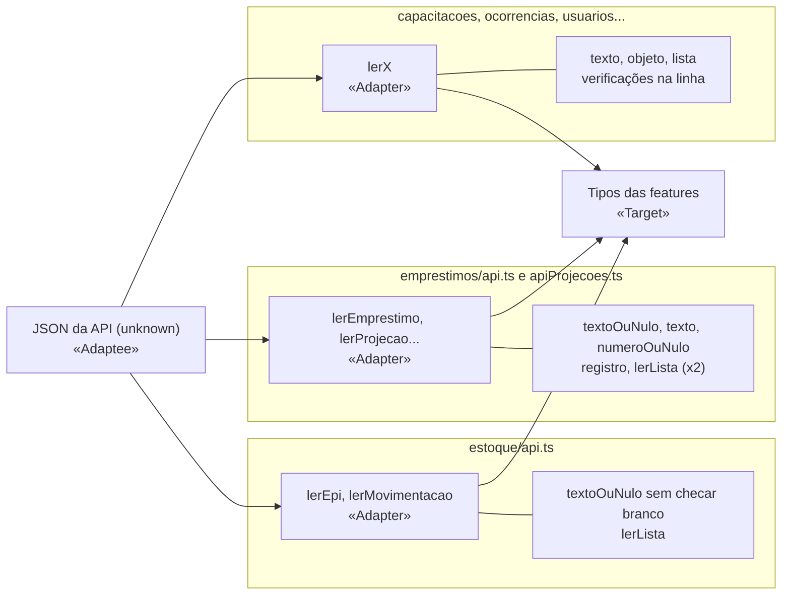

**Depois (#244).** Os adaptadores se apoiam nas mesmas primitivas.

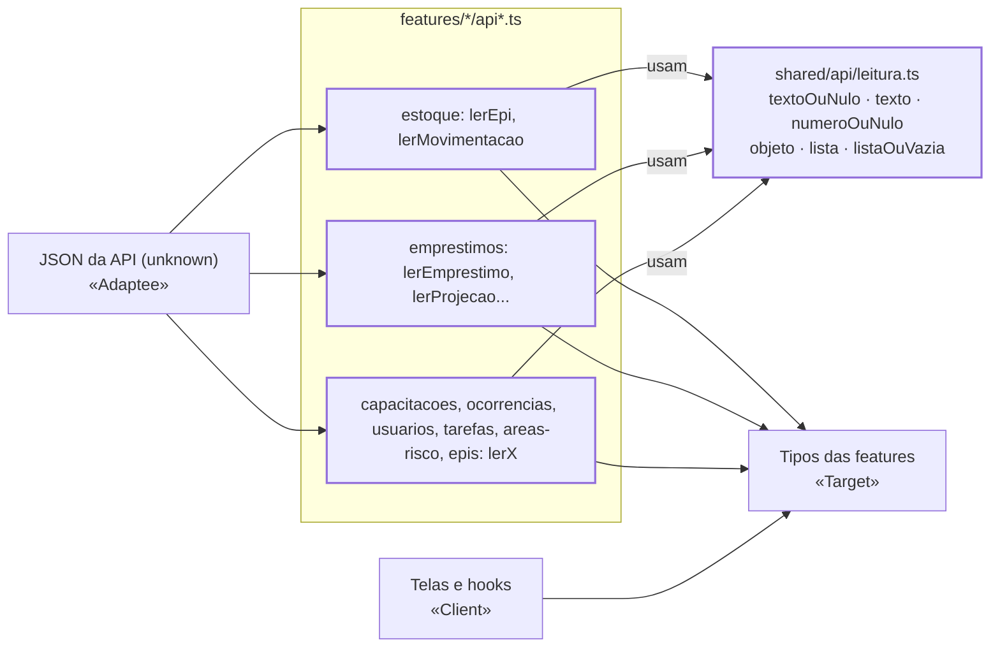

O diagrama da parte 2 (`Epi` único) fica para a [#231](https://github.com/yIuriy/rp-iv-grupo03-safeplace/issues/231).

### Código antes × depois

**Adaptador `lerEpi` do estoque.**

Antes:

```ts
function textoOuNulo(valor: unknown): string | null {
  return typeof valor === 'string' ? valor : null     // aceitava texto em branco
}

function lerMovimentacao(dado: unknown): Movimentacao {
  if (dado === null || typeof dado !== 'object') throw new Error('Movimentação inválida')
  const bruto = dado as Record<string, unknown>
  ...
  responsavelId: typeof bruto.responsavelId === 'number' ? bruto.responsavelId : null,
  motivo: textoOuNulo(bruto.motivo),
}

function lerLista<T>(dados: unknown, ler: (dado: unknown) => T, descricao: string): T[] {
  if (!Array.isArray(dados)) throw new Error(`Esperava uma lista de ${descricao}`)
  return dados.map(ler)
}
```

Depois:

```ts
import { lista, numeroOuNulo, objeto, texto, textoOuNulo } from '../../shared/api/leitura'

function lerMovimentacao(dado: unknown): Movimentacao {
  const bruto = objeto(dado, 'Movimentação inválida')
  ...
  responsavelId: numeroOuNulo(bruto.responsavelId),
  motivo: textoOuNulo(bruto.motivo),                  // texto em branco vira null, como nas outras telas
}

export async function listarHistorico(epiId: number, signal?: AbortSignal) {
  const { data } = await http.get<unknown>(`/epis/${epiId}/movimentacoes`, { signal })
  const movimentacoes = lista(data, lerMovimentacao, 'Esperava uma lista de movimentações')
  ...
}
```

**Primitivas (`shared/api/leitura.ts`, novo).**

```ts
export function textoOuNulo(valor: unknown): string | null {
  return typeof valor === 'string' && valor.trim() ? valor : null
}

export function texto(valor: unknown, reserva: string): string {
  return textoOuNulo(valor) ?? reserva
}

export function numeroOuNulo(valor: unknown): number | null {
  return typeof valor === 'number' ? valor : null
}

export function objeto(dado: unknown, mensagem: string): Bruto {
  if (dado === null || typeof dado !== 'object' || Array.isArray(dado)) throw new Error(mensagem)
  return dado as Bruto
}

export function lista<T>(dado: unknown, ler: (item: unknown) => T, mensagem: string): T[] {
  if (!Array.isArray(dado)) throw new Error(mensagem)
  return dado.map(ler)
}

export function listaOuVazia<T>(dado: unknown, ler: (item: unknown) => T): T[] {
  return Array.isArray(dado) ? dado.map(ler) : []
}
```

### Benefício

**Parte 1 (#244).** A regra de leitura de cada tipo de campo passou a existir uma vez. Antes, "o que é um texto vazio" tinha duas respostas no frontend, e um campo em branco aparecia de jeitos diferentes conforme a tela; agora a resposta é única e documentada, e o catálogo do estoque mostra "Não informada" como as demais telas. Os adaptadores ficaram mais curtos (cerca de 100 linhas a menos nos `api*.ts`) e dizem só o que é próprio de cada recurso: quais campos ler, qual reserva usar e qual mensagem mostrar. Uma mudança na regra, por exemplo passar a aparar espaços, é feita em `leitura.ts` e vale para todas as telas, com os testes das primitivas mostrando o efeito.

### Métricas locais

| Métrica | Antes (`dev`, `a5aa9be`) | Depois da #244 |
| --- | ---: | ---: |
| Cópias locais de primitivas de leitura (funções) | 17 | 0 |
| Cópias de `textoOuNulo` nas features | 4 | 0 (1 em `shared/api/leitura.ts`) |
| Semânticas de texto em branco entre as cópias de `textoOuNulo` | 2 | 1 |
| Verificações de objeto escritas na linha | 22 | 0 |
| Verificações de lista obrigatória escritas na linha | 17 | 0 |
| Leituras de número escritas na linha | 14 | 0 |
| Leituras de "texto como veio" (fora do escopo, ver acima) | 36 | 35 |
| Linhas dos `features/*/api*.ts` | 1984 | 1883 |
| Tipos e adaptadores `Epi` duplicados para `GET /api/epis` (#231) | 2 | 2 |

Medição por busca nos arquivos `frontend/src/features/*/api*.ts`. A contagem de verificações de lista inclui as que estavam dentro das funções locais. A leitura de "texto como veio" a menos é a cópia de `textoOuNulo` do estoque, que passou à semântica única.

### Evidências

**Parte 1 (#244).**

Testes novos:

1. `tests/leitura.spec.ts` (11 testes, sem navegador; papel Adapter): `textoOuNulo` devolve o texto como veio e troca vazio, espaços, ausência e outros tipos por `null`; `texto` usa a reserva nos mesmos casos; `numeroOuNulo` aceita zero e negativos e recusa texto numérico; `objeto` recusa `null`, lista e valor simples com a mensagem do adaptador; `lista` aplica o leitor, recusa o que não é lista e propaga a recusa de um item inválido; `listaOuVazia` troca ausência por lista vazia.
2. `tests/estoque.spec.ts`, teste "blank text from the API reads as missing" (Client e Target): com a API devolvendo localização em branco, descrição vazia e motivo só com espaços, o catálogo mostra "Não informada", o detalhe não mostra a descrição e o histórico mostra "Motivo: não informado". Executado contra o `estoque/api.ts` anterior, o teste falha: a célula fica em branco.

Os adaptadores das features não são importados direto no `leitura.spec.ts` porque dependem do cliente `http`, que lê o `import.meta.env` do Vite. Eles são exercitados pelas specs de cada tela, que simulam as respostas da API e não mudaram.

Suíte existente (`npm run lint`, `npm run build` e `npx playwright test`, 301 testes): lint e build sem erros. Em duas execuções completas, 300 testes passaram e 1 falhou, e o teste que falhou não foi o mesmo. Na primeira, falhou o "fluxo completo pelo teclado" de `capacitacoes.spec.ts` (foco depois de `Tab`), que passa nas três execuções isoladas. Na segunda, falhou "Gestor cadastra nova tarefa" de `tarefas.spec.ts` (botão do diálogo instável). Executado sozinho, ele falha também na `dev` sem esta mudança (`a5aa9be`), então a instabilidade é anterior à #244.

**Parte 2 (#231).** *A preencher na issue [#231](https://github.com/yIuriy/rp-iv-grupo03-safeplace/issues/231).*

---

## Template Method (hook) — envio de formulário

**Catálogo:** GoF, comportamental (implementado como React Hook).

**Intenção:** definir o esqueleto da submissão de formulários (`executarEnvio`, usado pelo hook `useEnvioFormulario`), delegando leitura, validação, ordem de foco, envio e descrição de falha por parâmetros.

**Issues:** [#233](https://github.com/yIuriy/rp-iv-grupo03-safeplace/issues/233) (parte 1) e [#243](https://github.com/yIuriy/rp-iv-grupo03-safeplace/issues/243) (parte 2), ambas aplicadas.

### Problema (antes)

**Parte 1 ([#233](https://github.com/yIuriy/rp-iv-grupo03-safeplace/issues/233)).** Na `dev` antes desta issue, 19 componentes declaravam `const [enviando, setEnviando] = useState(false)` e repetiam à mão o mesmo algoritmo de envio:

1. `preventDefault`;
2. ignorar envio duplo;
3. ler os dados;
4. validar;
5. focar o primeiro campo inválido;
6. limpar a falha anterior;
7. `try/catch` com a descrição da falha;
8. `enviando = false` quando a API falha.

As cópias já tinham divergido. Nos 5 formulários desta parte havia duas variantes:

| Formulário | Envio duplo | Foco no primeiro erro | Falha da API |
| --- | --- | --- | --- |
| `SetorFormDialog`, `PessoaFormulario` | bloqueado | `focarCampo` local (uma cópia em cada arquivo) | `descreverFalha` (Strategy, #232) |
| `InspecaoFormDialog` | bloqueado | `document.getElementById` | `descreverFalha` |
| `AreaRiscoFormDialog`, `TarefaFormDialog` | **não bloqueado** | nenhum | `mensagemDaApi(err) \|\| texto` |

### Por que Template Method

O algoritmo de envio é invariante; só mudam as etapas (ler, validar, ordenar os campos, enviar e descrever a falha). O Template Method fixa o esqueleto num lugar e deixa as etapas como ganchos. Em React, a forma idiomática é um hook que recebe as etapas como funções, em vez de uma classe abstrata com subclasses.

O esqueleto ficou em duas peças:

- `executarEnvio` (`shared/formularios/envioFormulario.ts`): o método-modelo, uma função assíncrona sem React. Ela recebe as etapas e as ações sobre a tela (`definirErros`, `definirFalha`, `definirEnviando`, `focar`). Por não depender do React, é testada sem navegador, como o `erros.ts` da #232.
- `useEnvioFormulario` (`shared/formularios/useEnvioFormulario.ts`): guarda `erros`, `falha` e `enviando` no estado do React, bloqueia o envio duplo com uma referência (`useRef`) e entrega `onSubmit`.

Decisões de comportamento:

- **Sucesso mantém `enviando`.** Depois do sucesso o diálogo fecha; o botão continua em carregamento até sumir, como já faziam setor, inspeção e pessoa. Área e tarefa voltavam o botão no `finally`, mas também fechavam o diálogo logo em seguida, então a tela não muda.
- **Envio duplo bloqueado em todos.** Área e tarefa ganharam o bloqueio que não tinham.
- **Mensagem única continua única.** Área e tarefa mostram uma mensagem por vez, não erros por campo. A validação delas devolve `{ geral: '...' }`, com `ordem: []`, e a tela mostra `erros.geral || falha` no mesmo alerta de antes. Os textos não mudaram, porque os specs dependem deles.
- **Foco por `name` ou por `id`.** `focarCampo` procura o campo pelo `name` e, sem ele (grupos de rádio e campos controlados, como os itens da inspeção), pelo `id` dentro do formulário.

Descartado por agora: `react-hook-form`, que está instalado sem uso e exigiria reescrever todos os formulários.

**Parte 2 ([#243](https://github.com/yIuriy/rp-iv-grupo03-safeplace/issues/243)).** Os formulários restantes trouxeram dois casos que o esqueleto da parte 1 não cobria, e ele ganhou três peças:

- **Hook operation `liberarAposSucesso`.** No Template Method do GoF, uma *hook operation* é um passo opcional com comportamento padrão. O padrão continua sendo manter `enviando` depois do sucesso, porque o formulário é desmontado. Com `liberarAposSucesso: true`, o botão é liberado. Usam a opção os formulários que continuam montados: os três de capacitações (seções da página, que limpam o rascunho e aceitam o próximo cadastro), os dois diálogos de `EpiPage` e os dois de tarefas (que liberavam o botão no `finally`).
- **`ordemPorId`.** Os formulários de capacitações identificam os campos por `id` com prefixo (`certificacao-nome`). A função monta a `ordem` a partir da lista de campos e do prefixo.
- **Foco em grupo de rádio.** `focarCampo` passou a focar a primeira opção quando o `name` é de um grupo de rádio (`RadioNodeList`), como já faziam `RelatoFormDialog` e `PlanoAcaoPainel`.

`MovimentacaoDialog` guardava o estado de envio no componente do diálogo, que fica montado entre uma abertura e outra, e zerava esse estado à mão ao fechar. O formulário foi para um componente interno (`MovimentacaoFormulario`) que só existe com o diálogo aberto, como os demais diálogos do projeto.

**Formulários que não entraram (4 de 19), com a justificativa:**

| Componente | Por que não usa o hook |
| --- | --- |
| `EntregaDialog` | Fluxo em etapas (`formulario` → `duplicidade` → `concluida`): quando o servidor aponta duplicidade de tipo de EPI, o diálogo troca de etapa e pede confirmação com justificativa, em vez de mostrar uma falha. As cópias locais do foco (`EntregaDialog` e `EntregaEtapas`) foram trocadas pelo `focarCampo` compartilhado. |
| `AcaoPlanoItem` | Vários envios no mesmo item (concluir, prorrogar, reatribuir, configurar alerta), todos pelo mesmo `executar`. As três cópias locais do foco foram trocadas pelo `focarCampo` compartilhado. |
| `OcorrenciaDetalheDialog` | Não é um formulário: são botões de ação (enviar para triagem e arquivar) que chamam a API, sem leitura nem validação de campos. |
| `LoginPage` | Depois de uma falha da API devolve o foco ao campo de senha, um passo a mais no ramo de falha. O foco usa `ref` do React, sem cópia de `focarCampo`. |

### Papéis do padrão

| Papel no padrão | Elemento no código | Responsabilidade |
| --- | --- | --- |
| Template Method (método-modelo) | `executarEnvio` | Sequência fixa: ler, validar, focar, limpar falha, enviar, descrever falha |
| Template Method (hook) | `useEnvioFormulario` → `{ enviando, erros, falha, temPendencias, onSubmit }` | Ligar o método-modelo ao estado do React e bloquear envio duplo |
| Primitive Operations | `ler`, `validar`, `ordem`, `enviar`, `descreverFalha` | Passos variáveis fornecidos por cada formulário |
| Hook operation | `liberarAposSucesso` (#243) | Passo opcional: liberar o botão depois do sucesso nos formulários que continuam montados |
| ConcreteClasses | `SetorFormDialog`, `AreaRiscoFormDialog`, `InspecaoFormDialog`, `TarefaFormDialog`, `PessoaFormulario` (#233); `CertificacaoForm`, `ExigenciaForm`, `TreinamentoForm`, `MovimentacaoDialog`, `DevolucaoDialog`, `RelatoFormDialog`, `PlanoAcaoPainel` (nova ação), `EpiPage` (cadastro e manutenção), `ClassificarTarefaDialog`, `VincularEpisTarefaDialog` (#243) | Preencher as operações primitivas |

### Diagramas

**Antes (#233).** Cada formulário tinha a sua cópia do algoritmo, com variações.

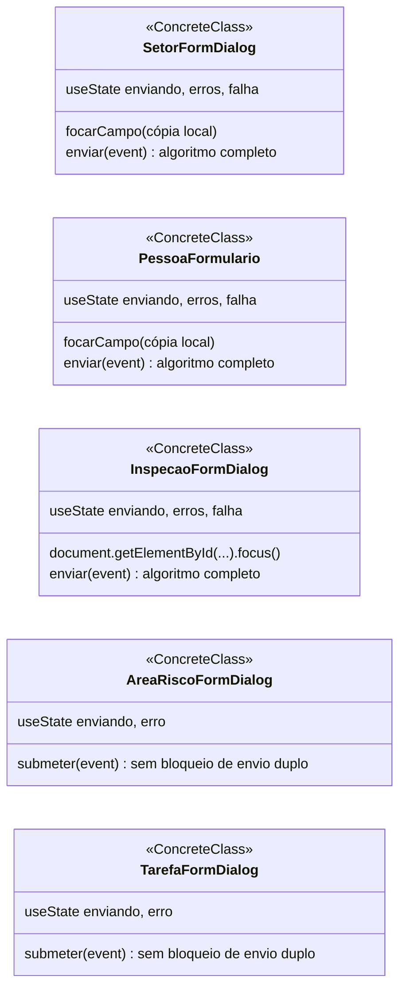

**Depois (#233).** O algoritmo existe uma vez; os formulários só informam as etapas.

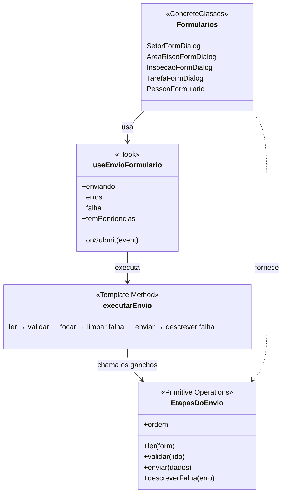

**Depois (#243).** O esqueleto ganhou a hook operation opcional; 15 dos 19 componentes usam o hook.

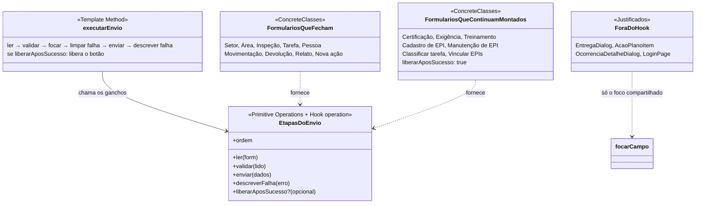

### Código antes × depois

**`SetorFormDialog` (#233).**

Antes:

```tsx
const [erros, setErros] = useState<ErrosSetor>({})
const [falha, setFalha] = useState('')
const [enviando, setEnviando] = useState(false)

async function enviar(event: FormEvent<HTMLFormElement>) {
  event.preventDefault()
  if (enviando) return
  const form = event.currentTarget
  const { dados, erros: pendencias } = lerDadosSetor(new FormData(form))
  setErros(pendencias)
  const primeiroInvalido = ordemDosCamposSetor.find(campo => pendencias[campo])
  if (primeiroInvalido || !dados) {
    if (primeiroInvalido) focarCampo(form, primeiroInvalido)
    return
  }
  setFalha('')
  setEnviando(true)
  try {
    if (editando && setor) {
      aoSalvar(await atualizarSetor(setor.id, dados))
    } else {
      aoSalvar(await cadastrarSetor(dados))
    }
  } catch (erro) {
    setFalha(descreverFalha(erro))
    setEnviando(false)
  }
}
```

Depois:

```tsx
const { enviando, erros, falha, temPendencias, onSubmit } = useEnvioFormulario({
  ler: form => new FormData(form),
  validar: lerDadosSetor,
  ordem: ordemDosCamposSetor,
  enviar: async dados => aoSalvar(editando && setor ? await atualizarSetor(setor.id, dados) : await cadastrarSetor(dados)),
  descreverFalha,
}, {} as ErrosSetor)
```

**Método-modelo (`envioFormulario.ts`, novo).**

```ts
export async function executarEnvio<L, D, E>(form, etapas, acoes): Promise<ResultadoDoEnvio> {
  const { dados, erros } = etapas.validar(etapas.ler(form))
  acoes.definirErros(erros)
  if (dados === null || dados === undefined) {
    const [primeiro] = camposInvalidos(etapas.ordem, erros)
    if (primeiro) acoes.focar(primeiro)
    return 'invalido'
  }
  acoes.definirFalha('')
  acoes.definirEnviando(true)
  try {
    await etapas.enviar(dados)
    return 'enviado'
  } catch (erro) {
    acoes.definirFalha(etapas.descreverFalha(erro))
    acoes.definirEnviando(false)
    return 'falhou'
  }
}
```

**`CertificacaoForm` (#243), formulário que continua aberto.**

Antes:

```tsx
async function enviar(event: FormEvent<HTMLFormElement>) {
  event.preventDefault()
  if (enviando) return
  const { dados, erros: pendencias } = validarCertificacao(rascunho, hoje)
  setErros(pendencias)
  if (!dados) {
    const primeiro = ordemDeFoco.find(campo => pendencias[campo])
    if (primeiro) document.getElementById(`certificacao-${primeiro}`)?.focus()
    return
  }
  setFalha('')
  setEnviando(true)
  try {
    const salva = await cadastrarCertificacao(dados)
    setSucesso(`Certificação "${salva.nome}" cadastrada.`)
    setRascunho(vazio)
  } catch (erro) {
    setFalha(descreverFalhaCadastro(erro))
  } finally {
    setEnviando(false)
  }
}
```

Depois:

```tsx
const { enviando, erros, falha, onSubmit } = useEnvioFormulario({
  ler: () => rascunho,
  validar: atual => validarCertificacao(atual, hoje),
  ordem: ordemPorId<Erros<CampoCertificacao>>('certificacao', ordemDeFoco),
  enviar: async dados => {
    const salva = await cadastrarCertificacao(dados)
    setSucesso(`Certificação "${salva.nome}" cadastrada.`)
    setRascunho(vazio)
  },
  descreverFalha: descreverFalhaCadastro,
  liberarAposSucesso: true,
}, {} as Erros<CampoCertificacao>)
```

### Benefício

**Parte 1 (#233).** A regra de envio passou a existir em um lugar só, com testes próprios. Corrigir ou melhorar o envio (por exemplo, o bloqueio de envio duplo) vale para todos os formulários migrados de uma vez: área e tarefa ganharam esse bloqueio sem nenhuma linha específica. Cada formulário ficou com o que é dele (como ler, validar e chamar a API), e não com a mecânica de `try/catch` e de estado de carregamento. Um formulário novo não precisa copiar o fluxo de outro, que era como as cópias divergiam.

**Parte 2 (#243).** A regra ficou com uma variação explícita e nomeada (`liberarAposSucesso`) em vez de variações acidentais. Antes, uns formulários liberavam o botão no `finally` e outros não, sem que o código dissesse por quê; agora a escolha aparece numa linha e tem teste. Dez componentes a mais deixaram de repetir o fluxo, e o código do frontend diminuiu. Os quatro que ficaram de fora estão justificados e já usam o `focarCampo` compartilhado onde focavam campos por `name`; o mesmo vale para `ConsultaOcorrenciasForm`, que só repassa os critérios de busca à tela (`aoConsultar`) e não tem estado de envio.

### Métricas locais

| Métrica | Antes (v1.0.0) | `dev` antes da #233 | Depois da #233 | Depois da #243 |
| --- | ---: | ---: | ---: | ---: |
| Componentes com `useState` próprio de `enviando` | 19 | 19 | 14 | 4 (justificados) |
| Componentes que usam `useEnvioFormulario` | 0 | 0 | 5 | 15 |
| Cópias locais da lógica de foco por `name` | | 2 funções + 9 trechos inline | 9 trechos inline | 0 (uma função em `shared/formularios`) |
| `useState` no frontend | | 202 | 192 | 164 |
| Linhas de código TS/TSX do frontend | 9.140 | 9.142 | 9.152 | 9.044 |

Na parte 1 as linhas subiram 10, porque o hook e o método-modelo são novos e só 5 formulários tinham sido migrados. Na parte 2 o código do frontend ficou 96 linhas abaixo da linha de base (9.140) e 108 abaixo da parte 1. Medição: `python scripts/metricas/coletar_metricas.py` (`frontend.linhas_ts_tsx.codigo`, `frontend.useState`).

### Evidências

**Parte 1 (#233).**

Testes novos: `tests/envio-formulario.spec.ts` (7 testes, sem navegador) exercita o método-modelo e a operação primitiva `ordem`. Dados inválidos mostram os erros, focam o primeiro campo da ordem e não enviam; o sucesso limpa a falha anterior e mantém `enviando`; a falha da API é descrita e libera o botão; dados `undefined` contam como inválidos; validação de mensagem única não tenta focar; `ordem` funciona como lista de chaves e como função (erros aninhados da inspeção).

Os specs de tela dos 5 formulários (`setores`, `areas-risco`, `inspecoes`, `tarefas`, `users`) continuam passando sem alteração, o que mostra que rótulos, papéis e textos foram mantidos.

Suíte do frontend: `npm ci && npm run lint && npm run build` sem erros; Playwright `--workers=2` em servidor isolado: **287 testes, 287 aprovados** (280 existentes e 7 novos).

**Parte 2 (#243).**

Testes novos em `tests/envio-formulario.spec.ts` (agora 9): a hook operation `liberarAposSucesso` libera o botão depois do sucesso; `ordemPorId` monta a ordem dos campos com prefixo. O foco em grupo de rádio é exercitado pelos specs de tela de relato e de plano de ação.

Os specs de tela dos componentes migrados (`capacitacoes`, `estoque`, `emprestimos`, `ocorrencias`, `ocorrencias-acompanhamento`, `epis`, `tarefas`) continuam passando sem alteração.

Suíte do frontend: `npm ci && npm run lint && npm run build` sem erros; Playwright `--workers=2` em servidor isolado: **289 testes, 289 aprovados** (287 da parte 1 e 2 novos).

---

## State — diálogos de `TasksPage`

**Catálogo:** GoF, comportamental (união discriminada em TypeScript).

**Intenção:** substituir múltiplos `useState<Tarefa | null>` independentes em `TasksPage` por um estado único discriminado (`DialogoTarefa`), impedindo estados simultâneos inválidos.

**Issue:** [#246](https://github.com/yIuriy/rp-iv-grupo03-safeplace/issues/246).

### Problema (antes)

*A preencher na issue [#246](https://github.com/yIuriy/rp-iv-grupo03-safeplace/issues/246) (base: `docs/revisões/analise-padroes-projeto-v1.0.0.md`, §6).*

### Papéis do padrão

| Papel no padrão | Elemento no código | Responsabilidade |
| --- | --- | --- |
| Context | `TasksPage` | Renderizar o diálogo correspondente ao estado ativo |
| State | `DialogoTarefa` (`nenhum`, `editar`, `classificar`, `epis`, `historico`, `novo`) | Representar de forma mutuamente exclusiva o diálogo aberto e seus dados |

### Diagramas

*Diagramas PlantUML antes e depois a preencher na issue [#246](https://github.com/yIuriy/rp-iv-grupo03-safeplace/issues/246).*

### Métricas locais

| Métrica | Antes (v1.0.0) | Depois |
| --- | --- | --- |
| Hooks `useState` para controle de diálogos em `TasksPage` | 6 | 1 |

### Evidências

*A preencher na issue [#246](https://github.com/yIuriy/rp-iv-grupo03-safeplace/issues/246).*
